# 식구(Sik-Gu) 구현 설계 문서

> 대학생 자취생을 위한 식재료 소분 공구 플랫폼 — 기획 문서를 구현용으로 정리한 통합 명세 (2026-11-11 초판)

## 목차

- [0. 문서 안내](#0-문서-안내)
  - [0.1 이 문서는](#01-이-문서는)
  - [0.2 문서 지도](#02-문서-지도)
  - [0.3 기준 우선순위와 표기 규칙](#03-기준-우선순위와-표기-규칙)
  - [0.4 핵심 결정 요약](#04-핵심-결정-요약)
- [1. 프로그램 개요](#1-프로그램-개요)
  - [1.1 한 줄 소개](#11-한-줄-소개)
  - [1.2 배경과 문제](#12-배경과-문제)
  - [1.3 타깃 사용자와 역할](#13-타깃-사용자와-역할)
  - [1.4 핵심 가치](#14-핵심-가치)
  - [1.5 서비스 범위](#15-서비스-범위)
  - [1.6 화면 목록](#16-화면-목록)
  - [1.7 용어 사전](#17-용어-사전)
  - [1.8 기술 스택 요약](#18-기술-스택-요약)
  - [1.9 확정된 결정](#19-확정된-결정)
  - [1.10 미정 사항](#110-미정-사항)
  - [1.11 법적·리스크 검토](#111-법적리스크-검토)
  - [1.12 기획 변경 이력](#112-기획-변경-이력)
  - [1.13 일정](#113-일정)
- [2. 사용자 시나리오 및 유스케이스](#2-사용자-시나리오-및-유스케이스)
  - [2.1 페르소나](#21-페르소나)
  - [2.2 대표 시나리오: 코스트코 생수 공구 (정상 흐름)](#22-대표-시나리오-코스트코-생수-공구-정상-흐름)
  - [2.3 대표 시나리오 포인트 장부](#23-대표-시나리오-포인트-장부)
  - [2.4 유스케이스 목록](#24-유스케이스-목록)
  - [2.5 유스케이스 상세](#25-유스케이스-상세)
  - [2.6 예외 시나리오](#26-예외-시나리오)
  - [2.7 시퀀스 다이어그램](#27-시퀀스-다이어그램)
- [3. 요구사항·기능 명세](#3-요구사항기능-명세)
  - [3.1 기능 요구사항](#31-기능-요구사항)
  - [3.2 비즈니스 규칙](#32-비즈니스-규칙)
  - [3.3 게시글 상태 머신](#33-게시글-상태-머신)
  - [3.4 상태 × 역할 허용 행위 매트릭스](#34-상태--역할-허용-행위-매트릭스)
  - [3.5 입력 검증 규칙](#35-입력-검증-규칙)
  - [3.6 비기능 요구사항](#36-비기능-요구사항)
  - [3.7 스케줄러 작업](#37-스케줄러-작업)
  - [3.8 범위 외·후순위](#38-범위-외후순위)
- [4. DB 설계](#4-db-설계)
  - [4.1 설계 원칙](#41-설계-원칙)
  - [4.2 전체 ERD](#42-전체-erd)
  - [4.3 테이블 정의](#43-테이블-정의)
  - [4.4 제약 조건과 인덱스](#44-제약-조건과-인덱스)
  - [4.5 ENUM 컬럼 매핑](#45-enum-컬럼-매핑)
  - [4.6 회의 ERD → 최종 설계 매핑](#46-회의-erd--최종-설계-매핑)
  - [4.7 포인트 무결성 규칙 (wallet ↔ hold ↔ transaction)](#47-포인트-무결성-규칙-wallet--hold--transaction)
  - [4.8 JPA 매핑 노트](#48-jpa-매핑-노트)
  - [4.9 Redis 키 설계](#49-redis-키-설계)
  - [4.10 DDL 초안](#410-ddl-초안)
- [5. 시스템 아키텍처](#5-시스템-아키텍처)
  - [5.1 시스템 컨텍스트](#51-시스템-컨텍스트)
  - [5.2 레이어드 아키텍처와 패키지 구조](#52-레이어드-아키텍처와-패키지-구조)
  - [5.3 공통 구성요소](#53-공통-구성요소)
  - [5.4 보안](#54-보안)
  - [5.5 WebSocket·STOMP 구조](#55-websocketstomp-구조)
  - [5.6 트랜잭션 경계](#56-트랜잭션-경계)
  - [5.7 락·동시성 전략](#57-락동시성-전략)
  - [5.8 PointService 계약](#58-pointservice-계약)
  - [5.9 내부 도메인 이벤트](#59-내부-도메인-이벤트)
  - [5.10 스케줄러](#510-스케줄러)
  - [5.11 외부 연동 어댑터와 프로필별 Mock](#511-외부-연동-어댑터와-프로필별-mock)
  - [5.12 이미지 업로드 흐름](#512-이미지-업로드-흐름)
  - [5.13 배포 구성](#513-배포-구성)
  - [5.14 기술 관점 주요 시퀀스](#514-기술-관점-주요-시퀀스)
- [6. API 명세](#6-api-명세)
  - [6.1 공통 규칙](#61-공통-규칙)
  - [6.2 에러 코드 카탈로그](#62-에러-코드-카탈로그)
  - [6.3 ENUM 정의](#63-enum-정의)
  - [6.4 엔드포인트 요약](#64-엔드포인트-요약)
  - [6.5 인증·회원·위치 (01, 07, 08)](#65-인증회원위치-01-07-08)
  - [6.6 이미지](#66-이미지)
  - [6.7 공구 게시글 (02, 04, 03 조회)](#67-공구-게시글-02-04-03-조회)
  - [6.8 공구 진행 (03 A~F)](#68-공구-진행-03-af)
  - [6.9 포인트 (06)](#69-포인트-06)
  - [6.10 채팅 (05)](#610-채팅-05)
  - [6.11 후기·신고·차단 (08, 08-B, 09)](#611-후기신고차단-08-08-b-09)
  - [6.12 폐기된 구 엔드포인트 → 대체 매핑](#612-폐기된-구-엔드포인트--대체-매핑)
- [7. 개발 환경·구현 로드맵](#7-개발-환경구현-로드맵)
  - [7.1 로컬 개발 환경](#71-로컬-개발-환경)
  - [7.2 build.gradle 추가 의존성](#72-buildgradle-추가-의존성)
  - [7.3 프로필별 설정](#73-프로필별-설정)
  - [7.4 코딩 컨벤션](#74-코딩-컨벤션)
  - [7.5 Git 전략](#75-git-전략)
  - [7.6 단계별 작업 분해](#76-단계별-작업-분해)
  - [7.7 테스트 전략](#77-테스트-전략)
  - [7.8 Definition of Done 체크리스트](#78-definition-of-done-체크리스트)
  - [7.9 트러블슈팅 주제 후보](#79-트러블슈팅-주제-후보)
- [부록](#부록)
  - [A. 미정 사항 체크리스트](#a-미정-사항-체크리스트)
  - [B. 변경 이력](#b-변경-이력)

---

## 0. 문서 안내

### 0.1 이 문서는

대학생 자취생을 위한 식재료 소분 공구 플랫폼 **식구(Sik-Gu)** 의 기획 문서(Google Docs 회의록·개요·API 명세)를 구현에 바로 쓸 수 있도록 하나로 정리한 설계 문서다. 코드는 포함하지 않으며, 구현 시 이 문서를 기준으로 삼는다.

- 원본 기획서: Google Docs `식구(Sik-Gu)` 문서
- 원본 ERD: [ERDCloud](https://www.erdcloud.com/p/35ycXvYR5RtYJnAwi)
- 백엔드 저장소: `Backend/Web` (Spring Boot 4.1.2, Java 21, PostgreSQL, Redis)
- 기준일: 2026-11-11, 대상: MVP(방장 주도 공구)

### 0.2 문서 지도

| 장                               | 내용                                                                | 주 독자 |
| -------------------------------- | ------------------------------------------------------------------- | ------- |
| 1. 프로그램 개요                 | 소개, 범위, 화면 목록, 용어, 확정·미정 사항, 리스크                 | 전원    |
| 2. 사용자 시나리오 및 유스케이스 | 생수 공구 예시 흐름, UC-01~UC-24, 예외 시나리오, 시퀀스             | 전원    |
| 3. 요구사항·기능 명세            | FR, BR(정책 상수), 상태 머신, 권한 매트릭스, 검증, 비기능, 스케줄러 | BE·FE   |
| 4. DB 설계                       | ERD, 20개 테이블 정의, 인덱스, Redis 키, DDL 초안                   | BE      |
| 5. 시스템 아키텍처               | 컨텍스트, 패키지 구조, 보안, STOMP, 트랜잭션·락, 외부 연동, 배포    | BE      |
| 6. API 명세                      | 공통 규칙, 에러 코드, ENUM, 엔드포인트 전체 상세, 폐기 엔드포인트   | BE·FE   |
| 7. 개발 환경·구현 로드맵         | 환경 구성, 의존성, 설정, 컨벤션, 단계별 작업, 테스트, DoD           | BE      |
| 부록                             | 미정 사항 체크리스트, 변경 이력                                     | 전원    |

**역할별 읽는 순서**

- 처음 합류한 사람: 1 → 2 → 3.3(상태 머신)
- 백엔드: 3 → 4 → 5 → 6 → 7
- 프론트엔드: 1.6(화면) → 2 → 3.4(권한) → 6

### 0.3 기준 우선순위와 표기 규칙

- 원본 내용이 서로 다르면 **API 명세 > 정리된 개요 > 회의록** 순으로 따른다. 회의록의 구 엔드포인트는 폐기되었다(→ 6장 폐기 매핑 표).
- **(가정·팀 확정 필요)**: 원본에 없거나 미정이어서 기본값을 제안한 항목. 설정값(`sikgu.policy.*`)으로 두어 바꾸기 쉽게 한다.
- **(추론)**: 원본에서 직접 확인되지 않고 문맥상 추론한 내용. **(보완)**: 원본 API 명세에 없어 새로 채운 항목.
- ID 체계: `FR-xx`, `BR-xx`는 3장에서만, `UC-xx`는 2장에서만, 에러 코드·ENUM은 6장에서만 정의한다. 다른 장은 ID를 인용만 한다.
- 화면 번호: Figma 기준 01~09 (03-A~F, 08-B, 09-A/B).

### 0.4 핵심 결정 요약

| 주제        | 결정                                                                                                    |
| ----------- | ------------------------------------------------------------------------------------------------------- |
| 서비스 범위 | 방장 주도 공구만. 시스템 매칭·배송비 분할·관리자 화면·비밀번호 찾기·채팅 이미지·포인트 출금 제외        |
| 결제 시점   | 참여 즉시 포인트 결제 → 보류(HELD). 방장도 본인 몫 결제. 정산 시 방장에게 지급                          |
| 게시글 상태 | `RECRUITING` → `RECRUITED` → `ORDERED` → `SHIPPING` → `DISTRIBUTED` → `SETTLED`, 예외 `CANCELLED` (7개) |
| 단가        | `unitPrice = totalPrice / totalUnits`, 나누어떨어지지 않으면 등록 거부 (가정·팀 확정 필요)              |
| 위치        | 동 이름 + 좌표 저장, Haversine 반경 1/3/5km(기본 3). 타인에게는 "○○동"과 거리만 노출                    |
| 인증        | 학교 이메일(ac.kr) 인증 → 회원가입, JWT(Access 30분 / Refresh 14일, Redis)                              |
| 충전        | prepare → confirm 2단계, Toss Payments 가정, orderId 멱등, dev는 Mock PG                                |
| 채팅        | 게시글 생성 시 방 자동 생성, STOMP(`/ws-stomp`), TEXT/SYSTEM 메시지                                     |
| 신고·차단   | 사용자만 신고, PENDING 저장만. 차단은 양방향 숨김·참여 불가                                             |
| 동시성      | 참여 시 게시글 행 비관적 락, 지갑은 `@Version` 낙관적 락                                                |

---

## 1. 프로그램 개요

### 1.1 한 줄 소개

**식구(Sik-Gu)** 는 학교 이메일로 인증된 같은 동네 대학생 자취생끼리 대용량 식재료·생필품을 함께 사서 단위별로 나누는 **소분 공동구매 웹 서비스**이다. 결제와 정산은 서비스 내 포인트로 처리해 돈 문제와 신뢰 문제를 줄인다.

> 예: 코스트코 생수 2L×24개(29,040원)를 "2L 생수 4병" 단위 6개로 나눠, 1단위 4,840원에 최대 6명이 나눠 산다.

### 1.2 배경과 문제

| 구분        | 문제                                                                             | 식구의 접근                                                                          |
| :---------- | :------------------------------------------------------------------------------- | :----------------------------------------------------------------------------------- |
| 1인 가구    | 자취생은 혼자 먹기엔 많은 대용량을 사서 버리거나, 단가가 비싼 소용량을 사야 한다 | 근처 학생들과 **단위(소분) 기준**으로 나눠 산다                                      |
| 대용량 구매 | 대형마트·온라인 대용량은 단가는 싸지만 수량·보관이 부담                          | 방장이 기본 단위·총 단위 수를 정하고, 참여자는 원하는 단위만큼만 산다                |
| 돈 문제     | 개인 간 송금·N분의1 계산, "먼저 낸 사람만 손해" 구조                             | 참여 즉시 포인트를 결제해 서비스가 **보류**하고, 전원 수령 확인 후 방장에게 **정산** |
| 신뢰        | 모르는 사람과의 거래, 잠수·사기·노쇼 우려                                        | 학교 이메일 인증, 동네 범위 제한, 영수증 등록, 별점·태그 후기, 신고·차단             |
| 개인정보    | 정확한 집 위치 노출 우려                                                         | 타인에게는 "○○동"과 거리(km)만 노출, 닉네임은 랜덤 부여                              |

### 1.3 타깃 사용자와 역할

**타깃:** 학교 근처에서 자취하는 대학생. 학교 이메일(ac.kr) 인증으로 신원을 확인하고, 사용자가 저장한 동네 좌표 기준 반경(1/3/5km, 기본 3km) 안의 공구만 보여 준다.

| 역할                        | 하는 일                                                                                                                                      | 받는 것                                                |
| :-------------------------- | :------------------------------------------------------------------------------------------------------------------------------------------- | :----------------------------------------------------- |
| 방장(호스트, HOST)          | 공구 글 등록(본인 구매 단위 포함, 본인 몫도 포인트 결제·보류) → 모집 완료 후 상품 주문·영수증 등록 → 배송 시작 → 직접 나눔                   | 전원 수령 확인 시 보류된 포인트 정산 + 인센티브 포인트 |
| 참여자(파티원, PARTICIPANT) | 근처 공구 검색 → 원하는 단위만큼 참여(즉시 포인트 결제) → 채팅으로 나눔 일정 조율 → 수령 후 '받았어요' 또는 '문제가 있어요' 문의 → 후기 작성 | 필요한 만큼의 상품을 대용량 단가로 구매                |

한 사용자는 공구마다 방장 또는 참여자가 될 수 있다. 관리자 역할·화면은 MVP에 없다.

**핵심 시나리오(요약):** 로그인 → 내 동네 공구 목록 → 검색 → 참여·결제 → 채팅방에서 일정 조율 → 수령 후 '받았어요' → 정산 → 후기. 상세 흐름은 → 2장 참조.

### 1.4 핵심 가치

1. **필요한 만큼만** — 대용량 상품을 단위로 쪼개 1인 가구가 필요한 양만 산다.
2. **돈 걱정 없는 공구** — 포인트 보류(에스크로형) 구조로, 물건을 받기 전에는 방장에게 돈이 넘어가지 않고 공구가 무산되면 자동 환불된다.
3. **믿을 수 있는 이웃** — 학교 인증 + 동네 기반 + 영수증 공개 + 별점·태그 후기 + 신고·차단.
4. **위치는 동네 수준만** — 정확한 위치는 숨기고 "○○동"과 거리만 노출.

### 1.5 서비스 범위

#### 1.5.1 MVP 포함

- **방장 주도형 공구**만 지원(방장이 글을 열고 참여자가 들어오는 방식).
- 대상 상품: 식재료·생필품. 카테고리는 식품·생활용품·생필품·기타 4종(값 목록 → 6장 참조).
- 학교 이메일 인증 회원가입(3단계), 별도 로그인 ID, 랜덤 닉네임.
- 동네 설정: 동 이름 검색 + 현재 위치(역지오코딩) 둘 다 제공.
- 공구 목록·검색·카테고리·거리·정렬, 공구 등록·수정·취소.
- 참여 즉시 포인트 결제(보류) → 주문·영수증 → 배송 → 나눔 → 수령 확인 → 자동 정산 + 방장 인센티브.
- 수령 문제 문의(접수와 정산 차단까지).
- 포인트 충전(PG 연동), 거래 내역.
- 공구별 실시간 채팅(텍스트 + 시스템 메시지).
- 후기(별점 + 태그, 양방향), 사용자 신고(접수만), 차단.

#### 1.5.2 MVP 제외

| 제외 항목                                       | 비고                                   |
| :---------------------------------------------- | :------------------------------------- |
| 시스템 매칭형 공구(방 자동 개설·방장 랜덤 지정) | 향후 확장                              |
| 배달비·배송비 분할(배달음식 공구)               | 서비스 범위 밖. 배달음식 카테고리 삭제 |
| 관리자 화면(신고 처리 등)                       | 신고는 PENDING 저장만                  |
| 비밀번호 찾기                                   |                                        |
| 채팅 이미지 전송                                | 텍스트만                               |
| 잔여 포인트 현금 출금                           | 법적·운영 리스크(→ 1.10)               |
| 영수증 금액 ≠ 모집 금액 차액 정산               | 일치 여부 표시만                       |
| 수령 문의의 자동 해결(재배송·부분 환불 등)      | 운영 수동 처리                         |

#### 1.5.3 향후 확장 후보

- 시스템 매칭형 공구(참여 희망자가 모이면 방 자동 개설, 방장 랜덤 매칭)
- 관리자 화면: 신고 처리, 수령 문의 중재, 패널티 부과
- 관심(찜) 기능, 문의하기 페이지
- 차액 정산, 잔여 포인트 출금
- 방장 패널티 (→ BR-16) 규칙(영수증 미등록·노쇼 등), 신뢰 온도 지표 (추론)
- 채팅 이미지, 비밀번호 찾기

### 1.6 화면 목록

Figma Wireframe(1440px 데스크톱 웹) 기준. 화면별 기능·API 매핑은 → 3장, 6장 참조.

| 번호   | 화면            | 한 줄 설명                                                                                                                                                      |
| :----- | :-------------- | :-------------------------------------------------------------------------------------------------------------------------------------------------------------- |
| 01     | 로그인·회원가입 | 로그인, 3단계 가입(학교 이메일 인증 → 아이디·비밀번호 → 동네 설정)                                                                                              |
| 02     | 홈·공구 목록    | 검색, 카테고리, 거리(1·3·5km), 모집중만 보기, 정렬(최신·마감임박·인기·가격)                                                                                     |
| 03     | 공구 상세       | 상품·단위·진행 단계(7단계 스테퍼), 참여자 목록, 참여·취소                                                                                                       |
| 03-A~F | 상세 하위 화면  | 03-B 참여·결제, 03-C 방장 주문·배송·나눔 관리, 03-D 영수증·금액 확인, 03-E 결제·수령 현황과 '받았어요', 03-F 수령 문제 문의 (03-A는 기본 상세/모집 단계로 추론) |
| 04     | 공구 등록·수정  | 사진, 기본 단위·총 단위 수·총 가격 → 단위당 가격 자동 계산, 방장 구매 단위, 마감 일시, 거래 장소                                                                |
| 05     | 채팅            | 공구별 채팅방 목록(진행중·종료 탭)과 대화                                                                                                                       |
| 06     | 포인트          | 잔액·보류 금액, 충전(카카오페이·토스페이·카드), 거래 내역                                                                                                       |
| 07     | 마이페이지      | 내 공구함(진행중·완료, 내가 연·참여한·액션 필요), 동네 설정, 차단 목록, 로그아웃                                                                                |
| 08     | 유저 프로필     | 신뢰도(별점·거래 수·태그), 받은 후기, 최근 거래, 차단                                                                                                           |
| 08-B   | 신고            | 사용자 신고(사유·내용·증빙 이미지)                                                                                                                              |
| 09     | 후기 작성       | 09-A 참여자 → 방장, 09-B 방장 → 참여자 (방향 배정은 추론) 별점 + 태그 + 내용                                                                                    |

### 1.7 용어 사전

| 용어                     | 정의                                                                                                           |
| :----------------------- | :------------------------------------------------------------------------------------------------------------- |
| 공구(공동구매)           | 방장이 연 게시글 단위의 공동구매 한 건. 게시글 = 공구                                                          |
| 소분                     | 대용량 상품을 여러 사람이 나눠 갖도록 작은 단위로 나누는 것                                                    |
| 기본 단위                | 방장이 정한 1단위의 내용(예: "2L 생수 4병")                                                                    |
| 총 단위 수 / 단위        | 공구 전체를 기본 단위로 나눈 개수. 참여자는 1단위 이상 선택해 구매                                             |
| 단위당 가격              | 총 가격 ÷ 총 단위 수. 서버가 계산                                                                              |
| 모집 금액                | 단위당 가격 × 총 단위 수(= 총 가격). 영수증 금액과 비교 대상                                                   |
| 방장(호스트)             | 공구를 연 사용자. 주문·영수증·배송·나눔 담당, 본인 구매 단위도 결제                                            |
| 참여자(파티원)           | 방장이 연 공구에 단위를 사서 참여한 사용자                                                                     |
| 포인트(P)                | 서비스 내 결제 수단. 1P = 1원. PG로 충전                                                                       |
| 충전                     | PG 결제로 포인트를 지갑에 적립하는 것(준비 → 승인 2단계)                                                       |
| 가용 잔액                | 지갑에서 바로 쓸 수 있는 포인트                                                                                |
| 보류                     | 참여 시 결제한 포인트를 공구가 끝날 때까지 서비스가 묶어 두는 상태. 방장에게 아직 넘어가지 않음                |
| 환불(환급)               | 보류를 해제해 참여자 가용 잔액으로 되돌리는 것(참여 취소, 공구 취소·무산 시)                                   |
| 정산                     | 전원 수령 확인 시 공구의 보류 포인트를 확정해 방장에게 지급하는 것                                             |
| 인센티브                 | 정산과 함께 방장에게 추가 지급하는 보상 포인트(금액 → BR-22)                                                   |
| 받았어요                 | 참여자의 수령 확인 버튼. 전원이 누르면 자동 정산                                                               |
| 문제가 있어요(수령 문의) | 미수령·수량 부족·파손 등을 접수하는 기능(03-F). 문의 중인 참여자가 있으면 정산 보류                            |
| 영수증 등록              | 방장이 실제 구매 영수증 사진과 금액을 올리는 것. 주문 완료 처리와 같이 이루어짐                                |
| 나눔                     | 방장이 상품을 받아 약속 장소·시간에 참여자에게 직접 전달하는 것                                                |
| 동네                     | 사용자가 저장한 동 이름 + 좌표. 목록 반경 계산 기준. 타인에게는 "○○동"만 노출                                  |
| 거래 장소                | 게시글에 지정된 나눔 장소(이름 + 좌표). 거리 계산 대상                                                         |
| 반경                     | 동네 좌표와 거래 장소 사이 거리 필터(1/3/5km)                                                                  |
| 공구 상태                | 모집중 → 모집완료 → 주문완료 → 배송중 → 나눔완료 → 정산완료, 예외 취소의 7개 상태(전이 규칙 → 3장, ENUM → 6장) |
| 후기                     | 공구 종료 후 상대방에게 남기는 별점 + 태그 + 내용. 신뢰도 지표의 원천                                          |
| 신고 / 차단              | 신고: 사용자 대상 신고 접수. 차단: 서로의 게시글을 숨기고 서로의 공구 참여를 막음                              |

### 1.8 기술 스택 요약

프론트엔드는 React 웹(데스크톱 1440px 기준), 백엔드는 **Spring Boot 4.1.2 / Java 21 / Gradle** 기반 **레이어드 + MVC 모놀리스**로 구성한다. 저장소는 **PostgreSQL**(주 데이터)과 **Redis**(이메일 인증코드, refresh 토큰, access 토큰 블랙리스트)를 쓰고, 로컬 개발 환경은 docker compose(postgres, redis)로 띄운다. 인증은 Spring Security + JWT, 실시간 채팅은 WebSocket(STOMP), 포인트 충전은 Toss Payments 형태의 PG 연동(가정, dev 프로필은 Mock PG), 동네 검색·역지오코딩은 Kakao Local API(가정), 위치 거리는 Haversine 계산으로 처리한다. 의존성·패키지 구조·인프라 상세는 → 5장 참조.

### 1.9 확정된 결정

| 항목        | 결정                                                                                      | 기획 반영 사항                                                                   |
| :---------- | :---------------------------------------------------------------------------------------- | :------------------------------------------------------------------------------- |
| 플랫폼      | 웹(React)                                                                                 | 없음                                                                             |
| 공구 방식   | 방장 주도형만. 시스템 매칭형(방 자동 개설·방장 랜덤)은 향후 확장                          | ERD '게시글 참여'의 매칭 방식 컬럼 제거                                          |
| 결제 시점   | 참여 즉시 포인트 결제(보류). 인원 미달 등으로 취소되면 자동 환불. 방장도 본인 구매분 결제 | Figma 03-B '결제 진행중' 단계·'인원 충족 → 결제 시작' 문구 삭제, 진행 단계 8 → 7 |
| 로그인      | 별도 아이디 + 학교 이메일 인증                                                            | Figma 01에 아이디 입력·중복확인 추가                                             |
| 신고 대상   | 사용자만. 게시글 문제는 "게시글을 통한 해당 사용자의 유해 행위" 사유로 처리               | Figma 08-B '게시글 유해함' 문구를 사용자 기준으로 정리                           |
| 서비스 범위 | 식재료·생필품 소분. 배달비 나누기 제외                                                    | Figma 02 '배달음식' 카테고리·마라탕 예시 카드 교체                               |
| 신뢰도 지표 | 별점 + 태그(온도 방식 미채택)                                                             | 후기 테이블에 태그 저장                                                          |
| 진행 상태   | 7개 상태, '나눔완료'와 '수령확인'은 하나(나눔완료)로 통합                                 | ERD 상태 ENUM 확장, 상태 변경 시각 컬럼 추가                                     |
| 주소 방식   | 동 이름 검색 + 현재 위치 둘 다 제공                                                       | 사용자·게시글에 동 이름 + 위도·경도 저장                                         |
| 목록 API    | 목록·검색·카테고리·거리·정렬을 하나의 목록 API로 통합                                     | 구 명세의 개별 엔드포인트 폐기(→ 6장 참조)                                       |

### 1.10 미정 사항

아래 항목은 팀 확정 전이며, 각 항목의 **기본값 제안과 설정 키는 3장 BR에서만 정의**한다(→ 3.2). (가정·팀 확정 필요)

- 모집 마감 시 인원 미달 공구의 처리 시점·방식 (→ BR-15)
- 모집 완료 후 영수증 미등록 유예 시간과 방장 패널티
- '받았어요' 미클릭 시 자동 수령 처리 기한 (→ BR-18)
- 수령 문의(03-F) 해결 주체와 처리 방식(재배송·부분/전액 환불) (→ BR-36, BR-37)
- 방장 인센티브 금액·지급 조건 (→ BR-22)
- 영수증 금액 ≠ 모집 금액일 때 차액 처리 (→ BR-35)
- 후기 작성 기한·수정 가능 여부 (→ BR-42)
- 포인트 충전 최소·최대·단위 금액 (→ BR-23)
- 관심(찜) 기능, 문의하기 페이지 도입 여부
- 식품 소분 관련 법적 제약 검토 결과(→ 1.11)

### 1.11 법적·리스크 검토

| 구분             | 리스크                                                                                                       | 대응 방향                                                                                                                                                                                      |
| :--------------- | :----------------------------------------------------------------------------------------------------------- | :--------------------------------------------------------------------------------------------------------------------------------------------------------------------------------------------- |
| 식품위생법       | 식품을 개봉·재포장해 판매하는 행위는 식품소분업 영업 신고 대상이 될 수 있다(회의에서 제기, 법률 검토 미완료) | 서비스는 판매 중개가 아닌 **공동구매 비용 분담** 구조로 설계, 방장은 이윤 없이 실비(영수증 금액)만 나눔. 가능하면 낱개 포장 상태로 나눔하도록 안내 (추론·팀 확정 필요). 출시 전 법률 확인 필요 |
| 결제·선불 포인트 | 포인트를 충전·보관·이전하는 구조는 전자금융거래법상 선불전자지급수단 규제와 관련될 수 있다 (추론)            | MVP는 PG 승인 기반 충전만 허용, 잔여 포인트 현금 출금 제외, 모든 포인트 변동 이력 기록                                                                                                         |
| 결제 정합성      | 마지막 단위 동시 참여, 중복 승인, 잔액 동시 변경                                                             | 게시글 비관적 락, 지갑 낙관적 락, 충전 주문번호 멱등 처리(→ 5장 참조)                                                                                                                          |
| 거래 신뢰        | 방장 잠수·영수증 미등록·노쇼, 참여자 수령 확인 미이행                                                        | 포인트 보류, 스케줄러 기반 자동 취소·자동 수령 처리(→ BR-15, BR-16, BR-18), 후기·신고·차단                                                                                                     |
| 개인정보         | 위치·이메일 노출                                                                                             | 타인에게 동 이름·거리만 노출, 학교 이메일은 인증용으로만 사용                                                                                                                                  |
| 운영 공백        | 관리자 화면 부재로 신고·문의 처리 지연                                                                       | MVP는 접수·정산 차단까지만, 처리는 운영 수동                                                                                                                                                   |

### 1.12 기획 변경 이력

| 시점            | 주요 내용                                                                                                                                                                                           | 최종 반영                                                                                                                                                                         |
| :-------------- | :-------------------------------------------------------------------------------------------------------------------------------------------------------------------------------------------------- | :-------------------------------------------------------------------------------------------------------------------------------------------------------------------------------- |
| 10/5            | 서비스 아이디어·시나리오. 유저 주도형 + 시스템 매칭형 두 방식, 앱 내 페이, 카카오페이 QR 충전, 위치는 동 수준만 노출, 랜덤 닉네임, 식품위생법 이슈 제기                                             | 시스템 매칭형은 향후 확장으로 이동. 충전은 PG 연동(준비 → 승인)으로 변경                                                                                                          |
| 10/27           | 화면 목록 확정(로그인·메인·상세·등록·수정·지도·채팅·사용자 정보·결제). 기본 단위 지정, 게시글 입장 시 포인트 지불, 영수증 미첨부 시 거래 삭제 + 방장 포인트를 참여자가 나눠 가짐, 인원 미달 시 환급 | 화면은 01~09로 재정리. 결제는 "참여 즉시 결제·보류"로 확정. 영수증 미등록 패널티는 미정(→ BR-15, BR-16, BR-18)                                                                    |
| 11/5            | React + Spring Boot, PostgreSQL + Redis, Layered + MVC 모놀리스 결정. API 명세·GitHub 생성·구현 착수 계획                                                                                           | 유지. Spring Boot 4.1.2 / Java 21로 구체화                                                                                                                                        |
| 11/9            | ERD 1차(게시글, 주문정보, 영수증, 사용자, 참여, 신고, 채팅, 포인트 지갑·결제·거래·보류, 후기). 1차 API 표 작성. '현실의 벽': 포인트 환급, 추가 정산                                                 | 상태 4개 → 7개, 참여·주문정보 자체 PK, 게시글 이미지·차단·수령 문의 테이블 신설, 상품 테이블 없이 게시글에 통합. 1차 API의 개별 검색·카테고리·거리·결제·상태 변경 엔드포인트 폐기 |
| 개요 정리       | 핵심 시나리오, 화면·기능 매핑, 확정 결정 6+1개, 미정 사항 목록                                                                                                                                      | 본 장 1.9·1.10에 반영                                                                                                                                                             |
| API 명세 (최종) | 공통 응답·에러 규칙, 7단계 상태, 프론트는 상태값 직접 전송 안 함, 후기·신고·차단·충전 API 추가                                                                                                      | 최우선 기준으로 채택(→ 6장 참조)                                                                                                                                                  |

### 1.13 일정

| 날짜      | 목표                                                                                                                                 |
| :-------- | :----------------------------------------------------------------------------------------------------------------------------------- |
| 10/5      | 아이디어·시나리오 회의                                                                                                               |
| 10/27     | 화면 목록·핵심 규칙 회의                                                                                                             |
| 11/5      | 기술 스택·아키텍처 결정, API 명세 작성, GitHub 저장소 생성, 구현 시작                                                                |
| 11/9      | ERD·1차 API 정리                                                                                                                     |
| **11/16** | **원본 기준 "E, C 제외 나머지 전부" 구현 완료 + 트러블슈팅 최소 1건 기록** (E·C가 가리키는 범위는 원본 이미지에만 있어 팀 확인 필요) |

단계별 개발 순서·마일스톤 상세는 → 7장 참조.

---

## 2. 사용자 시나리오 및 유스케이스

이 장은 식구 MVP(방장 주도 공구)를 사용자 관점에서 처음부터 끝까지 따라간다. 기능 요구사항(FR)과 비즈니스 규칙(BR)은 3장, 요청·응답 필드와 에러 코드·ENUM은 6장, 테이블·컬럼은 4장에서 정의하며, 이 장에서는 ID와 엔드포인트 이름만 인용한다. 유스케이스 ID(UC-xx)는 이 장에서만 정의한다.

### 2.1 페르소나

| 구분         | 닉네임(랜덤)  | 프로필                                                                           | 목표                                                                                              | 주요 화면                |
| :----------- | :------------ | :------------------------------------------------------------------------------- | :------------------------------------------------------------------------------------------------ | :----------------------- |
| 방장(호스트) | 배고픈 고구마 | ○○대 3학년, 역삼동 자취 4년차, 차가 있어 코스트코를 자주 감. 거래 23회, 평점 4.9 | 대용량 생수를 싸게 사고 남는 양을 이웃 학생에게 나눠 비용을 줄임. 정산금과 인센티브 포인트를 받음 | 04, 03-A·C, 05, 06, 09-B |
| 참여자 A     | 졸린 감자     | ○○대 1학년, 역삼동 원룸. 혼자 마실 만큼(생수 4병)만 필요. 포인트 12,000P 보유    | 정문 앞에서 1단위만 받아 감                                                                       | 02, 03-A·B·D·E, 05, 09-A |
| 참여자 B     | 용감한 두부   | ○○대 대학원생, 인근 동 거주(0.8km). 포인트 5,000P만 있어 충전이 필요             | 3단위를 사서 연구실과 나눔. 처음 써 보는 사용자                                                   | 01, 06, 03-B·E, 05, 09-A |

공통 전제: 세 사람 모두 학교 이메일(ac.kr)로 인증해 가입했고(UC-01), 저장 동네 기준 반경 3km 안에 있다. 다른 사용자에게는 "○○동"과 거리(km)만 보이고 정확한 좌표는 보이지 않는다(→ 3장 BR 위치 노출 규칙).

### 2.2 대표 시나리오: 코스트코 생수 공구 (정상 흐름)

원본 기획서의 예시를 그대로 사용한다.

- 상품: 커클랜드 생수 2L×24병, 총 가격 29,040원
- 기본 단위 "2L 생수 4병", 총 6단위 → 단위당 4,840원(서버 계산)
- 방장 본인 구매 2단위(hostUnits), 참여자 A 1단위, 참여자 B 3단위 → 6/6단위
- 모집 마감 2026-10-29 23:59, 거래 장소 "○○대학교 정문 앞"

| 단계 | 시각(예시)  | 행위자     | 행동                                                                                                                                      | 화면       | 엔드포인트                                                                           | 게시글 상태      |
| :--- | :---------- | :--------- | :---------------------------------------------------------------------------------------------------------------------------------------- | :--------- | :----------------------------------------------------------------------------------- | :--------------- |
| S1   | 10/27 13:55 | 방장       | 상품 사진을 먼저 업로드                                                                                                                   | 04         | `POST /api/images`                                                                   | -                |
| S2   | 10/27 14:00 | 방장       | 공구 등록(단위·총 단위·총 가격·hostUnits·마감·거래 장소). 서버가 단위당 가격 계산, 방장 몫 2단위 결제·보류, 채팅방 자동 개설 후 방장 입장 | 04 → 03-A  | `POST /api/posts`                                                                    | RECRUITING (2/6) |
| S3   | 10/28 09:00 | 참여자 A   | 홈에서 "생수" 검색, 반경 3km·모집중만 보기로 목록 확인 → 상세 진입                                                                        | 02 → 03-A  | `GET /api/posts`, `GET /api/posts/{postId}`                                          | RECRUITING       |
| S4   | 10/28 09:12 | 참여자 A   | 1단위 선택 → 참여. 4,840P 즉시 결제·보류, 채팅방 입장(SYSTEM "졸린 감자님이 참여했어요")                                                  | 03-B       | `POST /api/posts/{postId}/participations`                                            | RECRUITING (3/6) |
| S5   | 10/28 20:00 | 참여자 B   | 3단위 선택 → 잔액 부족(5,000P < 14,520P) 안내 → 포인트 화면에서 10,000P 충전                                                              | 03-B → 06  | `GET /api/points/me`, `POST /api/points/charges`, `POST /api/points/charges/confirm` | RECRUITING       |
| S6   | 10/28 20:05 | 참여자 B   | 다시 3단위 참여. 14,520P 결제·보류. 총 단위가 다 차서 자동으로 모집 완료                                                                  | 03-B       | `POST /api/posts/{postId}/participations`                                            | RECRUITED (6/6)  |
| S7   | 10/28~29    | 전원       | 채팅방에서 구매·나눔 일정 조율                                                                                                            | 05         | `GET /api/chats/{chatRoomId}/messages`, STOMP `/pub/chats/{id}/messages`             | RECRUITED        |
| S8   | 10/29 10:20 | 방장       | 코스트코에서 구매 후 영수증 사진 업로드, 영수증 금액 29,040원 입력 → 주문 완료. 모집 금액과 일치(amountMatched=true)                      | 03-C       | `POST /api/images`, `POST /api/posts/{postId}/order`                                 | ORDERED          |
| S9   | 10/29 11:00 | 참여자 A·B | 영수증 사진·금액 일치 여부 확인                                                                                                           | 03-D       | `GET /api/posts/{postId}/order`                                                      | ORDERED          |
| S10  | 10/29 18:00 | 방장       | 배송 시작 처리. 직접 구매해 차로 가져오므로 택배사·송장은 비움(NULL 허용) (추론)                                                          | 03-C       | `PATCH /api/posts/{postId}/order/shipping`                                           | SHIPPING         |
| S11  | 10/30 19:00 | 방장       | 정문 앞에서 나눠준 뒤 나눔 일정·장소 입력 → 나눔 완료                                                                                     | 03-C       | `PATCH /api/posts/{postId}/order/distribution`                                       | DISTRIBUTED      |
| S12  | 10/30 19:10 | 참여자 A   | '받았어요' 클릭                                                                                                                           | 03-E       | `POST /api/posts/{postId}/receipt`                                                   | DISTRIBUTED      |
| S13  | 10/30 21:30 | 참여자 B   | '받았어요' 클릭 → 전원 수령 확인으로 자동 정산. 보류 포인트 전부 확정되어 방장에게 SETTLEMENT, 동시에 INCENTIVE 지급. 채팅방 CLOSED       | 03-E       | `POST /api/posts/{postId}/receipt`                                                   | SETTLED          |
| S14  | 10/31       | 전원       | 후기 작성. 참여자 → 방장(09-A), 방장 → 참여자 각각(09-B), 별점 + 태그                                                                     | 09-A, 09-B | `GET /api/posts/{postId}/reviews/targets`, `POST /api/posts/{postId}/reviews`        | SETTLED          |

비고

- 방장 본인 참여분의 수령 상태는 공구 등록 시점부터 수령 확인 대상에서 제외되거나 자동 RECEIVED로 취급한다 (추론·팀 확정 필요). '전원 RECEIVED'는 방장을 뺀 참여자 기준이다.
- 프론트는 게시글 상태 값을 직접 보내지 않는다. 모든 상태 전이는 위 행위 API의 결과로 서버가 결정한다(→ [3장 상태 전이](#3-요구사항기능-명세) 참조).

### 2.3 대표 시나리오 포인트 장부

지갑은 가용 잔액(availableBalance)과 보류 금액(heldAmount)으로 나뉜다. 결제(PAYMENT)는 가용 → 보류, 정산(SETTLEMENT)은 게시글의 보류를 모두 확정하고 방장 가용으로 지급한다. 모든 변동은 거래 내역에 변동 후 잔액과 함께 기록된다(→ 3장 FR-POINT, 4장 point_transactions).

시작 잔액: 방장 20,000 / 0, 참여자 A 12,000 / 0, 참여자 B 5,000 / 0 (가용 / 보류, 단위 P).

| 단계   | 이벤트                | 거래 유형                          | 방장 가용 / 보류 | A 가용 / 보류 | B 가용 / 보류 | 게시글 보류 합계 |
| :----- | :-------------------- | :--------------------------------- | ---------------: | ------------: | ------------: | ---------------: |
| 시작   | -                     | -                                  |       20,000 / 0 |    12,000 / 0 |     5,000 / 0 |                0 |
| S2     | 방장 2단위 결제       | PAYMENT −9,680                     |   10,320 / 9,680 |    12,000 / 0 |     5,000 / 0 |            9,680 |
| S4     | A 1단위 결제          | PAYMENT −4,840                     |   10,320 / 9,680 | 7,160 / 4,840 |     5,000 / 0 |           14,520 |
| S5     | B 10,000P 충전        | CHARGE +10,000                     |   10,320 / 9,680 | 7,160 / 4,840 |    15,000 / 0 |           14,520 |
| S6     | B 3단위 결제          | PAYMENT −14,520                    |   10,320 / 9,680 | 7,160 / 4,840 |  480 / 14,520 |           29,040 |
| S8~S12 | 주문·배송·나눔·A 수령 | (변동 없음)                        |   10,320 / 9,680 | 7,160 / 4,840 |  480 / 14,520 |           29,040 |
| S13    | 전원 수령 → 정산      | 보류 확정, 방장 SETTLEMENT +29,040 |       39,360 / 0 |     7,160 / 0 |       480 / 0 |                0 |
| S13    | 인센티브 지급         | INCENTIVE +290                     |       39,650 / 0 |     7,160 / 0 |       480 / 0 |                0 |

해설

- 방장은 본인 몫 9,680P도 결제·보류했다가 정산 때 전체 29,040P로 돌려받는다. 실제 순이익은 다른 참여자 몫 19,360P(코스트코에서 현금으로 낸 29,040원 중 남의 몫 회수) + 인센티브다.
- 인센티브 290P는 모집 금액 29,040의 1%(290.4)를 내림한 값이다. 비율과 소수점 처리는 → BR-22 참조 (가정·팀 확정 필요).
- 참여자의 보류 금액은 정산 시점에 0이 되고 가용은 그대로다. 남은 포인트(A 7,160P, B 480P)의 현금 출금은 MVP 제외다.

### 2.4 유스케이스 목록

| ID    | 이름                            | 주 액터        | 화면           | 관련 FR                            |
| :---- | :------------------------------ | :------------- | :------------- | :--------------------------------- |
| UC-01 | 회원가입                        | 비회원         | 01             | FR-AUTH, FR-LOC                    |
| UC-02 | 로그인·토큰 재발급·로그아웃     | 회원           | 01, 07         | FR-AUTH                            |
| UC-03 | 동네 설정·변경                  | 회원           | 01, 02, 07     | FR-LOC, FR-USER                    |
| UC-04 | 공구 목록 탐색·검색             | 회원           | 02             | FR-POST                            |
| UC-05 | 공구 상세 조회                  | 회원           | 03-A           | FR-POST                            |
| UC-06 | 공구 등록                       | 방장           | 04             | FR-POST, FR-IMG, FR-POINT, FR-CHAT |
| UC-07 | 공구 수정                       | 방장           | 04             | FR-POST                            |
| UC-08 | 공구 취소(방장)                 | 방장           | 03-A           | FR-POST, FR-POINT                  |
| UC-09 | 공구 참여·결제                  | 참여자         | 03-B           | FR-PART, FR-POINT                  |
| UC-10 | 참여 취소                       | 참여자         | 03-B           | FR-PART, FR-POINT                  |
| UC-11 | 영수증 등록(주문 완료)          | 방장           | 03-C           | FR-ORDER, FR-IMG                   |
| UC-12 | 영수증·주문 정보 확인           | 참여자         | 03-D           | FR-ORDER                           |
| UC-13 | 배송 시작 처리                  | 방장           | 03-C           | FR-ORDER                           |
| UC-14 | 나눔 완료 처리                  | 방장           | 03-C           | FR-ORDER                           |
| UC-15 | 수령 확인('받았어요')·자동 정산 | 참여자, 시스템 | 03-E           | FR-PART, FR-POINT                  |
| UC-16 | 수령 문제 문의                  | 참여자         | 03-F           | FR-INQ, FR-IMG                     |
| UC-17 | 포인트 충전                     | 회원, PG       | 06             | FR-POINT                           |
| UC-18 | 포인트 잔액·거래 내역 조회      | 회원           | 06, 07         | FR-POINT                           |
| UC-19 | 공구 채팅                       | 방장, 참여자   | 05             | FR-CHAT                            |
| UC-20 | 후기 작성·조회                  | 방장, 참여자   | 09-A, 09-B, 08 | FR-REVIEW                          |
| UC-21 | 마이페이지·유저 프로필 조회     | 회원           | 07, 08         | FR-USER                            |
| UC-22 | 자동 처리(스케줄러)             | 시스템         | -              | FR-SCHED                           |
| UC-23 | 사용자 신고                     | 회원           | 08-B, 03-D     | FR-REPORT                          |
| UC-24 | 사용자 차단·해제                | 회원           | 08, 07         | FR-BLOCK                           |

### 2.5 유스케이스 상세

각 유스케이스의 정책 수치(기한, 금액 범위 등)는 3장 BR을 따른다. 에러 코드 이름은 6장 정의를 따르며 여기서는 상황만 적는다.

#### UC-01 회원가입

- 액터: 비회원
- 사전조건: 학교 이메일(ac.kr) 보유
- 기본 흐름
  1. 1단계: 학교 이메일 입력 → 인증코드 6자리 발송 → 코드 입력 → 인증 통과 시 verificationToken 수령
  2. 2단계: 로그인 ID 입력 후 중복확인, 비밀번호 입력
  3. 3단계: 동 이름 검색 또는 현재 위치로 동네 설정
  4. 가입 완료. 닉네임은 "형용사+음식" 형태로 랜덤 부여, 포인트 지갑 생성 (추론)
- 대안·예외 흐름
  - 1a. ac.kr이 아닌 이메일 → 발송 거부
  - 1b. 코드 불일치·만료(TTL) → 재발송 유도
  - 1c. 이미 가입된 이메일 → 가입 불가 안내
  - 2a. 아이디 중복 → 다른 아이디 입력
  - 3a. 위치 권한 거부 → 동 이름 검색으로 대체
  - 4a. verificationToken 만료 → 1단계부터 다시
- 화면: 01
- 엔드포인트: `POST /api/auth/email/send`, `POST /api/auth/email/verify`, `GET /api/auth/check-id`, `GET /api/locations/search`, `GET /api/locations/reverse`, `POST /api/auth/signup`

#### UC-02 로그인·토큰 재발급·로그아웃

- 액터: 회원
- 사전조건: 가입 완료
- 기본 흐름: 로그인 ID·비밀번호 입력 → access·refresh 토큰 발급 → access 만료 시 refresh로 재발급 → 로그아웃 시 refresh 삭제 및 access 무효화
- 대안·예외 흐름: 자격 증명 불일치 → 실패 안내 / refresh 만료·무효 → 재로그인 / 비밀번호 찾기는 MVP 제외
- 화면: 01, 07
- 엔드포인트: `POST /api/auth/login`, `POST /api/auth/reissue`, `POST /api/auth/logout`

#### UC-03 동네 설정·변경

- 액터: 회원
- 사전조건: 로그인
- 기본 흐름: 동 이름 검색 또는 현재 위치 역지오코딩 → 동 선택 → 저장. 이후 목록의 거리 계산 기준이 됨
- 대안·예외 흐름: 검색 결과 없음 → 다른 검색어 / 외부 지도 API 장애 → 재시도 안내
- 화면: 01(가입 3단계), 02, 07
- 엔드포인트: `GET /api/locations/search`, `GET /api/locations/reverse`, `PATCH /api/users/me/location`

#### UC-04 공구 목록 탐색·검색

- 액터: 회원
- 사전조건: 로그인, 동네 설정됨
- 기본 흐름: 홈 진입 → 저장 동네 기준 반경(기본 3km) 공구 목록 → 검색어·카테고리(FOOD/LIVING/DAILY/ETC)·거리(1/3/5km)·모집중만 보기·정렬(최신·마감임박·인기·가격) 조합 → 카드 선택
- 대안·예외 흐름: 결과 없음 → 반경 확대 유도 / 차단 관계 사용자의 게시글은 목록에서 제외
- 화면: 02
- 엔드포인트: `GET /api/posts` (목록·검색·카테고리·거리·정렬을 하나로 처리)

#### UC-05 공구 상세 조회

- 액터: 회원
- 사전조건: 로그인
- 기본 흐름: 상세 진입(조회수 증가) → 상품·단위·남은 단위·단위당 가격·진행 상태 타임라인·방장 신뢰도·참여자 목록·내 참여 정보 확인
- 대안·예외 흐름: 차단 관계 → 조회 불가 처리 / 삭제·취소된 글 → 취소 상태 표시
- 화면: 03-A
- 엔드포인트: `GET /api/posts/{postId}`

#### UC-06 공구 등록

- 액터: 방장
- 사전조건: 로그인, 방장 몫(hostUnits × 단위당 가격) 이상의 가용 포인트
- 기본 흐름
  1. 상품 사진 업로드(선택, 비우면 기본 이미지)
  2. 제목·상품명·상품 링크·카테고리·설명·기본 단위·총 단위 수·총 가격·본인 구매 단위·모집 마감·거래 장소 입력
  3. 화면에서 단위당 가격 미리보기, 서버가 최종 계산
  4. 등록 → 게시글 RECRUITING, 방장 몫 결제·보류, 채팅방 자동 개설 및 방장 입장
- 대안·예외 흐름
  - 4a. 가용 잔액 부족 → 충전 유도(UC-17)
  - 4b. 총 가격이 총 단위로 나누어떨어지지 않음 → 등록 거부(→ BR-10) (가정·팀 확정 필요)
  - 4c. hostUnits ≥ totalUnits, 마감 일시가 과거 등 → 검증 실패
- 화면: 04 → 03-A
- 엔드포인트: `POST /api/images`, `POST /api/posts`

#### UC-07 공구 수정

- 액터: 방장
- 사전조건: 게시글 RECRUITING이고 방장 외 참여자가 없음
- 기본 흐름: 수정 화면 진입 → 내용 변경 → 저장. hostUnits·가격이 바뀌면 방장 보류 금액 재계산 (추론)
- 대안·예외 흐름: 참여자가 1명이라도 있거나 RECRUITING이 아니면 수정 불가 → 상세로 복귀
- 화면: 04
- 엔드포인트: `PATCH /api/posts/{postId}`

#### UC-08 공구 취소(방장)

- 액터: 방장
- 사전조건: 게시글 RECRUITING 또는 RECRUITED (ORDERED 이전)
- 기본 흐름: 상세에서 '공구 취소' → 확인 → CANCELLED, 방장 포함 전원 보류 금액 환불(REFUND), 채팅방 SYSTEM 메시지 후 CLOSED
- 대안·예외 흐름: ORDERED 이후 → 취소 불가(문의·운영 처리로 안내)
- 화면: 03-A
- 엔드포인트: `DELETE /api/posts/{postId}`
- 관련 예외: 2.6.2

#### UC-09 공구 참여·결제

- 액터: 참여자
- 사전조건: 로그인, 게시글 RECRUITING, 미참여, 방장과 차단 관계 아님
- 기본 흐름
  1. 상세에서 단위 수 선택(최대 선택 가능 단위 = 남은 단위)
  2. 결제 금액(단위 × 단위당 가격)과 내 가용 잔액 확인
  3. '참여하기' → 즉시 결제·보류, 참여 생성, 채팅방 입장
  4. 이번 참여로 총 단위가 다 차면 게시글 자동 RECRUITED
- 대안·예외 흐름
  - 3a. 가용 잔액 부족 → 충전 화면으로 이동(2.6.7)
  - 3b. 남은 단위 초과 또는 동시에 다른 사용자가 마지막 단위를 가져감(2.6.6)
  - 3c. 이미 참여함 → 거절
  - 3d. 모집중 아님(RECRUITED·CANCELLED 등) → 거절
  - 3e. 방장 본인이 참여 시도 → 거절(방장은 hostUnits로 이미 참여)
  - 3f. 차단 관계 → 참여 불가
- 화면: 03-B
- 엔드포인트: `GET /api/points/me`, `POST /api/posts/{postId}/participations`

#### UC-10 참여 취소

- 액터: 참여자(방장 제외)
- 사전조건: 게시글 RECRUITING 또는 RECRUITED, 본인 참여 존재
- 기본 흐름: '참여 취소' → 보류 금액 환불(REFUND) → 참여 삭제, 채팅방 퇴장(SYSTEM 메시지). RECRUITED였다면 RECRUITING으로 복귀
- 대안·예외 흐름: ORDERED 이후 → 취소 불가 / 방장 → 참여 취소 대신 공구 취소(UC-08)
- 화면: 03-B
- 엔드포인트: `DELETE /api/posts/{postId}/participations/me`
- 관련 예외: 2.6.8

#### UC-11 영수증 등록(주문 완료)

- 액터: 방장
- 사전조건: 게시글 RECRUITED, 영수증 등록 기한 내
- 기본 흐름: 실제 구매 → 영수증 사진 1장 이상 업로드 + 영수증 금액 입력 → 주문 완료. 게시글 ORDERED, 모집 금액과의 일치 여부(amountMatched) 기록, 채팅방 SYSTEM 메시지
- 대안·예외 흐름
  - 영수증 금액 ≠ 모집 금액 → 등록은 되고 불일치로 표시만, 차액 정산은 MVP 제외(→ BR-35)
  - 사진 없음 → 검증 실패
  - 기한 초과 → 이미 자동 취소됨(2.6.3)
- 화면: 03-C
- 엔드포인트: `POST /api/images`, `POST /api/posts/{postId}/order`

#### UC-12 영수증·주문 정보 확인

- 액터: 참여자(방장도 조회 가능)
- 사전조건: 게시글 ORDERED 이후, 해당 공구 참여
- 기본 흐름: 영수증 사진·금액·모집 금액·일치 여부·택배 정보·나눔 일정·보관 중 포인트 확인
- 대안·예외 흐름: 영수증이 의심스러우면 방장 신고(UC-23, 03-D에서 진입)
- 화면: 03-D, 03-C, 03-E
- 엔드포인트: `GET /api/posts/{postId}/order`

#### UC-13 배송 시작 처리

- 액터: 방장
- 사전조건: 게시글 ORDERED
- 기본 흐름: 택배사·송장번호 입력(직접 구매·운반이면 생략 가능) → 배송 시작 → SHIPPING
- 대안·예외 흐름: ORDERED가 아니면 거절
- 화면: 03-C
- 엔드포인트: `PATCH /api/posts/{postId}/order/shipping`

#### UC-14 나눔 완료 처리

- 액터: 방장
- 사전조건: 게시글 SHIPPING
- 기본 흐름: 나눔 일시·장소 입력 → 나눔 완료 → DISTRIBUTED. 참여자에게 '받았어요' 요청(SYSTEM 메시지)
- 대안·예외 흐름: SHIPPING이 아니면 거절
- 화면: 03-C
- 엔드포인트: `PATCH /api/posts/{postId}/order/distribution`

#### UC-15 수령 확인('받았어요')·자동 정산

- 액터: 참여자, 시스템
- 사전조건: 게시글 DISTRIBUTED, 본인 수령 상태 WAITING(또는 INQUIRING, 가정)
- 기본 흐름
  1. '받았어요' → 본인 수령 상태 RECEIVED
  2. 시스템이 전원 RECEIVED인지 확인
  3. 전원이면 게시글 SETTLED: 보류 확정 + 방장 SETTLEMENT, 동시에 INCENTIVE 지급, 채팅방 CLOSED, 후기 작성 가능
- 대안·예외 흐름
  - 2a. 아직 남은 참여자 있음 → DISTRIBUTED 유지, 진행 현황(받은 인원/전체)만 갱신
  - 2b. INQUIRING 참여자 있음 → 정산 차단(2.6.5)
  - 1a. 기한 내 미클릭 → 스케줄러가 자동 RECEIVED(2.6.4)
  - 1b. 이미 RECEIVED → 중복 요청 무시 또는 거절
- 화면: 03-E
- 엔드포인트: `POST /api/posts/{postId}/receipt`, `GET /api/posts/{postId}/participations`

#### UC-16 수령 문제 문의

- 액터: 참여자
- 사전조건: 게시글 DISTRIBUTED, 본인 수령 상태 WAITING
- 기본 흐름: '문제가 있어요' → 유형(미수령·수량 부족·오배송/파손·기타) 선택 → 받은 단위(수량 부족 시)·원하는 처리·내용·사진(오배송/파손 시 필수) 입력 → 등록. 본인 수령 상태 INQUIRING
- 대안·예외 흐름: 필수 항목 누락 → 검증 실패 / 이미 RECEIVED → 문의 불가 (추론)
- 화면: 03-F (방장은 03-C에서 문의 목록 확인)
- 엔드포인트: `POST /api/images`, `POST /api/posts/{postId}/inquiries`, `GET /api/posts/{postId}/inquiries`
- 관련 예외: 2.6.5

#### UC-17 포인트 충전

- 액터: 회원, PG(Toss Payments 가정, dev는 Mock PG)
- 사전조건: 로그인
- 기본 흐름: 금액·수단(카카오페이·토스페이·카드) 선택 → 충전 준비(orderId 발급) → PG 결제창 결제 → PG 리다이렉트 → 승인 요청 → 가용 포인트 적립(CHARGE)
- 대안·예외 흐름
  - 금액 범위·단위 위반 → 준비 단계에서 거절(→ BR-23)
  - 사용자가 결제창에서 취소 → 적립 없음
  - 승인 금액 ≠ 준비 금액 → 거절
  - 같은 orderId 재요청(새로고침 등) → 기존 결과 반환(멱등)
  - PG 승인 실패·타임아웃 → 실패 안내, 재시도
- 화면: 06 (03-B에서 잔액 부족 시 진입)
- 엔드포인트: `POST /api/points/charges`, `POST /api/points/charges/confirm`

#### UC-18 포인트 잔액·거래 내역 조회

- 액터: 회원
- 사전조건: 로그인
- 기본 흐름: 가용 잔액·보관 중(보류) 금액 확인 → 거래 내역을 유형별(전체·충전·결제·환불·정산·인센티브) 필터로 조회
- 대안·예외 흐름: 내역 없음 → 빈 상태 표시
- 화면: 06, 07, 03-B
- 엔드포인트: `GET /api/points/me`, `GET /api/points/transactions`

#### UC-19 공구 채팅

- 액터: 방장, 참여자
- 사전조건: 해당 공구 채팅방 참여자(게시글 생성·참여 시 자동 입장)
- 기본 흐름: 채팅 목록(진행중·종료 탭) → 방 진입 → 이전 메시지 커서 조회 → STOMP 연결·구독 → 텍스트 발행 → 읽음 시각 갱신. 입장·퇴장·상태 변경은 SYSTEM 메시지로 자동 게시
- 대안·예외 흐름: 토큰 무효 → 연결 거부 / 참여 취소 시 퇴장 / SETTLED·CANCELLED 후 CLOSED(읽기만) / 이미지 전송은 MVP 제외
- 화면: 05
- 엔드포인트: `GET /api/chats`, `GET /api/chats/{chatRoomId}`, `GET /api/chats/{chatRoomId}/messages`, `PATCH /api/chats/{chatRoomId}/read`, STOMP `/ws-stomp`, `/sub/chats/{chatRoomId}`, `/pub/chats/{chatRoomId}/messages`

#### UC-20 후기 작성·조회

- 액터: 방장, 참여자
- 사전조건: 게시글 SETTLED, 작성 기한 내, 해당 대상에 대해 미작성
- 기본 흐름: 평가 대상과 작성 여부 조회 → 대상별 별점 + 태그(시간 약속·소분 깔끔·응답 빠름·결제 빠름) + 내용 → 한 번에 제출. 참여자는 방장을(09-A), 방장은 참여자 각각을(09-B) 평가
- 대안·예외 흐름: 기한 초과·중복 작성 → 거절 / 작성 후 수정 불가(→ BR-42)
- 화면: 09-A, 09-B, 08(받은 후기 조회)
- 엔드포인트: `GET /api/posts/{postId}/reviews/targets`, `POST /api/posts/{postId}/reviews`, `GET /api/users/{userId}/reviews`

#### UC-21 마이페이지·유저 프로필 조회

- 액터: 회원
- 사전조건: 로그인
- 기본 흐름: 마이페이지에서 내 정보·공구 수·포인트 확인 → 내 공구함(진행중·완료 탭, 내가 연·참여한·액션 필요 필터). 다른 사용자 닉네임 클릭 시 프로필 모달(신뢰도·받은 후기·최근 거래)
- 대안·예외 흐름: 차단한 사용자 프로필 → 차단 해제 버튼 노출 (추론)
- 화면: 07, 08
- 엔드포인트: `GET /api/users/me`, `GET /api/users/me/posts`, `GET /api/users/{userId}`

#### UC-22 자동 처리(스케줄러)

- 액터: 시스템
- 사전조건: 주기 실행 (주기는 → 3장 FR-SCHED)
- 기본 흐름
  1. 모집 마감이 지났는데 RECRUITING인 게시글 → CANCELLED + 전원 환불(2.6.1)
  2. RECRUITED 후 영수증 등록 기한이 지난 게시글 → CANCELLED + 전원 환불(2.6.3)
  3. DISTRIBUTED 후 수령 확인 기한이 지난 게시글 → WAITING 참여자를 RECEIVED로 변경, 전원 RECEIVED면 정산(2.6.4)
- 대안·예외 흐름: 처리 중 일부 게시글 실패 → 게시글 단위 트랜잭션으로 격리, 다음 주기에 재시도 (추론)
- 화면: 없음(결과는 채팅 SYSTEM 메시지·상세 상태로 노출)
- 엔드포인트: 없음(내부 스케줄러)

#### UC-23 사용자 신고

- 액터: 회원
- 사전조건: 로그인, 신고 대상은 사용자(게시글 자체 신고 없음)
- 기본 흐름: 프로필 모달 또는 영수증 확인 화면에서 '신고' → 사유 선택(게시글을 통한 유해 행위 포함) → 관련 게시글·메시지·위반 단계·내용·증빙 사진 입력 → 접수(PENDING)
- 대안·예외 흐름: 본인 신고 → 거절 / 신고 처리·제재는 MVP 제외(접수만)
- 화면: 08-B, 03-D
- 엔드포인트: `POST /api/images`, `POST /api/reports`
- 관련 예외: 2.6.9

#### UC-24 사용자 차단·해제

- 액터: 회원
- 사전조건: 로그인
- 기본 흐름: 프로필 모달에서 '차단' → 이후 서로의 게시글이 목록·상세에서 숨겨지고 서로의 공구에 참여 불가. 마이페이지 차단 목록에서 해제 가능
- 대안·예외 흐름: 본인 차단·중복 차단 → 거절 / 이미 함께 진행 중인 공구는 유지 (추론·팀 확정 필요)
- 화면: 08, 07
- 엔드포인트: `POST /api/users/{userId}/block`, `DELETE /api/users/{userId}/block`, `GET /api/users/me/blocks`
- 관련 예외: 2.6.9

### 2.6 예외 시나리오

대표 시나리오(2.2)의 생수 공구를 기준으로 각 예외를 설명한다. 기한·비율 등 수치는 모두 3장 BR 정의를 따르며, 여기 적은 값은 현재 기본 제안값이다 (가정·팀 확정 필요).

#### 2.6.1 인원 미달 + 모집 마감

- 상황: 마감(10/29 23:59)까지 방장 2단위 + A 1단위 = 3/6단위만 모임
- 처리: 스케줄러(UC-22)가 게시글 CANCELLED, cancelled_at 기록 → 방장 9,680P, A 4,840P 보류 해제(REFUND) → 채팅방 SYSTEM 메시지 "인원 미달로 공구가 취소되었어요" 후 CLOSED
- 포인트: 방장 10,320/9,680 → 20,000/0, A 7,160/4,840 → 12,000/0
- 근거: → BR-15

#### 2.6.2 방장 취소

- 상황: RECRUITED 상태에서 방장이 코스트코 품절로 공구 취소
- 처리: UC-08. 방장 포함 전원 환불, CANCELLED, 채팅방 CLOSED. ORDERED 이후에는 취소 API가 거절되므로 운영 문의로 처리
- 포인트: 방장·A·B 모두 시작 잔액(B는 충전 후 15,000)으로 복귀, 보류 0

#### 2.6.3 영수증 미등록(RECRUITED 후 48시간)

- 상황: 6/6단위가 모여 RECRUITED가 되었지만 방장이 48시간 안에 영수증을 등록하지 않음
- 처리: 스케줄러가 CANCELLED + 전원 환불, 채팅방 CLOSED. 원 기획의 "방장 포인트를 참여자들이 나눠 가짐" 패널티는 MVP에서 보류
- 근거: → BR-16 (가정·팀 확정 필요)

#### 2.6.4 '받았어요' 미클릭(DISTRIBUTED 후 72시간)

- 상황: 나눔 완료 후 A는 클릭했지만 B가 72시간 동안 '받았어요'를 누르지 않음
- 처리: 스케줄러가 B의 수령 상태 WAITING → RECEIVED로 자동 변경 → 전원 RECEIVED이므로 정산(SETTLEMENT + INCENTIVE), SETTLED, 채팅방 CLOSED
- 예외: 해당 시점에 INQUIRING인 참여자는 자동 변경 대상에서 제외되어 정산 대기(2.6.5)
- 근거: → BR-18

#### 2.6.5 영수증·수령 문제 문의

- 상황: B가 나눔 장소에서 3단위 중 2단위만 받아 '문제가 있어요'로 수량 부족 문의(받은 단위 2, 원하는 처리 부분 환불)
- 처리: B 수령 상태 INQUIRING → 게시글은 DISTRIBUTED에 머무르고 정산 차단. 방장은 03-C에서 문의 확인. 해결(다시 받기·부분 환불·전액 환불)은 운영팀 수동 처리이며 MVP는 정산 차단까지만 구현
- 이후: 운영 처리 또는 B가 문제 해결 후 '받았어요'를 누르면 RECEIVED → 전원 RECEIVED면 정산 (B의 직접 해제 허용 여부는 가정·팀 확정 필요)
- 영수증 금액이 모집 금액과 다른 경우: 주문 시 amountMatched=false로 표시만 하며 차액 정산은 MVP 제외. 의심되면 신고(2.6.9)

#### 2.6.6 마지막 단위 동시 클릭

- 상황: 5/6단위가 찬 상태에서 A와 C가 거의 동시에 마지막 1단위 참여 요청
- 처리: 참여 처리 시 게시글 행 비관적 락으로 직렬화. 먼저 락을 얻은 A가 결제·참여 → 6/6, RECRUITED. 뒤이은 C는 락 해제 후 게시글이 RECRUITED(모집중 아님) 또는 남은 단위 초과로 거절되고, C의 지갑은 변동 없음(트랜잭션 롤백)
- 지갑 측면: 같은 사용자가 여러 공구에 동시에 결제하는 경우는 지갑 낙관적 락 + 재시도로 처리(→ 5장 동시성)

#### 2.6.7 잔액 부족

- 상황: 2.2의 S5. B의 가용 5,000P로 3단위(14,520P) 결제 불가
- 처리: 참여 요청이 잔액 부족으로 거절되고 아무 상태도 바뀌지 않음 → 03-B에서 부족 금액 표시 + 충전 버튼 → 06에서 충전(UC-17) → 03-B 복귀 후 재참여. 충전 단위가 정해져 있으므로 부족분 이상 최소 금액(10,000P)을 권장 표시 (추론)
- 방장 등록 시(UC-06)에도 hostUnits 몫이 부족하면 동일하게 처리

#### 2.6.8 RECRUITED 상태에서 참여자 취소

- 상황: 6/6단위로 RECRUITED가 된 직후, 방장이 영수증을 등록하기 전에 B가 참여 취소
- 처리: B 보류 14,520P 환불(REFUND), B 채팅방 퇴장 → 게시글 RECRUITED → RECRUITING 복귀(3/6), recruited_at 처리는 4장 정의를 따름. 영수증 등록 기한 타이머는 무효화되고 다시 모집 마감 기준으로 관리
- 주의: 이미 모집 마감 시각이 지난 뒤 RECRUITING으로 돌아오면 다음 스케줄러 실행에서 인원 미달 취소(2.6.1)될 수 있음 (가정·팀 확정 필요). ORDERED 이후에는 참여 취소 불가

#### 2.6.9 신고·차단

- 상황: A가 03-D에서 영수증 사진이 다른 상품으로 보여 방장을 신고하고 차단
- 처리: 신고는 PENDING으로 저장만(처리·제재는 MVP 제외). 차단 즉시 A와 방장은 서로의 게시글이 목록·상세에서 숨겨지고 앞으로 서로의 공구에 참여할 수 없음. 진행 중인 이 공구 자체는 차단으로 취소되지 않음 (추론·팀 확정 필요)
- 근거: → 3장 FR-REPORT, FR-BLOCK

### 2.7 시퀀스 다이어그램

#### 2.7.1 공구 참여·결제

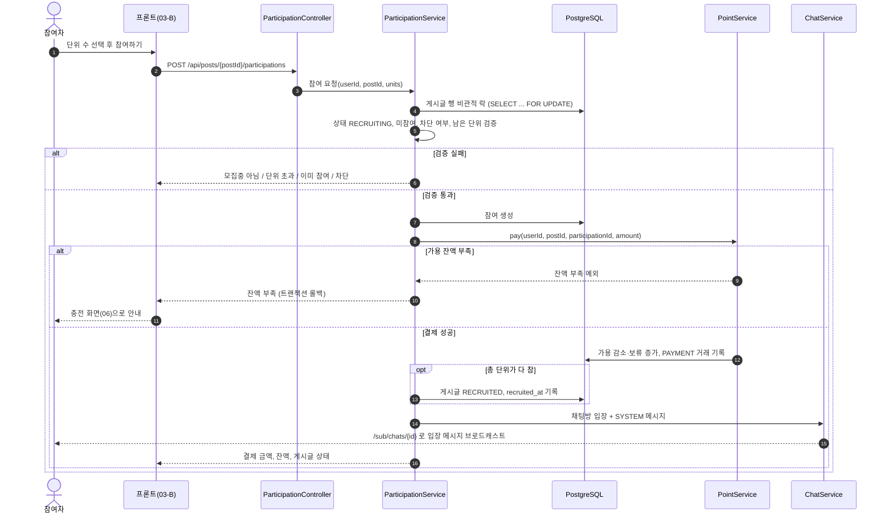

#### 2.7.2 수령 확인과 정산

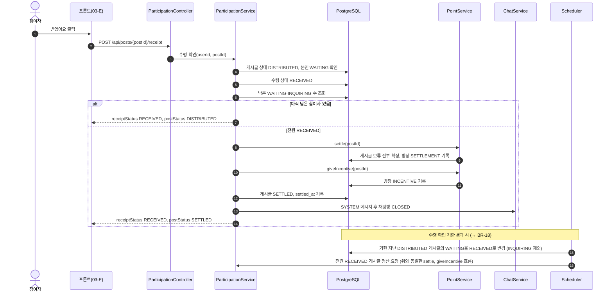

#### 2.7.3 포인트 충전

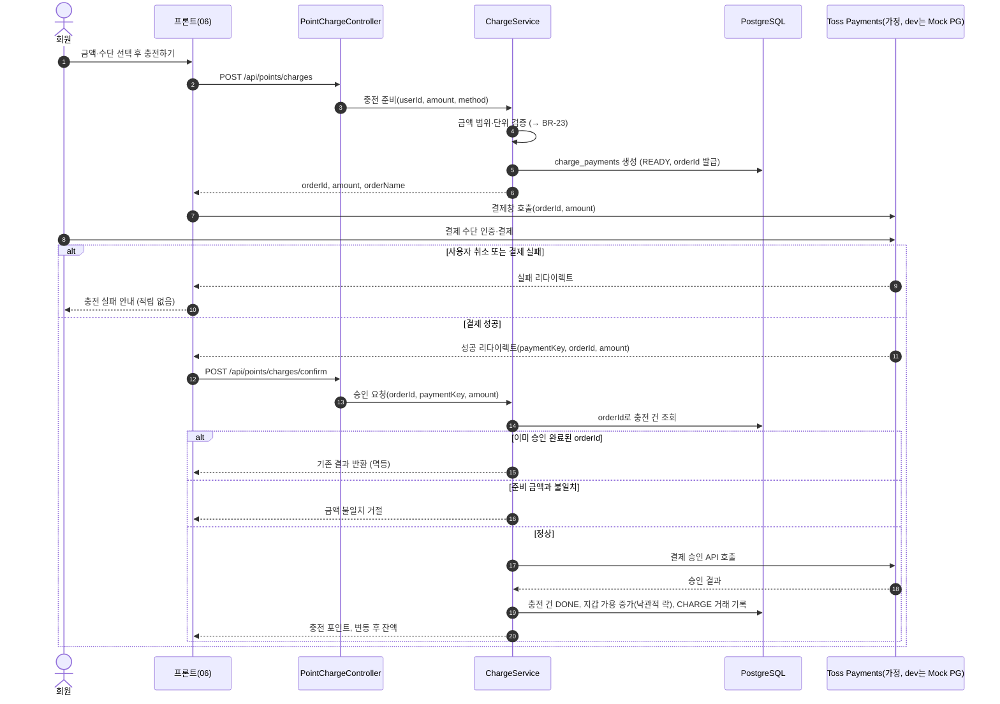

---

## 3. 요구사항·기능 명세

이 장은 식구 MVP의 **기능 요구사항(FR)**, **비즈니스 규칙(BR)**, 게시글 상태 머신, 역할별 허용 행위, 입력 검증, 비기능 요구사항, 스케줄러 작업, 범위 외 항목을 정의합니다.

- FR·BR ID는 이 장에서만 정의합니다. 다른 장은 ID만 인용합니다.
- **정책 상수(금액, 시간, 비율, 한도)는 3.2 비즈니스 규칙 표에만 적습니다.** FR과 검증 규칙에는 숫자 대신 BR ID를 적습니다.
- URL·요청/응답 JSON은 6장, 에러 코드·ENUM 정의는 6장, 테이블·컬럼은 4장, 유스케이스 흐름은 2장에서 다룹니다.
- 표기: "(가정·팀 확정 필요)"는 팀이 정하지 않아 기본값을 제안한 정책, "(추론)"은 원본에 명시되지 않았지만 다른 결정에서 도출한 내용입니다.

### 3.1 기능 요구사항

우선순위는 **MVP**(첫 출시 필수)와 **후순위**(MVP 이후) 두 단계입니다. 화면 번호는 Figma Wireframe 기준(01~09, 03-A~F, 08-B, 09-A/B)입니다.

#### 3.1.1 인증·회원가입 (FR-AUTH)

| ID         | 기능명                    | 설명                                                                                                                 | 우선순위 | 인수 조건                                                                                                                                                                                                 | 화면          |
| ---------- | ------------------------- | -------------------------------------------------------------------------------------------------------------------- | -------- | --------------------------------------------------------------------------------------------------------------------------------------------------------------------------------------------------------- | ------------- |
| FR-AUTH-01 | 학교 이메일 인증코드 발송 | 학교 이메일(BR-01)로 숫자 6자리 인증코드를 메일로 보낸다. 코드는 Redis에 TTL(BR-02)을 두고 저장한다                  | MVP      | 학교 도메인이 아니면 COMMON400. 이미 가입된 이메일이면 USER409. 재발송 간격(BR-03) 안에 다시 요청하면 거절. 재발송하면 이전 코드는 무효                                                                   | 01 가입 1단계 |
| FR-AUTH-02 | 인증코드 확인             | 코드가 맞으면 `verificationToken`(유효시간 BR-04)을 발급한다                                                         | MVP      | 코드 불일치·만료 시 실패. 시도 횟수(BR-05)를 넘기면 해당 코드 폐기. 성공하면 코드 삭제(1회용)                                                                                                             | 01 가입 1단계 |
| FR-AUTH-03 | 아이디 중복확인           | 로그인 ID 사용 가능 여부를 알려준다                                                                                  | MVP      | 형식 위반이면 COMMON400(3.5). 이미 있으면 `available=false`. 최종 중복은 FR-AUTH-04에서 다시 검사                                                                                                         | 01 가입 2단계 |
| FR-AUTH-04 | 회원가입                  | `verificationToken` + 로그인 ID + 비밀번호 + 동네(동 이름·좌표)로 계정을 만든다. **서버 저장은 이 시점 한 번뿐**이다 | MVP      | 토큰 만료·위조 시 AUTH401. 로그인 ID 또는 이메일 중복 시 USER409. 성공 시 랜덤 닉네임(BR-06) 부여, 포인트 지갑을 잔액 0으로 생성, 학교명은 이메일 도메인에서 채움(추론). 중간에 이탈하면 계정이 남지 않음 | 01 가입 3단계 |
| FR-AUTH-05 | 로그인                    | 로그인 ID·비밀번호로 Access/Refresh 토큰(BR-07)을 발급한다                                                           | MVP      | 불일치 시 ID·비밀번호 중 무엇이 틀렸는지 구분하지 않는 동일 메시지. 연속 실패 잠금(BR-08)                                                                                                                 | 01            |
| FR-AUTH-06 | 토큰 재발급               | Refresh 토큰으로 Access 토큰을 다시 발급한다                                                                         | MVP      | Redis에 저장된 Refresh 토큰과 다르거나 만료되면 AUTH401. 재발급 때 Refresh 토큰도 교체(rotation, 추론)                                                                                                    | 공통          |
| FR-AUTH-07 | 로그아웃                  | Refresh 토큰을 Redis에서 지우고 현재 Access 토큰을 남은 만료시간 동안 블랙리스트에 올린다                            | MVP      | 로그아웃 뒤 같은 Access 토큰으로 호출하면 AUTH401                                                                                                                                                         | 07            |
| FR-AUTH-08 | 비밀번호 찾기·변경        | 이메일 인증으로 비밀번호 재설정                                                                                      | 후순위   | MVP 범위 외(3.8)                                                                                                                                                                                          | -             |

#### 3.1.2 사용자 (FR-USER)

| ID         | 기능명           | 설명                                                                                                                          | 우선순위 | 인수 조건                                                                                                                         | 화면   |
| ---------- | ---------------- | ----------------------------------------------------------------------------------------------------------------------------- | -------- | --------------------------------------------------------------------------------------------------------------------------------- | ------ |
| FR-USER-01 | 내 정보 조회     | 닉네임, 학교명, 동네, 공구 수(진행중·완료), 포인트(가용·보관중)를 보여준다                                                    | MVP      | 로그인 필수. 다른 사용자 정보는 포함하지 않음                                                                                     | 07, 02 |
| FR-USER-02 | 내 공구함        | 내가 연 공구·참여한 공구를 `진행중/완료` 탭과 `전체/내가 연/참여한/액션 필요` 필터로 보여준다                                 | MVP      | 진행중 = RECRUITING~DISTRIBUTED, 완료 = SETTLED·CANCELLED(추론). 카드마다 내 역할, 필요한 액션(BR-40), 완료 탭은 후기 작성 진행도 | 07     |
| FR-USER-03 | 유저 프로필 조회 | 닉네임, 학교명, 동 이름, 가입일, 평균 별점, 후기 수, 거래 수, 주 카테고리, 태그 집계, 최근 후기·거래, 내 차단 여부를 보여준다 | MVP      | 정확한 좌표·로그인 ID·이메일은 노출하지 않음(BR-50). 탈퇴·없는 사용자면 COMMON404                                                 | 08     |
| FR-USER-04 | 신뢰도 표시      | 평균 별점과 태그 집계로 신뢰도를 보여준다(BR-41)                                                                              | MVP      | 후기가 없으면 별점 대신 "후기 없음"(추론)                                                                                         | 03, 08 |
| FR-USER-05 | 온도(매너 점수)  | 별점 외 별도 점수 계산                                                                                                        | 후순위   | 계산식 미정. MVP는 별점+태그만                                                                                                    | -      |
| FR-USER-06 | 회원 탈퇴        | 계정 삭제                                                                                                                     | 후순위   | 진행 중 공구·보관 포인트 처리 규칙 필요                                                                                           | -      |

#### 3.1.3 위치 (FR-LOC)

| ID        | 기능명              | 설명                                                                                     | 우선순위 | 인수 조건                                                                                                | 화면   |
| --------- | ------------------- | ---------------------------------------------------------------------------------------- | -------- | -------------------------------------------------------------------------------------------------------- | ------ |
| FR-LOC-01 | 동 이름 검색        | 검색어로 동 후보(동 이름 + 대표 좌표)를 돌려준다. 외부 지도 API(Kakao Local 가정)를 쓴다 | MVP      | 검색어 길이(3.5) 위반 시 COMMON400. 결과 없으면 빈 목록. 외부 API 장애 시 재시도 안내 메시지             | 01, 07 |
| FR-LOC-02 | 현재 위치 → 동 이름 | 브라우저 위치(위도·경도)를 동 이름으로 바꾼다                                            | MVP      | 국내 좌표 범위 밖이면 COMMON400. 서버는 받은 원본 좌표를 그대로 저장하지 않고 동 대표 좌표로 저장(BR-51) | 01, 07 |
| FR-LOC-03 | 내 동네 변경        | 저장된 동 이름과 좌표를 바꾼다                                                           | MVP      | 변경 즉시 목록의 거리 계산 기준이 바뀜. 이미 참여한 공구에는 영향 없음                                   | 07, 02 |

#### 3.1.4 공구 게시글 (FR-POST)

| ID         | 기능명          | 설명                                                                                                                                                       | 우선순위 | 인수 조건                                                                                                                                                                                                   | 화면     |
| ---------- | --------------- | ---------------------------------------------------------------------------------------------------------------------------------------------------------- | -------- | ----------------------------------------------------------------------------------------------------------------------------------------------------------------------------------------------------------- | -------- |
| FR-POST-01 | 공구 목록·검색  | 하나의 목록 기능으로 키워드(제목·상품명), 카테고리, 반경, 모집중만 보기, 정렬, 페이지를 처리한다                                                           | MVP      | 기본값: 반경 BR-52, 모집중만 보기 true, 정렬 LATEST, 페이지 크기 9. 내가 차단했거나 나를 차단한 사용자의 글은 빠짐(BR-60). 카드에 동 이름과 거리(km)만 노출                                                 | 02       |
| FR-POST-02 | 정렬            | LATEST(등록 최신순), DEADLINE(마감 임박순: 마감 시각 오름차순), POPULAR(조회수 내림차순), PRICE(단위당 가격 오름차순)                                      | MVP      | 동률이면 게시글 ID 내림차순으로 순서 고정(추론). DEADLINE은 이미 마감 시각이 지난 글을 뒤로 보냄(추론)                                                                                                      | 02       |
| FR-POST-03 | 공구 상세       | 상품 정보, 단위·가격, 진행 상태와 타임라인, 동 이름·거리, 거래 장소 이름, 방장·참여자 요약, 내 참여 정보, 최대 선택 가능 단위(BR-12), 채팅방 ID를 보여준다 | MVP      | 조회 시 조회수 +1(BR-53). 채팅방 ID는 방장·참여자에게만. 차단 관계면 COMMON404처럼 보이게 처리(BR-60)                                                                                                       | 03, 03-A |
| FR-POST-04 | 공구 등록       | 상품명·링크·카테고리·설명·이미지·기본 단위·총 단위 수·총 가격·방장 구매 단위·마감 시각·거래 장소로 공구를 연다                                             | MVP      | 단위당 가격은 서버가 계산(BR-10, BR-11). 등록과 동시에 방장 구매분을 결제·보류(BR-20). 잔액 부족이면 POINT409이고 글이 만들어지지 않음. 채팅방 자동 생성 후 방장 입장. 이미지가 없으면 카테고리 기본 이미지 | 04       |
| FR-POST-05 | 공구 수정       | 방장이 글 내용을 고친다                                                                                                                                    | MVP      | 상태 RECRUITING이고 방장 외 참여자가 없을 때만(BR-30). 수정 가능한 필드는 BR-31. 조건 위반 시 POST409                                                                                                       | 04       |
| FR-POST-06 | 공구 취소(삭제) | 방장이 공구를 취소하면 CANCELLED로 바꾸고 방장 포함 전원 보류 포인트를 환급한다                                                                            | MVP      | RECRUITING·RECRUITED에서만(ORDERED 이후 불가, POST409). 채팅방 CLOSED, SYSTEM 메시지 발송. 글은 물리 삭제하지 않음(추론)                                                                                    | 03       |
| FR-POST-07 | 카테고리        | FOOD·LIVING·DAILY·ETC 4개                                                                                                                                  | MVP      | 그 밖의 값은 COMMON400                                                                                                                                                                                      | 02, 04   |
| FR-POST-08 | 지도 화면       | 지도 위에 주변 공구 표시                                                                                                                                   | 후순위   | MVP는 목록의 거리 표시로 대신함(추론)                                                                                                                                                                       | -        |
| FR-POST-09 | 관심(찜)        | 공구 찜하기                                                                                                                                                | 후순위   | 미정 기능                                                                                                                                                                                                   | -        |

#### 3.1.5 참여 (FR-PART)

| ID         | 기능명           | 설명                                                                                          | 우선순위 | 인수 조건                                                                                                                                                                                                                                                        | 화면     |
| ---------- | ---------------- | --------------------------------------------------------------------------------------------- | -------- | ---------------------------------------------------------------------------------------------------------------------------------------------------------------------------------------------------------------------------------------------------------------- | -------- |
| FR-PART-01 | 참여 + 즉시 결제 | 원하는 단위 수를 고르면 그 즉시 `단위당 가격 × 단위 수`만큼 포인트를 결제해 보류(HELD)한다    | MVP      | RECRUITING이고 마감 전일 때만(아니면 POST409). 단위 수는 1 이상 최대 선택 단위(BR-12) 이하(초과 시 COMMON400). 잔액 부족 POINT409. 이미 참여했으면 409. 방장 본인·차단 관계면 거절(BR-60). 마지막 단위가 차면 자동 RECRUITED(BR-13). 채팅방 입장 + SYSTEM 메시지 | 03, 03-B |
| FR-PART-02 | 참여 취소 + 환급 | 참여자가 참여를 취소하면 보류 포인트 전액을 환급하고 채팅방에서 나간다                        | MVP      | RECRUITING·RECRUITED에서만(BR-14). RECRUITED에서 취소하면 RECRUITING으로 돌아감. 방장은 이 기능을 쓸 수 없음(FR-POST-06 사용). SYSTEM 메시지 발송                                                                                                                | 03       |
| FR-PART-03 | 결제·수령 현황   | 참여자별 단위, 결제 포인트, 결제 상태, 수령 상태와 집계(결제 수, 수령 수, 전체 수)를 보여준다 | MVP      | 방장·참여자만 조회(아니면 AUTH403). `isMe`로 내 행 표시                                                                                                                                                                                                          | 03-E     |
| FR-PART-04 | 재참여           | 취소한 사용자가 같은 공구에 다시 참여                                                         | MVP      | 허용(추론). 기존 참여 행을 재사용하거나 갱신(UNIQUE(post,user) 유지, → 4장 참조)                                                                                                                                                                                 | 03       |

#### 3.1.6 주문·배송·나눔 (FR-ORDER)

| ID          | 기능명                  | 설명                                                                                                | 우선순위 | 인수 조건                                                                                                                             | 화면             |
| ----------- | ----------------------- | --------------------------------------------------------------------------------------------------- | -------- | ------------------------------------------------------------------------------------------------------------------------------------- | ---------------- |
| FR-ORDER-01 | 영수증 등록 + 주문 완료 | 방장이 영수증 금액과 영수증 사진을 올리면 ORDERED로 바뀐다                                          | MVP      | RECRUITED에서만, 방장만. 사진 장수 BR-34. 영수증 금액과 모집 금액을 비교해 `amountMatched`를 기록만 함(BR-35). 48h 타이머 종료(BR-16) | 03-C             |
| FR-ORDER-02 | 배송 시작               | 택배사·송장번호를 입력하고 SHIPPING으로 바꾼다                                                      | MVP      | ORDERED에서만, 방장만. 매장 직접 구매처럼 택배가 없으면 택배사·송장 생략 가능(추론, NULL 허용)                                        | 03-C             |
| FR-ORDER-03 | 나눔 완료               | 나눔 일정·장소를 입력하고 DISTRIBUTED로 바꾼다                                                      | MVP      | SHIPPING에서만, 방장만. 방장 본인 참여의 수령 상태는 자동 RECEIVED(BR-17). 72h 타이머 시작(BR-18)                                     | 03-C             |
| FR-ORDER-04 | 주문 정보 조회          | 택배사, 송장, 영수증 금액, 모집 금액, 금액 일치 여부, 영수증 사진, 나눔 일정·장소, 보관 포인트 합계 | MVP      | 방장·참여자만. 주문 전이면 COMMON404                                                                                                  | 03-C, 03-D, 03-E |
| FR-ORDER-05 | 영수증 금액 확인        | 참여자가 영수증과 모집 금액 일치 여부를 확인한다                                                    | MVP      | 불일치면 화면에 경고 표시. 차액 정산은 하지 않음(BR-35). 이의가 있으면 신고(FR-REPORT-01)                                             | 03-D             |
| FR-ORDER-06 | 배송 추적 연동          | 택배사 API로 배송 상태 자동 갱신                                                                    | 후순위   | -                                                                                                                                     | -                |

#### 3.1.7 수령 확인·문의 (FR-INQ)

| ID        | 기능명         | 설명                                                                                     | 우선순위 | 인수 조건                                                                                                                                                                                | 화면       |
| --------- | -------------- | ---------------------------------------------------------------------------------------- | -------- | ---------------------------------------------------------------------------------------------------------------------------------------------------------------------------------------- | ---------- |
| FR-INQ-01 | 받았어요       | 참여자가 수령을 확인하면 내 수령 상태가 RECEIVED가 된다                                  | MVP      | DISTRIBUTED에서만, 수령 상태 WAITING인 참여자만(INQUIRING이면 불가, POST409). 같은 요청 반복은 현재 상태 그대로 응답(멱등). 이것이 마지막 확인이면 자동 SETTLED + 정산 + 인센티브(BR-19) | 03-E       |
| FR-INQ-02 | 수령 문제 문의 | 유형(미수령·수량 부족·오배송/파손·기타), 받은 단위, 원하는 처리, 내용, 사진으로 문의한다 | MVP      | DISTRIBUTED이고 내 수령 상태 WAITING일 때만. 참여 1건당 문의 1건(BR-36). 등록 즉시 수령 상태 INQUIRING → 정산 차단(BR-37). 유형별 필수값은 3.5                                           | 03-F       |
| FR-INQ-03 | 문의 목록      | 해당 공구의 문의를 보여준다                                                              | MVP      | 방장은 전체, 참여자는 본인 문의만(추론)                                                                                                                                                  | 03-C, 03-F |
| FR-INQ-04 | 문의 해결      | 운영팀이 수동으로 처리(DB 작업)하고 수령 상태를 RECEIVED로 바꾸거나 부분·전액 환불한다   | 후순위   | MVP는 정산 차단까지만(BR-37). 처리 화면·API 없음                                                                                                                                         | -          |

#### 3.1.8 포인트 (FR-POINT)

| ID          | 기능명           | 설명                                                                                                             | 우선순위 | 인수 조건                                                                                                                            | 화면         |
| ----------- | ---------------- | ---------------------------------------------------------------------------------------------------------------- | -------- | ------------------------------------------------------------------------------------------------------------------------------------ | ------------ |
| FR-POINT-01 | 잔액 조회        | 가용 잔액과 보관중 금액을 보여준다                                                                               | MVP      | 본인 것만                                                                                                                            | 06, 03-B, 07 |
| FR-POINT-02 | 충전 준비        | 금액·결제수단(KAKAOPAY·TOSSPAY·CARD)으로 주문번호를 발급하고 결제 대기 내역을 만든다                             | MVP      | 금액 규칙 BR-23 위반 시 COMMON400                                                                                                    | 06           |
| FR-POINT-03 | 충전 승인        | PG 결제 키와 주문번호·금액으로 PG 승인을 요청하고 성공하면 포인트를 적립한다(CHARGE)                             | MVP      | 준비한 금액과 다르면 400 + 적립 안 함. 같은 주문번호 재요청은 기존 결과 그대로(BR-24). 남의 주문번호면 AUTH403. dev 프로필은 Mock PG | 06           |
| FR-POINT-04 | 거래 내역        | 충전·결제·환불·정산·인센티브 내역을 유형 필터와 함께 최신순으로 보여준다                                         | MVP      | 모든 항목에 거래 후 잔액과 관련 게시글(있으면) 표시                                                                                  | 06, 07       |
| FR-POINT-05 | 내부 포인트 처리 | 결제(pay), 환급(refund), 정산(settle), 인센티브(giveIncentive)를 공구 진행 기능 안에서 처리한다. 외부 API는 없다 | MVP      | 모든 변동은 거래 내역에 남음(BR-26). 같은 대상에 두 번 실행해도 결과가 한 번과 같음(BR-27)                                           | -            |
| FR-POINT-06 | 잔여 포인트 출금 | 남은 포인트를 현금으로 환불                                                                                      | 후순위   | MVP 범위 외                                                                                                                          | -            |
| FR-POINT-07 | 충전 취소        | 충전 직후 PG 결제 취소                                                                                           | 후순위   | 사용 전 포인트만 취소 가능하게 할지 정책 필요                                                                                        | -            |

#### 3.1.9 채팅 (FR-CHAT)

| ID         | 기능명           | 설명                                                       | 우선순위 | 인수 조건                                                                         | 화면   |
| ---------- | ---------------- | ---------------------------------------------------------- | -------- | --------------------------------------------------------------------------------- | ------ |
| FR-CHAT-01 | 채팅방 자동 생성 | 게시글 등록 때 공구 채팅방을 만들고 방장을 입장시킨다      | MVP      | 게시글당 채팅방 1개                                                               | 04, 05 |
| FR-CHAT-02 | 입장·퇴장        | 참여하면 입장, 참여 취소하면 퇴장. 각각 SYSTEM 메시지      | MVP      | 퇴장한 사용자는 이후 메시지 조회·발송 불가                                        | 05     |
| FR-CHAT-03 | 채팅방 목록      | 진행중/종료 탭, 마지막 메시지, 안 읽은 수, 인원            | MVP      | 내가 속한 방만. 마지막 메시지 시각 내림차순                                       | 05     |
| FR-CHAT-04 | 메시지 송수신    | STOMP로 텍스트 메시지를 보내고 받는다                      | MVP      | 연결 시 JWT 검증(BR-56). 방 구성원만 구독·발행. 길이 3.5. CLOSED 방에는 발행 불가 | 05     |
| FR-CHAT-05 | 이전 메시지 조회 | 커서 기반으로 과거 메시지를 불러온다                       | MVP      | 최신→과거 순. 다음 커서와 hasNext 제공                                            | 05     |
| FR-CHAT-06 | 읽음 처리        | 마지막으로 읽은 시각을 갱신해 안 읽은 수를 계산한다        | MVP      | 방 구성원만                                                                       | 05     |
| FR-CHAT-07 | 상태 변경 알림   | 공구 상태가 바뀌면 SYSTEM 메시지를 남긴다                  | MVP      | RECRUITED·ORDERED·SHIPPING·DISTRIBUTED·SETTLED·CANCELLED 모두(3.3.2)              | 05     |
| FR-CHAT-08 | 채팅방 종료      | SETTLED·CANCELLED가 되면 CLOSED. 이력은 읽기 전용으로 남음 | MVP      | 종료 탭으로 이동                                                                  | 05     |
| FR-CHAT-09 | 채팅 이미지      | 이미지 메시지                                              | 후순위   | MVP는 TEXT·SYSTEM만                                                               | -      |

#### 3.1.10 후기 (FR-REVIEW)

| ID           | 기능명                 | 설명                                                                        | 우선순위 | 인수 조건                                                                                                                              | 화면       |
| ------------ | ---------------------- | --------------------------------------------------------------------------- | -------- | -------------------------------------------------------------------------------------------------------------------------------------- | ---------- |
| FR-REVIEW-01 | 평가 대상 조회         | 내가 이 공구에서 평가할 대상과 작성 여부를 보여준다                         | MVP      | 참여자는 방장 1명, 방장은 참여자 전원(BR-43)                                                                                           | 09-A, 09-B |
| FR-REVIEW-02 | 후기 작성              | 대상별 별점·태그·내용을 배열로 한 번에 제출한다                             | MVP      | SETTLED이고 기한(BR-42) 안일 때만. (작성자, 게시글, 대상) 중복 불가. 배열 중 하나라도 실패하면 전부 실패(추론). 작성 후 수정·삭제 불가 | 09-A, 09-B |
| FR-REVIEW-03 | 받은 후기 목록         | 사용자가 받은 후기를 최신순으로 보여준다                                    | MVP      | 페이지네이션. 작성자 닉네임·게시글 제목 포함                                                                                           | 08         |
| FR-REVIEW-04 | 별점·거래 수 캐시 갱신 | 후기 작성 시 대상의 평균 별점·후기 수, SETTLED 시 참여자 거래 수를 갱신한다 | MVP      | BR-41 계산식                                                                                                                           | -          |

#### 3.1.11 신고 (FR-REPORT)

| ID           | 기능명      | 설명                                                                                                              | 우선순위 | 인수 조건                                                                                 | 화면       |
| ------------ | ----------- | ----------------------------------------------------------------------------------------------------------------- | -------- | ----------------------------------------------------------------------------------------- | ---------- |
| FR-REPORT-01 | 사용자 신고 | 사유(POST_HARMFUL·CHAT_ABUSE·TRADE_VIOLATION·ETC), 관련 게시글·메시지·위반 단계, 내용, 사진으로 사용자를 신고한다 | MVP      | 대상은 사용자만. 자기 자신 신고 불가. PENDING으로 저장만 함(BR-61). 중복 신고 제한(BR-62) | 08-B, 03-D |
| FR-REPORT-02 | 신고 처리   | 관리자가 신고를 확인·제재                                                                                         | 후순위   | 관리자 화면은 MVP 범위 외                                                                 | -          |

#### 3.1.12 차단 (FR-BLOCK)

| ID          | 기능명    | 설명                    | 우선순위 | 인수 조건                                                     | 화면 |
| ----------- | --------- | ----------------------- | -------- | ------------------------------------------------------------- | ---- |
| FR-BLOCK-01 | 차단      | 특정 사용자를 차단한다  | MVP      | 자기 자신 불가. 이미 차단했으면 멱등 성공(추론). 효과는 BR-60 | 08   |
| FR-BLOCK-02 | 차단 해제 | 차단을 푼다             | MVP      | 차단하지 않은 사용자면 멱등 성공(추론)                        | 08   |
| FR-BLOCK-03 | 차단 목록 | 내가 차단한 사용자 목록 | MVP      | 본인 것만                                                     | 07   |

#### 3.1.13 이미지 (FR-IMG)

| ID        | 기능명             | 설명                                                           | 우선순위 | 인수 조건                                      | 화면                 |
| --------- | ------------------ | -------------------------------------------------------------- | -------- | ---------------------------------------------- | -------------------- |
| FR-IMG-01 | 이미지 업로드      | 파일을 올리면 URL을 돌려준다. 다른 기능은 이 URL만 받는다      | MVP      | 형식·크기 BR-55 위반 시 COMMON400. 로그인 필수 | 04, 03-C, 03-F, 08-B |
| FR-IMG-02 | 이미지 URL 검증    | 다른 요청에 들어온 이미지 URL이 서비스 저장소 URL인지 확인한다 | MVP      | 외부 URL이면 COMMON400(추론)                   | -                    |
| FR-IMG-03 | 미사용 이미지 정리 | 어디에도 연결되지 않은 업로드 파일 삭제                        | 후순위   | -                                              | -                    |

#### 3.1.14 스케줄러 (FR-SCHED)

스케줄러 작업의 동작 기준은 3.7에서 자세히 다룹니다.

| ID          | 기능명                  | 설명                                                                             | 우선순위 | 인수 조건    | 화면 |
| ----------- | ----------------------- | -------------------------------------------------------------------------------- | -------- | ------------ | ---- |
| FR-SCHED-01 | 모집 마감 처리          | 마감 시각이 지난 RECRUITING 공구를 CANCELLED로 바꾸고 전액 환급                  | MVP      | BR-15        | -    |
| FR-SCHED-02 | 영수증 미등록 자동 취소 | RECRUITED 후 기한(BR-16) 안에 영수증이 없으면 CANCELLED + 전액 환급              | MVP      | BR-16        | -    |
| FR-SCHED-03 | 자동 수령 확인          | DISTRIBUTED 후 기한(BR-18)이 지나면 WAITING을 RECEIVED로 바꾸고 조건이 되면 정산 | MVP      | BR-18, BR-37 | -    |
| FR-SCHED-04 | 미완료 충전 만료        | 오래된 결제 대기 충전 건을 만료 처리                                             | MVP      | BR-25        | -    |

### 3.2 비즈니스 규칙

**정책 상수는 이 표에만 둡니다.** 값은 설정 파일의 `sikgu.policy.*` 키로 빼서 코드 수정 없이 바꿀 수 있게 합니다(설정 키 이름은 제안, → 5장 참조). 원본에서 팀이 확정하지 않은 값은 모두 "(가정·팀 확정 필요)"입니다.

#### 3.2.1 인증·계정

| ID    | 규칙                       | 값 / 내용                                                                                                                              | 설정 키                                                    | 출처                |
| ----- | -------------------------- | -------------------------------------------------------------------------------------------------------------------------------------- | ---------------------------------------------------------- | ------------------- |
| BR-01 | 학교 이메일 판별           | 이메일 도메인이 `ac.kr`로 끝나야 함. 한 이메일당 계정 1개                                                                              | `sikgu.policy.auth.email-domain-suffix`                    | 확정                |
| BR-02 | 인증코드                   | 숫자 6자리, Redis TTL **5분**                                                                                                          | `sikgu.policy.auth.code-ttl`                               | 확정                |
| BR-03 | 인증코드 재발송 간격       | **60초**. 같은 이메일 하루 최대 **10회**                                                                                               | `sikgu.policy.auth.resend-cooldown`, `...daily-send-limit` | (가정·팀 확정 필요) |
| BR-04 | verificationToken 유효시간 | **30분**. 가입 완료 시 무효화                                                                                                          | `sikgu.policy.auth.verification-token-ttl`                 | 확정                |
| BR-05 | 인증코드 시도 횟수         | 코드당 **5회** 틀리면 코드 폐기, 재발송 필요                                                                                           | `sikgu.policy.auth.code-max-attempts`                      | (가정·팀 확정 필요) |
| BR-06 | 랜덤 닉네임                | "형용사 + 음식" 형식(예: 배고픈 고구마). 중복이면 다시 뽑고, 일정 횟수 실패하면 숫자 접미사 부여(추론). MVP에서 닉네임 변경 불가(추론) | -                                                          | 확정(형식)          |
| BR-07 | 토큰 수명                  | Access **30분**, Refresh **14일**(Redis 저장). 로그아웃 시 Refresh 삭제 + Access는 남은 수명만큼 블랙리스트                            | `sikgu.policy.jwt.access-ttl`, `...refresh-ttl`            | 확정                |
| BR-08 | 로그인 실패 잠금           | 같은 로그인 ID **5회** 연속 실패 시 **10분** 잠금                                                                                      | `sikgu.policy.auth.login-max-fail`, `...login-lock`        | (가정·팀 확정 필요) |

#### 3.2.2 공구 금액·단위

| ID    | 규칙                | 값 / 내용                                                                                                                                                                                | 설정 키                                                 | 출처                                                 |
| ----- | ------------------- | ---------------------------------------------------------------------------------------------------------------------------------------------------------------------------------------- | ------------------------------------------------------- | ---------------------------------------------------- |
| BR-10 | 단위당 가격 계산    | `unitPrice = totalPrice / totalUnits`. 서버만 계산, 프론트 값은 받지 않음. **나누어떨어지지 않으면 등록 거부**(POST4001). 예: 29,040 ÷ 6 = 4,840                                         | -                                                       | 계산은 확정, 나누어떨어짐 조건은 (가정·팀 확정 필요) |
| BR-11 | 모집 금액           | `recruitedAmount = unitPrice × totalUnits` (= `totalPrice`, BR-10에 의해 항상 일치)                                                                                                      | -                                                       | 확정                                                 |
| BR-12 | 최대 선택 단위      | `maxSelectableUnits = totalUnits − filledUnits`(남은 단위). 1인 상한은 두지 않음. 참여 중이거나 RECRUITING이 아니면 0                                                                    | `sikgu.policy.post.max-units-per-user`(미사용 = 무제한) | (가정·팀 확정 필요)                                  |
| BR-13 | 모집 완료           | 참여로 `filledUnits == totalUnits`가 되면 같은 트랜잭션에서 RECRUITED, `recruited_at` 기록                                                                                               | -                                                       | 확정                                                 |
| BR-14 | 참여 취소 가능 구간 | RECRUITING·RECRUITED에서만. RECRUITED에서 취소하면 RECRUITING으로 돌아가고 `recruited_at`을 비움(48h 타이머 초기화). 단, 마감 시각이 지난 RECRUITED에서는 참여 취소 불가(방장 주문 보호) | -                                                       | 앞부분 확정, 마감 후 금지는 (가정·팀 확정 필요)      |
| BR-20 | 결제 시점           | 참여 즉시 `unitPrice × units`를 가용 → 보류(HELD). 방장도 등록 시 `hostUnits`만큼 같은 방식으로 결제·보류. "결제 진행중" 단계 없음                                                       | -                                                       | 확정                                                 |
| BR-21 | 방장 구매 단위      | `1 ≤ hostUnits ≤ totalUnits − 1`(참여자 몫을 최소 1단위 남김)                                                                                                                            | -                                                       | (가정·팀 확정 필요)                                  |

#### 3.2.3 진행 기한·자동 처리

| ID    | 규칙             | 값 / 내용                                                                                                                                                                     | 설정 키                                   | 출처                            |
| ----- | ---------------- | ----------------------------------------------------------------------------------------------------------------------------------------------------------------------------- | ----------------------------------------- | ------------------------------- |
| BR-15 | 모집 마감        | `deadlineAt`이 지났는데 RECRUITING(인원 미달)이면 스케줄러가 CANCELLED + 전원(방장 포함) 전액 환급. 마감 후 신규 참여 불가                                                    | -                                         | (가정·팀 확정 필요)             |
| BR-16 | 영수증 등록 기한 | `recruited_at` + **48시간** 안에 영수증 미등록 시 자동 CANCELLED + 전액 환급. 방장 패널티(원안: 방장 포인트를 참여자가 나눠 가짐)는 **MVP에서 보류**                          | `sikgu.policy.order.receipt-deadline`     | (가정·팀 확정 필요)             |
| BR-17 | 방장 본인 수령   | DISTRIBUTED로 바뀌는 순간 방장 참여의 수령 상태를 RECEIVED로 둠                                                                                                               | -                                         | (추론)                          |
| BR-18 | 자동 수령 확인   | `distributed_at` + **72시간** 지나면 WAITING인 참여를 RECEIVED로 자동 변경. INQUIRING은 제외                                                                                  | `sikgu.policy.receipt.auto-confirm-after` | (가정·팀 확정 필요)             |
| BR-19 | 정산 조건        | DISTRIBUTED에서 모든 참여(방장 포함)가 RECEIVED가 되면 자동 SETTLED. 같은 트랜잭션에서 settle(게시글의 HELD 전부 CAPTURED, 합계를 방장에게 SETTLEMENT) → giveIncentive(BR-22) | -                                         | 확정(인센티브 동시 지급은 가정) |
| BR-22 | 방장 인센티브    | 모집 금액(BR-11)의 **1%**, 1P 미만 버림. 플랫폼이 지급(INCENTIVE). SETTLED일 때만, 공구당 1회                                                                                 | `sikgu.policy.incentive.rate`             | (가정·팀 확정 필요)             |

#### 3.2.4 포인트·충전

| ID    | 규칙           | 값 / 내용                                                                                                                        | 설정 키                                        | 출처                |
| ----- | -------------- | -------------------------------------------------------------------------------------------------------------------------------- | ---------------------------------------------- | ------------------- |
| BR-23 | 충전 금액      | 최소 **1,000P**, 최대 **500,000P**, **1,000P 단위**. 1P = 1원                                                                    | `sikgu.policy.charge.min`, `...max`, `...step` | (가정·팀 확정 필요) |
| BR-24 | 충전 멱등성    | 같은 `orderId`로 승인을 다시 요청하면 PG를 다시 부르지 않고 첫 결과를 돌려줌. 승인 금액이 준비 금액과 다르면 실패                | -                                              | 확정                |
| BR-25 | 충전 대기 만료 | 준비 후 **30분** 안에 승인되지 않은 충전 건은 만료 처리(이후 승인 요청 거절)                                                     | `sikgu.policy.charge.ready-expire`             | (가정·팀 확정 필요) |
| BR-26 | 포인트 원장    | 모든 잔액 변동(CHARGE·PAYMENT·REFUND·SETTLEMENT·INCENTIVE)은 거래 내역 한 줄과 거래 후 잔액을 남김. 잔액을 직접 고치는 경로 없음 | -                                              | 확정                |
| BR-27 | 보류 상태      | 보류는 HELD → CAPTURED(정산) 또는 HELD → RELEASED(환급) 한 번만 바뀜. 이미 바뀐 보류에 다시 실행하면 아무것도 하지 않음          | -                                              | 확정                |
| BR-28 | 잔액 제약      | 가용 잔액·보류 금액은 항상 0 이상. 결제 금액이 가용 잔액보다 크면 POINT409                                                       | -                                              | 확정                |
| BR-29 | 현금 출금      | 남은 포인트 현금 환불 없음(MVP)                                                                                                  | -                                              | 확정(범위 외)       |

#### 3.2.5 게시글 수정·주문·문의

| ID    | 규칙               | 값 / 내용                                                                                                                                                                        | 설정 키                                             | 출처                                               |
| ----- | ------------------ | -------------------------------------------------------------------------------------------------------------------------------------------------------------------------------- | --------------------------------------------------- | -------------------------------------------------- |
| BR-30 | 수정 가능 조건     | RECRUITING이고 방장 외 참여자 0명                                                                                                                                                | -                                                   | 확정                                               |
| BR-31 | 수정 가능 필드     | 제목, 상품명, 상품 링크, 카테고리, 설명, 이미지, 마감 시각, 거래 장소. 총 단위 수·총 가격·방장 구매 단위·기본 단위는 수정 불가(보류 금액 재계산을 피함, 바꾸려면 취소 후 재등록) | -                                                   | (가정·팀 확정 필요)                                |
| BR-32 | 모집 기간          | 마감 시각은 등록·수정 시점 기준 **1시간 후 ~ 7일 후**                                                                                                                            | `sikgu.policy.post.deadline-min`, `...deadline-max` | (가정·팀 확정 필요)                                |
| BR-33 | 총 단위 수         | **2 ~ 100** 단위                                                                                                                                                                 | `sikgu.policy.post.total-units-min`, `...max`       | (가정·팀 확정 필요)                                |
| BR-34 | 이미지 장수        | 게시글 0~**5**장, 영수증 **1~5**장(1장 이상 필수), 문의 0~**5**장, 신고 0~**5**장                                                                                                | `sikgu.policy.image.max-*`                          | 영수증 1장 필수는 확정, 상한은 (가정·팀 확정 필요) |
| BR-35 | 영수증 금액 불일치 | `amountMatched = (receiptAmount == recruitedAmount)`를 저장·표시만. 차액 환불·추가 결제는 MVP 제외                                                                               | -                                                   | (가정·팀 확정 필요)                                |
| BR-36 | 문의 개수          | 참여 1건당 문의 1건. 해결 전 추가 문의 불가                                                                                                                                      | -                                                   | (가정·팀 확정 필요)                                |
| BR-37 | 문의 효과          | 문의가 있으면 그 참여는 INQUIRING. INQUIRING이 하나라도 있으면 SETTLED로 넘어가지 않음. 해결은 운영팀 수동 처리(MVP는 정산 차단만)                                               | -                                                   | (가정·팀 확정 필요)                                |

#### 3.2.6 후기·신뢰도·액션

| ID    | 규칙           | 값 / 내용                                                                                                                                                                                                        | 설정 키                            | 출처                                  |
| ----- | -------------- | ---------------------------------------------------------------------------------------------------------------------------------------------------------------------------------------------------------------- | ---------------------------------- | ------------------------------------- |
| BR-40 | 액션 필요 판정 | ORDER(방장, RECRUITED), SHIP(방장, ORDERED), DISTRIBUTE(방장, SHIPPING), CONFIRM_RECEIPT(참여자, DISTRIBUTED + 내 수령 WAITING), WRITE_REVIEW(SETTLED + 기한 내 + 미작성 대상 있음). 여러 개면 위 순서의 첫 번째 | -                                  | (추론)                                |
| BR-41 | 신뢰도 계산    | 평균 별점 = 받은 후기 별점 평균(소수 첫째 자리 반올림). 거래 수 = 방장·참여자로 SETTLED된 공구 수. 주 카테고리 = SETTLED 공구 카테고리 상위 2개. 태그 집계 = 받은 태그별 개수                                    | -                                  | (추론)                                |
| BR-42 | 후기 작성 기한 | `settled_at` + **7일** 안. 작성 후 수정·삭제 불가                                                                                                                                                                | `sikgu.policy.review.write-period` | (가정·팀 확정 필요)                   |
| BR-43 | 후기 대상      | 참여자 → 방장, 방장 → 각 참여자. 참여자끼리는 평가하지 않음. CANCELLED 공구는 후기 없음                                                                                                                          | -                                  | 확정(양방향), 참여자 간 제외는 (추론) |
| BR-44 | 후기 태그      | PUNCTUAL, CLEAN_SPLIT, FAST_REPLY, FAST_PAYMENT 중 0~4개, 중복 없이                                                                                                                                              | -                                  | 확정(태그 후보)                       |

#### 3.2.7 위치·개인정보·노출

| ID    | 규칙             | 값 / 내용                                                                                                                                                   | 설정 키                                                     | 출처                                    |
| ----- | ---------------- | ----------------------------------------------------------------------------------------------------------------------------------------------------------- | ----------------------------------------------------------- | --------------------------------------- |
| BR-50 | 위치 노출        | 다른 사용자에게는 "○○동"과 거리(km, 소수 첫째 자리)만. 좌표, 로그인 ID, 이메일은 본인 외 노출 금지. 게시글 거래 장소는 장소 이름만 노출(좌표는 거리 계산용) | -                                                           | 확정                                    |
| BR-51 | 사용자 좌표 저장 | 사용자 위치는 동 대표 좌표로 저장(GPS 원본 좌표 보관 안 함)                                                                                                 | -                                                           | (추론)                                  |
| BR-52 | 검색 반경        | **1 / 3 / 5km**, 기본 **3km**. 기준은 내 동네 좌표 ↔ 게시글 거래 장소 좌표, Haversine 거리                                                                  | `sikgu.policy.location.radius-options`, `...default-radius` | 확정                                    |
| BR-53 | 조회수           | 상세 조회마다 +1. 같은 사용자 중복 조회 제외는 후순위                                                                                                       | -                                                           | 확정(+1), 중복 제외는 후순위            |
| BR-54 | 페이지 크기      | 기본 20, 게시글 목록 9, 최대 50                                                                                                                             | `sikgu.policy.page.max-size`                                | 기본값 확정, 최대치 (가정·팀 확정 필요) |
| BR-55 | 업로드 파일      | jpg·jpeg·png·webp, 1장 최대 **10MB**                                                                                                                        | `sikgu.policy.image.max-bytes`                              | (가정·팀 확정 필요)                     |
| BR-56 | 채팅 인증        | STOMP CONNECT 때 Access 토큰을 검증하고, 구독·발행 때마다 방 구성원인지 확인                                                                                | -                                                           | 확정                                    |

#### 3.2.8 신고·차단

| ID    | 규칙      | 값 / 내용                                                                                                                                                                 | 설정 키 | 출처                                              |
| ----- | --------- | ------------------------------------------------------------------------------------------------------------------------------------------------------------------------- | ------- | ------------------------------------------------- |
| BR-60 | 차단 효과 | A가 B를 차단하면 **양방향**으로: 서로의 게시글이 목록·상세에서 숨겨지고, 서로의 공구에 참여할 수 없음. 차단 전에 이미 함께 있던 공구·채팅방은 그대로 진행(강제 퇴장 없음) | -       | 앞부분 확정, 기존 공구 유지는 (가정·팀 확정 필요) |
| BR-61 | 신고 처리 | PENDING으로 저장만. 처리(DONE)는 관리자 기능과 함께 후순위. POST_HARMFUL은 "게시글을 통한 해당 사용자의 유해 행위"                                                        | -       | 확정                                              |
| BR-62 | 중복 신고 | 같은 신고자 → 같은 대상, 같은 게시글로 PENDING 신고가 있으면 다시 신고 불가                                                                                               | -       | (가정·팀 확정 필요)                               |

### 3.3 게시글 상태 머신

게시글 상태는 7개입니다(정의는 6장 PostStatus). 프론트엔드는 상태값을 직접 보내지 않고, 각 행위(참여, 영수증 등록, 배송 시작 등)의 결과로 서버가 상태를 바꿉니다. 전이마다 해당 타임라인 컬럼(`recruited_at`, `ordered_at`, `shipped_at`, `distributed_at`, `settled_at`, `cancelled_at`)을 기록합니다.

#### 3.3.1 상태 다이어그램

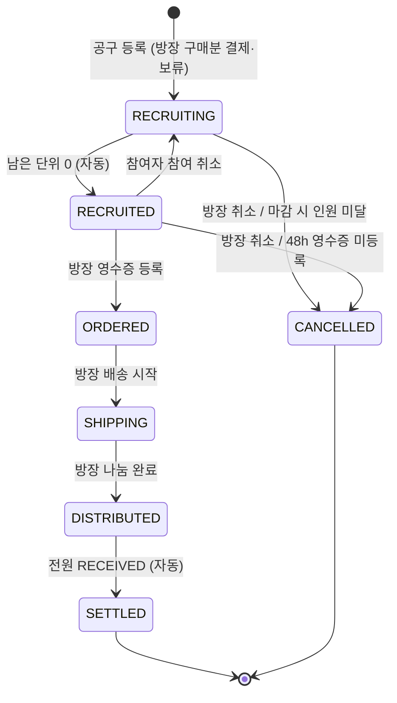

ORDERED 이후에는 취소 경로가 없습니다. 주문 이후의 문제는 문의(FR-INQ-02)와 신고(FR-REPORT-01)로만 다루고, 해결은 운영팀이 수동으로 처리합니다(BR-37).

#### 3.3.2 전이 표

| #   | 현재 → 다음               | 트리거                                           | 주체                     | 조건                                                      | 부수효과                                                                                                                                  |
| --- | ------------------------- | ------------------------------------------------ | ------------------------ | --------------------------------------------------------- | ----------------------------------------------------------------------------------------------------------------------------------------- |
| T1  | (없음) → RECRUITING       | 공구 등록 (FR-POST-04)                           | 방장                     | 입력 검증 통과(3.5), 가용 잔액 ≥ `unitPrice × hostUnits`  | 게시글·이미지 저장, 방장 참여(HOST) 생성, 방장 pay(HELD), 채팅방 생성·방장 입장                                                           |
| T2  | RECRUITING → RECRUITING   | 참여 (FR-PART-01)                                | 참여자                   | 마감 전, 남은 단위 > 요청 단위, 차단 관계 아님, 잔액 충분 | pay(HELD), 참여 생성, 채팅 입장 + SYSTEM                                                                                                  |
| T3  | RECRUITING → RECRUITED    | 참여로 남은 단위 0 (BR-13)                       | 시스템(참여 트랜잭션 안) | T2 조건 + 요청 단위 == 남은 단위                          | T2 효과 + `recruited_at` 기록, 48h 타이머 시작(BR-16), SYSTEM "모집 완료"                                                                 |
| T4  | RECRUITING → RECRUITING   | 참여 취소 (FR-PART-02)                           | 참여자                   | 참여 중, 역할 PARTICIPANT                                 | refund(RELEASED), 참여 결제 상태 REFUNDED, 채팅 퇴장 + SYSTEM                                                                             |
| T5  | RECRUITED → RECRUITING    | 참여 취소 (FR-PART-02)                           | 참여자                   | T4 조건 + 마감 시각 전(BR-14)                             | T4 효과 + `recruited_at` 비움(48h 타이머 해제)                                                                                            |
| T6  | RECRUITED → ORDERED       | 영수증 등록 (FR-ORDER-01)                        | 방장                     | 48h 기한 안, 영수증 사진 1장 이상                         | 주문 정보·영수증 사진 저장, `amountMatched` 기록, `ordered_at`, SYSTEM                                                                    |
| T7  | ORDERED → SHIPPING        | 배송 시작 (FR-ORDER-02)                          | 방장                     | -                                                         | 택배사·송장 저장(선택), `shipped_at`, SYSTEM                                                                                              |
| T8  | SHIPPING → DISTRIBUTED    | 나눔 완료 (FR-ORDER-03)                          | 방장                     | 나눔 일정·장소 입력                                       | 일정·장소 저장, 방장 참여 RECEIVED(BR-17), `distributed_at`, 72h 타이머 시작(BR-18), SYSTEM                                               |
| T9  | DISTRIBUTED → DISTRIBUTED | 받았어요 (FR-INQ-01) 또는 자동 수령(FR-SCHED-03) | 참여자 / 스케줄러        | 대상 참여가 WAITING, 마지막 확인이 아님                   | 수령 상태 RECEIVED                                                                                                                        |
| T10 | DISTRIBUTED → DISTRIBUTED | 문의 등록 (FR-INQ-02)                            | 참여자                   | 내 수령 상태 WAITING                                      | 문의 저장, 수령 상태 INQUIRING(정산 차단)                                                                                                 |
| T11 | DISTRIBUTED → SETTLED     | 마지막 RECEIVED (BR-19)                          | 시스템                   | 모든 참여 RECEIVED, INQUIRING 0건                         | settle → 방장 SETTLEMENT, giveIncentive → 방장 INCENTIVE, `settled_at`, 채팅방 CLOSED, 참여자 거래 수 갱신, 후기 기한 시작(BR-42), SYSTEM |
| T12 | RECRUITING → CANCELLED    | 방장 취소 (FR-POST-06)                           | 방장                     | -                                                         | 전원(방장 포함) refund, `cancelled_at`, 채팅방 CLOSED, SYSTEM                                                                             |
| T13 | RECRUITING → CANCELLED    | 마감 미달 (FR-SCHED-01)                          | 스케줄러                 | `deadlineAt` ≤ 현재                                       | T12와 동일                                                                                                                                |
| T14 | RECRUITED → CANCELLED     | 방장 취소 (FR-POST-06)                           | 방장                     | -                                                         | T12와 동일                                                                                                                                |
| T15 | RECRUITED → CANCELLED     | 영수증 미등록 (FR-SCHED-02)                      | 스케줄러                 | `recruited_at` + BR-16 ≤ 현재                             | T12와 동일(방장 패널티 없음)                                                                                                              |

표에 없는 전이 요청(예: SHIPPING에서 영수증 등록, ORDERED 이후 취소, SETTLED에서 받았어요)은 모두 POST409로 거절합니다.

#### 3.3.3 하위 상태: 참여·수령·보류

게시글 상태와 함께 참여 한 건마다 결제 상태, 수령 상태, 보류 상태가 움직입니다.

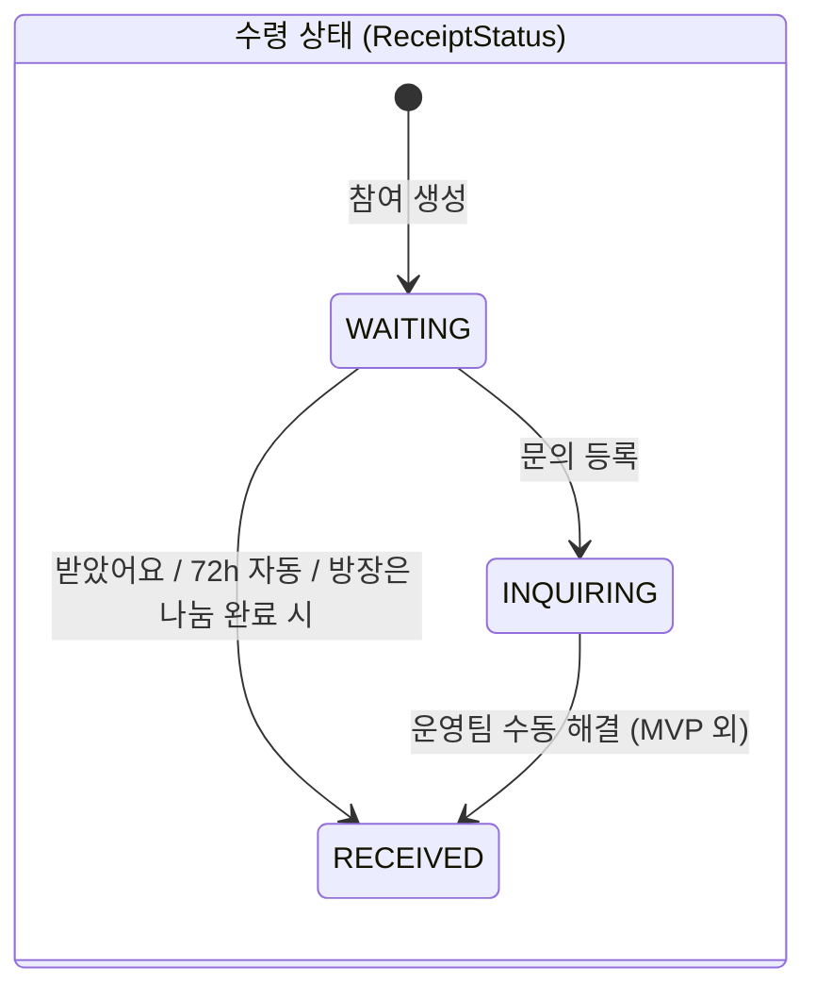

| 대상                      | 상태 흐름                      | 바뀌는 시점                                                                                |
| ------------------------- | ------------------------------ | ------------------------------------------------------------------------------------------ |
| 결제 상태 (PaymentStatus) | PAID → REFUNDED                | 참여 시 PAID. 참여 취소·게시글 CANCELLED 시 REFUNDED. SETTLED 때는 PAID 유지               |
| 보류 상태 (HoldStatus)    | HELD → CAPTURED / RELEASED     | 참여 시 HELD. SETTLED 시 CAPTURED. 참여 취소·CANCELLED 시 RELEASED. 한 번 바뀌면 끝(BR-27) |
| 수령 상태 (ReceiptStatus) | WAITING → RECEIVED / INQUIRING | 위 다이어그램. DISTRIBUTED 이전에는 의미 없음(WAITING 유지)                                |

#### 3.3.4 상태별 포인트 흐름 요약

| 시점                  | 지갑 변화 (참여자) | 지갑 변화 (방장)                     | 거래 내역 유형 |
| --------------------- | ------------------ | ------------------------------------ | -------------- |
| 참여·등록             | 가용 −, 보류 +     | (등록 시) 가용 −, 보류 +             | PAYMENT        |
| 참여 취소 / CANCELLED | 보류 −, 가용 +     | (CANCELLED 시) 보류 −, 가용 +        | REFUND         |
| SETTLED               | 보류 − (확정)      | 본인 보류 −, 가용 + 게시글 보류 합계 | SETTLEMENT     |
| SETTLED               | -                  | 가용 + 인센티브(BR-22)               | INCENTIVE      |

### 3.4 상태 × 역할 허용 행위 매트릭스

- 역할: **방장**(게시글 작성자), **참여자**(PARTICIPANT로 참여 중, 취소하지 않음), **비참여자**(로그인했지만 참여하지 않았거나 취소한 사용자).
- 표기: ○ 허용, × 거절(POST409 또는 AUTH403), △ 조건부(비고 참조), - 해당 없음.
- 차단 관계인 사용자는 비참여자 칸에서도 상세 조회·참여가 ×입니다(BR-60).

| 행위                  | 역할                    | RECRUITING   | RECRUITED | ORDERED | SHIPPING | DISTRIBUTED | SETTLED         | CANCELLED |
| --------------------- | ----------------------- | ------------ | --------- | ------- | -------- | ----------- | --------------- | --------- |
| 상세 조회             | 전원                    | ○            | ○         | ○       | ○        | ○           | ○               | ○         |
| 참여 (단위 선택·결제) | 비참여자                | △ 마감 전    | ×         | ×       | ×        | ×           | ×               | ×         |
| 참여 취소             | 참여자                  | ○            | △ 마감 전 | ×       | ×        | ×           | ×               | ×         |
| 게시글 수정           | 방장                    | △ 참여자 0명 | ×         | ×       | ×        | ×           | ×               | ×         |
| 공구 취소             | 방장                    | ○            | ○         | ×       | ×        | ×           | ×               | ×         |
| 결제·수령 현황 조회   | 방장·참여자             | ○            | ○         | ○       | ○        | ○           | ○               | ○         |
| 영수증 등록           | 방장                    | ×            | △ 48h 안  | ×       | ×        | ×           | ×               | ×         |
| 주문 정보 조회        | 방장·참여자             | -            | -         | ○       | ○        | ○           | ○               | -         |
| 배송 시작             | 방장                    | ×            | ×         | ○       | ×        | ×           | ×               | ×         |
| 나눔 완료             | 방장                    | ×            | ×         | ×       | ○        | ×           | ×               | ×         |
| 받았어요              | 참여자                  | ×            | ×         | ×       | ×        | △ WAITING   | ×               | ×         |
| 수령 문의             | 참여자                  | ×            | ×         | ×       | ×        | △ WAITING   | ×               | ×         |
| 문의 목록 조회        | 방장(전체)·참여자(본인) | -            | -         | -       | -        | ○           | ○               | -         |
| 채팅 메시지 발송      | 방장·참여자             | ○            | ○         | ○       | ○        | ○           | × CLOSED        | × CLOSED  |
| 채팅 이력 조회        | 방장·참여자             | ○            | ○         | ○       | ○        | ○           | ○               | ○         |
| 후기 작성             | 방장·참여자             | ×            | ×         | ×       | ×        | ×           | △ 7일 안(BR-42) | ×         |
| 사용자 신고           | 전원(로그인)            | ○            | ○         | ○       | ○        | ○           | ○               | ○         |

비고:

- 방장은 언제나 참여(FR-PART-01)·참여 취소(FR-PART-02)가 ×입니다. 방장의 구매분은 등록 때 이미 결제됐고, 빠지려면 공구 취소를 씁니다.
- 비참여자는 결제·수령 현황, 주문 정보, 문의 목록, 채팅에 접근할 수 없습니다(AUTH403).
- 참여를 취소한 사용자는 비참여자로 돌아가며, CANCELLED·SETTLED 이후 채팅 이력은 퇴장 전까지 있던 구성원만 볼 수 있습니다(추론).

### 3.5 입력 검증 규칙

검증 실패는 모두 COMMON400입니다(코드 정의 → 6장). 문자열 길이는 앞뒤 공백을 지운 뒤 글자 수로 셉니다. "(가정)"이 붙은 길이·범위는 팀 확정이 필요합니다. 정책 상수는 BR을 참조합니다.

#### 3.5.1 인증·사용자·위치

| 필드               | 필수 | 규칙                                                     | 비고                          |
| ------------------ | ---- | -------------------------------------------------------- | ----------------------------- |
| email              | ○    | 이메일 형식, 최대 100자, 도메인 BR-01                    | 소문자로 정규화(추론)         |
| code (인증코드)    | ○    | 숫자 정확히 6자리                                        | BR-02                         |
| verificationToken  | ○    | 서명·만료 검증                                           | BR-04                         |
| loginId            | ○    | 영문 소문자로 시작, 영문 소문자·숫자 4~20자 (가정)       | 중복 불가                     |
| password           | ○    | 8~20자, 영문·숫자·특수문자 각 1개 이상, 공백 불가 (가정) | 로그인 ID와 같으면 거절(추론) |
| location.dongName  | ○    | 1~30자, "동·읍·면·가"로 끝남(추론)                       | FR-LOC-01·02 결과값 사용      |
| location.latitude  | ○    | 33.0 ~ 39.0 (국내 범위, 추론)                            | DOUBLE                        |
| location.longitude | ○    | 124.0 ~ 132.0 (국내 범위, 추론)                          | DOUBLE                        |
| query (동 검색)    | ○    | 1~30자                                                   | -                             |

#### 3.5.2 게시글

| 필드                            | 필수 | 규칙                                     | 비고                                            |
| ------------------------------- | ---- | ---------------------------------------- | ----------------------------------------------- |
| title                           | ○    | 2~50자 (가정)                            | -                                               |
| productName                     | ○    | 1~100자 (가정)                           | -                                               |
| productLink                     | ×    | http/https URL, 최대 500자               | -                                               |
| category                        | ○    | FOOD·LIVING·DAILY·ETC                    | -                                               |
| content                         | ×    | 최대 2,000자 (가정)                      | -                                               |
| imageUrls                       | ×    | BR-34 장수, 서비스 업로드 URL(FR-IMG-02) | 비우면 기본 이미지                              |
| baseUnit                        | ○    | 1~30자 (가정), 예: "2L 생수 4병"         | 자유 텍스트                                     |
| totalUnits                      | ○    | 정수, BR-33 범위                         | -                                               |
| totalPrice                      | ○    | 정수, 1,000 ~ 10,000,000원 (가정)        | 단위당 가격 BR-10                               |
| hostUnits                       | ○    | 정수, BR-21 범위                         | -                                               |
| deadlineAt                      | ○    | ISO 8601, BR-32 범위                     | 서버 시간(KST) 기준                             |
| tradePlace.name                 | ○    | 1~50자                                   | 타인에게 노출됨                                 |
| tradePlace.latitude / longitude | ○    | 위치 좌표 범위와 동일                    | 내 동네에서 BR-52 최대 반경 밖이면 경고만(추론) |

#### 3.5.3 목록 조회

| 필드                     | 필수 | 규칙                                           | 비고                                      |
| ------------------------ | ---- | ---------------------------------------------- | ----------------------------------------- |
| keyword                  | ×    | 1~30자                                         | 앞뒤 공백 제거, 빈 문자열은 없음으로 취급 |
| category                 | ×    | Category 값                                    | 없으면 전체                               |
| radius                   | ×    | BR-52 선택지 중 하나                           | -                                         |
| recruitingOnly           | ×    | true/false                                     | 기본 true                                 |
| sort                     | ×    | LATEST·DEADLINE·POPULAR·PRICE                  | 기본 LATEST                               |
| page                     | ×    | 0 이상 정수                                    | -                                         |
| size                     | ×    | 1 이상 BR-54 최대치 이하                       | -                                         |
| tab / filter (내 공구함) | ×    | ONGOING·DONE / ALL·HOST·JOINED·ACTION_REQUIRED | -                                         |
| cursor (채팅)            | ×    | 양의 정수(메시지 ID)                           | 없으면 최신부터                           |

#### 3.5.4 참여·주문·문의

| 필드                      | 필수 | 규칙                                                      | 비고                                 |
| ------------------------- | ---- | --------------------------------------------------------- | ------------------------------------ |
| units (참여)              | ○    | 정수 1 이상 BR-12 이하                                    | 초과 시 COMMON400                    |
| receiptAmount             | ○    | 정수 1 이상                                               | BR-35 비교                           |
| receiptImageUrls          | ○    | BR-34(1장 이상)                                           | -                                    |
| courier                   | ×    | 1~30자                                                    | 송장과 함께 넣거나 함께 비움(추론)   |
| trackingNumber            | ×    | 숫자·하이픈 8~20자 (가정)                                 | -                                    |
| distributeAt              | ○    | ISO 8601                                                  | 과거 시각 허용(이미 나눈 경우, 추론) |
| distributePlace           | ○    | 1~50자                                                    | -                                    |
| inquiry.type              | ○    | NOT_RECEIVED·SHORT_QUANTITY·WRONG_OR_DAMAGED·ETC          | -                                    |
| inquiry.receivedUnits     | △    | type이 SHORT_QUANTITY면 필수, 0 이상 내 단위 수 미만 정수 | 그 외 유형이면 무시                  |
| inquiry.desiredResolution | ×    | REDELIVER·PARTIAL_REFUND·FULL_REFUND                      | 참고용, 자동 처리 없음               |
| inquiry.content           | ○    | 1~500자 (가정)                                            | -                                    |
| inquiry.imageUrls         | △    | type이 WRONG_OR_DAMAGED면 1장 이상, BR-34 상한            | -                                    |

#### 3.5.5 포인트·채팅·후기·신고

| 필드                         | 필수 | 규칙                                           | 비고                                |
| ---------------------------- | ---- | ---------------------------------------------- | ----------------------------------- |
| charge.amount                | ○    | BR-23                                          | -                                   |
| charge.method                | ○    | KAKAOPAY·TOSSPAY·CARD                          | -                                   |
| confirm.orderId              | ○    | 서버가 발급한 형식(예: `CHG-YYYYMMDD-NNNN`)    | 본인 소유                           |
| confirm.paymentKey           | ○    | 1~200자                                        | Toss 가정 시 `tgen_` 접두사(테스트) |
| confirm.amount               | ○    | 준비 금액과 정확히 같음                        | BR-24                               |
| transactions.type            | ×    | ALL·CHARGE·PAYMENT·REFUND·SETTLEMENT·INCENTIVE | -                                   |
| chat.content                 | ○    | 1~1,000자 (가정)                               | 공백만 있는 메시지 거절             |
| review.targetUserId          | ○    | BR-43 대상에 포함                              | -                                   |
| review.rating                | ○    | 정수 1~5                                       | -                                   |
| review.tags                  | ×    | BR-44                                          | -                                   |
| review.content               | ×    | 최대 300자 (가정)                              | -                                   |
| reviews 배열                 | ○    | 1개 이상, 같은 대상 중복 불가                  | -                                   |
| report.targetUserId          | ○    | 존재하는 사용자, 본인 아님                     | -                                   |
| report.postId                | ×    | 존재하는 게시글                                | -                                   |
| report.reason                | ○    | POST_HARMFUL·CHAT_ABUSE·TRADE_VIOLATION·ETC    | -                                   |
| report.detail.messageIds     | ×    | 최대 20개, 해당 게시글 채팅방의 메시지         | CHAT_ABUSE에 권장                   |
| report.detail.violationStage | ×    | 위반 단계 값(→ 6장)                            | TRADE_VIOLATION에 권장              |
| report.content               | ○    | 10~1,000자 (가정)                              | -                                   |
| report.imageUrls             | ×    | BR-34                                          | -                                   |
| image file                   | ○    | BR-55                                          | MIME과 확장자 모두 검사             |

### 3.6 비기능 요구사항

#### 3.6.1 보안

| ID         | 항목             | 요구사항                                                                                                                                                                                |
| ---------- | ---------------- | --------------------------------------------------------------------------------------------------------------------------------------------------------------------------------------- |
| NFR-SEC-01 | 비밀번호 저장    | BCrypt(또는 동급 적응형 해시)로 저장. 평문·복호화 가능한 형태 저장 금지. 응답·로그에 비밀번호 노출 금지                                                                                 |
| NFR-SEC-02 | JWT              | 서명 알고리즘 HS256 이상, 비밀키는 환경변수로 주입(저장소 커밋 금지). 수명 BR-07. Access 블랙리스트·Refresh 저장소는 Redis                                                              |
| NFR-SEC-03 | 인증 범위        | 공개 API(이메일 인증, 아이디 확인, 동 검색·역지오코딩, 가입, 로그인, 재발급) 외 모든 API는 Access 토큰 필수. WebSocket은 CONNECT 때 검증(BR-56)                                         |
| NFR-SEC-04 | 인가             | 역할 판정(방장·참여자·비참여자)은 서비스 계층에서 게시글·참여 데이터로 매번 확인. 프론트가 보낸 역할·userId를 믿지 않음. 본인 자원(지갑, 충전 주문, 차단 목록)은 토큰의 사용자로만 조회 |
| NFR-SEC-05 | 금액 신뢰        | 결제·환급·정산 금액은 모두 서버가 계산. 클라이언트가 보낸 금액은 충전 승인 대조용으로만 사용                                                                                            |
| NFR-SEC-06 | 무차별 대입 방지 | BR-03, BR-05, BR-08 적용                                                                                                                                                                |
| NFR-SEC-07 | 업로드 보안      | BR-55, 저장 파일명은 서버가 생성(UUID), 실행 가능 파일 거절                                                                                                                             |
| NFR-SEC-08 | 전송 구간        | 운영 환경 HTTPS/WSS 필수. CORS는 프론트 도메인만 허용                                                                                                                                   |
| NFR-SEC-09 | PG 비밀키        | PG 시크릿 키는 서버에만 두고 프론트에는 클라이언트 키만 전달                                                                                                                            |

#### 3.6.2 개인정보

| ID         | 항목            | 요구사항                                                                           |
| ---------- | --------------- | ---------------------------------------------------------------------------------- |
| NFR-PRI-01 | 위치 최소 노출  | BR-50, BR-51. 다른 사용자 응답에 좌표 필드를 아예 넣지 않음                        |
| NFR-PRI-02 | 식별정보 비노출 | 다른 사용자에게는 랜덤 닉네임·학교명·동 이름만. 로그인 ID·이메일은 본인 응답에만   |
| NFR-PRI-03 | 최소 수집       | 가입 전 이메일·인증코드는 Redis에만 TTL로 보관하고 가입하지 않으면 자동 소멸       |
| NFR-PRI-04 | 로그 마스킹     | 이메일(앞 2글자 외 마스킹), 토큰, 결제 키, 좌표는 로그에 원문으로 남기지 않음      |
| NFR-PRI-05 | 차단 정보       | 차단 사실은 차단한 사람에게만 보임. 차단당한 쪽 응답에 차단 여부를 넣지 않음(추론) |

#### 3.6.3 동시성·멱등성

| ID         | 상황                  | 요구사항                                                                                                                                              |
| ---------- | --------------------- | ----------------------------------------------------------------------------------------------------------------------------------------------------- |
| NFR-CON-01 | 마지막 단위 동시 참여 | 참여 트랜잭션은 게시글 행을 비관적 락(`SELECT … FOR UPDATE`)으로 잡고 남은 단위를 다시 계산. 초과 판매 0건                                            |
| NFR-CON-02 | 지갑 갱신             | 포인트 지갑은 버전 기반 낙관적 락. 충돌 시 최대 **3회** 재시도 (가정·팀 확정 필요), 그래도 실패하면 요청 실패 응답 + 트랜잭션 롤백                    |
| NFR-CON-03 | 참여·취소 경합        | 참여 취소, 방장 취소, 스케줄러 취소도 같은 게시글 락을 잡아 상태를 다시 확인한 뒤 처리                                                                |
| NFR-CON-04 | 중복 정산 방지        | 받았어요와 자동 수령이 동시에 마지막 확인이 되는 경우: 게시글 락 + "DISTRIBUTED일 때만 SETTLED로" 조건부 갱신으로 settle·giveIncentive가 한 번만 실행 |
| NFR-CON-05 | 포인트 연산 멱등      | refund는 HELD 보류에만, settle은 게시글의 HELD 보류에만 적용(BR-27). 같은 호출이 두 번 와도 잔액 변화는 한 번                                         |
| NFR-CON-06 | 충전 멱등             | BR-24. orderId에 UNIQUE 제약. PG 승인 성공 후 서버 저장 실패 시 같은 orderId 재시도로 복구                                                            |
| NFR-CON-07 | 중복 요청             | 참여는 (게시글, 사용자) UNIQUE, 후기는 (작성자, 게시글, 대상) UNIQUE로 DB에서도 막음(→ 4장 참조)                                                      |
| NFR-CON-08 | 트랜잭션 경계         | 상태 전이와 그에 따른 포인트 처리·참여 변경은 한 트랜잭션. 채팅 SYSTEM 메시지 발송은 커밋 후 실행(추론)                                               |
| NFR-CON-09 | 스케줄러 중복 실행    | MVP는 단일 인스턴스 전제. 각 작업은 대상 행을 락으로 다시 확인하므로 겹쳐 실행돼도 결과가 같음. 다중 인스턴스 분산 락은 후순위                        |

#### 3.6.4 성능 목표

모두 (가정·팀 확정 필요)이며, 개발 환경(docker compose 단일 서버, 게시글 1만 건 기준) 목표입니다.

| ID          | 대상                                | 목표                                                                    |
| ----------- | ----------------------------------- | ----------------------------------------------------------------------- |
| NFR-PERF-01 | 공구 목록(GET 목록, 반경·정렬 포함) | p95 300ms 이하. 위경도 범위(bounding box)로 먼저 거른 뒤 Haversine 계산 |
| NFR-PERF-02 | 공구 상세                           | p95 200ms 이하                                                          |
| NFR-PERF-03 | 참여(락 포함)                       | p95 500ms 이하, 같은 게시글 동시 50건에서 초과 판매 0건                 |
| NFR-PERF-04 | 채팅 메시지 전달                    | 발행부터 구독자 수신까지 1초 이내                                       |
| NFR-PERF-05 | 동시 접속                           | 동시 WebSocket 연결 500개                                               |
| NFR-PERF-06 | 스케줄러                            | 한 번 실행에 대상 1,000건 이하 처리, 1분 안 완료                        |

#### 3.6.5 로깅·감사

| ID         | 항목           | 요구사항                                                                                                                |
| ---------- | -------------- | ----------------------------------------------------------------------------------------------------------------------- |
| NFR-LOG-01 | 포인트 감사    | 거래 내역이 원장 역할(BR-26). 거래 내역 행은 수정·삭제하지 않음. 임의 시점에 `가용 + 보류 = 거래 내역 합계`가 맞아야 함 |
| NFR-LOG-02 | 상태 전이 로그 | 게시글 상태 전이마다 INFO 로그: 게시글 ID, 이전·다음 상태, 트리거(사용자/스케줄러), 행위자 ID                           |
| NFR-LOG-03 | 요청 추적      | 요청마다 추적 ID를 만들어 로그에 포함, 응답 헤더로 반환(추론)                                                           |
| NFR-LOG-04 | 외부 연동 로그 | PG·메일·지도 API 호출의 요청 시각, 결과 코드, 소요 시간 기록(비밀값 제외)                                               |
| NFR-LOG-05 | 스케줄러 로그  | 작업별 실행 시각, 대상 수, 성공·실패 수, 실패 게시글 ID                                                                 |
| NFR-LOG-06 | 에러 로그      | 5xx는 ERROR + 스택 트레이스, 4xx는 WARN 이하. 사용자 응답에는 내부 메시지를 노출하지 않음                               |
| NFR-LOG-07 | 보안 이벤트    | 로그인 실패·잠금, 토큰 검증 실패, 인가 거절(AUTH403)을 기록                                                             |

#### 3.6.6 가용성·운영

| ID         | 항목           | 요구사항                                                                         |
| ---------- | -------------- | -------------------------------------------------------------------------------- |
| NFR-OPS-01 | 시간대         | 서버·DB 시간대 Asia/Seoul. 응답은 ISO 8601                                       |
| NFR-OPS-02 | 외부 장애 격리 | 메일·지도·PG 장애가 다른 기능을 막지 않음. 호출 제한 시간 5초 (가정)             |
| NFR-OPS-03 | 설정 분리      | 정책 상수(3.2)와 비밀값은 설정 파일·환경변수. dev는 Mock PG, 로컬 메일 대체 사용 |

### 3.7 스케줄러 작업

모든 작업은 "대상 조회 → 건별로 게시글 락을 잡고 조건을 다시 확인 → 처리"의 순서이며, 한 건 실패가 다른 건을 막지 않도록 건별 트랜잭션으로 처리합니다. 실행 주기는 모두 (가정·팀 확정 필요)입니다.

| ID          | 작업                    | 주기 | 대상 조건                                         | 처리                                                                                             | 재확인 조건(락 후)                                 | 관련 규칙           |
| ----------- | ----------------------- | ---- | ------------------------------------------------- | ------------------------------------------------------------------------------------------------ | -------------------------------------------------- | ------------------- |
| FR-SCHED-01 | 모집 마감 처리          | 1분  | 상태 RECRUITING, `deadlineAt` ≤ 현재              | CANCELLED, `cancelled_at`, 방장 포함 전원 refund, 채팅방 CLOSED, SYSTEM "인원 미달로 취소"       | 여전히 RECRUITING이고 마감 지남                    | BR-15               |
| FR-SCHED-02 | 영수증 미등록 자동 취소 | 5분  | 상태 RECRUITED, `recruited_at` + BR-16 ≤ 현재     | CANCELLED, 전원 refund, 채팅방 CLOSED, SYSTEM "영수증 미등록으로 취소". 방장 패널티 없음         | 여전히 RECRUITED이고 `recruited_at` 기준 기한 지남 | BR-16               |
| FR-SCHED-03 | 자동 수령 확인          | 10분 | 상태 DISTRIBUTED, `distributed_at` + BR-18 ≤ 현재 | WAITING 참여를 모두 RECEIVED. INQUIRING이 없으면 SETTLED(T11 효과 전부). 있으면 DISTRIBUTED 유지 | 여전히 DISTRIBUTED                                 | BR-18, BR-19, BR-37 |
| FR-SCHED-04 | 미완료 충전 만료        | 10분 | 결제 대기 충전 건, 생성 + BR-25 ≤ 현재            | 만료 상태로 변경(포인트 변화 없음)                                                               | 여전히 결제 대기                                   | BR-25               |

참고:

- FR-SCHED-03 이후에도 INQUIRING이 남은 공구는 운영팀이 문의를 해결해 RECEIVED로 바꾸는 순간 정산됩니다(BR-37). 이 해결 경로는 MVP에서 DB 수동 작업이며, 해결 뒤 정산을 일으키는 내부 진입점은 남겨 둡니다(추론).
- 인증코드, verificationToken, Refresh 토큰, 블랙리스트는 Redis TTL로 자동 소멸하므로 별도 작업이 없습니다.
- 마감 직전 참여로 RECRUITED가 된 공구는 FR-SCHED-01 대상이 아닙니다(마감 처리는 RECRUITING만).

### 3.8 범위 외·후순위

| 항목                                             | 구분      | 사유 / 메모                                              |
| ------------------------------------------------ | --------- | -------------------------------------------------------- |
| 시스템 매칭형 공구(자동 방 개설, 방장 랜덤 지정) | 후순위    | MVP는 방장 주도 공구만                                   |
| 배달비·배달음식 나누기                           | 범위 외   | 서비스 범위는 식재료·생필품 소분                         |
| 관리자 화면(신고 처리, 문의 해결, 제재)          | 후순위    | MVP는 신고 PENDING 저장, 문의는 정산 차단만              |
| 문의 해결 자동화(다시 받기·부분 환불·전액 환불)  | 후순위    | BR-37. 해결 주체(방장 vs 운영팀) 미정                    |
| 방장 패널티(영수증 미등록 시 포인트 분배 등)     | 후순위    | BR-16                                                    |
| 영수증 금액 차액 정산                            | 후순위    | BR-35                                                    |
| 잔여 포인트 현금 출금, 충전 취소                 | 후순위    | BR-29, FR-POINT-06·07                                    |
| 비밀번호 찾기·변경, 회원 탈퇴, 닉네임 변경       | 후순위    | FR-AUTH-08, FR-USER-06                                   |
| 채팅 이미지 전송                                 | 후순위    | FR-CHAT-09                                               |
| 온도(매너 점수)                                  | 후순위    | 계산식 미정, MVP는 별점+태그                             |
| 관심(찜)                                         | 후순위    | FR-POST-09                                               |
| 지도 화면                                        | 후순위    | FR-POST-08                                               |
| 푸시·이메일 알림(상태 변경, 마감 임박)           | 후순위    | MVP는 채팅 SYSTEM 메시지와 액션 필요 표시로 대신함(추론) |
| 조회수 중복 제외                                 | 후순위    | BR-53                                                    |
| 배송 추적 API 연동                               | 후순위    | FR-ORDER-06                                              |
| 다중 인스턴스 스케줄러 분산 락                   | 후순위    | NFR-CON-09                                               |
| 모바일 앱                                        | 범위 외   | 플랫폼은 웹(React, 1440px 데스크톱 기준)                 |
| 식품위생법 등 소분 재판매 법적 검토              | 확인 필요 | 기능 요구사항은 아니지만 출시 전 확인 필요               |

---

## 4. DB 설계

PostgreSQL을 주 저장소로 쓰고, 휘발성·TTL 데이터(이메일 인증, 토큰, rate limit)는 Redis에 둔다. 이 장은 테이블 20개의 구조, 제약·인덱스, 포인트 무결성 규칙, Redis 키, JPA 매핑 원칙과 DDL 초안을 다룬다. 업무 규칙은 3장 BR-xx를, ENUM 값 목록은 6장을 기준으로 한다(→ [6장 API 명세](#6-api-명세) 참조).

### 4.1 설계 원칙

| 항목      | 결정                                                                             | 비고                                                                               |
| :-------- | :------------------------------------------------------------------------------- | :--------------------------------------------------------------------------------- |
| PK        | 모든 테이블 `id BIGINT GENERATED BY DEFAULT AS IDENTITY` 단독 PK                 | 회의 ERD의 복합 PK(게시글 참여, 채팅 참여)는 단독 PK + UNIQUE로 바꿈               |
| 테이블명  | snake_case 복수형. 예약어 회피로 `users`, `post_orders`                          | 엔티티는 `User`, `PostOrder`                                                       |
| 금액      | 게시글 가격은 `INTEGER`, 포인트 잔액·거래 금액은 `BIGINT`                        | 원 = P, 소수 없음                                                                  |
| 시각      | `TIMESTAMP(6)` (time zone 없음), DB·JVM 타임존 `Asia/Seoul` (가정·팀 확정 필요)  | API가 오프셋 없는 ISO 8601(`2026-10-27T14:00:00`)을 쓰므로 `LocalDateTime` 매핑    |
| 좌표      | `DOUBLE PRECISION` 위도·경도                                                     | Haversine을 애플리케이션/SQL에서 계산, PostGIS 미사용                              |
| ENUM      | `VARCHAR(n)` + JPA `@Enumerated(EnumType.STRING)`                                | 값 목록은 6장 소유. PG `ENUM` 타입은 값 추가 시 마이그레이션 부담이 있어 쓰지 않음 |
| 삭제      | 물리 삭제 최소화. 게시글 취소는 `CANCELLED` 상태 전환, 사용자 탈퇴는 MVP 범위 밖 | soft delete 컬럼(`deleted_at`) 없음 (→ 4.8 참조)                                   |
| 공통 컬럼 | `created_at`, 수정이 있는 테이블은 `updated_at`                                  | JPA Auditing(`BaseTimeEntity`)                                                     |
| 상품      | 별도 상품 테이블 없음. 상품명·링크·카테고리·가격은 `posts`에                     | 공구 1건 = 상품 1개                                                                |

### 4.2 전체 ERD

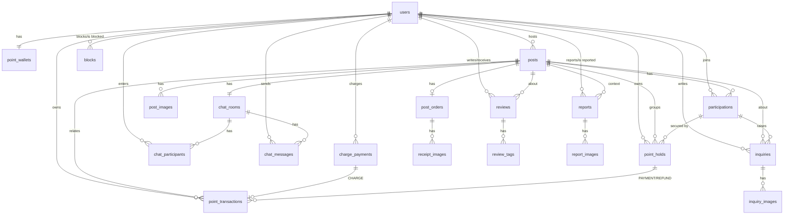

> ERD는 관계만 표시했다. 컬럼은 4.3 참조. 이미지 테이블(`post_images`, `receipt_images`, `inquiry_images`, `report_images`)과 `review_tags`는 모두 `(id, 부모 FK, 값, sort_order)` 구조다.

### 4.3 테이블 정의

표기: **N** = NULL 허용 여부(N이면 NOT NULL, Y면 NULL 허용), ENUM 컬럼의 값은 6장 ENUM 표를 따른다.

#### 4.3.1 users — 사용자

| 컬럼            | 타입             | N   | 기본값   | 제약           | 설명                                                                  |
| :-------------- | :--------------- | :-- | :------- | :------------- | :-------------------------------------------------------------------- |
| id              | BIGINT           | N   | identity | PK             |                                                                       |
| login_id        | VARCHAR(20)      | N   |          | UNIQUE         | 로그인 아이디(이메일과 별개). 형식 검증은 FR-AUTH 참조                |
| password        | VARCHAR(100)     | N   |          |                | BCrypt 해시                                                           |
| email           | VARCHAR(100)     | N   |          | UNIQUE         | 인증된 학교 이메일(`ac.kr`). 소문자로 정규화해 저장                   |
| university_name | VARCHAR(50)      | N   |          |                | 학교명. 이메일 도메인에서 도출 (추론)                                 |
| nickname        | VARCHAR(30)      | N   |          | UNIQUE         | 랜덤 "형용사+음식". 충돌 시 재생성 또는 숫자 접미 (가정·팀 확정 필요) |
| dong_name       | VARCHAR(50)      | N   |          |                | 저장 동네 이름(예: 역삼동). 타인에게는 이것만 노출                    |
| latitude        | DOUBLE PRECISION | N   |          | CHECK -90~90   | 저장 동네 좌표. 반경 검색 기준점                                      |
| longitude       | DOUBLE PRECISION | N   |          | CHECK -180~180 |                                                                       |
| rating_avg      | NUMERIC(3,2)     | N   | 0        | CHECK 0~5      | 받은 후기 평균 별점 캐시                                              |
| review_count    | INTEGER          | N   | 0        | CHECK ≥0       | 받은 후기 수 캐시                                                     |
| trade_count     | INTEGER          | N   | 0        | CHECK ≥0       | `SETTLED`된 공구 참여(호스트 포함) 수 캐시                            |
| role            | VARCHAR(20)      | N   | 'USER'   |                | Security 권한(`UserRole`, 6장). 관리자 화면은 MVP 제외                |
| created_at      | TIMESTAMP(6)     | N   | now()    |                | 가입 일시(API `joinedAt`)                                             |
| updated_at      | TIMESTAMP(6)     | N   | now()    |                |                                                                       |

- 캐시 컬럼(`rating_avg`, `review_count`, `trade_count`)은 후기 저장·정산 트랜잭션 안에서 갱신한다. `mainCategories`는 저장하지 않고 참여 공구의 카테고리 빈도로 조회 시 계산 (추론).
- 위치 변경(`PATCH /api/users/me/location`)은 `dong_name`, `latitude`, `longitude` 세 컬럼을 함께 갱신.

#### 4.3.2 posts — 공구 게시글(상품 정보 포함)

| 컬럼              | 타입             | N   | 기본값       | 제약                                 | 설명                                                                                                    |
| :---------------- | :--------------- | :-- | :----------- | :----------------------------------- | :------------------------------------------------------------------------------------------------------ |
| id                | BIGINT           | N   | identity     | PK                                   |                                                                                                         |
| host_id           | BIGINT           | N   |              | FK users                             | 방장                                                                                                    |
| title             | VARCHAR(100)     | N   |              |                                      | 제목                                                                                                    |
| product_name      | VARCHAR(100)     | N   |              |                                      | 상품명 (검색 대상)                                                                                      |
| product_link      | VARCHAR(500)     | Y   |              |                                      | 상품 링크(회의 ERD의 '내용 안 링크'를 분리)                                                             |
| category          | VARCHAR(20)      | N   |              |                                      | `Category`                                                                                              |
| content           | TEXT             | Y   |              |                                      | 본문                                                                                                    |
| thumbnail_url     | VARCHAR(500)     | N   |              |                                      | 대표 이미지. 이미지 미첨부 시 카테고리별 기본 이미지 URL (추론)                                         |
| base_unit         | VARCHAR(50)      | N   |              |                                      | 기본 단위 설명(예: "2L 생수 4병")                                                                       |
| total_units       | INTEGER          | N   |              | CHECK ≥2                             | 총 단위 수                                                                                              |
| total_price       | INTEGER          | N   |              | CHECK >0                             | 총 가격(모집 금액)                                                                                      |
| unit_price        | INTEGER          | N   |              | CHECK >0                             | 단위당 가격. 서버 계산 `total_price / total_units`. 나누어떨어지지 않으면 등록 거부 (가정·팀 확정 필요) |
| host_units        | INTEGER          | N   |              | CHECK 1 ≤ host_units < total_units   | 방장 본인 구매 단위(방장도 결제·보류)                                                                   |
| filled_units      | INTEGER          | N   |              | CHECK 0 ≤ filled_units ≤ total_units | 현재 참여(결제 완료) 단위 합. 등록 시 `host_units`                                                      |
| participant_count | INTEGER          | N   | 1            | CHECK ≥1                             | 방장 포함 현재 참여 인원 캐시                                                                           |
| deadline_at       | TIMESTAMP(6)     | N   |              | CHECK > created_at                   | 모집 마감 일시                                                                                          |
| trade_place_name  | VARCHAR(100)     | N   |              |                                      | 거래 장소 이름                                                                                          |
| trade_latitude    | DOUBLE PRECISION | N   |              |                                      | 거래 장소 좌표(거리 계산 대상)                                                                          |
| trade_longitude   | DOUBLE PRECISION | N   |              |                                      |                                                                                                         |
| dong_name         | VARCHAR(50)      | N   |              |                                      | 거래 장소의 동 이름(역지오코딩 결과). 목록·상세 노출용                                                  |
| status            | VARCHAR(20)      | N   | 'RECRUITING' | CHECK 7개 값                         | `PostStatus`                                                                                            |
| view_count        | BIGINT           | N   | 0            |                                      | 조회수(인기순 정렬)                                                                                     |
| recruited_at      | TIMESTAMP(6)     | Y   |              |                                      | `RECRUITED` 진입 시각(48h 영수증 기한 기준)                                                             |
| ordered_at        | TIMESTAMP(6)     | Y   |              |                                      | `ORDERED` 진입                                                                                          |
| shipped_at        | TIMESTAMP(6)     | Y   |              |                                      | `SHIPPING` 진입                                                                                         |
| distributed_at    | TIMESTAMP(6)     | Y   |              |                                      | `DISTRIBUTED` 진입(72h 자동 수령 기준)                                                                  |
| settled_at        | TIMESTAMP(6)     | Y   |              |                                      | `SETTLED` 진입                                                                                          |
| cancelled_at      | TIMESTAMP(6)     | Y   |              |                                      | `CANCELLED` 진입                                                                                        |
| cancel_reason     | VARCHAR(30)      | Y   |              |                                      | `PostCancelReason`(호스트 취소·인원 미달·영수증 미등록 등, 6장) (추론)                                  |
| created_at        | TIMESTAMP(6)     | N   | now()        |                                      |                                                                                                         |
| updated_at        | TIMESTAMP(6)     | N   | now()        |                                      |                                                                                                         |

- 상태 7개: `RECRUITING` → `RECRUITED` → `ORDERED` → `SHIPPING` → `DISTRIBUTED` → `SETTLED`, 예외 `CANCELLED`. 전이 규칙은 3장 BR과 5장 상태 머신 참조. 상태 변경 이력 테이블은 두지 않고 타임라인 컬럼 6개로 대신한다(API `statusTimeline`).
- `filled_units`, `participant_count`는 참여·취소 트랜잭션에서 게시글 행 비관적 락(`SELECT … FOR UPDATE`)을 잡은 뒤 갱신한다. `filled_units = total_units`가 되는 순간 `RECRUITED`로 바뀐다.
- 남은 단위(`maxSelectableUnits`) = `total_units - filled_units`. 모집 금액(`recruitedAmount`) = `unit_price × total_units`.
- 정합성: `filled_units` = 해당 게시글 `participations` 중 `payment_status = 'PAID'`인 `units` 합. 배치 점검 대상.

#### 4.3.3 post_images — 게시글 이미지 (및 receipt/inquiry/report_images)

| 컬럼       | 타입         | N   | 기본값   | 제약                        | 설명                          |
| :--------- | :----------- | :-- | :------- | :-------------------------- | :---------------------------- |
| id         | BIGINT       | N   | identity | PK                          |                               |
| post_id    | BIGINT       | N   |          | FK posts ON DELETE CASCADE  |                               |
| image_url  | VARCHAR(500) | N   |          |                             | `POST /api/images`로 받은 URL |
| sort_order | SMALLINT     | N   |          | UNIQUE(post_id, sort_order) | 0이 대표 이미지               |
| created_at | TIMESTAMP(6) | N   | now()    |                             |                               |

- 최대 장수는 FR-IMG 참조. `posts.thumbnail_url`은 `sort_order = 0` 이미지와 동기화.
- **같은 구조의 이미지 테이블**: `receipt_images`(FK `order_id` → post_orders, 1장 이상 필수는 서비스 검증), `inquiry_images`(FK `inquiry_id` → inquiries), `report_images`(FK `report_id` → reports). 모두 `id`, 부모 FK(ON DELETE CASCADE), `image_url`, `sort_order`, UNIQUE(부모 FK, sort_order).

#### 4.3.4 participations — 공구 참여(방장 포함)

| 컬럼           | 타입         | N   | 기본값    | 제약                               | 설명                                                 |
| :------------- | :----------- | :-- | :-------- | :--------------------------------- | :--------------------------------------------------- |
| id             | BIGINT       | N   | identity  | PK                                 | API `participationId`                                |
| post_id        | BIGINT       | N   |           | FK posts, UNIQUE(post_id, user_id) |                                                      |
| user_id        | BIGINT       | N   |           | FK users                           |                                                      |
| role           | VARCHAR(20)  | N   |           |                                    | `ParticipationRole` (`HOST`, `PARTICIPANT`)          |
| units          | INTEGER      | N   |           | CHECK ≥1                           | 구매 단위 수                                         |
| paid_point     | BIGINT       | N   |           | CHECK ≥0                           | 결제 포인트 = `units × unit_price`                   |
| payment_status | VARCHAR(20)  | N   | 'PAID'    |                                    | `PaymentStatus` (`PAID`, `REFUNDED`)                 |
| receipt_status | VARCHAR(20)  | N   | 'WAITING' |                                    | `ReceiptStatus` (`WAITING`, `RECEIVED`, `INQUIRING`) |
| joined_at      | TIMESTAMP(6) | N   | now()     |                                    | 참여(결제) 일시                                      |
| cancelled_at   | TIMESTAMP(6) | Y   |           |                                    | 참여 취소·환불 일시                                  |
| received_at    | TIMESTAMP(6) | Y   |           |                                    | '받았어요' 또는 72h 자동 수령 처리 일시              |
| auto_received  | BOOLEAN      | N   | false     |                                    | 72h 경과로 자동 `RECEIVED` 처리됐는지                |
| updated_at     | TIMESTAMP(6) | N   | now()     |                                    |                                                      |

- 방장 행은 게시글 등록 시 `role = HOST`, `units = host_units`로 함께 생성되고 `receipt_status = 'RECEIVED'`로 시작한다(방장은 수령 확인 대상 아님) (추론).
- 참여 취소 시 행을 지우지 않고 `payment_status = REFUNDED`, `cancelled_at` 기록. 같은 사용자가 다시 참여하면 UNIQUE(post_id, user_id) 때문에 **기존 행을 재활성화**(units·paid_point 갱신, `PAID`, 새 hold 생성)한다 (가정·팀 확정 필요). 이때 이전 hold·거래 내역은 남는다.
- 정산 조건 "전원 RECEIVED"는 `payment_status = 'PAID'`인 행 전체에 대해 판단한다(BR 참조). `INQUIRING`이 하나라도 있으면 정산하지 않는다.

#### 4.3.5 post_orders — 주문 정보 (엔티티 `PostOrder`)

| 컬럼             | 타입         | N   | 기본값   | 제약             | 설명                                                                           |
| :--------------- | :----------- | :-- | :------- | :--------------- | :----------------------------------------------------------------------------- |
| id               | BIGINT       | N   | identity | PK               | API `orderId`                                                                  |
| post_id          | BIGINT       | N   |          | FK posts, UNIQUE | 게시글당 주문 1건                                                              |
| receipt_amount   | INTEGER      | N   |          | CHECK >0         | 영수증 금액                                                                    |
| amount_matched   | BOOLEAN      | N   |          |                  | `receipt_amount = unit_price × total_units` 여부. 표시만, 차액 정산은 MVP 제외 |
| courier          | VARCHAR(30)  | Y   |          |                  | 택배사(배송 시작 시 입력)                                                      |
| tracking_number  | VARCHAR(50)  | Y   |          |                  | 송장번호                                                                       |
| distribute_at    | TIMESTAMP(6) | Y   |          |                  | 나눔 일정                                                                      |
| distribute_place | VARCHAR(100) | Y   |          |                  | 나눔 장소                                                                      |
| registered_at    | TIMESTAMP(6) | N   | now()    |                  | 영수증 등록(주문 완료) 일시                                                    |
| updated_at       | TIMESTAMP(6) | N   | now()    |                  |                                                                                |

- 직접 수령 후 나눔처럼 택배가 없을 수 있어 `courier`, `tracking_number`는 NULL 허용. 단, 두 값은 함께 있거나 함께 없어야 한다(CHECK).

#### 4.3.6 inquiries — 수령 문제 문의

| 컬럼               | 타입         | N   | 기본값   | 제약                                  | 설명                                                                        |
| :----------------- | :----------- | :-- | :------- | :------------------------------------ | :-------------------------------------------------------------------------- |
| id                 | BIGINT       | N   | identity | PK                                    |                                                                             |
| participation_id   | BIGINT       | N   |          | FK participations                     | 문의한 참여 건                                                              |
| post_id            | BIGINT       | N   |          | FK posts                              | 조회 편의 비정규화                                                          |
| writer_id          | BIGINT       | N   |          | FK users                              | 작성 참여자                                                                 |
| type               | VARCHAR(30)  | N   |          |                                       | `InquiryType` (`NOT_RECEIVED`, `SHORT_QUANTITY`, `WRONG_OR_DAMAGED`, `ETC`) |
| received_units     | INTEGER      | Y   |          | CHECK ≥0, `SHORT_QUANTITY`면 NOT NULL | 실제 받은 단위                                                              |
| desired_resolution | VARCHAR(30)  | Y   |          |                                       | `DesiredResolution` (선택)                                                  |
| content            | TEXT         | N   |          |                                       |                                                                             |
| status             | VARCHAR(20)  | N   | 'OPEN'   |                                       | `InquiryStatus`. 해결은 운영 수동 처리                                      |
| resolved_at        | TIMESTAMP(6) | Y   |          |                                       |                                                                             |
| created_at         | TIMESTAMP(6) | N   | now()    |                                       |                                                                             |

- 문의 생성 시 해당 참여의 `receipt_status`를 `INQUIRING`으로 바꾸고 정산을 막는다. `WRONG_OR_DAMAGED`의 이미지 1장 이상 요건은 서비스 검증.

#### 4.3.7 chat_rooms — 채팅방

| 컬럼                 | 타입         | N   | 기본값    | 제약             | 설명                                                                      |
| :------------------- | :----------- | :-- | :-------- | :--------------- | :------------------------------------------------------------------------ |
| id                   | BIGINT       | N   | identity  | PK               | API `chatRoomId`                                                          |
| post_id              | BIGINT       | N   |           | FK posts, UNIQUE | 게시글당 1개, 등록 시 자동 생성                                           |
| name                 | VARCHAR(100) | N   |           |                  | 방 이름(기본: 게시글 제목 기반)                                           |
| status               | VARCHAR(20)  | N   | 'ONGOING' |                  | `ChatRoomStatus` (`ONGOING`, `CLOSED`). `SETTLED`/`CANCELLED` 시 `CLOSED` |
| last_message_id      | BIGINT       | Y   |           |                  | 목록 표시용 비정규화(FK 미설정, 순환 참조 회피)                           |
| last_message_preview | VARCHAR(200) | Y   |           |                  | 마지막 메시지 앞부분                                                      |
| last_message_at      | TIMESTAMP(6) | Y   |           |                  | 목록 정렬 기준                                                            |
| created_at           | TIMESTAMP(6) | N   | now()     |                  |                                                                           |
| closed_at            | TIMESTAMP(6) | Y   |           |                  |                                                                           |

#### 4.3.8 chat_participants — 채팅방 참여

| 컬럼                 | 타입         | N   | 기본값   | 제약                                         | 설명                                                           |
| :------------------- | :----------- | :-- | :------- | :------------------------------------------- | :------------------------------------------------------------- |
| id                   | BIGINT       | N   | identity | PK                                           |                                                                |
| chat_room_id         | BIGINT       | N   |          | FK chat_rooms, UNIQUE(chat_room_id, user_id) |                                                                |
| user_id              | BIGINT       | N   |          | FK users                                     |                                                                |
| joined_at            | TIMESTAMP(6) | N   | now()    |                                              | 입장 일시                                                      |
| left_at              | TIMESTAMP(6) | Y   |          |                                              | 퇴장(참여 취소) 일시. NULL이면 현재 참여 중                    |
| last_read_message_id | BIGINT       | Y   |          |                                              | 마지막으로 읽은 메시지 ID. 안 읽은 수 = 이 ID보다 큰 메시지 수 |
| last_read_at         | TIMESTAMP(6) | Y   |          |                                              | 마지막 읽은 시각(회의 ERD 유지)                                |

- 재참여 시 기존 행의 `left_at`을 NULL로 되돌린다(participations와 같은 재활성화 방식).
- `participantCount`는 `left_at IS NULL`인 행 수.

#### 4.3.9 chat_messages — 채팅 메시지

| 컬럼         | 타입          | N   | 기본값   | 제약                     | 설명                             |
| :----------- | :------------ | :-- | :------- | :----------------------- | :------------------------------- |
| id           | BIGINT        | N   | identity | PK                       | 커서 기준(단조 증가)             |
| chat_room_id | BIGINT        | N   |          | FK chat_rooms            |                                  |
| sender_id    | BIGINT        | Y   |          | FK users                 | `SYSTEM`이면 NULL                |
| type         | VARCHAR(20)   | N   |          | CHECK 타입별 sender 규칙 | `MessageType` (`TEXT`, `SYSTEM`) |
| content      | VARCHAR(1000) | N   |          |                          | 길이 상한 (가정·팀 확정 필요)    |
| sent_at      | TIMESTAMP(6)  | N   | now()    |                          |                                  |

- 이미지 메시지는 MVP 제외. 입장·퇴장·상태 변경 알림은 `SYSTEM` 메시지로 저장.

#### 4.3.10 point_wallets — 포인트 지갑

| 컬럼              | 타입         | N   | 기본값   | 제약             | 설명                           |
| :---------------- | :----------- | :-- | :------- | :--------------- | :----------------------------- |
| id                | BIGINT       | N   | identity | PK               |                                |
| user_id           | BIGINT       | N   |          | FK users, UNIQUE | 사용자당 1개, 회원가입 시 생성 |
| available_balance | BIGINT       | N   | 0        | CHECK ≥0         | 사용 가능 잔액                 |
| held_amount       | BIGINT       | N   | 0        | CHECK ≥0         | 보류 중 금액 합                |
| version           | BIGINT       | N   | 0        |                  | JPA `@Version` 낙관적 락       |
| created_at        | TIMESTAMP(6) | N   | now()    |                  |                                |
| updated_at        | TIMESTAMP(6) | N   | now()    |                  | API `updatedAt`                |

#### 4.3.11 point_holds — 포인트 보류

| 컬럼             | 타입         | N   | 기본값   | 제약                       | 설명                                          |
| :--------------- | :----------- | :-- | :------- | :------------------------- | :-------------------------------------------- |
| id               | BIGINT       | N   | identity | PK                         |                                               |
| participation_id | BIGINT       | N   |          | FK participations          | 어느 참여의 결제분인지                        |
| user_id          | BIGINT       | N   |          | FK users                   | 보류된 지갑 주인                              |
| post_id          | BIGINT       | N   |          | FK posts                   | 정산 단위(게시글별 일괄 확정)                 |
| amount           | BIGINT       | N   |          | CHECK >0                   | 보류 금액 = participations.paid_point         |
| status           | VARCHAR(20)  | N   | 'HELD'   |                            | `HoldStatus` (`HELD`, `CAPTURED`, `RELEASED`) |
| held_at          | TIMESTAMP(6) | N   | now()    |                            | 보류 일시                                     |
| resolved_at      | TIMESTAMP(6) | Y   |          | CHECK status='HELD' ↔ NULL | 확정(CAPTURED) 또는 해제(RELEASED) 일시       |

- 한 참여에 `HELD` 상태 hold는 최대 1개(부분 UNIQUE). 재참여 시 새 hold가 생기므로 참여:hold = 1:N.

#### 4.3.12 point_transactions — 포인트 거래 내역(원장)

| 컬럼              | 타입         | N   | 기본값   | 제약               | 설명                                                                     |
| :---------------- | :----------- | :-- | :------- | :----------------- | :----------------------------------------------------------------------- |
| id                | BIGINT       | N   | identity | PK                 | API `transactionId`                                                      |
| user_id           | BIGINT       | N   |          | FK users           | 지갑 주인                                                                |
| type              | VARCHAR(20)  | N   |          | CHECK 유형별 부호  | `PointTxType` (`CHARGE`, `PAYMENT`, `REFUND`, `SETTLEMENT`, `INCENTIVE`) |
| amount            | BIGINT       | N   |          | CHECK ≠0           | 가용 잔액 변화량(부호 포함). 결제 -4840, 환불 +4840                      |
| balance_after     | BIGINT       | N   |          | CHECK ≥0           | 거래 직후 `available_balance`                                            |
| post_id           | BIGINT       | Y   |          | FK posts           | 관련 공구(CHARGE 외 필수)                                                |
| charge_payment_id | BIGINT       | Y   |          | FK charge_payments | `CHARGE`일 때만                                                          |
| hold_id           | BIGINT       | Y   |          | FK point_holds     | `PAYMENT`, `REFUND`일 때만                                               |
| description       | VARCHAR(200) | N   |          |                    | 표시 문구(예: "코스트코 생수… · 1단위")                                  |
| created_at        | TIMESTAMP(6) | N   | now()    |                    |                                                                          |

- 수정·삭제 없는 append-only 원장. 엔티티에 setter를 두지 않는다.

#### 4.3.13 charge_payments — 충전 결제 내역

| 컬럼             | 타입         | N   | 기본값   | 제약                                                 | 설명                                                 |
| :--------------- | :----------- | :-- | :------- | :--------------------------------------------------- | :--------------------------------------------------- |
| id               | BIGINT       | N   | identity | PK                                                   |                                                      |
| user_id          | BIGINT       | N   |          | FK users                                             |                                                      |
| order_id         | VARCHAR(64)  | N   |          | UNIQUE                                               | 서버 발급 주문번호(예: `CHG-20261027-0001`). 멱등 키 |
| order_name       | VARCHAR(100) | N   |          |                                                      | PG 결제창 표시명                                     |
| payment_key      | VARCHAR(200) | Y   |          | UNIQUE                                               | PG 결제 키(Toss `tgen_…`). confirm 전 NULL           |
| pg_provider      | VARCHAR(20)  | N   | 'TOSS'   |                                                      | `PgProvider` (dev는 `MOCK`)                          |
| method           | VARCHAR(20)  | N   |          |                                                      | `ChargeMethod` (`KAKAOPAY`, `TOSSPAY`, `CARD`)       |
| amount           | INTEGER      | N   |          | CHECK 1,000~500,000 & 1,000 단위 (가정·팀 확정 필요) | 요청 금액                                            |
| cancelled_amount | INTEGER      | N   | 0        | CHECK 0 ≤ x ≤ amount                                 | 취소 금액(MVP에서는 PG 승인 실패 보상 취소용)        |
| status           | VARCHAR(20)  | N   | 'READY'  |                                                      | `ChargeStatus` (6장)                                 |
| failure_reason   | VARCHAR(200) | Y   |          |                                                      | PG 실패 메시지                                       |
| approved_at      | TIMESTAMP(6) | Y   |          |                                                      | PG 승인 일시                                         |
| created_at       | TIMESTAMP(6) | N   | now()    |                                                      |                                                      |
| updated_at       | TIMESTAMP(6) | N   | now()    |                                                      |                                                      |

- confirm 시 `order_id`로 행을 `SELECT … FOR UPDATE`해 중복 confirm을 직렬화하고, 이미 승인된 건이면 기존 결과를 반환한다(멱등). 요청 `amount`와 저장 `amount`가 다르면 400.

#### 4.3.14 reviews — 후기

| 컬럼       | 타입         | N   | 기본값   | 제약                                            | 설명                              |
| :--------- | :----------- | :-- | :------- | :---------------------------------------------- | :-------------------------------- |
| id         | BIGINT       | N   | identity | PK                                              |                                   |
| writer_id  | BIGINT       | N   |          | FK users, UNIQUE(writer_id, post_id, target_id) | 작성자                            |
| post_id    | BIGINT       | N   |          | FK posts                                        | `SETTLED` 게시글만                |
| target_id  | BIGINT       | N   |          | FK users, CHECK ≠ writer_id                     | 평가 대상                         |
| rating     | SMALLINT     | N   |          | CHECK 1~5                                       | 별점                              |
| content    | VARCHAR(500) | Y   |          |                                                 | 내용                              |
| created_at | TIMESTAMP(6) | N   | now()    |                                                 | 수정 불가이므로 `updated_at` 없음 |

- 작성 기한(SETTLED 후 7일)은 서비스 검증 (가정·팀 확정 필요). 저장 시 대상자의 `users.rating_avg`, `review_count` 갱신.

#### 4.3.15 review_tags — 후기 태그

| 컬럼      | 타입        | N   | 기본값   | 제약                                                 | 설명                                                                  |
| :-------- | :---------- | :-- | :------- | :--------------------------------------------------- | :-------------------------------------------------------------------- |
| id        | BIGINT      | N   | identity | PK                                                   |                                                                       |
| review_id | BIGINT      | N   |          | FK reviews ON DELETE CASCADE, UNIQUE(review_id, tag) |                                                                       |
| tag       | VARCHAR(30) | N   |          |                                                      | `ReviewTag` (`PUNCTUAL`, `CLEAN_SPLIT`, `FAST_REPLY`, `FAST_PAYMENT`) |

#### 4.3.16 reports — 사용자 신고

| 컬럼           | 타입          | N   | 기본값    | 제약                          | 설명                                                                    |
| :------------- | :------------ | :-- | :-------- | :---------------------------- | :---------------------------------------------------------------------- |
| id             | BIGINT        | N   | identity  | PK                            |                                                                         |
| reporter_id    | BIGINT        | N   |           | FK users                      | 신고자                                                                  |
| target_user_id | BIGINT        | N   |           | FK users, CHECK ≠ reporter_id | 대상자(사용자만)                                                        |
| post_id        | BIGINT        | Y   |           | FK posts                      | 관련 공구(맥락)                                                         |
| reason         | VARCHAR(30)   | N   |           |                               | `ReportReason` (`POST_HARMFUL`, `CHAT_ABUSE`, `TRADE_VIOLATION`, `ETC`) |
| detail         | JSONB         | Y   |           |                               | 사유별 부가 정보: `messageIds`, `violationStage` (API `detail` 그대로)  |
| content        | VARCHAR(1000) | N   |           |                               | 신고 내용                                                               |
| status         | VARCHAR(20)   | N   | 'PENDING' |                               | `ReportStatus`. MVP는 `PENDING` 저장만                                  |
| processed_at   | TIMESTAMP(6)  | Y   |           |                               | 처리 일자(운영 수동)                                                    |
| created_at     | TIMESTAMP(6)  | N   | now()     |                               |                                                                         |

- `detail`은 사유마다 구조가 달라 JSONB로 둔다 (추론). 메시지 ID는 FK가 아니라 증빙 참조값.

#### 4.3.17 blocks — 차단

| 컬럼       | 타입         | N   | 기본값   | 제약                                     | 설명          |
| :--------- | :----------- | :-- | :------- | :--------------------------------------- | :------------ |
| id         | BIGINT       | N   | identity | PK                                       |               |
| blocker_id | BIGINT       | N   |          | FK users, UNIQUE(blocker_id, blocked_id) | 차단한 사람   |
| blocked_id | BIGINT       | N   |          | FK users, CHECK ≠ blocker_id             | 차단당한 사람 |
| created_at | TIMESTAMP(6) | N   | now()    |                                          |               |

- 차단 해제는 행 물리 삭제. 차단 효과는 양방향(서로의 게시글 숨김 + 서로의 공구 참여 불가)이므로 조회 시 `blocker_id = me OR blocked_id = me` 양쪽을 확인한다.

### 4.4 제약 조건과 인덱스

#### 4.4.1 UNIQUE·CHECK 요약

| 테이블             | 제약                                                                                      | 목적                                    |
| :----------------- | :---------------------------------------------------------------------------------------- | :-------------------------------------- |
| users              | UNIQUE(login_id), UNIQUE(email), UNIQUE(nickname)                                         | 아이디·이메일 중복 방지(`USER409`)      |
| posts              | CHECK host_units, filled_units 범위, status 7개 값                                        | 초과 참여·잘못된 상태 차단(최후 방어선) |
| participations     | UNIQUE(post_id, user_id)                                                                  | 같은 공구 중복 참여 방지                |
| post_orders        | UNIQUE(post_id)                                                                           | 게시글당 주문 1건                       |
| chat_rooms         | UNIQUE(post_id)                                                                           | 게시글당 채팅방 1개                     |
| chat_participants  | UNIQUE(chat_room_id, user_id)                                                             |                                         |
| chat_messages      | CHECK (type='SYSTEM' AND sender_id IS NULL) OR (type<>'SYSTEM' AND sender_id IS NOT NULL) |                                         |
| point_wallets      | UNIQUE(user_id), CHECK 잔액 ≥0                                                            | 음수 잔액 방지                          |
| point_holds        | 부분 UNIQUE(participation_id) WHERE status='HELD'                                         | 참여당 활성 보류 1개                    |
| point_transactions | 부분 UNIQUE(charge_payment_id) WHERE type='CHARGE'                                        | 충전 이중 적립 방지                     |
| point_transactions | 부분 UNIQUE(hold_id, type) WHERE type IN ('PAYMENT','REFUND')                             | 결제·환불 이중 처리 방지                |
| point_transactions | 부분 UNIQUE(post_id, type) WHERE type IN ('SETTLEMENT','INCENTIVE')                       | 정산·인센티브 이중 지급 방지            |
| charge_payments    | UNIQUE(order_id), UNIQUE(payment_key)                                                     | confirm 멱등                            |
| reviews            | UNIQUE(writer_id, post_id, target_id), CHECK rating 1~5                                   | 대상별 1회 작성                         |
| review_tags        | UNIQUE(review_id, tag)                                                                    |                                         |
| blocks             | UNIQUE(blocker_id, blocked_id)                                                            |                                         |

#### 4.4.2 인덱스와 지원 쿼리

| 인덱스                                        | 컬럼                                                    | 지원 쿼리                                                                                                                      |
| :-------------------------------------------- | :------------------------------------------------------ | :----------------------------------------------------------------------------------------------------------------------------- |
| idx_posts_status_created                      | posts(status, created_at DESC)                          | 목록 `recruitingOnly=true&sort=LATEST`                                                                                         |
| idx_posts_status_deadline                     | posts(status, deadline_at)                              | 목록 `sort=DEADLINE`, 스케줄러 "RECRUITING이고 deadline_at < now" 탐색                                                         |
| idx_posts_status_view                         | posts(status, view_count DESC)                          | 목록 `sort=POPULAR`                                                                                                            |
| idx_posts_status_price                        | posts(status, unit_price)                               | 목록 `sort=PRICE`                                                                                                              |
| idx_posts_category_status                     | posts(category, status, created_at DESC)                | 카테고리 필터 + 최신순                                                                                                         |
| idx_posts_trade_lat_lng                       | posts(trade_latitude, trade_longitude)                  | 반경 검색 1차 bounding box(위도±Δ, 경도±Δ) 후 Haversine 정밀 필터                                                              |
| idx_posts_host                                | posts(host_id, created_at DESC)                         | 내 공구함(HOST), 프로필 최근 거래                                                                                              |
| idx_posts_recruited_at                        | posts(recruited_at) WHERE status='RECRUITED'            | 스케줄러: 48h 영수증 미등록 자동 취소                                                                                          |
| idx_posts_distributed_at                      | posts(distributed_at) WHERE status='DISTRIBUTED'        | 스케줄러: 72h 자동 수령 처리                                                                                                   |
| idx_posts_title_trgm / idx_posts_product_trgm | GIN(title gin_trgm_ops), GIN(product_name gin_trgm_ops) | `keyword` 부분일치(`ILIKE '%…%'`). `pg_trgm` 확장 필요 (가정·팀 확정 필요, 초기 데이터가 적으면 생략 가능)                     |
| uk_participations_post_user                   | participations(post_id, user_id)                        | 게시글별 참여자 목록, 내 참여 여부(`me`)                                                                                       |
| idx_participations_user                       | participations(user_id, joined_at DESC)                 | 내 공구함(JOINED), 프로필 tradeCount 재계산                                                                                    |
| idx_post_images_post                          | (UNIQUE post_id, sort_order)                            | 상세 이미지                                                                                                                    |
| idx_inquiries_post                            | inquiries(post_id, created_at DESC)                     | 문의 목록                                                                                                                      |
| idx_inquiries_participation                   | inquiries(participation_id)                             | 참여별 문의                                                                                                                    |
| idx_chat_messages_room_id                     | chat_messages(chat_room_id, id DESC)                    | 커서 페이지네이션 `WHERE chat_room_id=? AND id < :cursor ORDER BY id DESC LIMIT :size`, 안 읽은 수 `id > last_read_message_id` |
| idx_chat_participants_user                    | chat_participants(user_id, left_at)                     | 내 채팅방 목록                                                                                                                 |
| idx_chat_rooms_status_last                    | chat_rooms(status, last_message_at DESC)                | 목록 탭 + 최근 메시지 순 (참여 테이블과 조인)                                                                                  |
| idx_point_tx_user_created                     | point_transactions(user_id, created_at DESC, id DESC)   | 거래 내역 `type=ALL`                                                                                                           |
| idx_point_tx_user_type                        | point_transactions(user_id, type, created_at DESC)      | 거래 내역 유형 필터                                                                                                            |
| idx_point_tx_post                             | point_transactions(post_id)                             | 게시글 단위 정산·환불 추적                                                                                                     |
| idx_point_holds_post_status                   | point_holds(post_id, status)                            | `settle(postId)`: 게시글 HELD 전부 조회, `heldPoint` 합계                                                                      |
| idx_point_holds_user_status                   | point_holds(user_id, status)                            | 지갑 `held_amount` 정합성 점검                                                                                                 |
| idx_charge_user_created                       | charge_payments(user_id, created_at DESC)               | 충전 이력                                                                                                                      |
| idx_charge_status_created                     | charge_payments(status, created_at)                     | 오래된 READY 정리 배치                                                                                                         |
| idx_reviews_target                            | reviews(target_id, created_at DESC)                     | 받은 후기 목록, 프로필 최근 후기                                                                                               |
| idx_reviews_post                              | reviews(post_id, writer_id)                             | `reviews/targets` 작성 여부, `reviewProgress`                                                                                  |
| idx_reports_target                            | reports(target_user_id, created_at DESC)                | 운영 조회(향후)                                                                                                                |
| idx_reports_status                            | reports(status, created_at)                             | 미처리 신고 조회(향후)                                                                                                         |
| idx_blocks_blocked                            | blocks(blocked_id)                                      | 양방향 차단 확인(역방향)                                                                                                       |

- 목록 쿼리는 **반경 + 상태 + 정렬 + 차단 제외**가 결합되므로, 실행 계획은 bounding box 인덱스 또는 상태·정렬 인덱스 중 선택도가 높은 쪽을 탄다. 데이터가 커지면 `(status, trade_latitude)` 복합이나 PostGIS 도입을 재검토 (추론).
- 반경 검색은 bounding box(3km 기준 Δ위도 ≈ 0.027°, Δ경도 ≈ 0.034° @37.5°N)로 1차 필터 → Haversine `distance_km <= :radius` 정밀 필터 → 차단 관계 `NOT EXISTS` 제외 → 정렬·페이징 순서로 구성한다.

### 4.5 ENUM 컬럼 매핑

모든 ENUM은 `VARCHAR` + `@Enumerated(EnumType.STRING)`. 값 목록과 의미는 6장 ENUM 표가 유일한 기준이다(→ [6장 API 명세](#6-api-명세) 참조).

| 테이블.컬럼                   | ENUM 이름           | 길이 | DB CHECK                                                                                                   |
| :---------------------------- | :------------------ | :--- | :--------------------------------------------------------------------------------------------------------- |
| posts.status                  | `PostStatus`        | 20   | 적용(7개 값 고정: `RECRUITING`, `RECRUITED`, `ORDERED`, `SHIPPING`, `DISTRIBUTED`, `SETTLED`, `CANCELLED`) |
| posts.category                | `Category`          | 20   | 미적용(앱 검증)                                                                                            |
| posts.cancel_reason           | `PostCancelReason`  | 30   | 미적용                                                                                                     |
| users.role                    | `UserRole`          | 20   | 미적용                                                                                                     |
| participations.role           | `ParticipationRole` | 20   | 미적용                                                                                                     |
| participations.payment_status | `PaymentStatus`     | 20   | 미적용                                                                                                     |
| participations.receipt_status | `ReceiptStatus`     | 20   | 미적용                                                                                                     |
| inquiries.type                | `InquiryType`       | 30   | 미적용                                                                                                     |
| inquiries.desired_resolution  | `DesiredResolution` | 30   | 미적용                                                                                                     |
| inquiries.status              | `InquiryStatus`     | 20   | 미적용                                                                                                     |
| chat_rooms.status             | `ChatRoomStatus`    | 20   | 미적용                                                                                                     |
| chat_messages.type            | `MessageType`       | 20   | sender 규칙 CHECK만                                                                                        |
| point_holds.status            | `HoldStatus`        | 20   | 적용(`HELD`, `CAPTURED`, `RELEASED`)                                                                       |
| point_transactions.type       | `PointTxType`       | 20   | 적용(부호 규칙과 함께)                                                                                     |
| charge_payments.pg_provider   | `PgProvider`        | 20   | 미적용                                                                                                     |
| charge_payments.method        | `ChargeMethod`      | 20   | 미적용                                                                                                     |
| charge_payments.status        | `ChargeStatus`      | 20   | 미적용                                                                                                     |
| review_tags.tag               | `ReviewTag`         | 30   | 미적용                                                                                                     |
| reports.reason                | `ReportReason`      | 30   | 미적용                                                                                                     |
| reports.status                | `ReportStatus`      | 20   | 미적용                                                                                                     |

- CHECK는 돈·상태 무결성에 직결되는 3개(`PostStatus`, `HoldStatus`, `PointTxType`)에만 건다. 나머지는 값 추가가 잦을 수 있어 앱 계층에서만 검증한다. 6장 값이 바뀌면 이 3개 CHECK도 함께 마이그레이션한다.
- `PostCancelReason`, `UserRole`, `InquiryStatus`, `ChatRoomStatus`, `PgProvider`, `ChargeStatus`는 원본 API에 값이 없어 이 설계에서 새로 필요해진 ENUM이다. 값은 6장에서 확정한다 (추론).

### 4.6 회의 ERD → 최종 설계 매핑

| 회의 ERD                    | 최종 테이블                                           | 주요 변경                                                                                                  | 사유                                                           |
| :-------------------------- | :---------------------------------------------------- | :--------------------------------------------------------------------------------------------------------- | :------------------------------------------------------------- |
| 게시글                      | `posts`                                               | 상태 4개 → 7개, 타임라인 컬럼 6개 추가                                                                     | Figma 7단계 스테퍼와 API `statusTimeline`                      |
| 게시글                      | `posts`                                               | `deadline_at`, `total_price`, `host_units`, `filled_units`, `participant_count` 추가                       | 마감 처리·단가 계산·방장 결제·락 기반 잔여 계산                |
| 게시글(내용에 링크 포함)    | `posts.product_link`                                  | 링크를 별도 컬럼으로 분리                                                                                  | API 요청·응답 필드 분리                                        |
| 게시글(주소)                | `posts.trade_place_name/latitude/longitude/dong_name` | 자유 주소 → 거래 장소 + 좌표 + 동                                                                          | 반경 검색·동 단위 노출                                         |
| 게시글(기본 이미지)         | `posts.thumbnail_url` + `post_images`                 | 이미지 여러 장을 별도 테이블로                                                                             | API `imageUrls[]`                                              |
| 상품(개요의 13개 테이블 중) | (없음) → `posts` 컬럼                                 | 상품 테이블 제거                                                                                           | 공구 1건 = 상품 1개, 조인 불필요                               |
| 주문정보                    | `post_orders`                                         | 자체 `id` PK + `post_id` FK(UNIQUE), 택배사·송장 NULL 허용, `amount_matched` 추가                          | PK가 택배사·송장이던 문제 해결, 영수증 등록 시점엔 송장이 없음 |
| 영수증 사진                 | `receipt_images`                                      | `sort_order` 추가                                                                                          | 여러 장 순서 보장                                              |
| 사용자                      | `users`                                               | `login_id` 추가, 주소 → `dong_name`+좌표, `rating_avg`·`review_count`·`trade_count` 캐시, `created_at`     | 로그인 ID 분리 결정, 프로필 API                                |
| 게시글 참여(복합 PK)        | `participations`                                      | 단독 `id` PK + UNIQUE(post_id, user_id), `joined_at`·`paid_point`·`cancelled_at` 추가, 매칭 유형 컬럼 제거 | 포인트 보류·문의가 참여를 FK로 참조, 시스템 매칭은 MVP 제외    |
| 신고                        | `reports` + `report_images`                           | 사유 ENUM, 관련 게시글, `detail`(메시지·위반 단계), 증빙 이미지                                            | API `POST /api/reports`                                        |
| 채팅방                      | `chat_rooms`                                          | `post_id` UNIQUE, 마지막 메시지 비정규화, `closed_at`                                                      | 목록 정렬·미리보기                                             |
| 채팅 참여(복합 PK)          | `chat_participants`                                   | 단독 PK + UNIQUE, `left_at`, `last_read_message_id`                                                        | 퇴장·재입장, 안 읽은 수 계산                                   |
| 메시지                      | `chat_messages`                                       | `type`(TEXT/SYSTEM), `sender_id` NULL 허용                                                                 | 시스템 메시지                                                  |
| 포인트 지갑                 | `point_wallets`                                       | 구조 유지(가용·보류·version)                                                                               | —                                                              |
| 카드 결제 내역              | `charge_payments`                                     | `order_name`, `failure_reason` 추가, 상태 ENUM화                                                           | Toss prepare/confirm 흐름                                      |
| 포인트 거래 내역            | `point_transactions`                                  | `post_id` 추가, 결제·보류 ID NULL 허용, `SETTLEMENT`·`REFUND`·`INCENTIVE` 유형                             | 공구 단위 환불·정산 추적                                       |
| 포인트 보류                 | `point_holds`                                         | 구조 유지, 상태 `HELD/CAPTURED/RELEASED`                                                                   | —                                                              |
| 후기                        | `reviews` + `review_tags`                             | 태그 분리, UNIQUE(writer, post, target)                                                                    | 신뢰도 = 별점 + 태그                                           |
| (없음)                      | `blocks`                                              | 신규                                                                                                       | 차단 기능                                                      |
| (없음)                      | `inquiries` + `inquiry_images`                        | 신규                                                                                                       | 03-F 수령 문제 문의                                            |

### 4.7 포인트 무결성 규칙 (wallet ↔ hold ↔ transaction)

포인트 처리 흐름 자체는 3장 BR과 5장 참조. 여기서는 세 테이블이 항상 지켜야 할 불변식과 연산별 행 변화만 정의한다.

#### 4.7.1 불변식

| ID    | 불변식                                                                                                               | 점검 쿼리 개요                         |
| :---- | :------------------------------------------------------------------------------------------------------------------- | :------------------------------------- |
| INV-1 | `wallet.available_balance` = 해당 사용자 `point_transactions.amount` 합                                              | `SUM(amount) GROUP BY user_id` vs 지갑 |
| INV-2 | `wallet.held_amount` = 해당 사용자 `point_holds` 중 `status='HELD'`의 `amount` 합                                    |                                        |
| INV-3 | 가장 최근 거래의 `balance_after` = 현재 `available_balance`                                                          | `ORDER BY id DESC LIMIT 1`             |
| INV-4 | `available_balance ≥ 0`, `held_amount ≥ 0`                                                                           | DB CHECK                               |
| INV-5 | `PAID` 참여마다 `HELD`(정산 전) 또는 `CAPTURED`(정산 후) hold가 정확히 1개, `REFUNDED` 참여의 hold는 모두 `RELEASED` |                                        |
| INV-6 | 게시글 `SETTLED` ⇒ 그 게시글 hold에 `HELD` 없음, `SETTLEMENT` 거래 금액 = `CAPTURED` hold 합                         |                                        |
| INV-7 | 게시글 `CANCELLED` ⇒ 그 게시글 hold 전부 `RELEASED`                                                                  |                                        |
| INV-8 | 시스템 전체: Σ(available + held) = Σ CHARGE + Σ INCENTIVE                                                            | 인센티브만 플랫폼 발행 포인트          |

- INV-1~3은 같은 트랜잭션 안에서 지갑 갱신과 거래 INSERT를 함께 해 보장한다. 정기 배치(일 1회, 가정)로 INV-1~8을 점검하고 불일치는 로그·알림만 남긴다(자동 보정 없음).

#### 4.7.2 연산별 행 변화

| 연산 (PointService)                            | point_wallets                              | point_holds                             | point_transactions                                                                                            |
| :--------------------------------------------- | :----------------------------------------- | :-------------------------------------- | :------------------------------------------------------------------------------------------------------------ |
| 충전 confirm                                   | 사용자 available +X                        | —                                       | `CHARGE` +X, `charge_payment_id` 설정                                                                         |
| `pay(userId, postId, participationId, amount)` | available −X, held +X                      | INSERT `HELD` amount X                  | `PAYMENT` −X, `hold_id`, `post_id` 설정                                                                       |
| `refund(participationId)`                      | available +X, held −X                      | 해당 `HELD` → `RELEASED`, `resolved_at` | `REFUND` +X, `hold_id`, `post_id`                                                                             |
| `settle(postId)`                               | 각 보류 주인 held −Xi, 방장 available +ΣXi | 게시글 `HELD` 전부 → `CAPTURED`         | 방장에게 `SETTLEMENT` +ΣXi 한 건(`hold_id` NULL, `post_id` 설정). 참여자는 가용 잔액 변화가 없어 거래 행 없음 |
| `giveIncentive(postId)`                        | 방장 available +I                          | —                                       | `INCENTIVE` +I (I = 모집 금액 1%, 가정·팀 확정 필요)                                                          |

- 거래 유형별 부호 CHECK: `PAYMENT`는 음수, 나머지(`CHARGE`, `REFUND`, `SETTLEMENT`, `INCENTIVE`)는 양수.
- `point_transactions`는 **가용 잔액 변화의 원장**이다. 보류 금액의 생성·확정·해제 이력은 `point_holds`의 `held_at`/`resolved_at`/`status`가 담당한다.
- 방장 본인 hold도 `settle` 시 함께 `CAPTURED`되어 방장 SETTLEMENT 합계에 포함된다(방장은 자기 결제분을 돌려받는 구조).

#### 4.7.3 동시성·잠금 순서

- 참여: ① `posts` 행 `FOR UPDATE` → ② 참여 검증·INSERT → ③ `pay()`에서 지갑 `@Version` 갱신(충돌 시 재시도, 최대 3회 가정) → ④ `posts.filled_units` 갱신. 한 트랜잭션.
- 정산·취소처럼 여러 지갑을 건드리는 연산은 데드락 방지를 위해 **user_id 오름차순**으로 지갑을 갱신한다 (추론).
- 스케줄러와 사용자 요청이 같은 게시글을 동시에 바꾸지 않도록 스케줄러도 `posts` 행 락을 먼저 잡고 상태를 재확인한다.

### 4.8 JPA 매핑 노트

| 항목                       | 방침                                                                                                                                                                                                                                        |
| :------------------------- | :------------------------------------------------------------------------------------------------------------------------------------------------------------------------------------------------------------------------------------------ |
| 엔티티 이름                | `User` → `@Table(name = "users")`, 주문은 `PostOrder` → `@Table(name = "post_orders")` (`Order`는 SQL 예약어·`ORDER BY`와 혼동)                                                                                                             |
| ID                         | `@GeneratedValue(strategy = GenerationType.IDENTITY)`                                                                                                                                                                                       |
| ENUM                       | `@Enumerated(EnumType.STRING)` 필수. `ORDINAL` 금지(순서 변경 시 데이터 오염)                                                                                                                                                               |
| 연관관계                   | 모든 `@ManyToOne(fetch = LAZY)`. 양방향은 `Post ↔ PostImage`(`cascade = ALL, orphanRemoval = true`), `PostOrder ↔ ReceiptImage`, `Inquiry ↔ InquiryImage`, `Report ↔ ReportImage`, `Review ↔ ReviewTag`처럼 생명주기가 같은 이미지·태그에만 |
| 도메인 경계                | 포인트·채팅 엔티티는 `Post`/`Participation`을 객체 참조하지 않고 `Long postId`, `Long participationId` 값으로 들고 간다(FK는 DB에 유지). 도메인 간 결합·N+1 감소 (추론)                                                                     |
| 낙관적 락                  | `PointWallet.version`에 `@Version`. `ObjectOptimisticLockingFailureException` 시 재시도                                                                                                                                                     |
| 비관적 락                  | `PostRepository`에 `@Lock(PESSIMISTIC_WRITE) findByIdForUpdate(Long id)`, 락 타임아웃 힌트 `jakarta.persistence.lock.timeout` 3000ms (가정)                                                                                                 |
| `Post`에는 `@Version` 없음 | 참여 경쟁은 비관적 락으로 직렬화하므로 중복 버전 관리 불필요                                                                                                                                                                                |
| soft delete                | **사용하지 않음**. 게시글 취소 = `CANCELLED` 상태, 참여 취소 = `REFUNDED` 상태, 채팅 퇴장 = `left_at`. 차단 해제만 물리 삭제. 회원 탈퇴는 MVP 제외                                                                                          |
| 감사 컬럼                  | `@MappedSuperclass BaseTimeEntity`(`created_at`, `updated_at`) + `@EnableJpaAuditing`. append-only 테이블(`point_transactions`, `chat_messages`, `reviews`)은 `created_at`만 가진 별도 상위 클래스                                          |
| JSONB                      | `Report.detail`은 `@JdbcTypeCode(SqlTypes.JSON)` + 값 객체(`ReportDetail`)                                                                                                                                                                  |
| 원장 불변성                | `PointTransaction`, `ChatMessage`는 정적 팩토리 생성만, setter 없음, `@Immutable` 고려                                                                                                                                                      |
| 스키마 관리                | 운영·공유 DB는 `spring.jpa.hibernate.ddl-auto=validate`, 스키마는 아래 DDL을 마이그레이션 도구(Flyway 등)로 관리 (가정·팀 확정 필요). 로컬만 `update` 허용                                                                                  |
| 상태 전이                  | `Post`에 `markRecruited()`, `markOrdered()` 등 도메인 메서드를 두고 그 안에서 상태 검증 + 타임라인 컬럼 기록 (→ 3장 BR 참조)                                                                                                                |

### 4.9 Redis 키 설계

공통: 구분자 `:`, 접두사 `sikgu:`(표에서는 생략), 값은 문자열(`StringRedisTemplate`).

| 용도                     | 키 패턴                             | 값                                     | TTL                   | 비고                                                                                                                                           |
| :----------------------- | :---------------------------------- | :------------------------------------- | :-------------------- | :--------------------------------------------------------------------------------------------------------------------------------------------- |
| 이메일 인증코드          | `auth:email:code:{email}`           | 6자리 숫자 코드                        | 5분                   | 재발송 시 덮어쓰기. 검증 성공 시 삭제                                                                                                          |
| 인증 시도 횟수           | `auth:email:attempt:{email}`        | 실패 횟수(INCR)                        | 5분                   | 5회 초과 시 코드 무효화 (가정·팀 확정 필요)                                                                                                    |
| 재발송 쿨다운            | `auth:email:cooldown:{email}`       | `1`                                    | 60초                  | `SET NX`. 존재하면 발송 거부 (가정)                                                                                                            |
| verificationToken        | `auth:verify:{tokenId}`             | 인증된 이메일                          | 30분                  | 토큰은 서명된 JWT(claim: email, jti=tokenId). signup 성공 시 키 삭제 → 1회용                                                                   |
| refresh 토큰             | `auth:refresh:{userId}`             | refresh 토큰 문자열(또는 SHA-256 해시) | 14일                  | 사용자당 1개(단일 세션). reissue 시 값 비교 후 교체(rotation). 다중 기기 허용 시 `auth:refresh:{userId}:{deviceId}`로 확장 (가정·팀 확정 필요) |
| access 블랙리스트        | `auth:blacklist:{accessJti}`        | `logout`                               | access 남은 만료 시간 | 로그아웃 시 등록, JWT 필터에서 존재 확인                                                                                                       |
| 조회수 중복 방지(선택)   | `post:view:{postId}:{userId}`       | `1`                                    | 24시간                | `SET NX` 성공 시에만 `view_count + 1`                                                                                                          |
| 조회수 버퍼(선택)        | `post:viewcount:{postId}`           | 누적 증가분(INCR)                      | 없음                  | 스케줄러가 주기적(1분 가정)으로 DB에 반영 후 삭제. MVP는 DB 직접 증가로 시작 가능                                                              |
| rate limit — 이메일 발송 | `rl:email-send:{ip}:{yyyyMMddHH}`   | 요청 수(INCR)                          | 1시간                 | 시간당 10회 (가정)                                                                                                                             |
| rate limit — 로그인      | `rl:login:{loginId}:{yyyyMMddHHmm}` | 실패 수                                | 10분                  | 연속 실패 5회 시 10분 잠금 (가정)                                                                                                              |
| rate limit — 충전 준비   | `rl:charge:{userId}:{yyyyMMddHHmm}` | 요청 수                                | 1분                   | 분당 5회 (가정)                                                                                                                                |
| rate limit — 채팅 발행   | `rl:chat:{userId}:{epochSecond}`    | 메시지 수                              | 2초                   | 초당 5건 (가정)                                                                                                                                |

- 회원가입 전 데이터(코드, verificationToken)는 Redis에만 있으므로 중간 이탈 시 DB에 빈 계정이 생기지 않는다.
- Redis 장애 시: 인증·로그아웃은 실패 처리(fail-closed), 조회수·rate limit은 통과(fail-open) (추론).
- 스케줄러 중복 실행 방지가 필요해지면(다중 인스턴스) `lock:scheduler:{jobName}` `SET NX EX`를 추가 (추론, MVP 단일 인스턴스면 불필요).

### 4.10 DDL 초안

PostgreSQL 15+ 기준. 이름 규칙: `pk_`, `fk_{테이블}_{컬럼}`, `uk_`, `ck_`, `idx_`.

```sql
-- 선택: 키워드 부분일치 검색
CREATE EXTENSION IF NOT EXISTS pg_trgm;

CREATE TABLE users (
    id               BIGINT GENERATED BY DEFAULT AS IDENTITY PRIMARY KEY,
    login_id         VARCHAR(20)  NOT NULL,
    password         VARCHAR(100) NOT NULL,
    email            VARCHAR(100) NOT NULL,
    university_name  VARCHAR(50)  NOT NULL,
    nickname         VARCHAR(30)  NOT NULL,
    dong_name        VARCHAR(50)  NOT NULL,
    latitude         DOUBLE PRECISION NOT NULL,
    longitude        DOUBLE PRECISION NOT NULL,
    rating_avg       NUMERIC(3,2) NOT NULL DEFAULT 0,
    review_count     INTEGER      NOT NULL DEFAULT 0,
    trade_count      INTEGER      NOT NULL DEFAULT 0,
    role             VARCHAR(20)  NOT NULL DEFAULT 'USER',
    created_at       TIMESTAMP(6) NOT NULL DEFAULT now(),
    updated_at       TIMESTAMP(6) NOT NULL DEFAULT now(),
    CONSTRAINT uk_users_login_id UNIQUE (login_id),
    CONSTRAINT uk_users_email    UNIQUE (email),
    CONSTRAINT uk_users_nickname UNIQUE (nickname),
    CONSTRAINT ck_users_lat CHECK (latitude BETWEEN -90 AND 90),
    CONSTRAINT ck_users_lng CHECK (longitude BETWEEN -180 AND 180),
    CONSTRAINT ck_users_rating CHECK (rating_avg BETWEEN 0 AND 5),
    CONSTRAINT ck_users_counts CHECK (review_count >= 0 AND trade_count >= 0)
);

CREATE TABLE posts (
    id                BIGINT GENERATED BY DEFAULT AS IDENTITY PRIMARY KEY,
    host_id           BIGINT       NOT NULL REFERENCES users(id),
    title             VARCHAR(100) NOT NULL,
    product_name      VARCHAR(100) NOT NULL,
    product_link      VARCHAR(500),
    category          VARCHAR(20)  NOT NULL,
    content           TEXT,
    thumbnail_url     VARCHAR(500) NOT NULL,
    base_unit         VARCHAR(50)  NOT NULL,
    total_units       INTEGER      NOT NULL,
    total_price       INTEGER      NOT NULL,
    unit_price        INTEGER      NOT NULL,
    host_units        INTEGER      NOT NULL,
    filled_units      INTEGER      NOT NULL,
    participant_count INTEGER      NOT NULL DEFAULT 1,
    deadline_at       TIMESTAMP(6) NOT NULL,
    trade_place_name  VARCHAR(100) NOT NULL,
    trade_latitude    DOUBLE PRECISION NOT NULL,
    trade_longitude   DOUBLE PRECISION NOT NULL,
    dong_name         VARCHAR(50)  NOT NULL,
    status            VARCHAR(20)  NOT NULL DEFAULT 'RECRUITING',
    view_count        BIGINT       NOT NULL DEFAULT 0,
    recruited_at      TIMESTAMP(6),
    ordered_at        TIMESTAMP(6),
    shipped_at        TIMESTAMP(6),
    distributed_at    TIMESTAMP(6),
    settled_at        TIMESTAMP(6),
    cancelled_at      TIMESTAMP(6),
    cancel_reason     VARCHAR(30),
    created_at        TIMESTAMP(6) NOT NULL DEFAULT now(),
    updated_at        TIMESTAMP(6) NOT NULL DEFAULT now(),
    CONSTRAINT ck_posts_status CHECK (status IN
        ('RECRUITING','RECRUITED','ORDERED','SHIPPING','DISTRIBUTED','SETTLED','CANCELLED')),
    CONSTRAINT ck_posts_units CHECK (total_units >= 2 AND host_units >= 1 AND host_units < total_units),
    CONSTRAINT ck_posts_filled CHECK (filled_units BETWEEN 0 AND total_units),
    CONSTRAINT ck_posts_price CHECK (total_price > 0 AND unit_price > 0
                                     AND unit_price * total_units = total_price),  -- 나누어떨어짐 가정
    CONSTRAINT ck_posts_deadline CHECK (deadline_at > created_at),
    CONSTRAINT ck_posts_participants CHECK (participant_count >= 1)
);

CREATE TABLE post_images (
    id          BIGINT GENERATED BY DEFAULT AS IDENTITY PRIMARY KEY,
    post_id     BIGINT       NOT NULL REFERENCES posts(id) ON DELETE CASCADE,
    image_url   VARCHAR(500) NOT NULL,
    sort_order  SMALLINT     NOT NULL,
    created_at  TIMESTAMP(6) NOT NULL DEFAULT now(),
    CONSTRAINT uk_post_images_order UNIQUE (post_id, sort_order)
);

CREATE TABLE participations (
    id              BIGINT GENERATED BY DEFAULT AS IDENTITY PRIMARY KEY,
    post_id         BIGINT       NOT NULL REFERENCES posts(id),
    user_id         BIGINT       NOT NULL REFERENCES users(id),
    role            VARCHAR(20)  NOT NULL,
    units           INTEGER      NOT NULL,
    paid_point      BIGINT       NOT NULL,
    payment_status  VARCHAR(20)  NOT NULL DEFAULT 'PAID',
    receipt_status  VARCHAR(20)  NOT NULL DEFAULT 'WAITING',
    joined_at       TIMESTAMP(6) NOT NULL DEFAULT now(),
    cancelled_at    TIMESTAMP(6),
    received_at     TIMESTAMP(6),
    auto_received   BOOLEAN      NOT NULL DEFAULT false,
    updated_at      TIMESTAMP(6) NOT NULL DEFAULT now(),
    CONSTRAINT uk_participations_post_user UNIQUE (post_id, user_id),
    CONSTRAINT ck_participations_units CHECK (units >= 1 AND paid_point >= 0)
);

CREATE TABLE post_orders (
    id                BIGINT GENERATED BY DEFAULT AS IDENTITY PRIMARY KEY,
    post_id           BIGINT       NOT NULL REFERENCES posts(id),
    receipt_amount    INTEGER      NOT NULL,
    amount_matched    BOOLEAN      NOT NULL,
    courier           VARCHAR(30),
    tracking_number   VARCHAR(50),
    distribute_at     TIMESTAMP(6),
    distribute_place  VARCHAR(100),
    registered_at     TIMESTAMP(6) NOT NULL DEFAULT now(),
    updated_at        TIMESTAMP(6) NOT NULL DEFAULT now(),
    CONSTRAINT uk_post_orders_post UNIQUE (post_id),
    CONSTRAINT ck_post_orders_amount CHECK (receipt_amount > 0),
    CONSTRAINT ck_post_orders_tracking CHECK ((courier IS NULL) = (tracking_number IS NULL))
);

CREATE TABLE receipt_images (
    id          BIGINT GENERATED BY DEFAULT AS IDENTITY PRIMARY KEY,
    order_id    BIGINT       NOT NULL REFERENCES post_orders(id) ON DELETE CASCADE,
    image_url   VARCHAR(500) NOT NULL,
    sort_order  SMALLINT     NOT NULL,
    created_at  TIMESTAMP(6) NOT NULL DEFAULT now(),
    CONSTRAINT uk_receipt_images_order UNIQUE (order_id, sort_order)
);

CREATE TABLE inquiries (
    id                  BIGINT GENERATED BY DEFAULT AS IDENTITY PRIMARY KEY,
    participation_id    BIGINT       NOT NULL REFERENCES participations(id),
    post_id             BIGINT       NOT NULL REFERENCES posts(id),
    writer_id           BIGINT       NOT NULL REFERENCES users(id),
    type                VARCHAR(30)  NOT NULL,
    received_units      INTEGER,
    desired_resolution  VARCHAR(30),
    content             TEXT         NOT NULL,
    status              VARCHAR(20)  NOT NULL DEFAULT 'OPEN',
    resolved_at         TIMESTAMP(6),
    created_at          TIMESTAMP(6) NOT NULL DEFAULT now(),
    CONSTRAINT ck_inquiries_received_units CHECK (received_units IS NULL OR received_units >= 0),
    CONSTRAINT ck_inquiries_short_qty CHECK (type <> 'SHORT_QUANTITY' OR received_units IS NOT NULL)
);

CREATE TABLE inquiry_images (
    id          BIGINT GENERATED BY DEFAULT AS IDENTITY PRIMARY KEY,
    inquiry_id  BIGINT       NOT NULL REFERENCES inquiries(id) ON DELETE CASCADE,
    image_url   VARCHAR(500) NOT NULL,
    sort_order  SMALLINT     NOT NULL,
    CONSTRAINT uk_inquiry_images_order UNIQUE (inquiry_id, sort_order)
);

CREATE TABLE chat_rooms (
    id                    BIGINT GENERATED BY DEFAULT AS IDENTITY PRIMARY KEY,
    post_id               BIGINT       NOT NULL REFERENCES posts(id),
    name                  VARCHAR(100) NOT NULL,
    status                VARCHAR(20)  NOT NULL DEFAULT 'ONGOING',
    last_message_id       BIGINT,
    last_message_preview  VARCHAR(200),
    last_message_at       TIMESTAMP(6),
    created_at            TIMESTAMP(6) NOT NULL DEFAULT now(),
    closed_at             TIMESTAMP(6),
    CONSTRAINT uk_chat_rooms_post UNIQUE (post_id)
);

CREATE TABLE chat_participants (
    id                    BIGINT GENERATED BY DEFAULT AS IDENTITY PRIMARY KEY,
    chat_room_id          BIGINT       NOT NULL REFERENCES chat_rooms(id),
    user_id               BIGINT       NOT NULL REFERENCES users(id),
    joined_at             TIMESTAMP(6) NOT NULL DEFAULT now(),
    left_at               TIMESTAMP(6),
    last_read_message_id  BIGINT,
    last_read_at          TIMESTAMP(6),
    CONSTRAINT uk_chat_participants UNIQUE (chat_room_id, user_id)
);

CREATE TABLE chat_messages (
    id            BIGINT GENERATED BY DEFAULT AS IDENTITY PRIMARY KEY,
    chat_room_id  BIGINT        NOT NULL REFERENCES chat_rooms(id),
    sender_id     BIGINT        REFERENCES users(id),
    type          VARCHAR(20)   NOT NULL,
    content       VARCHAR(1000) NOT NULL,
    sent_at       TIMESTAMP(6)  NOT NULL DEFAULT now(),
    CONSTRAINT ck_chat_messages_sender CHECK (
        (type = 'SYSTEM' AND sender_id IS NULL) OR (type <> 'SYSTEM' AND sender_id IS NOT NULL))
);

CREATE TABLE point_wallets (
    id                 BIGINT GENERATED BY DEFAULT AS IDENTITY PRIMARY KEY,
    user_id            BIGINT       NOT NULL REFERENCES users(id),
    available_balance  BIGINT       NOT NULL DEFAULT 0,
    held_amount        BIGINT       NOT NULL DEFAULT 0,
    version            BIGINT       NOT NULL DEFAULT 0,
    created_at         TIMESTAMP(6) NOT NULL DEFAULT now(),
    updated_at         TIMESTAMP(6) NOT NULL DEFAULT now(),
    CONSTRAINT uk_point_wallets_user UNIQUE (user_id),
    CONSTRAINT ck_point_wallets_balance CHECK (available_balance >= 0 AND held_amount >= 0)
);

CREATE TABLE point_holds (
    id                BIGINT GENERATED BY DEFAULT AS IDENTITY PRIMARY KEY,
    participation_id  BIGINT       NOT NULL REFERENCES participations(id),
    user_id           BIGINT       NOT NULL REFERENCES users(id),
    post_id           BIGINT       NOT NULL REFERENCES posts(id),
    amount            BIGINT       NOT NULL,
    status            VARCHAR(20)  NOT NULL DEFAULT 'HELD',
    held_at           TIMESTAMP(6) NOT NULL DEFAULT now(),
    resolved_at       TIMESTAMP(6),
    CONSTRAINT ck_point_holds_amount CHECK (amount > 0),
    CONSTRAINT ck_point_holds_status CHECK (status IN ('HELD','CAPTURED','RELEASED')),
    CONSTRAINT ck_point_holds_resolved CHECK ((status = 'HELD') = (resolved_at IS NULL))
);

CREATE TABLE charge_payments (
    id                BIGINT GENERATED BY DEFAULT AS IDENTITY PRIMARY KEY,
    user_id           BIGINT       NOT NULL REFERENCES users(id),
    order_id          VARCHAR(64)  NOT NULL,
    order_name        VARCHAR(100) NOT NULL,
    payment_key       VARCHAR(200),
    pg_provider       VARCHAR(20)  NOT NULL DEFAULT 'TOSS',
    method            VARCHAR(20)  NOT NULL,
    amount            INTEGER      NOT NULL,
    cancelled_amount  INTEGER      NOT NULL DEFAULT 0,
    status            VARCHAR(20)  NOT NULL DEFAULT 'READY',
    failure_reason    VARCHAR(200),
    approved_at       TIMESTAMP(6),
    created_at        TIMESTAMP(6) NOT NULL DEFAULT now(),
    updated_at        TIMESTAMP(6) NOT NULL DEFAULT now(),
    CONSTRAINT uk_charge_payments_order UNIQUE (order_id),
    CONSTRAINT uk_charge_payments_key   UNIQUE (payment_key),
    -- 최소·최대·단위는 sikgu.policy.* 기본값 가정
    CONSTRAINT ck_charge_payments_amount CHECK (amount BETWEEN 1000 AND 500000 AND amount % 1000 = 0),
    CONSTRAINT ck_charge_payments_cancel CHECK (cancelled_amount BETWEEN 0 AND amount)
);

CREATE TABLE point_transactions (
    id                 BIGINT GENERATED BY DEFAULT AS IDENTITY PRIMARY KEY,
    user_id            BIGINT       NOT NULL REFERENCES users(id),
    type               VARCHAR(20)  NOT NULL,
    amount             BIGINT       NOT NULL,
    balance_after      BIGINT       NOT NULL,
    post_id            BIGINT       REFERENCES posts(id),
    charge_payment_id  BIGINT       REFERENCES charge_payments(id),
    hold_id            BIGINT       REFERENCES point_holds(id),
    description        VARCHAR(200) NOT NULL,
    created_at         TIMESTAMP(6) NOT NULL DEFAULT now(),
    CONSTRAINT ck_point_tx_type CHECK (type IN ('CHARGE','PAYMENT','REFUND','SETTLEMENT','INCENTIVE')),
    CONSTRAINT ck_point_tx_sign CHECK (
        (type = 'PAYMENT' AND amount < 0) OR (type <> 'PAYMENT' AND amount > 0)),
    CONSTRAINT ck_point_tx_balance CHECK (balance_after >= 0),
    CONSTRAINT ck_point_tx_refs CHECK (
        (type = 'CHARGE'  AND charge_payment_id IS NOT NULL AND hold_id IS NULL) OR
        (type IN ('PAYMENT','REFUND') AND hold_id IS NOT NULL AND post_id IS NOT NULL) OR
        (type IN ('SETTLEMENT','INCENTIVE') AND post_id IS NOT NULL AND hold_id IS NULL))
);

CREATE TABLE reviews (
    id          BIGINT GENERATED BY DEFAULT AS IDENTITY PRIMARY KEY,
    writer_id   BIGINT       NOT NULL REFERENCES users(id),
    post_id     BIGINT       NOT NULL REFERENCES posts(id),
    target_id   BIGINT       NOT NULL REFERENCES users(id),
    rating      SMALLINT     NOT NULL,
    content     VARCHAR(500),
    created_at  TIMESTAMP(6) NOT NULL DEFAULT now(),
    CONSTRAINT uk_reviews_writer_post_target UNIQUE (writer_id, post_id, target_id),
    CONSTRAINT ck_reviews_rating CHECK (rating BETWEEN 1 AND 5),
    CONSTRAINT ck_reviews_self CHECK (writer_id <> target_id)
);

CREATE TABLE review_tags (
    id         BIGINT GENERATED BY DEFAULT AS IDENTITY PRIMARY KEY,
    review_id  BIGINT      NOT NULL REFERENCES reviews(id) ON DELETE CASCADE,
    tag        VARCHAR(30) NOT NULL,
    CONSTRAINT uk_review_tags UNIQUE (review_id, tag)
);

CREATE TABLE reports (
    id              BIGINT GENERATED BY DEFAULT AS IDENTITY PRIMARY KEY,
    reporter_id     BIGINT        NOT NULL REFERENCES users(id),
    target_user_id  BIGINT        NOT NULL REFERENCES users(id),
    post_id         BIGINT        REFERENCES posts(id),
    reason          VARCHAR(30)   NOT NULL,
    detail          JSONB,
    content         VARCHAR(1000) NOT NULL,
    status          VARCHAR(20)   NOT NULL DEFAULT 'PENDING',
    processed_at    TIMESTAMP(6),
    created_at      TIMESTAMP(6)  NOT NULL DEFAULT now(),
    CONSTRAINT ck_reports_self CHECK (reporter_id <> target_user_id)
);

CREATE TABLE report_images (
    id          BIGINT GENERATED BY DEFAULT AS IDENTITY PRIMARY KEY,
    report_id   BIGINT       NOT NULL REFERENCES reports(id) ON DELETE CASCADE,
    image_url   VARCHAR(500) NOT NULL,
    sort_order  SMALLINT     NOT NULL,
    CONSTRAINT uk_report_images_order UNIQUE (report_id, sort_order)
);

CREATE TABLE blocks (
    id          BIGINT GENERATED BY DEFAULT AS IDENTITY PRIMARY KEY,
    blocker_id  BIGINT       NOT NULL REFERENCES users(id),
    blocked_id  BIGINT       NOT NULL REFERENCES users(id),
    created_at  TIMESTAMP(6) NOT NULL DEFAULT now(),
    CONSTRAINT uk_blocks UNIQUE (blocker_id, blocked_id),
    CONSTRAINT ck_blocks_self CHECK (blocker_id <> blocked_id)
);

-- ===== 부분 UNIQUE (멱등·이중 처리 방지) =====
CREATE UNIQUE INDEX uk_point_holds_active   ON point_holds (participation_id) WHERE status = 'HELD';
CREATE UNIQUE INDEX uk_point_tx_charge      ON point_transactions (charge_payment_id) WHERE type = 'CHARGE';
CREATE UNIQUE INDEX uk_point_tx_hold_type   ON point_transactions (hold_id, type) WHERE type IN ('PAYMENT','REFUND');
CREATE UNIQUE INDEX uk_point_tx_post_settle ON point_transactions (post_id, type) WHERE type IN ('SETTLEMENT','INCENTIVE');
-- ===== 조회 인덱스 =====
CREATE INDEX idx_posts_status_created   ON posts (status, created_at DESC);
CREATE INDEX idx_posts_status_deadline  ON posts (status, deadline_at);
CREATE INDEX idx_posts_status_view      ON posts (status, view_count DESC);
CREATE INDEX idx_posts_status_price     ON posts (status, unit_price);
CREATE INDEX idx_posts_category_status  ON posts (category, status, created_at DESC);
CREATE INDEX idx_posts_trade_lat_lng    ON posts (trade_latitude, trade_longitude);
CREATE INDEX idx_posts_host             ON posts (host_id, created_at DESC);
CREATE INDEX idx_posts_recruited_at     ON posts (recruited_at)   WHERE status = 'RECRUITED';
CREATE INDEX idx_posts_distributed_at   ON posts (distributed_at) WHERE status = 'DISTRIBUTED';
CREATE INDEX idx_posts_title_trgm       ON posts USING GIN (title gin_trgm_ops);
CREATE INDEX idx_posts_product_trgm     ON posts USING GIN (product_name gin_trgm_ops);
CREATE INDEX idx_participations_user    ON participations (user_id, joined_at DESC);
CREATE INDEX idx_inquiries_post         ON inquiries (post_id, created_at DESC);
CREATE INDEX idx_inquiries_participation ON inquiries (participation_id);
CREATE INDEX idx_chat_messages_room_id  ON chat_messages (chat_room_id, id DESC);
CREATE INDEX idx_chat_participants_user ON chat_participants (user_id, left_at);
CREATE INDEX idx_chat_rooms_status_last ON chat_rooms (status, last_message_at DESC);
CREATE INDEX idx_point_tx_user_created  ON point_transactions (user_id, created_at DESC, id DESC);
CREATE INDEX idx_point_tx_user_type     ON point_transactions (user_id, type, created_at DESC);
CREATE INDEX idx_point_tx_post          ON point_transactions (post_id);
CREATE INDEX idx_point_holds_post_status ON point_holds (post_id, status);
CREATE INDEX idx_point_holds_user_status ON point_holds (user_id, status);
CREATE INDEX idx_charge_user_created    ON charge_payments (user_id, created_at DESC);
CREATE INDEX idx_charge_status_created  ON charge_payments (status, created_at);
CREATE INDEX idx_reviews_target         ON reviews (target_id, created_at DESC);
CREATE INDEX idx_reviews_post           ON reviews (post_id, writer_id);
CREATE INDEX idx_reports_target         ON reports (target_user_id, created_at DESC);
CREATE INDEX idx_reports_status         ON reports (status, created_at);
CREATE INDEX idx_blocks_blocked         ON blocks (blocked_id);
```

- `posts.ck_posts_deadline`은 `created_at` 기본값과 비교하므로 테스트 데이터 적재 시 주의. 마감 최소·최대 기간(예: 등록 후 1시간~7일)은 서비스 검증으로 둔다 (가정·팀 확정 필요).
- `ck_posts_price`(나누어떨어짐)를 팀이 받아들이지 않으면 `unit_price = CEIL(total_price / total_units)`로 바꾸고 CHECK를 `unit_price * total_units >= total_price`로 완화한다.

---

## 5. 시스템 아키텍처

11/5 회의에서 정한 구조(React + Spring Boot, PostgreSQL + Redis, Layered + MVC 모놀리스)를 백엔드 스켈레톤(Spring Boot 4.1.2, Java 21, Gradle)에 맞춰 구체화한다. 엔드포인트 명세는 6장, 컬럼 상세는 4장, 환경 설정과 코딩 컨벤션은 7장에서 다룬다.

### 5.1 시스템 컨텍스트

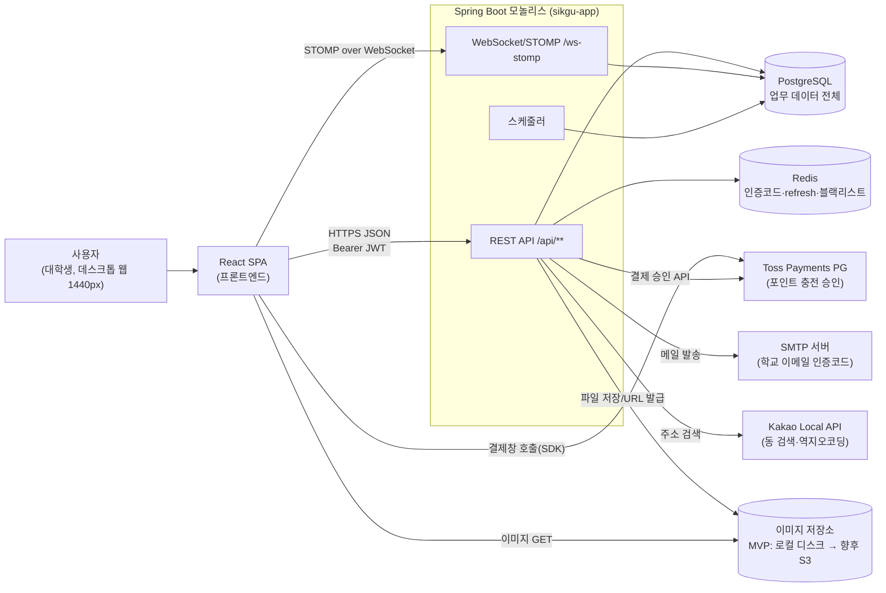

| 외부 요소       | 역할                                                                 | 연동 방향        | 비고                                                            |
| --------------- | -------------------------------------------------------------------- | ---------------- | --------------------------------------------------------------- |
| React SPA       | 화면 01~09 렌더링, REST·STOMP 호출                                   | FE → BE          | 별도 배포(정적 호스팅 또는 Vite dev 서버)                       |
| PostgreSQL      | 사용자·공구·참여·포인트·채팅 등 영속 데이터 (테이블 목록 → 4장 참조) | BE → DB          | 위치 계산은 Haversine으로 앱/SQL에서 처리, PostGIS 미사용       |
| Redis           | 이메일 인증코드(TTL 5분), refresh token(14일), access 블랙리스트     | BE → Redis       | MVP 이후 STOMP 브로드캐스트용 pub/sub 추가                      |
| Toss Payments   | 충전 결제창(프론트 SDK)과 결제 승인(서버)                            | FE → PG, BE → PG | dev 프로필은 Mock PG (5.11 참조)                                |
| SMTP            | 학교 이메일(ac.kr) 인증코드 발송                                     | BE → SMTP        | dev 프로필은 로그 출력 Mock                                     |
| Kakao Local API | 동 이름 검색, 좌표 → 동 이름 역지오코딩                              | BE → Kakao       | 가정. 프론트가 직접 호출하지 않고 서버가 프록시해 API 키를 숨김 |
| 이미지 저장소   | 게시글·영수증·문의·신고 이미지                                       | BE → 저장소      | `ImageStorage` 인터페이스로 추상화, MVP는 로컬 디스크           |

### 5.2 레이어드 아키텍처와 패키지 구조

#### 5.2.1 레이어 구성

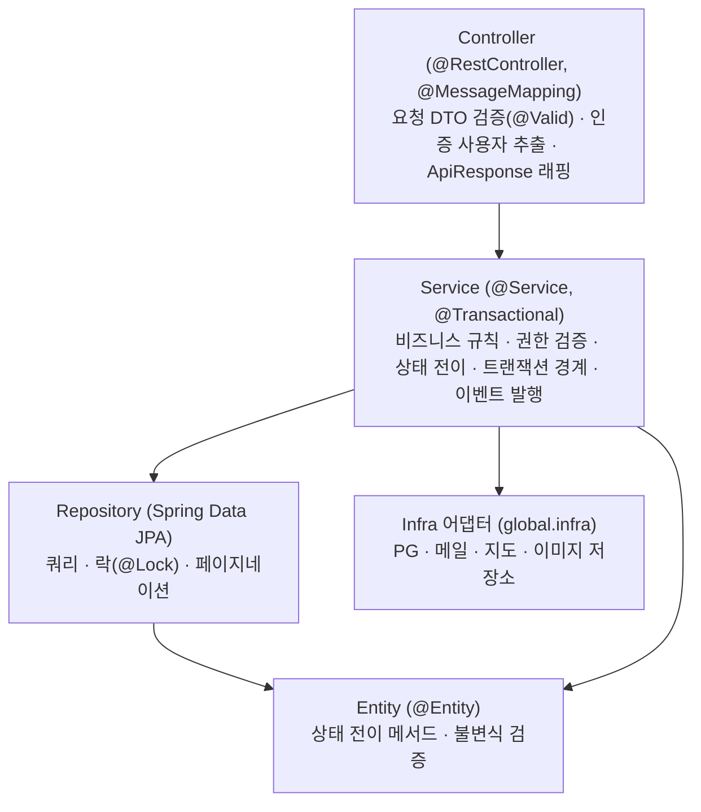

| 레이어     | 책임                                                                                                         | 금지 사항                                             |
| ---------- | ------------------------------------------------------------------------------------------------------------ | ----------------------------------------------------- |
| Controller | URL 매핑, `@Valid` 입력 검증, `@AuthenticationPrincipal`로 사용자 ID 획득, `ApiResponse.onSuccess(...)` 반환 | 비즈니스 로직, Repository 직접 호출, Entity 직접 반환 |
| Service    | 유스케이스 단위 메서드, 트랜잭션 경계, 리소스 권한(방장/참여자) 검증, 도메인 이벤트 발행                     | HTTP 객체(`HttpServletRequest` 등) 의존               |
| Repository | JPA 쿼리, 비관적 락 쿼리, 거리·정렬 조회 쿼리                                                                | 비즈니스 판단                                         |
| Entity     | 상태 전이 메서드(`post.markOrdered()` 등)에서 현재 상태 검증 후 변경, 불변식 유지                            | setter 공개, 다른 Aggregate 저장                      |
| DTO        | 요청/응답 record, Entity ↔ DTO 변환은 정적 팩토리(`from`)                                                    | Entity를 응답에 노출                                  |

- 상태 값은 Entity 메서드를 통해서만 바뀐다. 프론트가 `status`를 직접 보내는 API는 없다(→ 3장 상태 전이, BR 참조).
- 조회 전용 서비스 메서드는 `@Transactional(readOnly = true)`로 둔다. OSIV는 끈다(`spring.jpa.open-in-view=false`, 가정·팀 확정 필요).

#### 5.2.2 패키지 트리

기본 패키지는 `Sikgu.com.example.Web`(build.gradle의 `group = 'Sikgu.com.example'` 기준).

```text
Sikgu.com.example.Web
├── WebApplication.java
├── domain
│   ├── user           (회원·프로필·동네 설정)
│   ├── auth           (이메일 인증, 가입, 로그인, 토큰 재발급·로그아웃)
│   ├── location       (동 검색·역지오코딩, Haversine 거리 유틸)
│   ├── post           (게시글·게시글 이미지, 목록/상세 조회)
│   ├── participation  (참여·참여 취소, 받았어요, 수령 문의, 공구 취소·정산 흐름)
│   ├── order          (주문정보·영수증, 배송 시작, 나눔 완료)
│   ├── point          (지갑·보류·거래내역·충전)
│   ├── chat           (채팅방·채팅 참여·메시지, STOMP 핸들러)
│   ├── review         (후기·태그)
│   ├── report         (신고)
│   ├── block          (차단)
│   └── image          (이미지 업로드)
│       └── 각 도메인 하위: controller / service / repository / entity / dto
└── global
    ├── config         (SecurityConfig, WebSocketConfig, JpaAuditingConfig, SchedulingConfig, CorsConfig, OpenApiConfig, RedisConfig)
    ├── security       (JwtProvider, JwtAuthenticationFilter, 인증 EntryPoint/DeniedHandler, StompAuthChannelInterceptor, AuthUser)
    ├── exception      (BaseErrorCode, ErrorStatus, GeneralException, GlobalExceptionHandler)
    ├── response       (ApiResponse, PageResponse, CursorResponse)
    ├── common         (BaseTimeEntity, 도메인 이벤트 클래스, 공통 유틸)
    ├── scheduler      (공구 자동 처리 Job)
    └── infra          (payment, mail, geo, storage 어댑터와 Mock 구현)
```

#### 5.2.3 도메인 간 의존 규칙

원칙: 다른 도메인의 **Repository는 직접 쓰지 않고 Service(또는 읽기 전용 Query 메서드)를 통해서만** 접근한다. 단방향 의존만 허용하고, 역방향으로 알려야 할 일은 도메인 이벤트(5.9)로 처리한다.

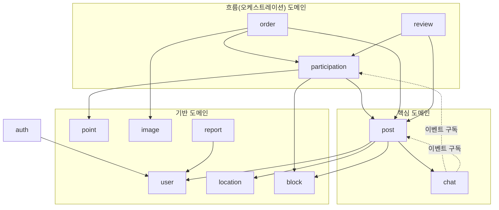

| 규칙 | 내용                                                                                                                                                                                                            |
| ---- | --------------------------------------------------------------------------------------------------------------------------------------------------------------------------------------------------------------- |
| R1   | `point`는 어떤 도메인에도 의존하지 않는다. `userId`, `postId`, `participationId` 같은 ID만 받는다(5.8 계약).                                                                                                    |
| R2   | `post`는 `participation`/`order`/`point`를 모른다. 게시글 상태 전이 메서드는 엔티티에 있지만, 포인트가 얽힌 흐름(참여, 공구 취소, 정산)은 상위 도메인이 호출한다.                                               |
| R3   | 공구 취소(방장 DELETE, 스케줄러 자동 취소)는 참여자 전원 환불이 필요하므로 `participation` 도메인의 `PostCancellationService`가 담당한다. `PostController`의 DELETE는 이 서비스를 호출한다. (추론·팀 확정 필요) |
| R4   | 게시글 생성 시 채팅방 생성은 응답에 `chatRoomId`가 필요하므로 같은 트랜잭션에서 `ChatRoomService.createForPost(...)`를 직접 호출한다. 그 외 입장/퇴장/SYSTEM 메시지/CLOSED 처리는 이벤트 구독으로 처리한다.     |
| R5   | 차단 여부 확인은 `BlockQueryService.isBlockedEither(a, b)` 하나로 통일해 목록 조회(post)와 참여(participation)에서 공용으로 쓴다.                                                                               |
| R6   | 순환 의존이 생기면 상위 도메인으로 흐름을 올리거나 이벤트로 끊는다. 패키지 의존 검증은 ArchUnit 테스트로 자동화하는 것을 권장(가정·팀 확정 필요).                                                               |

### 5.3 공통 구성요소

| 구성요소                             | 위치             | 설명                                                                                                                                                                                                                                                                                                                                                                                 |
| ------------------------------------ | ---------------- | ------------------------------------------------------------------------------------------------------------------------------------------------------------------------------------------------------------------------------------------------------------------------------------------------------------------------------------------------------------------------------------ |
| `ApiResponse<T>`                     | global.response  | 모든 응답을 `{isSuccess, code, message, result}`로 감싼다. 정적 팩토리 `onSuccess(result)`, `of(BaseCode, result)`, `onFailure(code, message, data)`. Jackson 3 기준 `null` result도 필드로 내려 프론트 파싱을 단순화(가정).                                                                                                                                                         |
| `PageResponse<T>`                    | global.response  | `{content, page, size, totalElements, hasNext}`. Spring Data `Page`/`Slice`에서 변환. page는 0부터, size 기본 20(게시글 목록 9).                                                                                                                                                                                                                                                     |
| `CursorResponse<T>`                  | global.response  | 채팅 메시지 이력용 `{messages, nextCursor, hasNext}`.                                                                                                                                                                                                                                                                                                                                |
| `BaseErrorCode` / `ErrorStatus` enum | global.exception | 인터페이스 `BaseErrorCode { HttpStatus httpStatus(); String code(); String message(); }`를 enum이 구현. 코드 값은 도메인 접두사(`COMMON400`, `AUTH401`, `POST409`, `POINT409`, `USER409` …). **전체 목록은 6장에서만 정의**한다. 도메인이 늘면 도메인별 enum(`PointErrorStatus` 등)으로 분리해도 같은 인터페이스를 구현.                                                             |
| `GeneralException`                   | global.exception | `BaseErrorCode`를 담는 런타임 예외. 서비스는 `throw new GeneralException(ErrorStatus.POINT_INSUFFICIENT)` 형태로만 실패를 알린다.                                                                                                                                                                                                                                                    |
| `GlobalExceptionHandler`             | global.exception | `@RestControllerAdvice`. 처리 대상: `GeneralException` → 해당 코드, `MethodArgumentNotValidException`/`ConstraintViolationException`/`HandlerMethodValidationException` → `COMMON400`(필드별 메시지 map을 result에), `ObjectOptimisticLockingFailureException`(재시도 소진) → 409 계열, `HttpMessageNotReadableException` → `COMMON400`, 그 외 `Exception` → `COMMON500`(로그 남김). |
| 인증 실패 응답                       | global.security  | 필터 단계 예외는 Advice에 닿지 않으므로 `AuthenticationEntryPoint`(401 `AUTH401`), `AccessDeniedHandler`(403 `AUTH403`)가 같은 `ApiResponse` 포맷을 직접 써서 응답.                                                                                                                                                                                                                  |
| `BaseTimeEntity`                     | global.common    | `@MappedSuperclass` + `@EntityListeners(AuditingEntityListener.class)`, `createdAt`(`@CreatedDate`, updatable=false), `updatedAt`(`@LastModifiedDate`). `@EnableJpaAuditing`은 `JpaAuditingConfig`에 둔다.                                                                                                                                                                           |
| `AuthUser`                           | global.security  | 인증 주체(`userId`, `loginId`). 컨트롤러에서 `@AuthenticationPrincipal AuthUser me`로 받는다.                                                                                                                                                                                                                                                                                        |

### 5.4 보안

#### 5.4.1 JWT 필터 체인 (Spring Security 7)

- 세션 미사용(`SessionCreationPolicy.STATELESS`), CSRF 비활성화(쿠키 인증을 쓰지 않음), formLogin/httpBasic 비활성화.
- `SecurityFilterChain` 빈 하나를 람다 DSL로 구성한다. Spring Security 7에서는 `and()` 체이닝과 `WebSecurityConfigurerAdapter`가 없으므로 람다 DSL만 사용한다.
- `JwtAuthenticationFilter`(`OncePerRequestFilter`)를 `UsernamePasswordAuthenticationFilter` 앞에 등록한다.

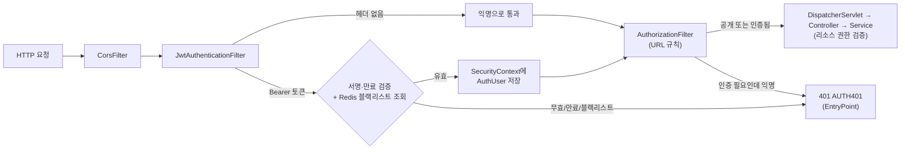

| 토큰              | 수명               | 저장                                                | 비고                                                  |
| ----------------- | ------------------ | --------------------------------------------------- | ----------------------------------------------------- |
| access token      | 30분               | 클라이언트 메모리                                   | 클레임: `sub`(userId), `loginId`, `iat`, `exp`, `jti` |
| refresh token     | 14일               | Redis `refresh:{userId}`                            | 재발급 시 회전(rotation), 로그아웃 시 삭제            |
| access 블랙리스트 | 남은 만료 시간만큼 | Redis `blacklist:{jti}`                             | 로그아웃 시 등록, 필터가 매 요청 조회                 |
| 이메일 인증코드   | 5분                | Redis `email:code:{email}`                          | 6자리                                                 |
| verificationToken | 30분               | 서명된 JWT(용도 클레임 `purpose=SIGNUP`) 또는 Redis | 구현 방식은 가정·팀 확정 필요                         |

- JWT 라이브러리는 의존성 추가 필요(jjwt 등, → 7장). 서명 키·만료 시간은 설정값으로 주입.
- 비밀번호는 `PasswordEncoder`(`DelegatingPasswordEncoder`, 기본 bcrypt)로 저장.

#### 5.4.2 권한 레벨과 적용 방식

| 레벨                      | 의미                                                  | 적용 위치                                                                                                                                                                                                                                                            | 실패 응답     |
| ------------------------- | ----------------------------------------------------- | -------------------------------------------------------------------------------------------------------------------------------------------------------------------------------------------------------------------------------------------------------------------- | ------------- |
| 공개                      | 토큰 없이 호출                                        | `SecurityFilterChain`의 `permitAll()` 화이트리스트: `/api/auth/email/**`, `/api/auth/check-id`, `/api/auth/signup`, `/api/auth/login`, `/api/auth/reissue`, `/api/locations/**`, `/ws-stomp/**`(핸드셰이크; 인증은 STOMP CONNECT에서), 이미지 GET 경로, Swagger 경로 | -             |
| 로그인                    | 유효한 access token                                   | 나머지 `/api/**`는 `authenticated()`                                                                                                                                                                                                                                 | 401 `AUTH401` |
| 호스트(방장)              | 해당 게시글의 `host_id == me`                         | **서비스 계층**에서 게시글 조회 후 검증 (`post.validateHost(userId)`)                                                                                                                                                                                                | 403 `AUTH403` |
| 참여자                    | 해당 게시글의 참여 행이 있고 role=PARTICIPANT         | 서비스 계층 (`participationRepository.findByPostIdAndUserId`)                                                                                                                                                                                                        | 403 `AUTH403` |
| 호스트·참여자 / 방 참여자 | 참여 행 존재(HOST 포함) / `chat_participants` 행 존재 | 서비스 계층, STOMP는 SUBSCRIBE·SEND 시 인터셉터에서 검증                                                                                                                                                                                                             | 403 `AUTH403` |

- 리소스 권한은 URL로 표현할 수 없으므로 `@PreAuthorize` 대신 서비스 메서드 안에서 검증한다. 이유: 같은 트랜잭션에서 조회한 엔티티(락 포함)로 검증해야 경쟁 조건이 없다. (추론)
- 차단 관계(`blocks`)는 권한 레벨과 별개로 서비스에서 확인한다(목록 숨김, 참여 거부 → 3장 FR-BLOCK 참조).

#### 5.4.3 CORS

- `CorsConfigurationSource` 빈을 등록하고 `http.cors(Customizer.withDefaults())`로 연결한다.
- 허용 Origin: 프로필별 설정값(`sikgu.cors.allowed-origins`, 예: 로컬 `http://localhost:5173`), 허용 메서드 GET/POST/PATCH/DELETE/OPTIONS, 허용 헤더 `Authorization`, `Content-Type`, `allowCredentials=false`(쿠키 미사용, 가정).
- WebSocket 엔드포인트는 `registry.addEndpoint("/ws-stomp").setAllowedOriginPatterns(...)`에 같은 Origin 목록을 넣는다.

### 5.5 WebSocket·STOMP 구조

| 구분             | 경로                               | 설정                                                     |
| ---------------- | ---------------------------------- | -------------------------------------------------------- |
| 연결(핸드셰이크) | `/ws-stomp`                        | `StompEndpointRegistry.addEndpoint`, SockJS 미사용(가정) |
| 구독 prefix      | `/sub`                             | `enableSimpleBroker("/sub")` (MVP)                       |
| 발행 prefix      | `/pub`                             | `setApplicationDestinationPrefixes("/pub")`              |
| 방 구독          | `/sub/chats/{chatRoomId}`          | 새 메시지·SYSTEM 메시지 수신                             |
| 메시지 발행      | `/pub/chats/{chatRoomId}/messages` | `@MessageMapping("/chats/{chatRoomId}/messages")`        |

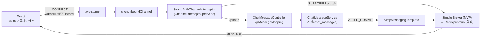

**인증 인터셉터(`StompAuthChannelInterceptor`) 동작**

| STOMP 명령 | 처리                                                                                                                                                                              |
| ---------- | --------------------------------------------------------------------------------------------------------------------------------------------------------------------------------- |
| CONNECT    | `Authorization` 네이티브 헤더에서 Bearer 토큰 추출 → `JwtProvider` 검증(블랙리스트 포함) → `accessor.setUser(Authentication)`. 실패 시 `MessageDeliveryException` → ERROR 프레임. |
| SUBSCRIBE  | 목적지에서 `chatRoomId` 추출 → `chat_participants`에 사용자 존재 여부 확인. 없으면 거부.                                                                                          |
| SEND       | 같은 방 참여 검증 + 방이 `CLOSED`면 거부. 메시지 본문은 `{ "content": "..." }`, 타입은 서버가 `TEXT`로 지정.                                                                      |
| DISCONNECT | 별도 처리 없음(읽음 시각은 REST `PATCH /read`로 갱신).                                                                                                                            |

- 토큰 만료: 연결 중 access token이 만료돼도 세션은 유지된다. 재연결 시 새 토큰으로 CONNECT. (가정·팀 확정 필요)
- 메시지 이력 조회는 REST 커서 페이지네이션(`messageId` 내림차순)으로 분리한다.
- **확장 경로**: 서버를 2대 이상으로 늘리면 Simple Broker는 인스턴스 간 메시지를 공유하지 못한다. 저장 후 Redis 채널 `chat:room:{id}`에 publish → 각 인스턴스의 `MessageListener`가 받아 로컬 `SimpMessagingTemplate`로 전달하는 구조로 교체한다. `ChatBroadcaster` 인터페이스로 감싸 두면 교체 시 서비스 코드는 그대로다. (추론)

### 5.6 트랜잭션 경계

| 유스케이스                | 트랜잭션 범위 (하나의 `@Transactional`)                                                                | 비고                                                |
| ------------------------- | ------------------------------------------------------------------------------------------------------ | --------------------------------------------------- |
| 공구 등록                 | posts + post_images + 방장 participation + 방장 `pay(hostUnits)` + chat_rooms + 방장 chat_participants | 방장 잔액 부족 시 전체 롤백                         |
| 참여                      | 게시글 락 → 검증 → participation 저장 → `pay` → filledUnits 갱신 → (다 차면) RECRUITED                 | 이벤트는 커밋 후 처리                               |
| 참여 취소                 | 게시글 락 → participation 삭제(또는 상태 변경) → `refund` → RECRUITED였다면 RECRUITING 복귀            |                                                     |
| 공구 취소 (방장/스케줄러) | 게시글 락 → 모든 participation에 대해 `refund` → CANCELLED, cancelled_at                               | 게시글 단위 1 트랜잭션                              |
| 주문 등록·배송·나눔       | 게시글 락 → post_orders/receipt_images → 상태 전이                                                     |                                                     |
| 받았어요                  | 게시글 락 → receipt_status=RECEIVED → 전원 RECEIVED면 `settle` + `giveIncentive` + SETTLED             | 마지막 확인자의 트랜잭션에서 정산                   |
| 충전 confirm              | charge_payments 행 락 → PG 승인 호출 → 지갑 적립 + CHARGE 거래                                         | PG 호출이 트랜잭션 안에 들어가는 예외 케이스(5.7.3) |

- 외부 I/O(메일 발송, Kakao 호출, 이미지 저장)는 트랜잭션 밖에서 수행한다. 충전 승인만 예외적으로 상태 일관성을 위해 아래 방식으로 처리한다.
- 도메인 이벤트 후처리(SYSTEM 메시지 저장·브로드캐스트)는 `@TransactionalEventListener(phase = AFTER_COMMIT)` + `REQUIRES_NEW`로 본 트랜잭션과 분리한다. 후처리가 실패해도 결제·상태 전이는 롤백되지 않는다.

### 5.7 락·동시성 전략

#### 5.7.1 게시글 행 비관적 락

- 공구 상태나 `filledUnits`를 바꾸는 모든 쓰기 흐름은 먼저 `PostRepository.findByIdForUpdate(postId)`(`@Lock(PESSIMISTIC_WRITE)` → `SELECT … FOR UPDATE`)로 게시글 행을 잠근다.
- 목적: 마지막 단위 동시 클릭(초과 참여), 참여와 공구 취소의 경합, 마지막 '받았어요' 두 건이 동시에 들어와 정산이 두 번 되는 것 방지.
- 락 타임아웃: `jakarta.persistence.lock.timeout` 힌트 3초(가정·팀 확정 필요). 초과 시 409 계열 재시도 안내.

#### 5.7.2 지갑 낙관적 락 + 재시도

- `point_wallets`는 `@Version` 컬럼으로 낙관적 락. 같은 사용자가 동시에 충전·참여하는 경우 충돌한다.
- 충돌(`ObjectOptimisticLockingFailureException`) 시 **트랜잭션 전체를 새로 시작**해 최대 3회 재시도(가정). 재시도는 트랜잭션 바깥 퍼사드에서 수행해야 하며, Spring Framework 7의 `@Retryable`(`@EnableResilientMethods`) 또는 직접 구현 루프를 쓴다. (추론)
- 재시도 소진 시 `GlobalExceptionHandler`가 409로 응답.
- 락 획득 순서는 항상 **게시글 → 지갑(userId 오름차순)**으로 고정해 교착을 막는다. 정산·전원 환불처럼 여러 지갑을 건드리는 경우 userId 순으로 처리한다.

#### 5.7.3 충전 멱등성

- `charge_payments.order_id` UNIQUE. confirm 요청 시 해당 행을 `FOR UPDATE`로 잠그고 상태를 본다.
  - 이미 `DONE`이면 PG를 다시 호출하지 않고 저장된 결과를 반환(멱등).
  - `READY`이고 금액이 일치하면 PG 승인 호출 → 성공 시 `DONE` + 지갑 적립 + `CHARGE` 거래 기록.
  - 금액 불일치는 PG 호출 전에 400.
- PG 승인 성공 후 DB 커밋이 실패하면 포인트 미적립 상태가 된다. MVP에서는 로그로 남기고 수동 대사, 이후 PG 결제 조회 API로 보정하는 배치를 추가한다. (가정·팀 확정 필요)

### 5.8 PointService 계약

모든 포인트 변동은 `PointService`(및 충전 전용 `ChargeService`)만 수행하고, 변동마다 `point_transactions`에 `balance_after`를 기록한다. 호출자는 이미 게시글 락을 잡은 트랜잭션 안에서 호출한다(`@Transactional(propagation = MANDATORY)` 권장, 추론).

| 메서드                                                             | 지갑 변화                                             | point_holds                       | point_transactions          | 호출 위치                                      |
| ------------------------------------------------------------------ | ----------------------------------------------------- | --------------------------------- | --------------------------- | ---------------------------------------------- |
| `pay(Long userId, Long postId, Long participationId, long amount)` | available −amount, held +amount                       | 신규 `HELD`                       | `PAYMENT`(−amount)          | 공구 등록(방장 hostUnits), 참여                |
| `refund(Long participationId)`                                     | held −금액, available +금액                           | `HELD` → `RELEASED`               | `REFUND`(+금액)             | 참여 취소, 공구 취소(전원), 스케줄러 자동 취소 |
| `settle(Long postId)`                                              | 각 참여자(방장 포함) held −금액, 방장 available +합계 | 게시글의 `HELD` 전부 → `CAPTURED` | 방장 `SETTLEMENT`(+합계)    | 전원 수령 확인(수동 마지막 클릭 또는 72h 자동) |
| `giveIncentive(Long postId)`                                       | 방장 available +인센티브                              | -                                 | 방장 `INCENTIVE`(+인센티브) | `settle` 직후 같은 트랜잭션                    |

- 반환값: `pay`는 `PaymentResult(holdId, balanceAfter)`, 나머지는 `void` 또는 결과 요약(가정). 금액은 `long` 정수(원 = P).
- 실패: 잔액 부족 → `POINT409`, 이미 해제/확정된 보류 → 상태 충돌 코드(→ 6장 에러코드 참조).
- 인센티브는 모집금액의 1%(설정값 `sikgu.policy.incentive-rate`, 가정·팀 확정 필요). 인센티브 재원은 서비스 부담(추론).
- 방장 본인 결제분도 보류 → CAPTURED 되어 방장에게 다시 정산되므로 순액 0이다.

### 5.9 내부 도메인 이벤트

Spring `ApplicationEventPublisher`로 발행하고, 구독은 대부분 `@TransactionalEventListener(AFTER_COMMIT)`.

| 이벤트                                         | 발행 시점           | 구독자와 처리                                                                                                                                          |
| ---------------------------------------------- | ------------------- | ------------------------------------------------------------------------------------------------------------------------------------------------------ |
| `ParticipationJoinedEvent(postId, userId)`     | 참여 커밋           | chat: chat_participants 추가 + SYSTEM "○○님이 참여했어요" 저장·브로드캐스트                                                                            |
| `ParticipationCancelledEvent(postId, userId)`  | 참여 취소 커밋      | chat: chat_participants 제거 + SYSTEM "○○님이 나갔어요"                                                                                                |
| `PostStatusChangedEvent(postId, from, to, at)` | 모든 상태 전이 커밋 | chat: 상태별 SYSTEM 메시지("모집이 완료됐어요", "주문이 완료됐어요" 등). to가 SETTLED/CANCELLED면 채팅방 `CLOSED`. user: SETTLED면 거래 횟수 캐시 갱신 |
| `ReceiptConfirmedEvent(postId, userId)`        | 받았어요 커밋       | chat: SYSTEM "○○님이 수령을 확인했어요" (선택)                                                                                                         |
| `ReviewCreatedEvent(targetUserId)`             | 후기 작성 커밋      | user: 평균 별점 캐시 재계산                                                                                                                            |

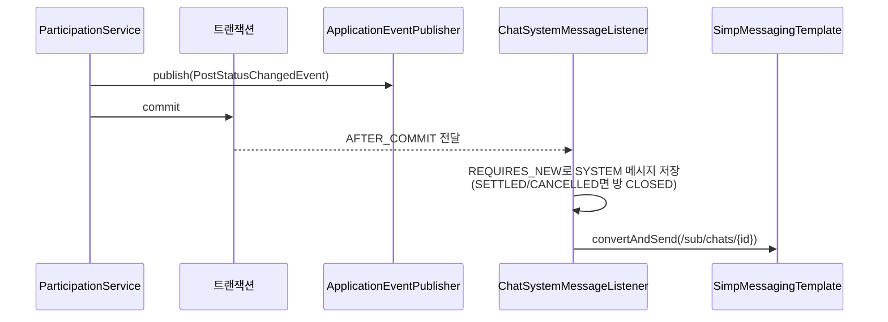

- 이벤트 클래스는 `global.common.event`(또는 발행 도메인 패키지)에 record로 둔다. 구독자 실패는 로그만 남기고 재전송하지 않는다(MVP, 가정).

### 5.10 스케줄러

`@EnableScheduling` + `global.scheduler`. 정책 값은 `sikgu.policy.*` 설정값(→ 3장 BR 참조, 모두 가정·팀 확정 필요).

| Job                  | 주기 | 대상 조회                                           | 처리                                                                                                                                                |
| -------------------- | ---- | --------------------------------------------------- | --------------------------------------------------------------------------------------------------------------------------------------------------- |
| `RecruitDeadlineJob` | 1분  | `status=RECRUITING AND deadline_at < now`           | 게시글별로 `PostCancellationService.cancel(postId, DEADLINE)` → 전원 `refund`, CANCELLED                                                            |
| `ReceiptOverdueJob`  | 10분 | `status=RECRUITED AND recruited_at < now - 48h`     | 자동 CANCELLED + 전원 환불 (방장 패널티는 보류)                                                                                                     |
| `AutoReceiveJob`     | 10분 | `status=DISTRIBUTED AND distributed_at < now - 72h` | `WAITING` 참여만 `RECEIVED`로 변경, `INQUIRING`은 유지. 남은 비RECEIVED가 없으면 `settle` + `giveIncentive` + SETTLED. INQUIRING이 있으면 정산 대기 |

- 대상 ID만 먼저 조회하고, **게시글 1건당 별도 트랜잭션**에서 게시글 락을 잡은 뒤 상태를 다시 확인하고 처리한다(사용자 요청과의 경합 방지, 한 건 실패가 전체를 막지 않음).
- MVP는 단일 인스턴스 가정. 다중 인스턴스가 되면 ShedLock(Redis/JDBC) 등으로 중복 실행을 막는다. (추론)
- 실행 시각·처리 건수·실패를 로그로 남긴다.

### 5.11 외부 연동 어댑터와 프로필별 Mock

서비스는 `global.infra`의 인터페이스에만 의존하고, 구현은 `@Profile`(또는 `@ConditionalOnProperty`)로 교체한다.

| 인터페이스                                        | 주요 메서드(개념)                                        | prod 구현                                                         | local/dev 구현                                                                 |
| ------------------------------------------------- | -------------------------------------------------------- | ----------------------------------------------------------------- | ------------------------------------------------------------------------------ |
| `PaymentGateway`                                  | `confirm(paymentKey, orderId, amount) → PaymentApproval` | `TossPaymentGateway` (RestClient, 시크릿 키 Basic 인증)           | `MockPaymentGateway`: `paymentKey`가 `tgen_`로 시작하면 승인, 금액 그대로 반환 |
| `MailSender`(이름 가정: `VerificationMailSender`) | `sendCode(email, code)`                                  | `SmtpVerificationMailSender` (spring-boot-starter-mail 추가 필요) | `LoggingMailSender`: 코드를 로그로 출력                                        |
| `GeoClient`                                       | `searchDong(query)`, `reverse(lat, lng)`                 | `KakaoLocalGeoClient` (REST API 키)                               | `FixtureGeoClient`: 고정 동 목록 반환                                          |
| `ImageStorage`                                    | `store(file) → url`, `delete(url)`                       | MVP: `LocalDiskImageStorage`, 향후 `S3ImageStorage`               | `LocalDiskImageStorage`                                                        |

- 외부 호출은 Spring의 `RestClient`를 쓰고, 연결/읽기 타임아웃(예: 3초/5초, 가정)을 둔다. 외부 오류는 어댑터에서 도메인 예외로 변환한다.
- 프로필 구성(`local`, `dev`, `prod`)과 키 주입 방법은 7장 참조.

### 5.12 이미지 업로드 흐름

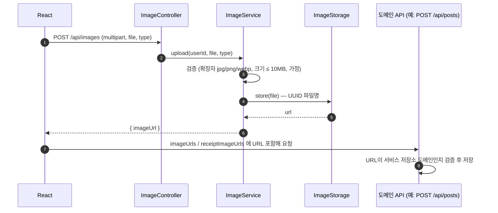

- 로컬 디스크 구현: 저장 경로 `sikgu.storage.local.path`(가정), `WebMvcConfigurer.addResourceHandlers("/images/**")`로 정적 서빙, 이미지 GET은 공개.
- S3 전환 시 `S3ImageStorage`가 S3 URL(또는 CloudFront URL)을 반환하고 도메인 테이블에는 URL만 저장하므로 다른 코드는 바뀌지 않는다. 향후 Presigned URL 직접 업로드로 바꿀 수 있다. (추론)
- 업로드 후 어떤 도메인에도 연결되지 않은 고아 이미지는 MVP에서 방치, 이후 정리 배치. (가정)
- 채팅 이미지는 MVP 제외.

### 5.13 배포 구성

현재 `compose.yaml`에는 `postgres`, `redis` 두 서비스만 있고 `spring-boot-docker-compose`가 로컬 실행 시 이를 자동으로 띄운다. 운영 배포에서는 `app` 서비스를 추가해 세 컨테이너로 구성한다(추가 방법 → 7장).

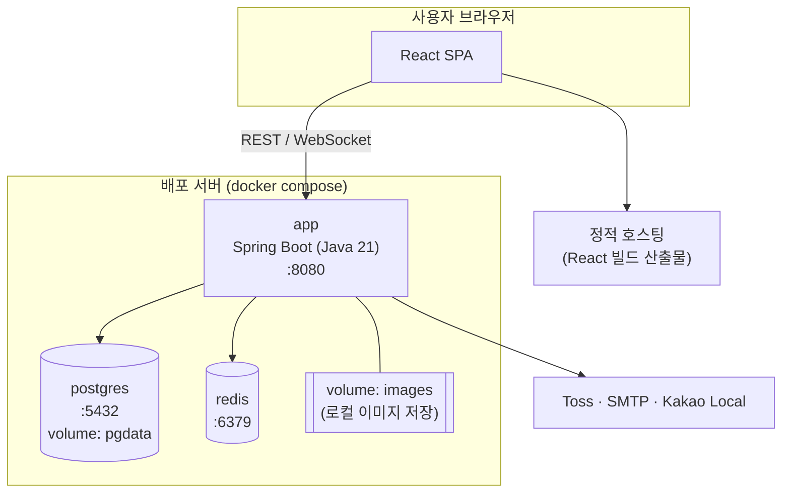

| 컨테이너 | 이미지                                                  | 비고                                                                |
| -------- | ------------------------------------------------------- | ------------------------------------------------------------------- |
| app      | 앱 빌드 이미지(bootJar 또는 bootBuildImage)             | 프로필 `prod`, 환경변수로 DB·Redis·JWT·외부 키 주입                 |
| postgres | `postgres` (운영은 `latest` 대신 메이저 버전 고정 권장) | 데이터 볼륨 마운트                                                  |
| redis    | `redis` (버전 고정 권장)                                | 인증코드·토큰은 휘발되어도 재로그인으로 복구 가능하므로 영속화 선택 |

- 리버스 프록시(Nginx 등)를 두면 HTTPS 종료와 WebSocket Upgrade 헤더 전달이 필요하다. (가정·팀 확정 필요)

### 5.14 기술 관점 주요 시퀀스

#### 5.14.1 참여 (참여 + 즉시 결제·보류)

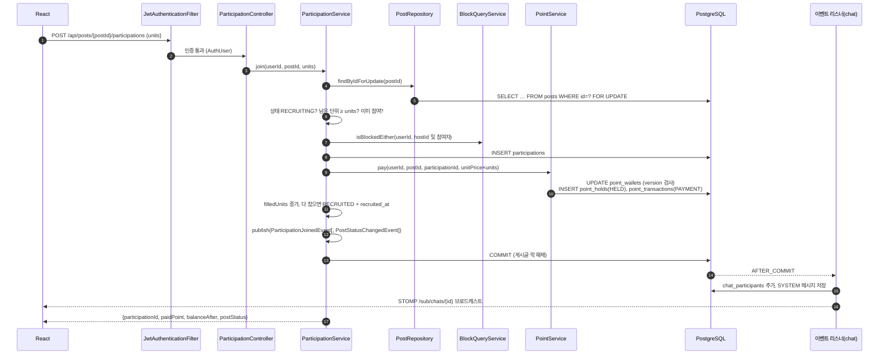

- 지갑 버전 충돌 시 전체 트랜잭션을 재시도(5.7.2). 실패 코드는 6장 참조(잔액 부족 `POINT409`, 모집중 아님 `POST409` 등).

#### 5.14.2 정산 (마지막 '받았어요' → SETTLED)

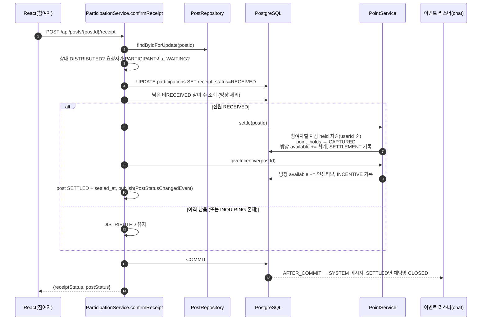

- 72h 자동 수령(`AutoReceiveJob`)도 같은 서비스 메서드 경로(락 → 상태 재확인 → settle)를 재사용한다.
- 방장 참여 행의 수령 상태는 정산 조건에서 제외한다(추론·팀 확정 필요).

#### 5.14.3 포인트 충전 (prepare → PG 결제창 → confirm)

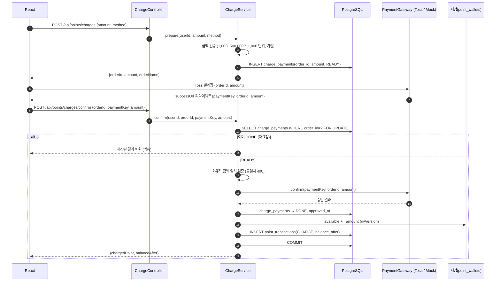

- dev 프로필에서는 `MockPaymentGateway`가 `tgen_` 접두사 paymentKey를 승인 처리해 실제 결제 없이 전체 흐름을 테스트한다.
- PG 승인 실패 시 `charge_payments`를 실패 상태로 남기고 지갑은 변경하지 않는다. 충전 상태 ENUM 값은 6장 참조.

---

## 6. API 명세

이 장은 식구 MVP의 REST API와 STOMP 메시지 규격을 정의한다. **에러 코드와 ENUM은 이 장에서만 정의**하며, 다른 장은 코드명만 인용한다. 기능·업무 규칙의 근거는 3장(FR/BR), 테이블 구조는 4장을 참조한다.

- 원본 API 명세에 없던 응답·요청 형식을 이 장에서 채운 부분은 "(보완)"으로 표시했다.
- 정해지지 않은 정책 값은 "(가정·팀 확정 필요)", 원본 문맥에서 추론한 내용은 "(추론)"으로 표시했다.
- 회의록에 있던 구 엔드포인트(`/api/posts/search` 등)는 모두 폐기했다. 대체 경로는 [6.12 폐기된 구 엔드포인트 → 대체 매핑](#612-폐기된-구-엔드포인트--대체-매핑)에 정리했다.

### 6.1 공통 규칙

#### 6.1.1 기본

| 항목           | 규칙                                                                                                                       |
| -------------- | -------------------------------------------------------------------------------------------------------------------------- |
| Base URL       | `/api` (STOMP 연결만 `/ws-stomp`)                                                                                          |
| 데이터 형식    | 요청·응답 모두 `application/json; charset=UTF-8`. 이미지 업로드만 `multipart/form-data`                                    |
| 인증 헤더      | `Authorization: Bearer {accessToken}`. 권한이 `공개`인 API만 토큰 없이 호출 가능                                           |
| 토큰           | Access 30분, Refresh 14일(Redis 저장). 로그아웃 시 Refresh 삭제 + Access 블랙리스트 등록 (→ 5장 참조)                      |
| 상태값         | 프론트는 게시글 `status`를 직접 보내지 않는다. 상태는 행위 API(참여, 주문 등록, 배송 시작 등)나 스케줄러의 결과로만 바뀐다 |
| 네이밍         | URL은 kebab-case·복수형 명사, JSON 필드는 camelCase, ENUM 값은 UPPER_SNAKE_CASE                                            |
| 성공 HTTP 상태 | 생성 API도 HTTP 200 + `COMMON200`으로 통일 (원본 공통 응답 기준)                                                           |

#### 6.1.2 권한 등급

| 권한          | 의미                                                         | 위반 시   |
| ------------- | ------------------------------------------------------------ | --------- |
| 공개          | 토큰 없이 호출 가능                                          | -         |
| 로그인        | 유효한 Access Token 필요                                     | `AUTH401` |
| 호스트        | 해당 게시글의 방장(`ParticipationRole=HOST`)                 | `POST403` |
| 참여자        | 해당 게시글에 `PARTICIPANT`로 참여 중인 사용자 (호스트 제외) | `PART403` |
| 호스트·참여자 | 해당 게시글의 HOST 또는 PARTICIPANT                          | `PART403` |
| 방 참여자     | 해당 채팅방에 입장해 있는 사용자                             | `CHAT403` |

#### 6.1.3 응답 포맷

모든 응답은 아래 형식을 따른다. 실패할 때 `result`는 `null`이고, 검증 실패(`COMMON400`)일 때만 필드별 오류를 담는다(보완).

```json
{
  "isSuccess": true,
  "code": "COMMON200",
  "message": "성공",
  "result": {}
}
```

```json
{
  "isSuccess": false,
  "code": "COMMON400",
  "message": "요청 값이 올바르지 않습니다.",
  "result": {
    "errors": [
      { "field": "units", "rejectedValue": 0, "reason": "1 이상이어야 합니다." }
    ]
  }
}
```

#### 6.1.4 페이지네이션

- 오프셋 방식: `page`(0부터), `size`(기본 20, **게시글 목록 `GET /api/posts`만 기본 9**). `size`는 최대 50(가정·팀 확정 필요). 범위를 벗어나면 `COMMON400`.
- 커서 방식: 채팅 메시지 이력만 사용. `cursor`(이 messageId보다 오래된 메시지부터 조회, 생략하면 최신부터), `size`(기본 20).

```json
"result": {
  "content": [ ],
  "page": 0,
  "size": 20,
  "totalElements": 24,
  "hasNext": true
}
```

```json
"result": {
  "messages": [ ],
  "nextCursor": 499,
  "hasNext": true
}
```

#### 6.1.5 날짜·금액·위치·이미지

| 항목        | 규칙                                                                                                                              |
| ----------- | --------------------------------------------------------------------------------------------------------------------------------- |
| 일시        | ISO 8601 로컬 일시 `2026-10-27T14:00:00`. 서버 기준 시간대 Asia/Seoul, 오프셋은 표기하지 않음 (가정·팀 확정 필요)                 |
| 날짜        | 일 단위 값(가입일, 후기 작성일 등)은 `2026-03-02`                                                                                 |
| 금액·포인트 | 정수(long). 1원 = 1P. 소수 없음                                                                                                   |
| 좌표        | `latitude`·`longitude`는 double(WGS84). 다른 사용자에게는 좌표를 내보내지 않고 `dongName`과 `distanceKm`(소수 첫째 자리)만 내보냄 |
| 거리        | 저장된 내 동네 좌표와 게시글 거래장소 좌표 사이를 Haversine으로 계산                                                              |
| 이미지      | `POST /api/images`로 먼저 업로드하고, 받은 URL을 각 API의 `imageUrls`·`receiptImageUrls` 필드에 넣음                              |
| 문자열      | 앞뒤 공백은 서버에서 제거(trim)한 뒤 검증 (가정·팀 확정 필요)                                                                     |

### 6.2 에러 코드 카탈로그

코드는 `도메인 접두사 + HTTP 상태 3자리 + (세부 일련번호 1자리)`로 짓는다. 세 자리 코드(`POST409` 등)는 그 계열의 대표 코드다. 원본에서 정의한 7개(`COMMON400`, `AUTH401`, `AUTH403`, `COMMON404`, `POST409`, `POINT409`, `USER409`)는 의미를 그대로 유지하고, 나머지는 이 장에서 보완했다. 메시지 문구는 예시다.

#### 6.2.1 공통 (COMMON)

| HTTP | code      | 상황                                                                              |
| ---- | --------- | --------------------------------------------------------------------------------- |
| 200  | COMMON200 | 성공                                                                              |
| 400  | COMMON400 | 요청 값 검증 실패(필수 누락, 형식·범위 오류, 알 수 없는 ENUM 값)                  |
| 404  | COMMON404 | 대상 없음(게시글·사용자·채팅방·주문·충전 주문번호 등). 경로 자체가 없을 때도 사용 |
| 405  | COMMON405 | 지원하지 않는 HTTP 메서드 (보완)                                                  |
| 500  | COMMON500 | 서버 내부 오류 (보완)                                                             |

#### 6.2.2 인증 (AUTH)

| HTTP | code     | 상황                                                  |
| ---- | -------- | ----------------------------------------------------- |
| 400  | AUTH4001 | 학교 이메일(`ac.kr`) 형식이 아님                      |
| 400  | AUTH4002 | 인증코드 불일치                                       |
| 400  | AUTH4003 | 인증코드 만료(TTL 5분) 또는 발송 이력 없음            |
| 400  | AUTH4004 | `verificationToken`이 유효하지 않거나 만료(30분)      |
| 401  | AUTH401  | Access Token 없음·만료·위조                           |
| 401  | AUTH4011 | 로그인 실패(아이디 또는 비밀번호 불일치)              |
| 401  | AUTH4012 | Refresh Token 무효·만료·Redis에 없음                  |
| 401  | AUTH4013 | 로그아웃 처리된(블랙리스트) Access Token              |
| 403  | AUTH403  | 권한 없음(다른 도메인 403 코드로 분류되지 않는 경우)  |
| 429  | AUTH4291 | 인증메일 재발송 간격 미준수(60초) (가정·팀 확정 필요) |

#### 6.2.3 회원·위치 (USER, LOC)

| HTTP | code     | 상황                                       |
| ---- | -------- | ------------------------------------------ |
| 409  | USER409  | 아이디·이메일 중복(대표 코드)              |
| 409  | USER4091 | 로그인 아이디 중복(가입 시점)              |
| 409  | USER4092 | 이미 가입된 학교 이메일                    |
| 400  | LOC4001  | 좌표가 범위를 벗어났거나 국내 좌표가 아님  |
| 404  | LOC4041  | 해당 좌표·검색어에 맞는 동이 없음          |
| 502  | LOC5021  | 외부 지도 API(Kakao Local, 가정) 호출 실패 |

#### 6.2.4 이미지 (IMAGE)

| HTTP | code      | 상황                                    |
| ---- | --------- | --------------------------------------- |
| 400  | IMAGE4001 | 허용하지 않는 확장자·MIME               |
| 400  | IMAGE4002 | 파일이 없거나 한 번에 올린 파일 수 초과 |
| 413  | IMAGE4131 | 파일 하나의 용량 초과                   |
| 500  | IMAGE5001 | 저장소 업로드 실패                      |

#### 6.2.5 게시글 (POST)

| HTTP | code     | 상황                                                                            |
| ---- | -------- | ------------------------------------------------------------------------------- |
| 400  | POST4001 | `totalPrice`가 `totalUnits`로 나누어떨어지지 않음 (가정·팀 확정 필요)           |
| 400  | POST4002 | `hostUnits` 범위 오류(1 이상, `totalUnits`-1 이하)                              |
| 400  | POST4003 | `deadlineAt`이 과거이거나 허용 기간(14일)을 넘음 (가정·팀 확정 필요)            |
| 403  | POST403  | 호스트 전용 API를 호스트가 아닌 사용자가 호출                                   |
| 403  | POST4031 | 차단 관계인 사용자의 게시글 조회                                                |
| 409  | POST409  | 현재 공구 상태에서 할 수 없는 요청(대표 코드. 예: RECRUITED가 아닌데 주문 등록) |
| 409  | POST4091 | 수정 불가(RECRUITING이 아니거나 호스트 외 참여자가 있음)                        |
| 409  | POST4092 | 취소 불가(ORDERED 이후)                                                         |

#### 6.2.6 참여·주문·문의 (PART, ORDER, INQ)

| HTTP | code      | 상황                                                                              |
| ---- | --------- | --------------------------------------------------------------------------------- |
| 400  | PART4001  | 신청 단위가 남은 단위를 초과                                                      |
| 403  | PART403   | 해당 게시글의 참여자(또는 호스트·참여자)가 아님                                   |
| 403  | PART4031  | 호스트와 차단 관계라 참여 불가                                                    |
| 409  | PART4091  | 이미 참여한 게시글                                                                |
| 409  | PART4092  | 호스트는 참여 취소 불가(게시글 취소 `DELETE /api/posts/{postId}` 사용)            |
| 409  | PART4093  | 참여 취소 가능한 상태가 아님(RECRUITING·RECRUITED에서만 가능)                     |
| 409  | PART4094  | 이미 '받았어요'를 누름                                                            |
| 400  | ORDER4001 | 영수증 이미지 0장 또는 개수 초과                                                  |
| 409  | ORDER4091 | 이미 주문 정보가 등록됨                                                           |
| 400  | INQ4001   | `SHORT_QUANTITY`인데 `receivedUnits`가 없거나 범위(0 이상, 내 단위 미만)를 벗어남 |
| 400  | INQ4002   | `WRONG_OR_DAMAGED`인데 이미지가 없음                                              |
| 409  | INQ4091   | 이미 '받았어요'를 눌러 문의할 수 없음                                             |
| 409  | INQ4092   | 이미 처리 중인 문의가 있음(참여당 OPEN 문의 1건) (가정·팀 확정 필요)              |

#### 6.2.7 포인트 (POINT)

| HTTP | code      | 상황                                                                             |
| ---- | --------- | -------------------------------------------------------------------------------- |
| 400  | POINT4001 | 충전 금액 규칙 위반(최소 1,000P, 최대 500,000P, 1,000P 단위) (가정·팀 확정 필요) |
| 400  | POINT4002 | 승인 요청 금액이 준비 단계 금액과 다름                                           |
| 409  | POINT409  | 포인트 잔액 부족                                                                 |
| 409  | POINT4091 | 동시 변경 충돌로 재시도 후에도 실패(낙관적 락)                                   |
| 409  | POINT4092 | 이미 실패·취소된 충전 주문번호                                                   |
| 502  | POINT5021 | PG 승인 실패                                                                     |

#### 6.2.8 채팅 (CHAT)

| HTTP | code     | 상황                                                    |
| ---- | -------- | ------------------------------------------------------- |
| 400  | CHAT4001 | 메시지 내용이 비었거나 1,000자 초과 (가정·팀 확정 필요) |
| 403  | CHAT403  | 채팅방 참여자가 아님(REST·STOMP 구독·발행 공통)         |
| 409  | CHAT4091 | 종료된(`CLOSED`) 채팅방에 메시지 발행                   |

#### 6.2.9 후기·신고·차단 (REVIEW, REPORT, BLOCK)

| HTTP | code       | 상황                                                                               |
| ---- | ---------- | ---------------------------------------------------------------------------------- |
| 400  | REVIEW4001 | 평가 대상이 아님(본인, 또는 허용 방향이 아닌 사용자)                               |
| 403  | REVIEW403  | 해당 게시글의 호스트·참여자가 아님                                                 |
| 409  | REVIEW4091 | 같은 대상에게 이미 후기를 작성함                                                   |
| 409  | REVIEW4092 | 작성 기간이 아님(SETTLED가 아니거나 정산 후 7일 경과) (가정·팀 확정 필요)          |
| 400  | REPORT4001 | 본인을 신고함                                                                      |
| 400  | REPORT4002 | 사유별 필수 값 누락(예: `CHAT_ABUSE`인데 `messageIds` 없음)                        |
| 409  | REPORT4091 | 같은 대상·같은 게시글에 대해 처리 전(PENDING) 신고가 이미 있음 (가정·팀 확정 필요) |
| 400  | BLOCK4001  | 본인을 차단함                                                                      |
| 409  | BLOCK4091  | 이미 차단한 사용자                                                                 |

### 6.3 ENUM 정의

시스템의 모든 ENUM 값은 여기서만 정의한다. 요청에 정의되지 않은 값이 오면 `COMMON400`이다.

| ENUM              | 값                                                                                                                                                                | 비고                                                                                         |
| ----------------- | ----------------------------------------------------------------------------------------------------------------------------------------------------------------- | -------------------------------------------------------------------------------------------- |
| PostStatus        | `RECRUITING` 모집중 → `RECRUITED` 모집완료 → `ORDERED` 주문완료 → `SHIPPING` 배송중 → `DISTRIBUTED` 나눔완료·수령확인 → `SETTLED` 정산완료, 예외 `CANCELLED` 취소 | 7개. Figma 스테퍼의 '나눔완료'와 '수령확인'은 둘 다 `DISTRIBUTED`. '결제 진행중' 단계는 없음 |
| Category          | `FOOD` 식품, `LIVING` 생활용품, `DAILY` 생필품, `ETC` 기타                                                                                                        | 배달음식 없음                                                                                |
| ParticipationRole | `HOST`, `PARTICIPANT`                                                                                                                                             |                                                                                              |
| PaymentStatus     | `PAID` 결제(보류) 완료, `REFUNDED` 환급됨                                                                                                                         |                                                                                              |
| ReceiptStatus     | `WAITING` 확인 대기, `RECEIVED` 받았어요, `INQUIRING` 문의중                                                                                                      | 호스트 참여 건은 `DISTRIBUTED` 진입 시 자동 `RECEIVED` (추론)                                |
| HoldStatus        | `HELD` 보관중, `CAPTURED` 정산됨, `RELEASED` 환급됨                                                                                                               | 응답에는 직접 노출하지 않음                                                                  |
| PointTxType       | `CHARGE` 충전, `PAYMENT` 결제, `REFUND` 환급, `SETTLEMENT` 정산, `INCENTIVE` 인센티브                                                                             |                                                                                              |
| PointTxFilter     | `ALL` + PointTxType 값                                                                                                                                            | 거래 내역 조회 쿼리                                                                          |
| ChargeMethod      | `KAKAOPAY`, `TOSSPAY`, `CARD`                                                                                                                                     |                                                                                              |
| ChargeStatus      | `READY` 준비, `DONE` 승인 완료, `FAILED` 실패                                                                                                                     | (보완)                                                                                       |
| PostSort          | `LATEST` 최신순, `DEADLINE` 마감임박순, `POPULAR` 인기순, `PRICE` 가격순                                                                                          | `POPULAR`=조회수 내림차순, `PRICE`=단위당 가격 오름차순 (가정·팀 확정 필요)                  |
| Radius            | `1`, `3`, `5` (km)                                                                                                                                                | 정수 쿼리 값, 기본 3                                                                         |
| MyPostTab         | `ONGOING` 진행중, `DONE` 완료                                                                                                                                     | `DONE` = `SETTLED`·`CANCELLED` (추론)                                                        |
| MyPostFilter      | `ALL`, `HOST` 내가 연 공구, `JOINED` 참여한 공구, `ACTION_REQUIRED` 액션 필요                                                                                     |                                                                                              |
| ActionRequired    | `ORDER`, `SHIP`, `DISTRIBUTE`, `CONFIRM_RECEIPT`, `WRITE_REVIEW`                                                                                                  | 아래 표 참조                                                                                 |
| InquiryType       | `NOT_RECEIVED` 못 받음, `SHORT_QUANTITY` 수량 부족, `WRONG_OR_DAMAGED` 다른 상품·파손, `ETC` 기타                                                                 |                                                                                              |
| DesiredResolution | `REDELIVER` 다시 받기, `PARTIAL_REFUND` 부분 환불, `FULL_REFUND` 전액 환불                                                                                        | 희망 사항일 뿐, MVP에서는 운영 수동 처리                                                     |
| InquiryStatus     | `OPEN` 처리 중, `RESOLVED` 해결                                                                                                                                   | (보완)                                                                                       |
| ChatRoomStatus    | `ONGOING` 진행중, `CLOSED` 종료                                                                                                                                   | `SETTLED`·`CANCELLED` 시 `CLOSED`                                                            |
| MessageType       | `TEXT`, `SYSTEM`                                                                                                                                                  | 채팅 이미지 없음                                                                             |
| SystemEvent       | `JOIN`, `LEAVE`, `STATUS_CHANGED`, `ROOM_CLOSED`                                                                                                                  | SYSTEM 메시지 세부 구분 (보완)                                                               |
| ReviewTag         | `PUNCTUAL` 시간 약속, `CLEAN_SPLIT` 소분 깔끔, `FAST_REPLY` 응답 빠름, `FAST_PAYMENT` 결제 빠름                                                                   |                                                                                              |
| ReportReason      | `POST_HARMFUL` 게시글을 통한 유해 행위, `CHAT_ABUSE` 채팅 욕설·비매너, `TRADE_VIOLATION` 거래 규칙 위반, `ETC` 기타                                               | 신고 대상은 항상 사용자                                                                      |
| ViolationStage    | `RECRUITING`, `PAYMENT`, `ORDER`, `RECEIPT`, `SHIPPING`, `DISTRIBUTION`                                                                                           | `TRADE_VIOLATION`의 위반 단계. 원본은 `RECEIPT`만 예시 (추론)                                |
| ReportStatus      | `PENDING` 처리 전, `DONE` 처리 완료                                                                                                                               | MVP는 `PENDING` 저장만                                                                       |
| ImageType         | `POST`, `RECEIPT`, `INQUIRY`, `REPORT`                                                                                                                            | 업로드 용도 (보완)                                                                           |
| PostCancelReason  | `HOST_CANCELLED` 방장 삭제, `UNDER_RECRUITED` 마감 시 인원 미달, `RECEIPT_TIMEOUT` 영수증 미등록                                                                  | `posts.cancel_reason` (보완·가정·팀 확정 필요)                                               |
| UserRole          | `USER`, `ADMIN`                                                                                                                                                   | Security 권한. `ADMIN`은 MVP에서 미사용 (보완)                                               |
| PgProvider        | `TOSS`, `MOCK`                                                                                                                                                    | `MOCK`은 local/dev 프로필 전용 (보완)                                                        |

**ActionRequired 판정 기준** (추론)

| 값                | 대상          | 조건                                                     |
| ----------------- | ------------- | -------------------------------------------------------- |
| `ORDER`           | 호스트        | 게시글 `RECRUITED`                                       |
| `SHIP`            | 호스트        | 게시글 `ORDERED`                                         |
| `DISTRIBUTE`      | 호스트        | 게시글 `SHIPPING`                                        |
| `CONFIRM_RECEIPT` | 참여자        | 게시글 `DISTRIBUTED` + 내 `receiptStatus=WAITING`        |
| `WRITE_REVIEW`    | 호스트·참여자 | 게시글 `SETTLED` + 작성 기간 안 + 작성 안 한 대상이 있음 |

### 6.4 엔드포인트 요약

REST 44개, STOMP 3개. 화면 번호는 Figma 기준(01~09, 03-A~F, 08-B, 09-A/B).

| #   | Method    | URL                                      | 권한          | 화면                 | 설명                                       |
| --- | --------- | ---------------------------------------- | ------------- | -------------------- | ------------------------------------------ |
| 1   | POST      | `/api/auth/email/send`                   | 공개          | 01 가입1             | 학교 이메일 인증코드 발송                  |
| 2   | POST      | `/api/auth/email/verify`                 | 공개          | 01 가입1             | 인증코드 확인 → `verificationToken`        |
| 3   | GET       | `/api/auth/check-id`                     | 공개          | 01 가입2             | 아이디 중복확인                            |
| 4   | GET       | `/api/locations/search`                  | 공개          | 01 가입3, 07         | 동 이름 검색                               |
| 5   | GET       | `/api/locations/reverse`                 | 공개          | 01 가입3, 07         | 현재 위치 → 동 이름                        |
| 6   | POST      | `/api/auth/signup`                       | 공개          | 01                   | 회원가입(랜덤 닉네임)                      |
| 7   | POST      | `/api/auth/login`                        | 공개          | 01                   | 로그인 → 토큰 발급                         |
| 8   | POST      | `/api/auth/reissue`                      | 공개          | 공통                 | 토큰 재발급                                |
| 9   | POST      | `/api/auth/logout`                       | 로그인        | 07                   | 로그아웃                                   |
| 10  | GET       | `/api/users/me`                          | 로그인        | 07, 02               | 내 프로필 + 공구 수 + 포인트               |
| 11  | PATCH     | `/api/users/me/location`                 | 로그인        | 07, 02               | 동네 변경                                  |
| 12  | GET       | `/api/users/me/posts`                    | 로그인        | 07                   | 내 공구함                                  |
| 13  | GET       | `/api/users/{userId}`                    | 로그인        | 08                   | 유저 프로필 모달                           |
| 14  | POST      | `/api/images`                            | 로그인        | 04, 03-C, 03-F, 08-B | 이미지 업로드 → URL                        |
| 15  | GET       | `/api/posts`                             | 로그인        | 02                   | 공구 목록·검색·카테고리·거리·정렬          |
| 16  | GET       | `/api/posts/{postId}`                    | 로그인        | 03                   | 공구 상세(조회수 +1)                       |
| 17  | POST      | `/api/posts`                             | 로그인        | 04                   | 공구 등록(채팅방 자동 개설, 호스트분 결제) |
| 18  | PATCH     | `/api/posts/{postId}`                    | 호스트        | 04                   | 공구 수정(RECRUITING + 참여자 없음)        |
| 19  | DELETE    | `/api/posts/{postId}`                    | 호스트        | 03                   | 공구 취소(전원 환급)                       |
| 20  | POST      | `/api/posts/{postId}/participations`     | 로그인        | 03, 03-B             | 참여 + 즉시 결제(보류)                     |
| 21  | DELETE    | `/api/posts/{postId}/participations/me`  | 참여자        | 03                   | 참여 취소 + 환급                           |
| 22  | GET       | `/api/posts/{postId}/participations`     | 호스트·참여자 | 03-E                 | 결제·수령 현황                             |
| 23  | POST      | `/api/posts/{postId}/order`              | 호스트        | 03-C                 | 영수증 등록 + 주문 완료                    |
| 24  | GET       | `/api/posts/{postId}/order`              | 호스트·참여자 | 03-C, 03-D, 03-E     | 주문 정보·영수증·금액 일치                 |
| 25  | PATCH     | `/api/posts/{postId}/order/shipping`     | 호스트        | 03-C                 | 택배사·송장 + 배송 시작                    |
| 26  | PATCH     | `/api/posts/{postId}/order/distribution` | 호스트        | 03-C                 | 나눔 일정·장소 + 나눔 완료                 |
| 27  | POST      | `/api/posts/{postId}/receipt`            | 참여자        | 03-E                 | 받았어요                                   |
| 28  | POST      | `/api/posts/{postId}/inquiries`          | 참여자        | 03-F                 | 수령 문제 문의                             |
| 29  | GET       | `/api/posts/{postId}/inquiries`          | 호스트·참여자 | 03-C, 03-F           | 문의 목록                                  |
| 30  | GET       | `/api/points/me`                         | 로그인        | 06, 03-B, 07         | 잔액·보관중 금액                           |
| 31  | POST      | `/api/points/charges`                    | 로그인        | 06                   | 충전 준비(주문번호 발급)                   |
| 32  | POST      | `/api/points/charges/confirm`            | 로그인        | 06                   | PG 승인 → 포인트 적립                      |
| 33  | GET       | `/api/points/transactions`               | 로그인        | 06, 07               | 거래 내역                                  |
| 34  | GET       | `/api/chats`                             | 로그인        | 05                   | 내 채팅방 목록                             |
| 35  | GET       | `/api/chats/{chatRoomId}`                | 방 참여자     | 05                   | 방 헤더 + 공구 요약                        |
| 36  | GET       | `/api/chats/{chatRoomId}/messages`       | 방 참여자     | 05                   | 이전 메시지(커서)                          |
| 37  | PATCH     | `/api/chats/{chatRoomId}/read`           | 방 참여자     | 05                   | 읽은 시각 갱신                             |
| 38  | GET       | `/api/posts/{postId}/reviews/targets`    | 호스트·참여자 | 09-A, 09-B           | 평가 대상·작성 여부                        |
| 39  | POST      | `/api/posts/{postId}/reviews`            | 호스트·참여자 | 09-A, 09-B           | 후기 작성(배열)                            |
| 40  | GET       | `/api/users/{userId}/reviews`            | 로그인        | 08                   | 받은 후기 목록                             |
| 41  | POST      | `/api/reports`                           | 로그인        | 08-B, 03-D           | 사용자 신고                                |
| 42  | POST      | `/api/users/{userId}/block`              | 로그인        | 08                   | 차단                                       |
| 43  | DELETE    | `/api/users/{userId}/block`              | 로그인        | 08                   | 차단 해제                                  |
| 44  | GET       | `/api/users/me/blocks`                   | 로그인        | 07                   | 차단 목록                                  |
| S1  | CONNECT   | `/ws-stomp`                              | 로그인        | 05                   | STOMP 연결(JWT 검증)                       |
| S2  | SUBSCRIBE | `/sub/chats/{chatRoomId}`                | 방 참여자     | 05                   | 새 메시지 수신                             |
| S3  | SEND      | `/pub/chats/{chatRoomId}/messages`       | 방 참여자     | 05                   | 메시지 발행                                |

### 6.5 인증·회원·위치 (01, 07, 08)

가입은 3단계(이메일 인증 → 아이디·비밀번호 → 동네 설정)지만, 서버에 저장하는 시점은 마지막 `signup` 한 번뿐이다. 1단계에서 받은 `verificationToken`을 프론트가 들고 다니므로 중간에 이탈해도 빈 계정이 생기지 않는다.

#### POST /api/auth/email/send — 인증코드 발송

- 권한: 공개 · 화면: 01 가입 1단계
- 6자리 코드를 메일로 보내고 Redis에 TTL 5분으로 저장한다. 다시 보내면 이전 코드는 무효가 된다.

| Body    | 타입   | 필수 | 검증                                              |
| ------- | ------ | ---- | ------------------------------------------------- |
| `email` | string | Y    | 이메일 형식, 도메인이 `.ac.kr`로 끝남, 최대 100자 |

```json
// Request
{ "email": "haeseung@korea.ac.kr" }
// Response result (보완)
{ "email": "haeseung@korea.ac.kr", "expiresInSec": 300, "resendAvailableInSec": 60 }
```

에러: `COMMON400`, `AUTH4001` 학교 이메일 아님, `USER4092` 이미 가입된 이메일, `AUTH4291` 재발송 간격 미준수.

#### POST /api/auth/email/verify — 인증코드 확인

- 권한: 공개 · 화면: 01 가입 1단계

| Body    | 타입   | 필수 | 검증             |
| ------- | ------ | ---- | ---------------- |
| `email` | string | Y    | send에 쓴 이메일 |
| `code`  | string | Y    | 숫자 6자리       |

```json
// Request
{ "email": "haeseung@korea.ac.kr", "code": "482913" }
// Response result
{ "verificationToken": "eyJ...", "expiresInSec": 1800 }
```

에러: `AUTH4002` 코드 불일치, `AUTH4003` 만료·발송 이력 없음. 5회 연속 틀리면 코드를 무효화한다 (가정·팀 확정 필요).

#### GET /api/auth/check-id — 아이디 중복확인

- 권한: 공개 · 화면: 01 가입 2단계

| Query     | 타입   | 필수 | 검증                                        |
| --------- | ------ | ---- | ------------------------------------------- |
| `loginId` | string | Y    | 영문 소문자·숫자 4~20자 (가정·팀 확정 필요) |

```json
// Response result (보완)
{ "loginId": "haeseung01", "available": true }
```

중복이어도 HTTP 200에 `available: false`를 돌려준다. `USER4091`은 가입 시점에 최종 확인할 때만 사용한다.

#### GET /api/locations/search — 동 이름 검색 (보완)

- 권한: 공개 · 화면: 01 가입 3단계, 07 동네 설정
- 외부 지도 API(Kakao Local 가정)를 감싼 프록시다. 결과는 최대 10건이며 페이지네이션은 없다.

| Query   | 타입   | 필수 | 검증   |
| ------- | ------ | ---- | ------ |
| `query` | string | Y    | 1~30자 |

```json
// Response result
[
  {
    "dongName": "역삼동",
    "fullAddress": "서울특별시 강남구 역삼동",
    "latitude": 37.5006,
    "longitude": 127.0364
  },
  {
    "dongName": "역삼1동",
    "fullAddress": "서울특별시 강남구 역삼1동",
    "latitude": 37.4954,
    "longitude": 127.0333
  }
]
```

결과가 없으면 빈 배열을 돌려준다. 에러: `COMMON400`, `LOC5021`.

#### GET /api/locations/reverse — 현재 위치 → 동 이름 (보완)

- 권한: 공개 · 화면: 01 가입 3단계, 07 동네 설정

| Query | 타입   | 필수 | 검증     |
| ----- | ------ | ---- | -------- |
| `lat` | double | Y    | -90~90   |
| `lng` | double | Y    | -180~180 |

```json
// Response result
{
  "dongName": "역삼동",
  "fullAddress": "서울특별시 강남구 역삼동",
  "latitude": 37.5006,
  "longitude": 127.0364
}
```

응답 좌표는 해당 동의 대표 좌표다. 사용자 GPS 좌표를 그대로 저장하지 않으므로 정확한 위치가 남지 않는다 (가정·팀 확정 필요). 에러: `LOC4001`, `LOC4041`, `LOC5021`.

#### POST /api/auth/signup — 회원가입

- 권한: 공개 · 화면: 01
- 닉네임은 서버가 "형용사+음식" 형식으로 랜덤 부여한다(예: 배고픈 고구마). 학교명은 인증한 이메일 도메인에서 정한다 (추론). 가입하면 포인트 지갑(잔액 0)을 함께 만든다 (추론).

| Body                 | 타입   | 필수 | 검증                                                |
| -------------------- | ------ | ---- | --------------------------------------------------- |
| `verificationToken`  | string | Y    | 유효한 토큰(30분)                                   |
| `loginId`            | string | Y    | 영문 소문자·숫자 4~20자, 중복 불가                  |
| `password`           | string | Y    | 8~20자, 영문·숫자·특수문자 포함 (가정·팀 확정 필요) |
| `location.dongName`  | string | Y    | 1~30자                                              |
| `location.latitude`  | double | Y    | -90~90                                              |
| `location.longitude` | double | Y    | -180~180                                            |

```json
// Request
{
  "verificationToken": "eyJ...",
  "loginId": "haeseung01",
  "password": "********",
  "location": { "dongName": "역삼동", "latitude": 37.5006, "longitude": 127.0364 }
}
// Response result
{ "userId": 12, "nickname": "배고픈 고구마" }
```

에러: `COMMON400`, `AUTH4004`, `USER4091` 아이디 중복, `USER4092` 이메일 중복(동시 가입 경합).

#### POST /api/auth/login — 로그인

- 권한: 공개 · 화면: 01

| Body       | 타입   | 필수 | 검증           |
| ---------- | ------ | ---- | -------------- |
| `loginId`  | string | Y    | 비어 있지 않음 |
| `password` | string | Y    | 비어 있지 않음 |

```json
// Request
{ "loginId": "haeseung01", "password": "********" }
// Response result
{ "accessToken": "eyJ...", "refreshToken": "eyJ...", "userId": 12, "nickname": "배고픈 고구마" }
```

에러: `AUTH4011`. 아이디가 없는 경우와 비밀번호가 틀린 경우를 구분하지 않는다.

#### POST /api/auth/reissue — 토큰 재발급

- 권한: 공개 · 화면: 공통 (Access 만료로 `AUTH401`을 받으면 호출)

| Body           | 타입   | 필수 | 검증                     |
| -------------- | ------ | ---- | ------------------------ |
| `refreshToken` | string | Y    | Redis에 저장된 값과 일치 |

```json
// Request (보완)
{ "refreshToken": "eyJ..." }
// Response result (보완)
{ "accessToken": "eyJ...", "refreshToken": "eyJ..." }
```

Refresh Token도 함께 새로 발급하고(rotation) 이전 값은 폐기한다 (가정·팀 확정 필요). 에러: `AUTH4012`.

#### POST /api/auth/logout — 로그아웃

- 권한: 로그인 · 화면: 07
- 바디 없음. Redis의 Refresh Token을 지우고, 현재 Access Token을 남은 유효시간만큼 블랙리스트에 올린다. 응답 `result`는 `null`이다.

에러: `AUTH401`.

#### GET /api/users/me — 내 정보 (보완)

- 권한: 로그인 · 화면: 07 마이페이지, 02 헤더(동네·반경 표시)
- 원본은 "내 프로필 + 공구 수 + 포인트"까지만 정했고, 아래 응답 형식은 이 장에서 보완했다. 본인 응답이므로 좌표를 포함한다.

```json
{
  "userId": 12,
  "loginId": "haeseung01",
  "nickname": "배고픈 고구마",
  "email": "haeseung@korea.ac.kr",
  "universityName": "○○대학교",
  "location": {
    "dongName": "역삼동",
    "latitude": 37.5006,
    "longitude": 127.0364
  },
  "joinedAt": "2026-03-02",
  "rating": 4.9,
  "reviewCount": 18,
  "tradeCount": 23,
  "postCounts": {
    "ongoing": 2,
    "done": 21,
    "hosted": 9,
    "joined": 14,
    "actionRequired": 1
  },
  "point": { "availableBalance": 12000, "heldAmount": 4840 }
}
```

`tradeCount`는 SETTLED에 이른 공구 수(호스트·참여 합계)다 (추론).

#### PATCH /api/users/me/location — 동네 변경

- 권한: 로그인 · 화면: 07, 02
- 이후 `GET /api/posts`의 거리 계산 기준이 바뀐다. 이미 등록한 게시글의 거래장소는 바뀌지 않는다.

| Body        | 타입   | 필수 | 검증     |
| ----------- | ------ | ---- | -------- |
| `dongName`  | string | Y    | 1~30자   |
| `latitude`  | double | Y    | -90~90   |
| `longitude` | double | Y    | -180~180 |

```json
// Request
{ "dongName": "역삼동", "latitude": 37.5006, "longitude": 127.0364 }
// Response result (보완)
{ "dongName": "역삼동", "latitude": 37.5006, "longitude": 127.0364 }
```

#### GET /api/users/me/posts — 내 공구함

- 권한: 로그인 · 화면: 07

| Query          | 타입         | 필수 | 기본값    | 검증 |
| -------------- | ------------ | ---- | --------- | ---- |
| `tab`          | MyPostTab    | N    | `ONGOING` |      |
| `filter`       | MyPostFilter | N    | `ALL`     |      |
| `page`, `size` | int          | N    | `0`, `20` |      |

`content[]` 각 항목은 PostCard([GET /api/posts](#get-apiposts--공구-목록검색필터) 참조)에 아래 필드를 더한 것이다. 내 공구함은 거리와 무관하므로 `distanceKm`는 내 동네 기준 값을 그대로 준다.

```json
{
  "postId": 3,
  "title": "코스트코 생수 2L x 24 같이 사요",
  "status": "DISTRIBUTED",
  "myRole": "PARTICIPANT",
  "myUnits": 1,
  "actionRequired": "CONFIRM_RECEIPT",
  "reviewProgress": null
}
```

- `actionRequired`: 해당 없으면 `null`. 값과 조건은 [6.3](#63-enum-정의)의 ActionRequired 표를 따른다.
- `reviewProgress`: `{ "written": 1, "total": 4 }`. 완료 탭의 SETTLED 공구에서만 값이 있고, 그 밖에는 `null`이다.
- `myUnits`: (보완)

#### GET /api/users/{userId} — 유저 프로필 모달

- 권한: 로그인 · 화면: 08
- 차단한 사용자도 조회할 수 있고 `isBlocked`로 구분한다. 좌표는 내보내지 않는다.

| Path     | 타입 | 필수 |
| -------- | ---- | ---- |
| `userId` | long | Y    |

```json
{
  "userId": 12,
  "nickname": "배고픈 고구마",
  "universityName": "○○대학교",
  "dongName": "역삼동",
  "joinedAt": "2026-03-02",
  "rating": 4.9,
  "reviewCount": 18,
  "tradeCount": 23,
  "mainCategories": ["FOOD", "DAILY"],
  "tagCounts": [{ "tag": "PUNCTUAL", "count": 12 }],
  "recentReviews": [
    {
      "reviewerNickname": "졸린 감자",
      "postTitle": "생수 공구",
      "rating": 5,
      "content": "...",
      "createdAt": "2026-10-30"
    }
  ],
  "recentTrades": [
    {
      "postId": 3,
      "role": "HOST",
      "title": "...",
      "status": "RECRUITING",
      "settledAt": null
    }
  ],
  "isBlocked": false
}
```

- `recentReviews`·`recentTrades`는 최대 3건이다 (가정·팀 확정 필요). 전체 후기는 `GET /api/users/{userId}/reviews`로 본다.
- `mainCategories`는 거래가 많은 카테고리 상위 2개다 (추론).
- 에러: `COMMON404`.

### 6.6 이미지

#### POST /api/images — 이미지 업로드 (보완)

- 권한: 로그인 · 화면: 04, 03-C, 03-F, 08-B
- 원본은 "업로드 → URL"만 정했고, 아래 형식과 제한은 이 장에서 보완했다. 업로드한 URL을 다른 API에서 쓰지 않으면 고아 파일이 되며, 정리는 배치로 한다 (가정·팀 확정 필요).
- Content-Type: `multipart/form-data`

| Part    | 타입      | 필수 | 검증                                                              |
| ------- | --------- | ---- | ----------------------------------------------------------------- |
| `files` | file[]    | Y    | 1~10개. 파일당 최대 10MB, 요청 전체 최대 50MB (가정·팀 확정 필요) |
| `type`  | ImageType | Y    | `POST`, `RECEIPT`, `INQUIRY`, `REPORT`                            |

허용 확장자와 MIME은 `jpg`·`jpeg`(image/jpeg), `png`(image/png), `webp`(image/webp)다 (가정·팀 확정 필요). 확장자뿐 아니라 파일 시그니처도 확인한다.

```json
// Response result
{
  "images": [
    {
      "url": "https://cdn.sikgu.app/post/2026/10/27/uuid-1.jpg",
      "originalName": "water.jpg",
      "size": 482113
    }
  ]
}
```

에러: `IMAGE4001` 확장자, `IMAGE4002` 개수, `IMAGE4131` 용량, `IMAGE5001` 저장 실패.

**용도별 첨부 개수 제한** (가정·팀 확정 필요)

| 사용처         | 필드               | 최소                      | 최대 |
| -------------- | ------------------ | ------------------------- | ---- |
| 공구 등록·수정 | `imageUrls`        | 0(비우면 기본 이미지)     | 10   |
| 영수증 등록    | `receiptImageUrls` | 1                         | 5    |
| 수령 문의      | `imageUrls`        | 0(`WRONG_OR_DAMAGED`면 1) | 5    |
| 신고           | `imageUrls`        | 0                         | 5    |

### 6.7 공구 게시글 (02, 04, 03 조회)

목록·검색·카테고리·거리·정렬은 모두 `GET /api/posts` 하나로 처리한다. 차단 관계(내가 차단했거나 나를 차단한 사용자)의 게시글은 목록에서 빠진다.

#### GET /api/posts — 공구 목록·검색·필터

- 권한: 로그인 · 화면: 02
- 거리는 로그인한 사용자가 저장한 동네 좌표를 기준으로 한다.

| Query            | 타입     | 필수 | 기본값   | 검증·설명                                                                    |
| ---------------- | -------- | ---- | -------- | ---------------------------------------------------------------------------- |
| `keyword`        | string   | N    | 없음     | 제목·상품명 부분 일치, 1~50자                                                |
| `category`       | Category | N    | 전체     |                                                                              |
| `radius`         | int      | N    | `3`      | `1`, `3`, `5`(km)만 허용                                                     |
| `recruitingOnly` | boolean  | N    | `true`   | `true`면 `RECRUITING`만. `false`면 `CANCELLED`를 뺀 전체 (가정·팀 확정 필요) |
| `sort`           | PostSort | N    | `LATEST` | `DEADLINE`은 마감이 지나지 않은 글만 마감 시각 오름차순                      |
| `page`, `size`   | int      | N    | `0`, `9` |                                                                              |

```json
// content[] 한 개 (PostCard)
{
  "postId": 3,
  "title": "코스트코 생수 2L x 24 같이 사요",
  "thumbnailUrl": "https://.../1.jpg",
  "category": "FOOD",
  "unitPrice": 4840,
  "baseUnit": "2L 생수 4병",
  "totalUnits": 6,
  "filledUnits": 4,
  "participantCount": 3,
  "dongName": "역삼동",
  "distanceKm": 0.8,
  "status": "RECRUITING",
  "viewCount": 52,
  "deadlineAt": "2026-10-29T23:59:00",
  "createdAt": "2026-10-27T14:00:00"
}
```

- `filledUnits`에는 호스트 본인 단위(`hostUnits`)가 포함된다. `participantCount`도 호스트를 포함한다 (추론).
- `dongName`은 거래장소가 속한 동이다 (추론).

#### GET /api/posts/{postId} — 공구 상세

- 권한: 로그인 · 화면: 03 (03-A~F 공통)
- 호출할 때마다 조회수가 1 오른다. MVP는 중복 조회를 거르지 않는다 (가정·팀 확정 필요).

```json
{
  "postId": 3,
  "title": "...",
  "productName": "...",
  "productLink": "https://...",
  "category": "FOOD",
  "content": "...",
  "imageUrls": ["..."],
  "baseUnit": "2L 생수 4병",
  "totalUnits": 6,
  "filledUnits": 4,
  "unitPrice": 4840,
  "totalPrice": 29040,
  "status": "RECRUITING",
  "statusTimeline": {
    "recruitedAt": null,
    "orderedAt": null,
    "shippedAt": null,
    "distributedAt": null,
    "settledAt": null,
    "cancelledAt": null
  },
  "dongName": "역삼동",
  "distanceKm": 0.8,
  "tradePlaceName": "○○대학교 정문 앞",
  "deadlineAt": "2026-10-29T23:59:00",
  "viewCount": 52,
  "createdAt": "2026-10-27T14:00:00",
  "host": {
    "userId": 12,
    "nickname": "배고픈 고구마",
    "rating": 4.9,
    "tradeCount": 23,
    "mainCategories": ["FOOD"]
  },
  "participants": [
    {
      "userId": 12,
      "nickname": "배고픈 고구마",
      "role": "HOST",
      "units": 2,
      "rating": 4.9,
      "tradeCount": 23,
      "mainCategories": ["FOOD", "DAILY"]
    }
  ],
  "me": {
    "role": "PARTICIPANT",
    "units": 1,
    "paymentStatus": "PAID",
    "receiptStatus": "WAITING"
  },
  "maxSelectableUnits": 2,
  "chatRoomId": 7
}
```

| 필드                         | 규칙                                                       |
| ---------------------------- | ---------------------------------------------------------- |
| `statusTimeline.cancelledAt` | (보완) 취소 시각. 원본 타임라인에 없던 필드                |
| `me`                         | 참여하지 않았으면 `null`                                   |
| `maxSelectableUnits`         | `totalUnits - filledUnits`. `RECRUITING`이 아니면 0 (추론) |
| `chatRoomId`                 | 호스트·참여자에게만 값이 있고, 그 밖에는 `null`            |
| `participants`               | 참여 취소(환급)한 사용자는 빠진다                          |

에러: `COMMON404`, `POST4031` 차단 관계인 사용자의 글.

#### POST /api/posts — 공구 등록

- 권한: 로그인 · 화면: 04
- 처리: 게시글을 `RECRUITING`으로 만들고 → 호스트 참여(`HOST`, `hostUnits`)를 만들고 → `hostUnits × unitPrice`를 결제·보류하고 → 채팅방을 열어 호스트를 입장시킨다. 이 과정은 한 트랜잭션이다.

| Body                   | 타입     | 필수 | 검증                                                                   |
| ---------------------- | -------- | ---- | ---------------------------------------------------------------------- |
| `title`                | string   | Y    | 1~50자                                                                 |
| `productName`          | string   | Y    | 1~100자                                                                |
| `productLink`          | string   | N    | URL 형식, 최대 500자                                                   |
| `category`             | Category | Y    |                                                                        |
| `content`              | string   | N    | 최대 2,000자                                                           |
| `imageUrls`            | string[] | N    | 0~10개. 비우면 기본 이미지                                             |
| `baseUnit`             | string   | Y    | 1~30자 (예: "2L 생수 4병")                                             |
| `totalUnits`           | int      | Y    | 2~50 (가정·팀 확정 필요)                                               |
| `totalPrice`           | long     | Y    | 1,000~10,000,000, `totalUnits`로 나누어떨어져야 함 (가정·팀 확정 필요) |
| `hostUnits`            | int      | Y    | 1 이상 `totalUnits`-1 이하 (가정·팀 확정 필요)                         |
| `deadlineAt`           | datetime | Y    | 현재보다 미래, 14일 이내 (가정·팀 확정 필요)                           |
| `tradePlace.name`      | string   | Y    | 1~100자                                                                |
| `tradePlace.latitude`  | double   | Y    | -90~90                                                                 |
| `tradePlace.longitude` | double   | Y    | -180~180                                                               |

단위당 가격(`unitPrice = totalPrice / totalUnits`)은 서버가 계산하며, 요청에 넣어도 무시한다. 거래장소의 `dongName`은 서버가 역지오코딩으로 정한다 (추론).

```json
// Request
{
  "title": "코스트코 생수 2L x 24 같이 사요",
  "productName": "커클랜드 생수 2L x 24",
  "productLink": "https://www.costco.co.kr/p/...",
  "category": "FOOD",
  "content": "차로 가져와서 정문 앞에서 나눠드릴게요!",
  "imageUrls": ["https://.../1.jpg"],
  "baseUnit": "2L 생수 4병",
  "totalUnits": 6,
  "totalPrice": 29040,
  "hostUnits": 2,
  "deadlineAt": "2026-10-29T23:59:00",
  "tradePlace": { "name": "○○대학교 정문 앞", "latitude": 37.5012, "longitude": 127.0396 }
}
// Response result
{ "postId": 3, "chatRoomId": 7, "unitPrice": 4840, "paidPoint": 9680, "balanceAfter": 2320 }
```

`unitPrice`, `paidPoint`, `balanceAfter`는 (보완) 필드다. 에러: `COMMON400`, `POST4001`, `POST4002`, `POST4003`, `POINT409` 잔액 부족, `POINT4091`.

#### PATCH /api/posts/{postId} — 공구 수정

- 권한: 호스트 · 화면: 04
- 선행조건: `RECRUITING`이고 호스트 외 참여자가 없어야 한다.
- 부분 수정이다. 보낸 필드만 바뀌고 검증 규칙은 등록과 같다.
- 수정 가능 필드: `title`, `productName`, `productLink`, `category`, `content`, `imageUrls`, `deadlineAt`, `tradePlace`.
- `totalUnits`, `totalPrice`, `hostUnits`, `baseUnit`은 호스트 보류 금액이 바뀌므로 수정할 수 없다. 바꾸려면 취소 후 다시 등록한다 (가정·팀 확정 필요).

```json
// Request
{ "title": "코스트코 생수 2L x 24 같이 사요 (정문 나눔)", "deadlineAt": "2026-10-30T23:59:00" }
// Response result (보완)
{ "postId": 3 }
```

에러: `POST403`, `POST4091`, `POST4003`, `COMMON400`(수정 불가 필드 포함), `COMMON404`.

#### DELETE /api/posts/{postId} — 공구 취소

- 권한: 호스트 · 화면: 03
- 선행조건: `RECRUITING` 또는 `RECRUITED` (ORDERED 이전).
- 처리: `CANCELLED`로 바꾸고, `cancelledAt`을 기록하고, 호스트를 포함한 전원의 보류 포인트를 환급(`REFUND`)하고, 채팅방을 `CLOSED`로 바꾼다. 게시글 레코드는 지우지 않는다 (추론).
- 마감까지 인원이 차지 않았거나, RECRUITED 후 48시간 안에 영수증을 등록하지 않으면 스케줄러가 같은 처리를 한다 (가정·팀 확정 필요, → 3장 참조).

```json
// Response result (보완)
{
  "postId": 3,
  "postStatus": "CANCELLED",
  "refundedCount": 4,
  "refundedPoint": 19360
}
```

에러: `POST403`, `POST4092`, `COMMON404`.

### 6.8 공구 진행 (03 A~F)

참여하는 순간 포인트를 보류(HELD)하고, 전원이 '받았어요'를 누르면 호스트에게 정산(CAPTURED)한다. 프론트가 상태값을 직접 보내는 API는 없다. 전이 규칙의 근거는 3장을 참조한다.

#### 6.8.1 상태별 API 매핑

| 단계 | 상태          | 넘어가는 조건                                   | 포인트 처리                       | 트리거 API                             |
| ---- | ------------- | ----------------------------------------------- | --------------------------------- | -------------------------------------- |
| 1    | `RECRUITING`  | 공구 등록                                       | 호스트분 보류                     | `POST /api/posts`                      |
| 2    | `RECRUITED`   | 총 단위가 다 참(자동)                           | 참여 시 이미 보류                 | `POST .../participations`              |
| 3    | `ORDERED`     | 영수증 등록 + 주문 완료                         | -                                 | `POST .../order`                       |
| 4    | `SHIPPING`    | 배송 시작 처리                                  | -                                 | `PATCH .../order/shipping`             |
| 5~6  | `DISTRIBUTED` | 나눔 완료 → 수령 확인 대기                      | -                                 | `PATCH .../order/distribution`         |
| 7    | `SETTLED`     | 전원 `RECEIVED`(자동)                           | CAPTURED → 호스트 정산 + 인센티브 | `POST .../receipt`                     |
| 예외 | `CANCELLED`   | 인원 미달, 영수증 미등록 기한 초과, 호스트 취소 | RELEASED → 전원 환급              | `DELETE /api/posts/{postId}`, 스케줄러 |

`RECRUITED`에서 참여 취소가 일어나면 `RECRUITING`으로 돌아간다. 상태가 바뀔 때마다 채팅방에 SYSTEM 메시지(`STATUS_CHANGED`)를 보낸다.

#### POST /api/posts/{postId}/participations — 참여 + 즉시 결제

- 권한: 로그인(호스트 제외) · 화면: 03, 03-B
- 선행조건: `RECRUITING`, 마감 전, 미참여, 호스트와 차단 관계가 아님.
- 처리: 게시글 행을 비관적 락으로 잡고 남은 단위를 확인한 뒤 → 참여를 만들고 → `units × unitPrice`를 결제·보류하고 → 채팅방에 입장시킨다(SYSTEM `JOIN`). 단위가 다 차면 `RECRUITED`가 된다. 마지막 단위를 여러 명이 동시에 누르는 경우를 이 락으로 막는다.

| Body    | 타입 | 필수 | 검증                   |
| ------- | ---- | ---- | ---------------------- |
| `units` | int  | Y    | 1 이상, 남은 단위 이하 |

```json
// Request
{ "units": 1 }
// Response result
{ "participationId": 21, "paidPoint": 4840, "balanceAfter": 7160, "postStatus": "RECRUITING", "chatRoomId": 7 }
```

`chatRoomId`는 (보완) 필드다. 에러: `COMMON400`, `PART4001` 남은 단위 초과, `POINT409` 잔액 부족, `PART4091` 이미 참여(호스트 본인 포함), `POST409` 모집중 아님·마감 지남, `PART4031` 차단 관계, `POINT4091`.

#### DELETE /api/posts/{postId}/participations/me — 참여 취소

- 권한: 참여자 · 화면: 03
- 선행조건: `RECRUITING` 또는 `RECRUITED`. 호스트는 호출할 수 없다.
- 처리: 보류를 환급(`REFUND`, 참여 `REFUNDED`)하고, 채팅방에서 퇴장시킨다(SYSTEM `LEAVE`). `RECRUITED`였으면 `RECRUITING`으로 돌아간다.

```json
// Response result (보완)
{ "refundedPoint": 4840, "balanceAfter": 12000, "postStatus": "RECRUITING" }
```

에러: `PART403`, `PART4092` 호스트, `PART4093` 취소 불가 상태.

#### GET /api/posts/{postId}/participations — 결제·수령 현황

- 권한: 호스트·참여자 · 화면: 03-E

```json
{
  "paidCount": 5,
  "receivedCount": 4,
  "totalCount": 5,
  "participants": [
    {
      "userId": 12,
      "nickname": "배고픈 고구마",
      "role": "HOST",
      "units": 2,
      "paidPoint": 9680,
      "paymentStatus": "PAID",
      "receiptStatus": "RECEIVED",
      "isMe": false
    }
  ]
}
```

`totalCount`는 환급되지 않은 참여 건수다(호스트 포함). `receiptStatus`는 `DISTRIBUTED` 전에는 모두 `WAITING`이다 (추론). 에러: `PART403`.

#### POST /api/posts/{postId}/order — 영수증 등록 + 주문 완료

- 권한: 호스트 · 화면: 03-C
- 선행조건: `RECRUITED`, 주문 미등록.
- 처리: 주문 정보와 영수증 이미지를 저장하고 `ORDERED`(`orderedAt`)로 바꾼다. `amountMatched = (receiptAmount == totalPrice)`이며, 값이 달라도 표시만 하고 차액 정산은 하지 않는다 (가정·팀 확정 필요).

| Body               | 타입     | 필수 | 검증   |
| ------------------ | -------- | ---- | ------ |
| `receiptAmount`    | long     | Y    | 1 이상 |
| `receiptImageUrls` | string[] | Y    | 1~5개  |

```json
// Request
{ "receiptAmount": 29040, "receiptImageUrls": ["https://.../receipt1.jpg"] }
// Response result
{ "orderId": 5, "postStatus": "ORDERED", "amountMatched": true }
```

에러: `POST403`, `POST409` RECRUITED 아님, `ORDER4001`, `ORDER4091`.

#### GET /api/posts/{postId}/order — 주문 정보 조회

- 권한: 호스트·참여자 · 화면: 03-C, 03-D, 03-E
- 선행조건: 주문 등록 후(`ORDERED` 이후). 그 전에 호출하면 `COMMON404`.

```json
{
  "orderId": 5,
  "courier": "CJ대한통운",
  "trackingNumber": "612345678901",
  "receiptAmount": 29040,
  "recruitedAmount": 29040,
  "amountMatched": true,
  "receiptImageUrls": ["..."],
  "registeredAt": "2026-10-29T10:20:00",
  "distributeAt": "2026-10-30T19:00:00",
  "distributePlace": "○○대학교 정문 앞",
  "heldPoint": 29040
}
```

`courier`·`trackingNumber`·`distributeAt`·`distributePlace`는 해당 단계 전에는 `null`이다. `recruitedAmount`는 `unitPrice × totalUnits`(= `totalPrice`)이고, `heldPoint`는 이 게시글에서 아직 `HELD`인 포인트 합계다. 에러: `PART403`, `COMMON404`.

#### PATCH /api/posts/{postId}/order/shipping — 배송 시작

- 권한: 호스트 · 화면: 03-C
- 선행조건: `ORDERED`. 처리 후 `SHIPPING`(`shippedAt`)이 된다.

| Body             | 타입   | 필수 | 검증                  |
| ---------------- | ------ | ---- | --------------------- |
| `courier`        | string | N    | 최대 30자             |
| `trackingNumber` | string | N    | 숫자·하이픈 최대 30자 |

오프라인 매장에서 직접 산 경우 두 값을 모두 `null`로 보낼 수 있다. 하나만 보내면 `COMMON400`이다 (가정·팀 확정 필요).

```json
// Request
{ "courier": "CJ대한통운", "trackingNumber": "612345678901" }
// Response result (보완)
{ "postStatus": "SHIPPING", "shippedAt": "2026-10-29T15:00:00" }
```

에러: `POST403`, `POST409`.

#### PATCH /api/posts/{postId}/order/distribution — 나눔 완료

- 권한: 호스트 · 화면: 03-C
- 선행조건: `SHIPPING`.
- 처리: `DISTRIBUTED`(`distributedAt`)로 바꾸고, 호스트 참여 건의 수령 상태를 `RECEIVED`로 바꾸고 (추론), 참여자는 `WAITING`으로 둔다. 72시간 안에 '받았어요'를 누르지 않은 `WAITING` 참여는 스케줄러가 `RECEIVED`로 바꾼다. `INQUIRING`은 대상에서 빠진다 (가정·팀 확정 필요).

| Body              | 타입     | 필수 | 검증              |
| ----------------- | -------- | ---- | ----------------- |
| `distributeAt`    | datetime | Y    | 나눔 일시(기록용) |
| `distributePlace` | string   | Y    | 1~100자           |

```json
// Request
{ "distributeAt": "2026-10-30T19:00:00", "distributePlace": "○○대학교 정문 앞" }
// Response result (보완)
{ "postStatus": "DISTRIBUTED", "distributedAt": "2026-10-30T19:30:00", "autoConfirmAt": "2026-11-02T19:30:00" }
```

에러: `POST403`, `POST409`.

#### POST /api/posts/{postId}/receipt — 받았어요

- 권한: 참여자 · 화면: 03-E
- 선행조건: `DISTRIBUTED`, 내 수령 상태가 `WAITING` 또는 `INQUIRING`. `INQUIRING`에서 누르면 문의를 스스로 해결한 것으로 보고 문의를 `RESOLVED`로 바꾼다 (가정·팀 확정 필요).
- 바디 없음.
- 처리: 내 참여를 `RECEIVED`로 바꾼다. 그 결과 전원이 `RECEIVED`가 되면 `SETTLED`로 바꾸고(`settledAt`), 게시글의 보류 전부를 확정해 호스트에게 정산(`SETTLEMENT`, 호스트 본인분 포함)하고, 인센티브(`INCENTIVE`, 기본 모집금액의 1%)를 지급하고, 채팅방을 `CLOSED`로 바꾼다 (가정·팀 확정 필요).

```json
// Response result
{ "receiptStatus": "RECEIVED", "postStatus": "DISTRIBUTED" }
```

마지막 확인이었으면 `postStatus`는 `SETTLED`다. 에러: `PART403`, `POST409` DISTRIBUTED 아님, `PART4094` 이미 받음.

#### POST /api/posts/{postId}/inquiries — 수령 문제 문의

- 권한: 참여자 · 화면: 03-F
- 선행조건: `DISTRIBUTED`, 내 수령 상태가 `WAITING`.
- 처리: 문의를 `OPEN`으로 저장하고 내 수령 상태를 `INQUIRING`으로 바꾼다. 문의 중인 참여가 하나라도 있으면 정산되지 않는다. 해결은 운영에서 수동으로 한다 (가정·팀 확정 필요).

| Body                | 타입              | 필수 | 검증                                         |
| ------------------- | ----------------- | ---- | -------------------------------------------- |
| `type`              | InquiryType       | Y    |                                              |
| `receivedUnits`     | int               | 조건 | `SHORT_QUANTITY`면 필수, 0 이상 내 단위 미만 |
| `desiredResolution` | DesiredResolution | N    |                                              |
| `content`           | string            | Y    | 1~1,000자                                    |
| `imageUrls`         | string[]          | 조건 | `WRONG_OR_DAMAGED`면 1개 이상, 최대 5개      |

```json
// Request
{
  "type": "NOT_RECEIVED",
  "receivedUnits": null,
  "desiredResolution": "REDELIVER",
  "content": "약속 장소에 호스트가 나오지 않았어요",
  "imageUrls": []
}
// Response result
{ "inquiryId": 2, "receiptStatus": "INQUIRING" }
```

에러: `PART403`, `POST409`, `INQ4001`, `INQ4002`, `INQ4091`, `INQ4092`.

#### GET /api/posts/{postId}/inquiries — 문의 목록 (보완)

- 권한: 호스트·참여자 · 화면: 03-C, 03-F
- 호스트는 전체 문의를, 참여자는 자기 문의만 본다 (추론). 건수가 적으므로 페이지네이션 없이 최신순 배열로 준다.

```json
[
  {
    "inquiryId": 2,
    "userId": 15,
    "nickname": "졸린 감자",
    "type": "SHORT_QUANTITY",
    "receivedUnits": 0,
    "myUnits": 1,
    "desiredResolution": "PARTIAL_REFUND",
    "content": "1단위 중 받은 게 없어요",
    "imageUrls": [],
    "status": "OPEN",
    "createdAt": "2026-10-30T20:10:00",
    "resolvedAt": null
  }
]
```

에러: `PART403`.

### 6.9 포인트 (06)

충전은 '준비 → PG 결제창 → 승인' 순서로 서버를 두 번 호출한다. PG는 Toss Payments를 가정하고, dev 프로필에서는 Mock PG가 `paymentKey`를 `tgen_`으로 시작하는 값으로 만들어 준다. 결제·환급·정산·인센티브는 6.8의 진행 API 안에서 포인트 서비스가 처리하며, 이를 위한 별도 API는 없다. 서비스 시그니처는 5장을 참조한다.

#### GET /api/points/me — 잔액 조회

- 권한: 로그인 · 화면: 06, 03-B, 07

```json
{
  "availableBalance": 12000,
  "heldAmount": 4840,
  "updatedAt": "2026-10-27T14:02:00"
}
```

#### POST /api/points/charges — 충전 준비

- 권한: 로그인 · 화면: 06
- 처리: `READY` 상태의 충전 주문을 만든다. 프론트는 응답값으로 PG 결제창을 연다.

| Body     | 타입         | 필수 | 검증                                          |
| -------- | ------------ | ---- | --------------------------------------------- |
| `amount` | long         | Y    | 1,000~500,000, 1,000 단위 (가정·팀 확정 필요) |
| `method` | ChargeMethod | Y    |                                               |

```json
// Request
{ "amount": 10000, "method": "KAKAOPAY" }
// Response result
{ "orderId": "CHG-20261027-0001", "amount": 10000, "orderName": "식구 포인트 10,000P" }
```

에러: `COMMON400`, `POINT4001`.

#### POST /api/points/charges/confirm — 충전 승인

- 권한: 로그인 · 화면: 06 (PG 성공 리다이렉트 후)
- 처리: 준비 단계의 금액과 비교한 뒤 PG에 승인을 요청한다. 성공하면 `DONE`으로 바꾸고 포인트를 적립한다(`CHARGE`).
- 멱등: 이미 `DONE`인 `orderId`로 다시 요청하면 PG를 다시 호출하지 않고 기존 결과를 그대로 돌려준다.

| Body         | 타입   | 필수 | 검증                       |
| ------------ | ------ | ---- | -------------------------- |
| `orderId`    | string | Y    | 본인의 충전 주문           |
| `paymentKey` | string | Y    | PG가 발급한 키             |
| `amount`     | long   | Y    | 준비 단계 금액과 같아야 함 |

```json
// Request
{ "orderId": "CHG-20261027-0001", "paymentKey": "tgen_...", "amount": 10000 }
// Response result
{ "chargedPoint": 10000, "balanceAfter": 22000 }
```

에러: `COMMON404` 주문번호 없음·타인 주문, `POINT4002` 금액 불일치(400), `POINT4092` 실패한 주문, `POINT5021` PG 승인 실패.

#### GET /api/points/transactions — 거래 내역

- 권한: 로그인 · 화면: 06, 07

| Query          | 타입          | 필수 | 기본값    |
| -------------- | ------------- | ---- | --------- |
| `type`         | PointTxFilter | N    | `ALL`     |
| `page`, `size` | int           | N    | `0`, `20` |

```json
// content[] 한 개
{
  "transactionId": 101,
  "type": "PAYMENT",
  "description": "코스트코 생수 2L x 24 같이 사요 · 1단위",
  "amount": -4840,
  "balanceAfter": 7160,
  "postId": 3,
  "createdAt": "2026-10-28T09:12:00"
}
```

- `amount`는 사용 가능 잔액 기준으로 부호를 붙인다. `PAYMENT`는 음수이고 `CHARGE`·`REFUND`·`SETTLEMENT`·`INCENTIVE`는 양수다.
- `balanceAfter`는 거래 직후의 사용 가능 잔액이다.
- `postId`는 `CHARGE`일 때 `null`이다. 정렬은 최신순이다.

### 6.10 채팅 (05)

채팅방은 게시글을 만들 때 자동으로 생기고 호스트가 입장한다. 참여하면 입장하고 참여를 취소하면 퇴장한다. `SETTLED`·`CANCELLED`가 되면 `CLOSED`로 바뀌며, 종료된 방은 읽기만 할 수 있다 (추론). 메시지는 `TEXT`·`SYSTEM`만 있고 이미지 전송은 없다.

#### GET /api/chats — 채팅방 목록

- 권한: 로그인 · 화면: 05

| Query    | 타입           | 필수 | 기본값    |
| -------- | -------------- | ---- | --------- |
| `status` | ChatRoomStatus | N    | `ONGOING` |

원본 정의대로 페이지 없이 배열(`result[]`)로 주고, `lastMessageAt` 최신순으로 정렬한다.

```json
// result[] 한 개
{
  "chatRoomId": 7,
  "postId": 3,
  "name": "생수 공구방",
  "thumbnailUrl": "https://.../1.jpg",
  "lastMessage": "그럼 내일 7시에 정문 앞에서 봬요!",
  "lastMessageAt": "2026-10-27T14:10:00",
  "unreadCount": 2,
  "participantCount": 3,
  "status": "ONGOING",
  "postStatus": "RECRUITED"
}
```

`status`·`postStatus`는 (보완) 필드다.

#### GET /api/chats/{chatRoomId} — 방 헤더 + 공구 요약 (보완)

- 권한: 방 참여자 · 화면: 05
- 원본은 "방 헤더 + 공구 요약"까지만 정했고, 아래 응답 형식은 이 장에서 보완했다.

```json
{
  "chatRoomId": 7,
  "name": "생수 공구방",
  "status": "ONGOING",
  "participantCount": 3,
  "participants": [
    { "userId": 12, "nickname": "배고픈 고구마", "role": "HOST" },
    { "userId": 15, "nickname": "졸린 감자", "role": "PARTICIPANT" }
  ],
  "post": {
    "postId": 3,
    "title": "코스트코 생수 2L x 24 같이 사요",
    "thumbnailUrl": "https://.../1.jpg",
    "status": "RECRUITED",
    "unitPrice": 4840,
    "filledUnits": 6,
    "totalUnits": 6
  }
}
```

에러: `COMMON404`, `CHAT403`.

#### GET /api/chats/{chatRoomId}/messages — 이전 메시지

- 권한: 방 참여자 · 화면: 05

| Query    | 타입 | 필수 | 기본값         | 설명                           |
| -------- | ---- | ---- | -------------- | ------------------------------ |
| `cursor` | long | N    | 없음(최신부터) | 이 `messageId`보다 작은 메시지 |
| `size`   | int  | N    | `20`           | 1~50                           |

```json
{
  "messages": [
    {
      "messageId": 501,
      "type": "TEXT",
      "senderId": 12,
      "senderNickname": "배고픈 고구마",
      "content": "안녕하세요!",
      "sentAt": "2026-10-27T13:02:00"
    },
    {
      "messageId": 500,
      "type": "SYSTEM",
      "senderId": null,
      "senderNickname": null,
      "content": "졸린 감자님이 참여했어요",
      "sentAt": "2026-10-27T13:00:00"
    }
  ],
  "nextCursor": 499,
  "hasNext": true
}
```

메시지는 `messageId` 내림차순으로 준다. 참여 전에 오간 메시지도 볼 수 있다 (가정·팀 확정 필요). 에러: `CHAT403`.

#### PATCH /api/chats/{chatRoomId}/read — 읽은 시각 갱신

- 권한: 방 참여자 · 화면: 05 (방에 들어가거나 새 메시지를 받을 때)
- 바디 없음. `unreadCount`는 이 시각 이후의 메시지 수로 계산한다.

```json
// Response result (보완)
{ "chatRoomId": 7, "lastReadAt": "2026-10-27T14:11:00" }
```

#### 6.10.1 WebSocket (STOMP)

| 구분      | 경로                               | 내용                                                                                                                                      |
| --------- | ---------------------------------- | ----------------------------------------------------------------------------------------------------------------------------------------- |
| 연결      | `/ws-stomp`                        | CONNECT 프레임 헤더에 `Authorization: Bearer {accessToken}`. ChannelInterceptor가 검증하고, 실패하면 ERROR 프레임을 보낸 뒤 연결을 끊는다 |
| 구독      | `/sub/chats/{chatRoomId}`          | 새 메시지 수신. SUBSCRIBE 때 방 참여 여부를 확인하고, 참여자가 아니면 `CHAT403`                                                           |
| 발행      | `/pub/chats/{chatRoomId}/messages` | `{ "content": "..." }`                                                                                                                    |
| 오류 수신 | `/user/queue/errors`               | 발행 실패 시 개인 오류 메시지 (보완)                                                                                                      |

**발행 페이로드** (원본)

| 필드      | 타입   | 필수 | 검증                          |
| --------- | ------ | ---- | ----------------------------- |
| `content` | string | Y    | 1~1,000자 (가정·팀 확정 필요) |

```json
{ "content": "그럼 내일 7시에 정문 앞에서 봬요!" }
```

**수신 페이로드** (보완). REST 메시지 항목과 같은 형식에 `chatRoomId`와 SYSTEM 전용 필드를 더한다.

```json
// TEXT
{
  "chatRoomId": 7, "messageId": 502, "type": "TEXT",
  "senderId": 15, "senderNickname": "졸린 감자",
  "content": "그럼 내일 7시에 정문 앞에서 봬요!",
  "sentAt": "2026-10-27T14:10:00",
  "systemEvent": null, "postStatus": null
}
// SYSTEM (게시글 상태 변경)
{
  "chatRoomId": 7, "messageId": 510, "type": "SYSTEM",
  "senderId": null, "senderNickname": null,
  "content": "호스트가 영수증을 등록했어요. 주문완료!",
  "sentAt": "2026-10-29T10:20:00",
  "systemEvent": "STATUS_CHANGED", "postStatus": "ORDERED"
}
```

SYSTEM 메시지는 서버만 만든다. 입장(`JOIN`), 퇴장(`LEAVE`), 상태 변경(`STATUS_CHANGED`), 방 종료(`ROOM_CLOSED`) 때 발행하고 DB에도 저장한다.

**오류 페이로드** (보완)

```json
{
  "code": "CHAT4091",
  "message": "종료된 채팅방에는 메시지를 보낼 수 없어요.",
  "chatRoomId": 7
}
```

발행 시 에러: `CHAT403`, `CHAT4001`, `CHAT4091`, `AUTH401`(연결 중 토큰 만료 시 재연결 필요) (가정·팀 확정 필요).

### 6.11 후기·신고·차단 (08, 08-B, 09)

#### GET /api/posts/{postId}/reviews/targets — 평가 대상 (보완)

- 권한: 호스트·참여자 · 화면: 09-A(참여자 → 호스트), 09-B(호스트 → 참여자)
- 원본은 "평가 대상·작성 여부"까지만 정했고, 아래 응답 형식은 이 장에서 보완했다.
- 참여자의 대상은 호스트 1명, 호스트의 대상은 환급되지 않은 참여자 전원이다. 참여자끼리는 서로 평가하지 않는다 (추론).

```json
{
  "postId": 3,
  "postTitle": "코스트코 생수 2L x 24 같이 사요",
  "postStatus": "SETTLED",
  "myRole": "HOST",
  "settledAt": "2026-10-31T10:00:00",
  "writableUntil": "2026-11-07T10:00:00",
  "canWrite": true,
  "targets": [
    {
      "userId": 15,
      "nickname": "졸린 감자",
      "role": "PARTICIPANT",
      "units": 1,
      "written": false
    },
    {
      "userId": 18,
      "nickname": "신난 두부",
      "role": "PARTICIPANT",
      "units": 3,
      "written": true
    }
  ]
}
```

`canWrite`는 `SETTLED`이고, 작성 기간(정산 후 7일, 가정·팀 확정 필요) 안이고, 쓰지 않은 대상이 있을 때 `true`다. `SETTLED` 전에는 `settledAt`·`writableUntil`이 `null`이다. 에러: `REVIEW403`.

#### POST /api/posts/{postId}/reviews — 후기 작성 (배열)

- 권한: 호스트·참여자 · 화면: 09-A, 09-B
- 선행조건: `SETTLED`이고 작성 기간 안이어야 한다. 작성한 후기는 수정·삭제할 수 없다 (가정·팀 확정 필요).
- 배열의 항목이 하나라도 실패하면 전체를 롤백한다 (가정·팀 확정 필요). 작성 결과는 대상자의 평균 별점·후기 수에 반영된다.

| Body                     | 타입        | 필수 | 검증                                    |
| ------------------------ | ----------- | ---- | --------------------------------------- |
| `reviews`                | array       | Y    | 1개 이상, 대상 수 이하                  |
| `reviews[].targetUserId` | long        | Y    | 평가 가능한 대상, 배열 안에서 중복 불가 |
| `reviews[].rating`       | int         | Y    | 1~5                                     |
| `reviews[].tags`         | ReviewTag[] | N    | 0~4개, 중복 불가                        |
| `reviews[].content`      | string      | N    | 최대 500자 (가정·팀 확정 필요)          |

```json
// Request
{
  "reviews": [
    { "targetUserId": 12, "rating": 4, "tags": ["PUNCTUAL", "CLEAN_SPLIT"], "content": "시간 약속 잘 지키셨어요" }
  ]
}
// Response result
{ "createdReviewIds": [31] }
```

에러: `COMMON400`, `REVIEW403`, `REVIEW4001`, `REVIEW4091`, `REVIEW4092`.

#### GET /api/users/{userId}/reviews — 받은 후기 목록 (보완)

- 권한: 로그인 · 화면: 08

| Query          | 타입 | 필수 | 기본값    |
| -------------- | ---- | ---- | --------- |
| `page`, `size` | int  | N    | `0`, `20` |

```json
// content[] 한 개
{
  "reviewId": 31,
  "reviewerId": 15,
  "reviewerNickname": "졸린 감자",
  "reviewerRole": "PARTICIPANT",
  "postId": 3,
  "postTitle": "코스트코 생수 2L x 24 같이 사요",
  "rating": 4,
  "tags": ["PUNCTUAL", "CLEAN_SPLIT"],
  "content": "시간 약속 잘 지키셨어요",
  "createdAt": "2026-10-31"
}
```

`reviewerRole`은 그 공구에서 작성자가 맡은 역할이다. 정렬은 최신순이다. 에러: `COMMON404`.

#### POST /api/reports — 사용자 신고

- 권한: 로그인 · 화면: 08-B, 03-D
- 신고 대상은 항상 사용자다. `POST_HARMFUL`은 "게시글을 통한 해당 사용자의 유해 행위"를 뜻한다. 신고는 `PENDING`으로 저장만 하고, 처리(관리자 화면)는 MVP에서 제외한다.

| Body                    | 타입           | 필수 | 검증                                                          |
| ----------------------- | -------------- | ---- | ------------------------------------------------------------- |
| `targetUserId`          | long           | Y    | 본인 불가                                                     |
| `postId`                | long           | 조건 | `POST_HARMFUL`·`TRADE_VIOLATION`이면 필수 (가정·팀 확정 필요) |
| `reason`                | ReportReason   | Y    |                                                               |
| `detail.messageIds`     | long[]         | 조건 | `CHAT_ABUSE`면 1개 이상. 대상자가 보낸 메시지여야 함          |
| `detail.violationStage` | ViolationStage | 조건 | `TRADE_VIOLATION`이면 필수                                    |
| `content`               | string         | N    | 최대 1,000자. `ETC`면 필수 (가정·팀 확정 필요)                |
| `imageUrls`             | string[]       | N    | 최대 5개                                                      |

```json
// Request
{
  "targetUserId": 12,
  "postId": 3,
  "reason": "TRADE_VIOLATION",
  "detail": { "messageIds": [], "violationStage": "RECEIPT" },
  "content": "영수증 금액과 실제 상품이 달라요",
  "imageUrls": []
}
// Response result
{ "reportId": 4, "status": "PENDING" }
```

에러: `COMMON400`, `COMMON404`, `REPORT4001`, `REPORT4002`, `REPORT4091`.

#### POST /api/users/{userId}/block — 차단

- 권한: 로그인 · 화면: 08
- 효과: 차단은 양방향으로 작동한다. 서로의 게시글이 목록에서 숨겨지고, 서로의 공구에 참여할 수 없다(`PART4031`). 이미 같은 공구에 함께 참여 중이면 그 공구는 그대로 진행한다 (추론).
- 바디 없음.

```json
// Response result (보완)
{ "blockedUserId": 12, "blockedAt": "2026-10-31T11:00:00" }
```

에러: `COMMON404`, `BLOCK4001`, `BLOCK4091`.

#### DELETE /api/users/{userId}/block — 차단 해제

- 권한: 로그인 · 화면: 08
- 바디 없음. 응답 `result`는 `null`이다. 차단 이력이 없으면 `COMMON404`다.

#### GET /api/users/me/blocks — 차단 목록 (보완)

- 권한: 로그인 · 화면: 07

| Query          | 타입 | 필수 | 기본값    |
| -------------- | ---- | ---- | --------- |
| `page`, `size` | int  | N    | `0`, `20` |

```json
// content[] 한 개
{
  "userId": 12,
  "nickname": "배고픈 고구마",
  "dongName": "역삼동",
  "blockedAt": "2026-10-31T11:00:00"
}
```

내가 차단한 사용자만 보여주고, 나를 차단한 사용자는 보여주지 않는다. 정렬은 최신순이다.

### 6.12 폐기된 구 엔드포인트 → 대체 매핑

회의록(화면별 API 초안)과 프로젝트 개요의 '관련 API' 열에 있던 경로를 현재 명세와 대조한 결과다. **폐기** 표시된 경로는 구현하지 않는다.

| 구 기능 (화면)                | 구 Method · URL                               | 판정            | 대체                                                                                                                                                                         |
| ----------------------------- | --------------------------------------------- | --------------- | ---------------------------------------------------------------------------------------------------------------------------------------------------------------------------- |
| 로그인·토큰 발급 (01)         | POST `/api/auth/login`                        | 유지            | 같음                                                                                                                                                                         |
| 회원가입 (01)                 | POST `/api/auth/signup`                       | 유지            | 같음. 요청에 `verificationToken`·`location` 추가                                                                                                                             |
| 인증메일 발송 (01)            | POST `/api/auth/email/send`                   | 유지            | 같음                                                                                                                                                                         |
| 인증코드 확인 (01)            | POST `/api/auth/email/verify`                 | 유지            | 같음. `verificationToken` 반환                                                                                                                                               |
| 아이디 중복 확인 (01)         | GET (경로 미정)                               | 확정            | GET `/api/auth/check-id`                                                                                                                                                     |
| 주소 확인 (01)                | (경로 미정)                                   | 확정            | GET `/api/locations/search`, GET `/api/locations/reverse`                                                                                                                    |
| 게시물 정렬 (02)              | GET `/api/posts`                              | 유지            | `sort` 쿼리                                                                                                                                                                  |
| 공구 검색 (02)                | GET `/api/posts/search`                       | **폐기**        | GET `/api/posts?keyword=`                                                                                                                                                    |
| 카테고리 (02)                 | GET `/api/posts/category`                     | **폐기**        | GET `/api/posts?category=`                                                                                                                                                   |
| 거리 변경 (02)                | PATCH `/api/posts/distance`                   | **폐기**        | GET `/api/posts?radius=` (서버에 저장하지 않음). 동네 자체를 바꾸려면 PATCH `/api/users/me/location`                                                                         |
| 사용자 정보 (02)              | GET `/api/users/me`                           | 유지            | 같음                                                                                                                                                                         |
| 공구 상세 (03)                | GET `/api/posts/{postId}`                     | 유지            | 같음                                                                                                                                                                         |
| 참여자 정보 (03)              | GET `/api/users/{userid}`                     | 유지(용도 변경) | 참여자 목록은 상세 응답 `participants`. 이 경로는 프로필 모달(08) 전용                                                                                                       |
| 참여하기 (03)                 | POST `/api/posts/{postId}`                    | **폐기**        | POST `/api/posts/{postId}/participations`                                                                                                                                    |
| 결제하기 (03)                 | POST `/api/points/pay`                        | **폐기**        | 별도 결제 API 없음. 참여 API 안에서 즉시 결제·보류                                                                                                                           |
| 채팅방 (03)                   | POST `/api/chats/{roomid}`                    | **폐기**        | 상세 응답의 `chatRoomId` → GET `/api/chats/{chatRoomId}`                                                                                                                     |
| 배송 상태 변경 (03)           | PATCH `/api/posts/{postId}/status`            | **폐기**        | PATCH `.../order/shipping`, PATCH `.../order/distribution`                                                                                                                   |
| 주문정보 등록 (03)            | POST `/api/posts/{postId}/status`             | **폐기**        | POST `/api/posts/{postId}/order`                                                                                                                                             |
| 받았어요 (03)                 | PATCH `/api/posts/{postId}/status/me`         | **폐기**        | POST `/api/posts/{postId}/receipt`                                                                                                                                           |
| 영수증 사진 업로드 (03)       | POST `/api/posts/{postId}/receipt`            | **의미 변경**   | 영수증은 POST `/api/images`(`type=RECEIPT`)로 올린 뒤 POST `.../order`의 `receiptImageUrls`로 보낸다. 같은 경로 `/receipt`는 이제 **'받았어요'** 이므로 혼동하지 않도록 주의 |
| 공구 취소하기 (03)            | DELETE `/api/posts/{postId}`                  | 유지            | 같음. ORDERED 이전만 가능                                                                                                                                                    |
| 생성하기 (04)                 | POST `/api/posts`                             | 유지            | 같음                                                                                                                                                                         |
| 내 채팅방 목록 (05)           | POST `/api/chats/list`                        | **폐기**        | GET `/api/chats?status=`                                                                                                                                                     |
| 한 채팅방 정보·채팅 목록 (05) | POST `/api/chats/{roomid}`                    | **폐기**        | GET `/api/chats/{chatRoomId}` + GET `/api/chats/{chatRoomId}/messages`                                                                                                       |
| 포인트 충전 (06)              | (경로 미정)                                   | 확정            | POST `/api/points/charges` → POST `/api/points/charges/confirm`                                                                                                              |
| 개요의 02 관련 API            | `/search`, `/category`                        | **폐기**        | GET `/api/posts` 하나로 통합                                                                                                                                                 |
| 개요의 09 후기                | 미정                                          | 확정            | 6.11의 후기 API                                                                                                                                                              |
| 개요의 "명세에 아직 없는 것"  | 후기·신고·차단·충전·아이디 중복확인·주소 확인 | 확정            | 각각 6.11, 6.9, 6.5                                                                                                                                                          |

게시글 상태를 직접 바꾸는 `/api/posts/{postId}/status*` 계열은 모두 폐기했다. 상태는 행위 API와 스케줄러로만 바뀐다(6.1.1).

---

## 7. 개발 환경·구현 로드맵

이 장은 백엔드 스켈레톤(`build.gradle`, `compose.yaml`, `application.yaml`)을 기준으로 로컬 환경, 의존성, 설정, 협업 규칙, 단계별 구현 순서를 정리한다. API 필드(→ 6장), 테이블 정의(→ 4장), 아키텍처·패키지 구조(→ 5장)는 이 장에서 다시 쓰지 않는다.

### 7.1 로컬 개발 환경

#### 7.1.1 필수 도구

| 항목                    | 버전/조건                 | 비고                                                                      |
| ----------------------- | ------------------------- | ------------------------------------------------------------------------- |
| JDK                     | 21                        | `build.gradle`의 toolchain이 `JavaLanguageVersion.of(21)`로 고정되어 있음 |
| Gradle                  | Wrapper(`./gradlew`) 사용 | 로컬 Gradle 설치는 필요 없음                                              |
| Docker / Docker Compose | Docker Desktop 최신       | `spring-boot-docker-compose`가 `compose.yaml`을 자동 기동                 |
| IDE                     | IntelliJ IDEA             | Lombok 플러그인과 Annotation Processing 활성화                            |
| Spring Boot             | 4.1.2                     | Jackson 3, Spring Security 7 기반                                         |

#### 7.1.2 실행 방법

1. 저장소 클론 → `Web/` 디렉터리로 이동한다.
2. Docker Desktop을 실행한다.
3. `./gradlew bootRun`(Windows는 `gradlew.bat bootRun`)을 실행한다. `developmentOnly` 스코프의 `spring-boot-docker-compose`가 `compose.yaml`의 postgres·redis를 띄우고 접속 정보를 자동으로 주입한다.
4. 프로필은 기본 `local`을 쓴다(`SPRING_PROFILES_ACTIVE=local`). Mock PG와 콘솔 메일을 쓰려면 `dev`를 지정한다(→ 7.3).
5. 테스트는 `./gradlew test`로 실행한다. 동시성 테스트처럼 실제 DB가 필요한 테스트는 Testcontainers를 권장한다(→ 7.7).

#### 7.1.3 compose 서비스 현황과 개선 권장

현재 `compose.yaml`의 구성은 아래와 같다.

| 서비스   | 현재 이미지       | 포트                     | 현재 설정                                           |
| -------- | ----------------- | ------------------------ | --------------------------------------------------- |
| postgres | `postgres:latest` | `5432`(호스트 포트 랜덤) | DB `mydatabase`, 사용자 `myuser`, 비밀번호 `secret` |
| redis    | `redis:latest`    | `6379`(호스트 포트 랜덤) | 인증 없음                                           |

다음 개선을 권장한다(파일 수정은 P0에서 담당자가 진행).

- **이미지 버전 고정**: `latest`를 쓰면 팀원마다 버전이 달라질 수 있다. `postgres:16-alpine`, `redis:7-alpine`처럼 메이저 버전을 고정한다(가정·팀 확정 필요).
- **DB 이름 변경**: `mydatabase`/`myuser`를 `sikgu`/`sikgu`로 바꾼다(가정).
- **호스트 포트 고정(선택)**: DB 클라이언트(DBeaver 등)로 접속하려면 `'5432:5432'`, `'6379:6379'`로 고정한다. 로컬에 Postgres가 이미 설치되어 있으면 `15432:5432`처럼 바꾼다.
- **볼륨**: 데이터를 유지하려면 named volume(`pgdata`)을 추가한다.

### 7.2 build.gradle 추가 의존성

현재 스켈레톤에는 JPA, Redis, Security, Validation, WebMVC, Lombok, PostgreSQL, devtools, docker-compose와 각각의 테스트 스타터가 들어 있다. 기능 구현을 위해 아래 의존성을 추가한다.

| 목적          | 의존성(제안)                                                                                                      | 적용 단계 | 비고                                  |
| ------------- | ----------------------------------------------------------------------------------------------------------------- | --------- | ------------------------------------- |
| STOMP 채팅    | `spring-boot-starter-websocket`                                                                                   | P5        | `/ws-stomp` 엔드포인트, 메시지 브로커 |
| 이메일 인증   | `spring-boot-starter-mail`                                                                                        | P1        | 학교 이메일 인증코드 발송             |
| JWT           | 방안 A `io.jsonwebtoken:jjwt-api/impl` + `jjwt-gson`, 방안 B `spring-boot-starter-oauth2-resource-server`(Nimbus) | P0        | 아래 호환성 주의 참조                 |
| API 문서      | `org.springdoc:springdoc-openapi-starter-webmvc-ui`                                                               | P0        | Boot 4 대응 버전(3.x 계열) 필요       |
| 통합 테스트   | `spring-boot-testcontainers`, `org.testcontainers:postgresql`                                                     | P0~P3     | 락·멱등성 테스트용                    |
| 외부 API 호출 | 별도 의존성 없음(`RestClient`)                                                                                    | P1, P3    | Kakao Local, Toss Payments            |

**Spring Boot 4.x 호환성 주의**

- Boot 4는 **Jackson 3**(`tools.jackson` 패키지)을 기본으로 쓴다. `jjwt-jackson`은 Jackson 2(`com.fasterxml`)에 의존하므로 classpath에 Jackson 2가 따로 들어온다. `jjwt-gson`을 쓰거나 Nimbus 방안을 권장한다(추론).
- springdoc은 Boot 3용 2.x가 Boot 4에서 동작하지 않을 수 있다. Boot 4.1을 지원하는 릴리스 버전을 확인한 뒤 버전을 명시한다(가정·호환 버전 확인 필요).
- Boot 4에서는 스타터가 모듈 단위로 나뉘어 있다. 테스트 스타터도 `*-test` 형태로 맞춘다(스켈레톤 관례를 따름).
- 버전을 직접 지정하는 서드파티 라이브러리는 `ext { }` 블록이나 Version Catalog(`libs.versions.toml`)로 한곳에서 관리한다.

### 7.3 프로필별 설정

#### 7.3.1 프로필 전략

| 프로필  | 용도                        | DB/Redis                 | PG(결제)                                   | 메일                     | 로그                   |
| ------- | --------------------------- | ------------------------ | ------------------------------------------ | ------------------------ | ---------------------- |
| `local` | 개인 개발                   | docker compose 자동 연결 | Mock PG                                    | 실제 SMTP 또는 로그 출력 | DEBUG, SQL 출력        |
| `dev`   | 공용 개발 서버, 프론트 연동 | 환경변수                 | **Mock PG**(paymentKey `tgen_…` 모의 승인) | 실제 SMTP                | INFO                   |
| `prod`  | 운영(시연)                  | 환경변수                 | Toss 실제 키(테스트 모드 가능)             | 실제 SMTP                | INFO/WARN, SQL 출력 끔 |

`ddl-auto`는 local=`update`, dev=`validate`, prod=`validate`로 둔다. 스키마 변경을 추적하려면 Flyway 도입을 권장한다(가정·팀 확정 필요).

#### 7.3.2 application.yaml 초안

```yaml
# application.yaml (공통)
spring:
  application:
    name: Web
  profiles:
    active: ${SPRING_PROFILES_ACTIVE:local}
  jpa:
    open-in-view: false
    properties:
      hibernate:
        default_batch_fetch_size: 100
  servlet:
    multipart:
      max-file-size: 10MB
      max-request-size: 30MB

jwt:
  secret: ${JWT_SECRET}
  access-token-validity: 30m
  refresh-token-validity: 14d

sikgu:
  policy: # 값의 근거는 3장 BR 참조 (가정·팀 확정 필요)
    recruit-fail-auto-cancel: true
    receipt-deadline-hours: 48
    auto-receive-hours: 72
    host-incentive-rate: 0.01
    review-window-days: 7
    charge-min: 1000
    charge-max: 500000
    charge-unit: 1000
    default-radius-km: 3
  payment:
    provider: ${PAYMENT_PROVIDER:mock} # mock | toss
    toss:
      secret-key: ${TOSS_SECRET_KEY:}
      client-key: ${TOSS_CLIENT_KEY:}
  kakao:
    rest-api-key: ${KAKAO_REST_API_KEY}
```

```yaml
# application-local.yaml
spring:
  jpa:
    hibernate:
      ddl-auto: update
    show-sql: true
logging:
  level:
    Sikgu.com.example.Web: DEBUG
    org.hibernate.SQL: DEBUG
```

```yaml
# application-dev.yaml / application-prod.yaml (공통 형태)
spring:
  docker:
    compose:
      enabled: false
  datasource:
    url: ${DB_URL}
    username: ${DB_USERNAME}
    password: ${DB_PASSWORD}
  data:
    redis:
      host: ${REDIS_HOST}
      port: ${REDIS_PORT:6379}
      password: ${REDIS_PASSWORD:}
  mail:
    host: ${SMTP_HOST}
    port: ${SMTP_PORT:587}
    username: ${SMTP_USERNAME}
    password: ${SMTP_PASSWORD}
    properties:
      mail.smtp.auth: true
      mail.smtp.starttls.enable: true
  jpa:
    hibernate:
      ddl-auto: validate
# prod에서는 sikgu.payment.provider=toss 로 덮어쓴다
```

#### 7.3.3 환경변수 목록

| 변수                                                       | 사용 프로필 | 설명                                                                   |
| ---------------------------------------------------------- | ----------- | ---------------------------------------------------------------------- |
| `SPRING_PROFILES_ACTIVE`                                   | 전체        | `local`/`dev`/`prod`                                                   |
| `DB_URL`, `DB_USERNAME`, `DB_PASSWORD`                     | dev, prod   | PostgreSQL 접속 정보                                                   |
| `REDIS_HOST`, `REDIS_PORT`, `REDIS_PASSWORD`               | dev, prod   | 인증코드·refresh 토큰·블랙리스트 저장소                                |
| `JWT_SECRET`                                               | 전체        | HS256 기준 256bit 이상의 Base64 문자열                                 |
| `SMTP_HOST`, `SMTP_PORT`, `SMTP_USERNAME`, `SMTP_PASSWORD` | 전체        | 인증 메일 발송(Gmail은 앱 비밀번호)                                    |
| `PAYMENT_PROVIDER`                                         | 전체        | `mock` 또는 `toss`                                                     |
| `TOSS_SECRET_KEY`, `TOSS_CLIENT_KEY`                       | prod        | Toss Payments 키(가정)                                                 |
| `KAKAO_REST_API_KEY`                                       | 전체        | 동 검색·역지오코딩(Kakao Local, 가정)                                  |
| `SIKGU_POLICY_*`                                           | 선택        | `sikgu.policy.*` 값을 덮어씀(예: `SIKGU_POLICY_AUTO_RECEIVE_HOURS=72`) |

- 비밀값은 저장소에 커밋하지 않는다. 로컬에서는 `.env`나 IDE Run Configuration에 넣고, `.env`는 `.gitignore`에 추가한다.
- 정책 값 자체(48h, 72h, 1%, 7일, 충전 한도)의 정의는 3장 BR에 있다(→ 3장 BR 참조). 이 장은 설정 키 매핑만 다룬다.

### 7.4 코딩 컨벤션

#### 7.4.1 네이밍

| 대상      | 규칙                               | 예                                                |
| --------- | ---------------------------------- | ------------------------------------------------- |
| 패키지    | 소문자, `domain.{도메인}.{계층}`   | `domain.post.service`                             |
| 클래스    | PascalCase + 역할 접미사           | `PostController`, `PostService`, `PostRepository` |
| DTO       | `{행위}{대상}Request/Response`     | `CreatePostRequest`, `PostDetailResponse`         |
| 엔티티    | 단수형, 테이블은 snake_case 복수형 | `PostOrder` ↔ `post_orders`                       |
| ENUM      | UPPER_SNAKE_CASE                   | `RECRUITING`, `POST_HARMFUL`                      |
| 메서드    | 동사로 시작                        | `createPost`, `cancelParticipation`               |
| 상수·설정 | 설정은 kebab-case                  | `sikgu.policy.auto-receive-hours`                 |

#### 7.4.2 DTO·엔티티

- 요청·응답 DTO는 **Java `record`**로 만든다. 엔티티를 응답으로 직접 반환하지 않는다.
- 엔티티에는 `@Setter`를 쓰지 않는다. 상태 변경은 도메인 메서드(`post.markOrdered()`)로 하고, 상태 전이 검증도 그 메서드 안에서 한다(→ 3장 상태 전이 참조).
- `@NoArgsConstructor(access = PROTECTED)`와 `@Builder` 또는 정적 팩토리를 쓴다.
- 연관관계는 기본 `LAZY`로 둔다. 컬렉션은 필요할 때만 매핑한다.

#### 7.4.3 검증·예외

- 입력 형식 검증은 DTO의 Bean Validation(`@NotBlank`, `@Positive`, `@Email`)과 컨트롤러의 `@Valid`로 처리한다.
- 비즈니스 규칙 검증(상태·권한·잔액)은 Service에서 하고, 위반 시 `GeneralException(ErrorStatus.XXX)`를 던진다. 에러 코드 목록은 6장에서만 정의한다(→ 6장 에러 코드 참조).
- `@RestControllerAdvice`에서 공통 응답 `{isSuccess, code, message, result}`로 변환한다.
- 트랜잭션은 Service에 둔다. 클래스에 `@Transactional(readOnly = true)`를 붙이고, 쓰기 메서드에만 `@Transactional`을 붙인다.

#### 7.4.4 로깅

- Lombok `@Slf4j`를 쓰고 `System.out`은 금지한다.
- 레벨 기준: ERROR(처리 못 한 예외, 외부 API 실패), WARN(비즈니스 예외 중 이상 징후, 낙관적 락 재시도 초과), INFO(결제·정산·스케줄러 실행 결과), DEBUG(개발용).
- 포인트·충전·정산 로그에는 `userId`, `postId`, `orderId`, 금액을 함께 남긴다. 비밀번호, 토큰, 인증코드, Toss secret은 로그에 남기지 않는다.
- 요청마다 `traceId`를 MDC에 넣는 필터를 권장한다(가정).

### 7.5 Git 전략

#### 7.5.1 브랜치 규칙

현재 저장소는 `main`(초기 커밋)과 개인 브랜치(`JinYoung`)로 구성되어 있다. 아래 GitHub Flow 변형을 제안한다(가정·팀 확정 필요).

| 브랜치                                 | 용도             | 규칙                                                |
| -------------------------------------- | ---------------- | --------------------------------------------------- |
| `main`                                 | 배포 가능한 상태 | 직접 push 금지, PR + 리뷰 1명 이상 승인 후 merge    |
| `develop`                              | 통합 개발        | 기능 브랜치의 merge 대상, dev 서버 배포 기준        |
| `feat/{이슈번호}-{요약}`               | 기능 개발        | 예: `feat/12-participation-lock`                    |
| `fix/`, `refactor/`, `docs/`, `chore/` | 성격별 작업      | `develop`에서 분기                                  |
| 개인 브랜치(예: `JinYoung`)            | 개인 실험·학습   | 기능 단위 PR에는 쓰지 않고, 기능 브랜치로 옮겨 작업 |

- merge는 Squash merge를 기본으로 한다. merge된 기능 브랜치는 삭제한다.
- `.idea/`, `build/`, `.env`는 `.gitignore`에 넣는다(현재 `.idea/`가 추적되지 않은 상태로 남아 있음).

#### 7.5.2 커밋 메시지

형식은 `type: 요약 (#이슈번호)`로 한다. 요약은 한국어, 50자 이내로 쓴다.

| type       | 의미                     |
| ---------- | ------------------------ |
| `feat`     | 기능 추가                |
| `fix`      | 버그 수정                |
| `refactor` | 동작 변경 없는 구조 개선 |
| `test`     | 테스트 추가·수정         |
| `docs`     | 문서                     |
| `chore`    | 빌드·설정·의존성         |

예: `feat: 공구 참여 시 게시글 비관적 락 적용 (#12)`

#### 7.5.3 PR 템플릿·이슈 라벨

`.github/PULL_REQUEST_TEMPLATE.md` 항목(제안):

- **관련 이슈**: `close #번호`
- **작업 내용**: 구현한 FR ID(예: FR-PART-01) 목록
- **변경 API/테이블**: 6장·4장과 다른 점이 있으면 명시
- **테스트**: 추가한 테스트, 로컬 실행 결과
- **체크리스트**: 7.8 DoD 충족 여부
- **리뷰 포인트**: 특히 봐 줬으면 하는 부분

이슈 라벨(제안): `feat`, `bug`, `refactor`, `test`, `docs`, `chore`, 도메인 라벨(`auth`, `post`, `participation`, `point`, `order`, `chat`, `review`, `report`), 우선순위(`P0`~`P7`), `blocked`, `question`.

### 7.6 단계별 작업 분해

회의록(11/16)의 목표는 "E, C 제외 나머지 전부 구현 + 트러블슈팅 최소 1개"였다. 아래 단계는 의존성 순서를 따른다. 인원 분담은 백엔드 3명 기준 예시다(가정·팀 확정 필요).

| 단계                      | 범위(FR 접두사)                | 주요 산출물                                                                                                                                                                        | 선행 단계                  | 분담(예)                                 |
| ------------------------- | ------------------------------ | ---------------------------------------------------------------------------------------------------------------------------------------------------------------------------------- | -------------------------- | ---------------------------------------- |
| **P0 공통·보안**          | (공통 기반)                    | 공통 응답·예외 처리(`global.response`, `global.exception`), `BaseTimeEntity`, SecurityConfig, JWT 필터·`JwtProvider`, CORS, springdoc, 의존성 추가, compose 버전 고정, 프로필 설정 | 없음                       | A(보안), B(공통 응답·예외), C(환경·문서) |
| **P1 인증·회원·위치**     | FR-AUTH, FR-USER, FR-LOC       | 이메일 인증코드(Redis TTL 5분), verificationToken, 회원가입·로그인·재발급·로그아웃(블랙리스트), 랜덤 닉네임, 내 정보, 동네 설정(Kakao 역지오코딩·동 검색)                          | P0                         | A(AUTH), B(USER), C(LOC)                 |
| **P2 게시글·이미지**      | FR-POST, FR-IMG                | `POST /api/images` 업로드, 게시글 CRUD, `GET /api/posts` 목록(검색·카테고리·반경·정렬·Haversine), 상세, 수정·삭제 조건                                                             | P1(위치)                   | A(POST 목록·거리), B(POST CRUD), C(IMG)  |
| **P3 참여·포인트**        | FR-PART, FR-POINT              | 포인트 지갑·거래 내역, `PointService.pay/refund/settle/giveIncentive`, 충전 prepare→confirm(Mock PG), 참여(비관적 락)·참여 취소, RECRUITED 자동 전환                               | P2                         | A(PART·락), B(POINT 코어), C(충전·PG)    |
| **P4 주문·정산·스케줄러** | FR-ORDER, FR-INQ, FR-SCHED     | 영수증 등록(ORDERED), 송장(SHIPPING), 나눔 완료(DISTRIBUTED), 받았어요·문의, 자동 정산(SETTLED)·인센티브, 스케줄러(모집 마감 미달, 영수증 48h, 수령 72h)                           | P3                         | A(ORDER), B(정산), C(SCHED)              |
| **P5 채팅**               | FR-CHAT                        | 채팅방 자동 생성·입퇴장, STOMP 설정, CONNECT JWT 인증 인터셉터, 메시지 저장, 커서 페이지네이션, SYSTEM 메시지 연동                                                                 | P3(참여 이벤트)            | A, C                                     |
| **P6 후기·신고·차단**     | FR-REVIEW, FR-REPORT, FR-BLOCK | 후기(SETTLED 후 7일, 태그), 신고(PENDING 저장), 차단(목록 숨김·참여 불가 필터)                                                                                                     | P4(SETTLED), P2(목록 필터) | B                                        |
| **P7 배포**               | (운영)                         | Dockerfile, 운영 compose 또는 클라우드 배포, 환경변수 주입, HTTPS·WSS, 시드 데이터, 시연 시나리오 점검                                                                             | P1~P6                      | 전원                                     |

- P5와 P6은 P4와 병렬로 진행할 수 있다. 단, 상태 변경 SYSTEM 메시지와 SETTLED 조건은 P4 완료 후 연결한다.
- 각 단계를 시작할 때 3장 FR ID로 이슈를 만들고, 단계 라벨(`P0`~`P7`)을 붙인다.
- 단계별 상세 API는 6장, 테이블은 4장, 상태 전이·정책은 3장을 기준으로 한다.

### 7.7 테스트 전략

| 종류              | 도구                                                | 대상                                                                                      | 기준                                       |
| ----------------- | --------------------------------------------------- | ----------------------------------------------------------------------------------------- | ------------------------------------------ |
| 단위 테스트       | JUnit 5, Mockito, AssertJ                           | Service 비즈니스 규칙, 엔티티 상태 전이 메서드, Haversine 계산, 닉네임 생성               | 정상 1개 + 예외 분기마다 1개 이상          |
| 리포지토리 테스트 | `@DataJpaTest` + Testcontainers PostgreSQL          | 목록 조회 쿼리(반경·카테고리·차단 필터), UNIQUE 제약(participations, reviews), fetch join | H2 대신 실제 Postgres 사용(락 동작이 다름) |
| 웹 계층 테스트    | `@WebMvcTest`, `spring-security-test`               | 요청 검증 실패 응답, 인증 필요 엔드포인트의 401/403, 공통 응답 형식                       | 주요 엔드포인트별 1개 이상                 |
| 통합 테스트       | `@SpringBootTest` + Testcontainers(Postgres, Redis) | 회원가입 3단계, 참여→정산 전체 흐름, 스케줄러                                             | 시나리오 단위                              |

#### 7.7.1 참여 락 동시성 테스트

- **시나리오**: 남은 수량이 1단위인 게시글에 사용자 N명(예: 10명)이 동시에 참여한다.
- **방법**: `ExecutorService` + `CountDownLatch`로 동시에 요청하고, 각 스레드는 별도 트랜잭션으로 실행한다(테스트 메서드에 `@Transactional`을 붙이지 않음).
- **검증**: 성공 1건, 나머지는 정원 초과 에러. 참여 단위 합계가 목표 수량을 넘지 않는다. 게시글 상태가 RECRUITED로 한 번만 전환된다. 실패한 사용자의 지갑 잔액은 변하지 않는다.
- **비교**: 락이 없는 버전에서 초과 참여가 재현되는지 먼저 확인하면 트러블슈팅 자료로 쓸 수 있다.

#### 7.7.2 포인트 정합성·충전 멱등성 테스트

- **낙관적 락 재시도**: 같은 사용자가 두 게시글에 동시에 참여할 때 `available_balance`가 음수가 되지 않고, 재시도 후 잔액이 맞는다.
- **불변식**: 모든 테스트 끝에 `available_balance + held_amount`의 변화량과 `point_transactions` 합계가 일치하는지, 마지막 거래의 `balance_after`가 지갑 잔액과 같은지 검증하는 헬퍼를 둔다.
- **충전 멱등성**: 같은 `orderId`로 confirm을 2회(순차·동시 모두) 호출해도 충전은 1회만 반영되고, 두 번째 호출은 같은 결과(또는 이미 처리됨 응답)를 받는다.
- **금액 위조**: prepare 금액과 confirm 금액이 다르면 거절된다. 한도·단위 위반(→ BR-23)도 거절된다.
- **PG 실패**: Mock PG가 실패를 반환하면 `charge_payments`는 실패 상태가 되고 지갑은 변하지 않는다.

### 7.8 Definition of Done 체크리스트

기능 PR은 아래를 모두 만족해야 merge한다.

- [ ] 대응하는 FR ID가 이슈·PR에 명시되어 있고, 3장 BR을 위반하지 않는다.
- [ ] 엔드포인트·요청·응답이 6장 명세와 일치한다(다르면 6장을 먼저 수정).
- [ ] 엔티티·컬럼이 4장 설계와 일치한다.
- [ ] 공통 응답 형식과 도메인 에러 코드를 사용한다.
- [ ] 입력 검증(`@Valid`)과 권한 검증(본인·방장 여부)이 있다.
- [ ] 상태 변경은 엔티티 메서드로 하고, 허용되지 않는 전이는 예외가 난다.
- [ ] 포인트가 바뀌면 `point_transactions`에 `balance_after`가 기록된다.
- [ ] 단위 테스트가 있고 `./gradlew test`가 통과한다. 동시성·포인트 관련이면 7.7 테스트가 있다.
- [ ] 목록 API에서 N+1이 없다(SQL 로그로 확인).
- [ ] Swagger(springdoc)에서 확인할 수 있고, 설명과 예시가 있다.
- [ ] 비밀값이 커밋되지 않았고, 새 설정 키는 7.3에 반영했다.
- [ ] 리뷰어 1명 이상이 승인했다.

### 7.9 트러블슈팅 주제 후보

회의록의 "트러블슈팅 최소 1개" 목표에 쓸 수 있는 후보다. 각 주제는 문제 재현 → 원인 → 해결 → 검증(테스트·수치) 순서로 정리한다.

| 주제                          | 문제 상황                                                                            | 해결 방향                                                                                                     | 검증                               |
| ----------------------------- | ------------------------------------------------------------------------------------ | ------------------------------------------------------------------------------------------------------------- | ---------------------------------- |
| 마지막 단위 동시 참여         | 남은 1단위에 여러 명이 동시에 참여해 목표 수량을 넘음(Lost Update)                   | 게시글 행 비관적 락(`SELECT … FOR UPDATE`), 락 범위·타임아웃 조정, 낙관적 락·Redis 분산 락과 비교             | 7.7.1 테스트, 락 전후 결과 비교    |
| 포인트 정합성                 | 동시 결제·환불로 잔액이 틀어지거나 음수가 됨, 거래 내역과 잔액 불일치                | `point_wallets` `@Version` + 재시도, 모든 변동을 단일 `PointService` 경유, `balance_after` 기록               | 불변식 검증 헬퍼, 동시 결제 테스트 |
| 충전 중복 승인                | 네트워크 재시도·중복 클릭으로 같은 결제가 두 번 반영됨                               | `orderId` UNIQUE + 상태 확인 후 처리, prepare 금액 대조                                                       | 7.7.2 멱등성 테스트                |
| STOMP 인증                    | WebSocket 핸드셰이크에는 Authorization 헤더를 붙이기 어려워 HTTP 필터로 인증이 안 됨 | CONNECT 프레임 헤더의 JWT를 `ChannelInterceptor`에서 검증하고 Principal 설정, SUBSCRIBE 시 채팅방 참여자 검증 | 비참여자 구독 거절 테스트          |
| N+1 문제                      | 게시글 목록에서 이미지·작성자·참여 수를 조회할 때 쿼리가 N번 추가 실행됨             | fetch join, `default_batch_fetch_size`, DTO 프로젝션, 카운트 컬럼                                             | 개선 전후 쿼리 수·응답 시간 비교   |
| 스케줄러 중복 실행(추가 후보) | 다중 인스턴스 배포 시 자동 취소·정산이 중복 실행됨                                   | 상태 조건부 UPDATE, ShedLock 도입 검토(추론)                                                                  | 중복 실행 시 결과 동일성 확인      |

---

## 부록

### A. 미정 사항 체크리스트

아래는 이 문서에서 기본값을 제안했지만 팀 확정이 필요한 항목이다. 확정되면 3장 BR 표의 상태와 이 표의 날짜를 함께 고친다.

| 항목                   | 제안 기본값                                                              | 근거                | 확정일 |
| ---------------------- | ------------------------------------------------------------------------ | ------------------- | ------ |
| 모집 마감 시 인원 미달 | 스케줄러가 자동 `CANCELLED` + 전액 환불                                  | BR-15               |        |
| 영수증 미등록          | `RECRUITED` 후 48시간 내 미등록 시 자동 취소·환불, 방장 패널티 보류      | BR-16               |        |
| '받았어요' 미클릭      | `DISTRIBUTED` 후 72시간 뒤 자동 수령 처리(문의 중 제외)                  | BR-18               |        |
| 정산 조건              | 방장 포함 전원 수령 시 자동 `SETTLED`                                    | BR-19               |        |
| 방장 인센티브          | 모집 금액의 1%, 1P 미만 버림, 정산과 동시 지급                           | BR-22               |        |
| 단가 계산              | 나누어떨어지지 않으면 등록 거부                                          | BR-10               |        |
| 방장 구매 단위         | 1 ≤ hostUnits ≤ totalUnits − 1                                           | BR-21               |        |
| 충전 한도              | 최소 1,000P, 최대 500,000P, 1,000P 단위                                  | BR-23               |        |
| 충전 대기 만료         | 준비 후 30분                                                             | BR-25               |        |
| 모집 기간·총 단위 수   | 1시간 후 ~ 7일 후, 2~100단위                                             | BR-32, BR-33        |        |
| 영수증 금액 불일치     | `amountMatched` 표시만, 차액 정산 제외                                   | BR-35               |        |
| 문의 처리              | 참여당 1건, 운영 수동 해결, 해결 전 정산 차단                            | BR-36, BR-37        |        |
| 후기                   | 정산 후 7일 내, 수정·삭제 불가                                           | BR-42               |        |
| 인증 보안              | 재발송 60초·일 10회, 코드 5회 오류 시 폐기, 로그인 5회 실패 시 10분 잠금 | BR-03, BR-05, BR-08 |        |
| 이미지·페이지          | 이미지 최대 5장·10MB, 페이지 최대 50                                     | BR-34, BR-54, BR-55 |        |
| 차단·중복 신고         | 양방향 차단, 같은 대상 PENDING 중복 신고 불가                            | BR-60, BR-62        |        |
| 재참여                 | 취소 후 재참여 시 기존 참여 행 재사용                                    | 4장 participations  |        |
| 외부 서비스            | 결제 Toss Payments, 지도 Kakao Local API                                 | 5장                 |        |
| 기타                   | 관심(찜) 기능, 문의하기 페이지 도입 여부, 식품 소분 법적 검토            | 1.10, 1.11          |        |

### B. 변경 이력

| 날짜       | 내용                                                                       |
| ---------- | -------------------------------------------------------------------------- |
| 2026-11-11 | 기획 Google Docs(회의록·개요·API 명세)를 바탕으로 통합 설계 문서 초판 작성 |
