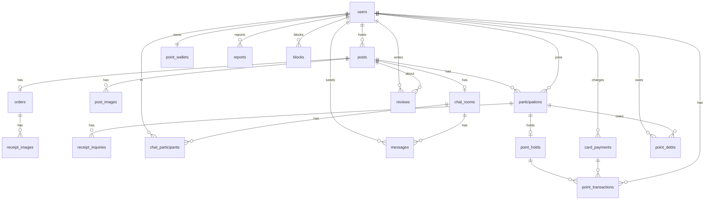

# 식구(Sik-Gu) DB 설계 정리

> 출처: 팀 회의록 Google Doc (10/5 ~ 11/16 회의, ERD 초안(11/9), API 명세서 7장 "ERD 반영 필요 사항")
> 이 문서는 **11/9 ERD 초안 + 이후 API 명세서에서 나온 수정 사항을 합친 버전**입니다.
> - `[원본]` = 11/9 ERDCloud 초안에 있던 내용
> - `[반영]` = API 명세서 / 개요 문서에서 "ERD 반영 필요"로 지적된 내용
> - `[제안]` = 문서에 명시되진 않았지만 구현상 필요해 보여 추가한 것 (팀 확인 필요)

---

## 1. 기술 스택 (11/5 결정)

| 항목 | 선택 |
|---|---|
| RDB | PostgreSQL |
| 캐시/보조 저장소 | Redis |
| 백엔드 | Spring Boot (Layered + MVC, 모놀리식) |
| 배포 | Docker 검토 중 |

---

## 2. ENUM 정의 (API 명세서 기준)

| ENUM | 값 |
|---|---|
| `PostStatus` | `RECRUITING` 모집중 → `RECRUITED` 모집완료 → `ORDERED` 주문완료 → `SHIPPING` 배송중 → `DISTRIBUTED` 나눔 진행·수령확인 대기 → `SETTLED` 정산완료, 예외 `CANCELLED` |
| `Category` | `FOOD` 식품, `LIVING` 생활용품, `DAILY` 생필품, `ETC` 기타 |
| `ParticipationRole` | `HOST`, `PARTICIPANT` |
| `PaymentStatus` | `PAID`, `REFUNDED` |
| `ReceiptStatus` | `WAITING` 확인 대기, `RECEIVED` 받았어요, `INQUIRING` 문의중 |
| `HoldStatus` | `HELD` 보관중, `CAPTURED` 정산됨, `RELEASED` 환급됨 |
| `PointTxType` | `CHARGE`, `PAYMENT`, `REFUND`, `SETTLEMENT`, `ADJUSTMENT_REFUND` 차액 환급, `ADJUSTMENT_CHARGE` 차액 추가 청구, `DEBT_REPAYMENT` 미수금 납부 |
| `DebtStatus` | `UNPAID` 미납, `PAID` 납부 완료, `WRITTEN_OFF` 탕감·종결 |
| `UserStatus` | `ACTIVE` 정상, `SUSPENDED` 정지 (D9 미수금 기한 초과 10회 이상) |
| `ReportReason` | `POST_HARMFUL`, `CHAT_ABUSE`, `TRADE_VIOLATION`, `ETC` |
| `ReportStatus` | `PENDING` 처리 전, `DONE` 처리 완료 |
| `MessageType` | `TEXT`, `IMAGE` (D13), `SYSTEM` |
| `ChatRoomStatus` | `ONGOING`, `CLOSED` (채팅 목록 탭 기준) |
| `ChargeMethod` | `KAKAOPAY`, `TOSSPAY`, `CARD` |
| `InquiryType` | `NOT_RECEIVED`, `SHORT_QUANTITY`, `WRONG_OR_DAMAGED`, `ETC` |
| `DesiredResolution` | `REDELIVER`, `PARTIAL_REFUND`, `FULL_REFUND` |
| `InquiryStatus` | `OPEN` 접수, `IN_PROGRESS` 운영팀 처리중, `RESOLVED` 처리 완료 [제안] (D10) |
| `InquiryResolution` | `REDELIVER` 다시 받기, `PARTIAL_REFUND` 부분 환불, `FULL_REFUND` 전액 환불, `REJECTED` 문제 없음 판정 [제안] (D10) |
| `UserRole` | `USER`, `ADMIN` (운영팀) [제안] (D10) |
| `ReviewTag` | `PUNCTUAL` 시간 약속, `CLEAN_SPLIT` 소분 깔끔, `FAST_REPLY` 응답 빠름, `FAST_PAYMENT` 결제 빠름 |

> 미정 ENUM: 카드 결제 상태, 수령 문의 처리 상태 → 문서에 값 정의 없음

---

## 3. 테이블 목록

| 도메인 | 테이블 |
|---|---|
| 사용자 | `users`, `blocks`(신규), `reports` |
| 공구 | `posts`, `post_images`(신규), `participations`, `orders`, `receipt_images`, `receipt_inquiries`(신규) |
| 후기 | `reviews`, `review_tags`[제안] |
| 채팅 | `chat_rooms`, `chat_participants`, `messages` |
| 포인트 | `point_wallets`, `card_payments`, `point_holds`, `point_transactions`, `point_debts`(신규) |

---

## 4. 테이블 상세

> PK 네이밍: 모든 테이블의 PK는 `{엔티티}_id` 형식 (예: `users.user_id`), FK도 같은 이름으로 참조

### 4.1 `users` 사용자

| 컬럼 | 타입 | 제약 | 비고 |
|---|---|---|---|
| user_id | BIGSERIAL | PK | [원본] |
| login_id | VARCHAR | UNIQUE, NOT NULL | [반영] 별도 아이디 로그인 결정 |
| role | UserRole | NOT NULL, DEFAULT 'USER' | [제안] 운영팀(ADMIN) 구분 — 수령 문의 처리 (D10) |
| school_email | VARCHAR | UNIQUE, NOT NULL | [원본] 인증 수단 |
| password_hash | VARCHAR(60) | NOT NULL | [원본] BCrypt 결과 문자열 (salt 포함, 60자) (D7) |
| nickname | VARCHAR | NOT NULL | [원본] 랜덤 부여 |
| university_name | VARCHAR | | [원본] 학교명 |
| dong_name | VARCHAR | | [반영] 주소 → 동 이름 |
| latitude / longitude | DOUBLE PRECISION | | [반영] 거리 계산용, 외부엔 동 이름만 노출 |
| rating_avg | NUMERIC(2,1) | | [반영] 평균 별점 캐시 |
| trade_count | INT | DEFAULT 0 | [반영] 거래 횟수 캐시 |
| created_at | TIMESTAMP | | [반영] 가입 일시 |
| status | UserStatus | NOT NULL, DEFAULT 'ACTIVE' | D9 계정 정지용 |
| suspended_until | TIMESTAMP | NULL | 정지 해제 시각 (NULL이면 무기한 또는 정지 아님) |
| overdue_count | INT | NOT NULL, DEFAULT 0 | 미수금 기한 초과 횟수. 10 이상이면 계정 정지 (D9) |

#### 비밀번호 저장·로그인 방식
Spring Security `BCryptPasswordEncoder` 사용 (D7)
1. **회원가입**: `encoder.encode(password)` → 내부에서 랜덤 salt 생성 + 해시 → `$2a$10$[salt 22자][hash 31자]` 문자열을 `password_hash`에 저장
2. **로그인**: `login_id`로 사용자 조회 → `encoder.matches(입력 비밀번호, password_hash)` → 저장값에서 salt·cost를 꺼내 다시 해시해서 비교
3. 일치하면 **JWT 발급** (Access Token + Refresh Token)

> salt는 `password_hash` 문자열 안에 들어 있어서 별도 컬럼 없음. 로그인 비교에 `encode()`를 쓰면 매번 새 salt가 생겨서 항상 실패 → 반드시 `matches()` 사용

### 4.2 `posts` 게시글(공구)

| 컬럼 | 타입 | 제약 | 비고 |
|---|---|---|---|
| post_id | BIGSERIAL | PK | [원본] |
| host_id | BIGINT | FK → users | [원본] |
| title | VARCHAR | NOT NULL | [원본] |
| content | TEXT | | [원본] |
| product_name | VARCHAR | | [원본] |
| product_link | VARCHAR | | [반영] 내용에서 분리 |
| category | Category | | [원본] |
| base_unit | VARCHAR | | [원본] 예: "2L 생수 4병" |
| total_units | INT | NOT NULL | [원본] 마감 기준 (이 수만큼 차면 모집완료) |
| filled_units | INT | NOT NULL, DEFAULT 0, CHECK (filled_units <= total_units) | 현재 참여된 단위 수. 참여 시 비관적 락 걸고 증가 |
| participant_count | INT | NOT NULL, DEFAULT 0 | 현재 참여 인원 수 (목록·상세 표시용, 호스트 포함) |
| total_price | INT | | [반영] |
| unit_price | INT | | [원본] 서버에서 계산 (total_price / total_units) |
| deadline_at | TIMESTAMP | | [반영] 모집 마감 일시 |
| trade_place_name | VARCHAR | | [반영] 주소 → 거래 장소 이름 |
| trade_latitude / trade_longitude | DOUBLE PRECISION | | [반영] |
| dong_name | VARCHAR | | [반영] |
| view_count | INT | DEFAULT 0 | [원본] 인기순 정렬용 |
| status | PostStatus | | [반영] 4개 → 7개 + CANCELLED |
| recruited_at | TIMESTAMP | NULL | [반영] 모집완료 시각 (`filled_units == total_units` 순간) |
| ordered_at | TIMESTAMP | NULL | [반영] 주문완료 시각 (영수증 등록) |
| shipped_at | TIMESTAMP | NULL | [반영] 배송 시작 시각 |
| distributed_at | TIMESTAMP | NULL | [반영] 호스트가 나눔 일정·장소를 입력해 `DISTRIBUTED`가 된 시각 |
| settled_at | TIMESTAMP | NULL | [반영] 정산완료 시각 |
| cancelled_at | TIMESTAMP | NULL | [제안] 취소 시각 (인원 미달 / 호스트 취소) |
| created_at | TIMESTAMP | | [원본] |

> 원본의 "기본 이미지" 컬럼은 `post_images`로 분리. 이미지가 없으면 기본 이미지 사용.
> **[결정] 상품은 별도 테이블 없이 게시글에 통합** (`product_name`, `product_link`)
> - 게시글 1개 = 상품 1개(1:1)이고 호스트가 글마다 직접 입력하므로 분리 이득 없음
> - 검색(제목·상품명·카테고리·거리·상태)이 `posts` 한 테이블에서 JOIN 없이 처리됨
> - 상품 카탈로그(여러 게시글이 같은 상품 공유) 기능이 생기면 그때 분리 검토
>
> 검색 성능: `ILIKE '%검색어%'`는 B-Tree 인덱스를 못 타므로, 데이터가 늘면 `pg_trgm` GIN 인덱스 추가
> ```sql
> CREATE EXTENSION IF NOT EXISTS pg_trgm;
> CREATE INDEX idx_posts_title_trgm ON posts USING gin (title gin_trgm_ops);
> CREATE INDEX idx_posts_product_name_trgm ON posts USING gin (product_name gin_trgm_ops);
> ```

### 4.3 `post_images` 게시글 이미지 [반영·신규]

| 컬럼 | 타입 | 제약 |
|---|---|---|
| post_image_id | BIGSERIAL | PK |
| post_id | BIGINT | FK → posts |
| image_url | VARCHAR | NOT NULL |
| sort_order | INT | |

### 4.4 `participations` 게시글 참여 (연결 엔티티)

| 컬럼 | 타입 | 제약 | 비고 |
|---|---|---|---|
| participation_id | BIGSERIAL | PK | [반영] 원본은 (게시글ID, 사용자ID) 복합 PK → 단독 PK로 변경 |
| post_id | BIGINT | FK → posts | |
| user_id | BIGINT | FK → users | |
| role | ParticipationRole | | [원본] |
| units | INT | | [원본] 수량 |
| payment_status | PaymentStatus | | [원본] |
| receipt_status | ReceiptStatus | | [원본] 수령 상태 |
| received_at | TIMESTAMP | NULL | [제안] '받았어요' 누른 시각 또는 자동 수령 처리 시각 (D10) |
| auto_confirmed | BOOLEAN | NOT NULL, DEFAULT FALSE | [제안] 3일 지나 자동으로 수령 처리됐는지 (D10) |
| joined_at | TIMESTAMP | | [반영] 참여 일시 |
| | | UNIQUE(post_id, user_id) | [반영] |

> 원본의 "시스템 매칭/유저 주도" 컬럼은 MVP에서 제거·보류 (유저 주도형만)

### 4.5 `orders` 주문정보

| 컬럼 | 타입 | 제약 | 비고 |
|---|---|---|---|
| order_id | BIGSERIAL | PK | [반영] 원본 PK가 (택배사, 송장번호)였던 문제 수정 |
| post_id | BIGINT | FK → posts, UNIQUE | [반영] |
| courier | VARCHAR | NULL | [반영] 배송 시작 시 입력 |
| tracking_number | VARCHAR | NULL | [반영] |
| receipt_amount | INT | | [원본] 영수증 금액 |
| registered_at | TIMESTAMP | | [원본] |
| distribute_at | TIMESTAMP | NULL | [원본] 나눔 예정 일시. '받았어요' 미클릭 시 **자동 정산 기준: + 3일** (D10) |
| distribute_place | VARCHAR | NULL | [원본] 나눔 장소 |

### 4.6 `receipt_images` 영수증 사진

| 컬럼 | 타입 | 제약 |
|---|---|---|
| receipt_image_id | BIGSERIAL | PK |
| order_id | BIGINT | FK → orders |
| image_url | VARCHAR | NOT NULL |

### 4.7 `receipt_inquiries` 수령 문의 [반영·신규]

| 컬럼 | 타입 | 제약 | 비고 |
|---|---|---|---|
| inquiry_id | BIGSERIAL | PK | |
| participation_id | BIGINT | FK → participations | |
| type | InquiryType | | |
| received_units | INT | NULL | SHORT_QUANTITY일 때 필수 |
| desired_resolution | DesiredResolution | NULL | |
| content | TEXT | | |
| status | InquiryStatus | NOT NULL | [제안] 운영팀이 처리 (D10) |
| resolution | InquiryResolution | NULL | [제안] 운영팀 최종 처리 결과 |
| refund_amount | INT | NULL | [제안] 부분·전액 환불 금액 |
| admin_id | BIGINT | FK → users, NULL | [제안] 처리한 운영팀 계정 |
| admin_memo | TEXT | NULL | [제안] 처리 사유 |
| created_at | TIMESTAMP | | [제안] |
| resolved_at | TIMESTAMP | NULL | [제안] |

> 이미지: `inquiry_images(inquiry_image_id, inquiry_id, image_url)` [제안] — WRONG_OR_DAMAGED일 때 1장 이상

### 4.8 `reviews` 후기

| 컬럼 | 타입 | 제약 | 비고 |
|---|---|---|---|
| review_id | BIGSERIAL | PK | |
| writer_id | BIGINT | FK → users | |
| post_id | BIGINT | FK → posts | |
| target_id | BIGINT | FK → users | |
| rating | SMALLINT | | 별점 |
| content | TEXT | | |
| created_at | TIMESTAMP | | |
| | | UNIQUE(writer_id, post_id, target_id) | [반영] |

> **작성 기한**: `posts.settled_at + 3일`까지만 작성 가능, **수정 불가** (D12)

> 태그 저장 [반영] → `review_tags(review_id FK, tag ReviewTag, PK(review_id, tag))` [제안]

### 4.9 `reports` 신고

| 컬럼 | 타입 | 제약 | 비고 |
|---|---|---|---|
| report_id | BIGSERIAL | PK | |
| reporter_id | BIGINT | FK → users | |
| target_id | BIGINT | FK → users | 사용자만 신고 가능 (게시글 신고 X) |
| post_id | BIGINT | FK → posts, NULL | [반영] 관련 게시글 |
| reason | ReportReason | | [반영] |
| content | TEXT | | |
| status | ReportStatus | | |
| created_at | TIMESTAMP | | |
| processed_at | TIMESTAMP | NULL | |

> 관련 메시지·증빙 이미지 [반영] → `report_messages(report_id, message_id)`, `report_images(report_id, image_url)` [제안]

### 4.10 `blocks` 차단 [반영·신규]

| 컬럼 | 타입 | 제약 |
|---|---|---|
| block_id | BIGSERIAL | PK |
| blocker_id | BIGINT | FK → users |
| blocked_id | BIGINT | FK → users |
| created_at | TIMESTAMP | |
| | | UNIQUE(blocker_id, blocked_id) |

### 4.11 `chat_rooms` 채팅방

| 컬럼 | 타입 | 제약 | 비고 |
|---|---|---|---|
| chat_room_id | BIGSERIAL | PK | |
| post_id | BIGINT | FK → posts, UNIQUE | 게시글 생성 시 자동 개설 |
| name | VARCHAR | | |
| status | ChatRoomStatus | | |
| created_at | TIMESTAMP | | |

### 4.12 `chat_participants` 채팅 참여

| 컬럼 | 타입 | 제약 |
|---|---|---|
| user_id | BIGINT | PK, FK → users |
| chat_room_id | BIGINT | PK, FK → chat_rooms |
| joined_at | TIMESTAMP | |
| last_read_at | TIMESTAMP | 안 읽은 메시지 수 계산용 |

### 4.13 `messages` 메시지

| 컬럼 | 타입 | 제약 | 비고 |
|---|---|---|---|
| message_id | BIGSERIAL | PK | 커서 페이지네이션 기준 |
| chat_room_id | BIGINT | FK → chat_rooms | |
| sender_id | BIGINT | FK → users, NULL | SYSTEM 메시지는 NULL |
| type | MessageType | | [반영] IMAGE 추가 (D13) |
| content | TEXT | NULL | TEXT·SYSTEM 메시지 내용. IMAGE면 NULL |
| image_url | VARCHAR | NULL | IMAGE 메시지의 이미지 URL (D13) |
| sent_at | TIMESTAMP | | |

> 제약 [제안]: `type = 'IMAGE'`이면 `image_url NOT NULL`, 아니면 `content NOT NULL` (CHECK)

### 4.14 `point_wallets` 포인트 지갑

| 컬럼 | 타입 | 제약 | 비고 |
|---|---|---|---|
| wallet_id | BIGSERIAL | PK | |
| user_id | BIGINT | FK → users, UNIQUE | |
| available_balance | BIGINT | | 사용 가능 잔액 |
| held_amount | BIGINT | | 보류 중인 금액 |
| version | BIGINT | | 동시성 제어(낙관적 락) |
| updated_at | TIMESTAMP | | |

### 4.15 `card_payments` 카드 결제 내역 (포인트 충전)

| 컬럼 | 타입 | 제약 | 비고 |
|---|---|---|---|
| payment_id | BIGSERIAL | PK | |
| user_id | BIGINT | FK → users | |
| pg_order_id | VARCHAR | UNIQUE | PG 주문번호 예: `CHG-20261027-0001`, 멱등성 키 (`orders.order_id`와 구분) |
| payment_key | VARCHAR | | PG 결제 키 |
| pg_provider | VARCHAR | | PG사 |
| method | ChargeMethod | | |
| amount | INT | | |
| canceled_amount | INT | DEFAULT 0 | |
| status | (미정) | | |
| approved_at | TIMESTAMP | NULL | |
| created_at / updated_at | TIMESTAMP | | |

### 4.16 `point_holds` 포인트 보류

| 컬럼 | 타입 | 제약 |
|---|---|---|
| hold_id | BIGSERIAL | PK |
| participation_id | BIGINT | FK → participations |
| user_id | BIGINT | FK → users |
| post_id | BIGINT | FK → posts |
| amount | INT | |
| status | HoldStatus | |
| held_at | TIMESTAMP | |
| resolved_at | TIMESTAMP | NULL (확정 또는 해제 일시) |

### 4.17 `point_transactions` 포인트 거래 내역

| 컬럼 | 타입 | 제약 | 비고 |
|---|---|---|---|
| transaction_id | BIGSERIAL | PK | |
| user_id | BIGINT | FK → users | |
| payment_id | BIGINT | FK → card_payments, NULL | [반영] NULL 허용 |
| hold_id | BIGINT | FK → point_holds, NULL | [반영] NULL 허용 |
| post_id | BIGINT | FK → posts, NULL | [반영] 어느 공구 건인지 추적 (환급·정산) |
| type | PointTxType | | [반영] SETTLEMENT·REFUND 추가 (INCENTIVE는 D11로 제외), 차액 조정·미수금 납부 유형 추가 (D9) |
| amount | INT | | 부호 포함 (결제는 음수) |
| balance_after | BIGINT | | |
| description | VARCHAR | | |
| created_at | TIMESTAMP | | |

### 4.18 `point_debts` 미수금 [신규, D9]

영수증 금액이 더 비싸서 추가 청구했는데 잔액이 부족할 때, 부족분을 기록하는 테이블.
지갑 잔액을 음수로 만들지 않고 따로 둔 이유: 잔액과 빚이 섞이면 "쓸 수 있는 돈"이 헷갈림

| 컬럼 | 타입 | 제약 | 비고 |
|---|---|---|---|
| debt_id | BIGSERIAL | PK | |
| participation_id | BIGINT | FK → participations | 어느 공구 참여 건인지 |
| user_id | BIGINT | FK → users | 내야 하는 사람 |
| post_id | BIGINT | FK → posts | 조회 편의용 |
| amount | INT | NOT NULL | 미납 금액 |
| status | DebtStatus | NOT NULL | |
| created_at | TIMESTAMP | | |
| due_at | TIMESTAMP | NOT NULL | 납부 기한 = 생성 시각 + **7일**. 지나면 3단계 |
| overdue_at | TIMESTAMP | NULL | 기한 초과 처리된 시각 (스케줄러가 기록, 중복 처리 방지) |
| paid_at | TIMESTAMP | NULL | |

> 인덱스: `(user_id, status)` — 참여·등록 시 "미납 미수금 있는지" 확인용, `(status, due_at)` — 기한 초과 스케줄러용

---

## 5. 관계도



---

## 6. 포인트 흐름과 DB 처리

| 단계 | 이벤트 | 테이블 변화 |
|---|---|---|
| 충전 | `/points/charges` → PG → `/confirm` | `card_payments` 생성 → 승인 시 `point_wallets.available_balance +`, `point_transactions(CHARGE)` |
| 영수증 등록 (차액 조정) | `POST /posts/{id}/order` (호스트) | 영수증 금액 ≠ 모집 금액이면 참여자별 단위 비율로 차액 계산 (D9). 더 싸면 `ADJUSTMENT_REFUND`로 지갑에 환급, 더 비싸면 `ADJUSTMENT_CHARGE`로 추가 차감 → 잔액 부족분은 `point_debts(UNPAID)` + 충전 요청 알림 |
| 미수금 납부 | 포인트 충전 confirm 시 | 미납 미수금이 있으면 충전액에서 **자동으로 먼저 차감** → `point_debts → PAID`, `point_transactions(DEBT_REPAYMENT)` → **해당 공구 호스트에게 추가 지급** `point_transactions(SETTLEMENT)` (D9) |
| 공구 등록 | `POST /posts` (호스트) | 게시글 생성과 함께 호스트의 `participations(HOST)` 생성, 호스트 몫(`hostUnits`) 포인트 `point_holds(HELD)`, `point_transactions(PAYMENT)`, `filled_units = hostUnits`, `participant_count = 1`. 잔액 부족이면 `POINT409` |
| 참여 | `POST /posts/{id}/participations` | `participations` 생성, `point_holds(HELD)`, 지갑 available → held 이동, `point_transactions(PAYMENT)` |
| 취소/인원 미달 | `DELETE` | `point_holds → RELEASED`, held → available, `point_transactions(REFUND)`, `payment_status=REFUNDED` |
| 나눔 | 호스트가 나눔 일정·장소 입력 (`PATCH .../order/distribution`) | `orders.distribute_at`, `distribute_place` 저장, `posts.status=DISTRIBUTED`, `distributed_at` 기록 |
| 수령확인 | 참여자 각자 '받았어요' (`POST .../receipt`) | `participations.receipt_status=RECEIVED` |
| 자동 수령 처리 | 나눔 예정 시각(`distribute_at`) + 3일 경과 (스케줄러) | '받았어요' 안 누른 `WAITING` 참여자 → `RECEIVED`, `auto_confirmed = true`. `INQUIRING`(문의중)은 제외 (D10) |
| 수령 문의 처리 | 운영팀 (D10) | `receipt_inquiries` 처리 결과에 따라 해당 참여자 보류분 환불(`REFUND`) 또는 `RECEIVED` 처리 |
| 정산 | 전원 `RECEIVED` (직접 또는 자동) | 호스트 포함 전체 `point_holds → CAPTURED`, 호스트 지갑 + (총 금액 = 본인 보류분 포함), `point_transactions(SETTLEMENT)`, `posts.status=SETTLED` |

### 동시성·정합성 처리 [결정]

| 상황 | 처리 방식 |
|---|---|
| 여러 명이 동시에 참여 (마지막 단위 경쟁) | `posts` 행에 **비관적 락** (`SELECT ... FOR UPDATE`) |
| 같은 사람이 참여 버튼 두 번 클릭 | `participations`의 `UNIQUE(post_id, user_id)` → 위반 시 "이미 참여" 409 |
| 포인트 지갑 잔액 변경 | `point_wallets.version` **낙관적 락** (`@Version`) |
| 데드락 방지 | 락 순서를 항상 **게시글 → 지갑**으로 통일 (참여, 참여 취소, 공구 취소 모두) |

**문제 상황**: 남은 단위가 1개일 때 A, B가 동시에 조회하면 둘 다 "남았다"고 판단하고 저장 → 총 단위 초과

**참여 처리 순서** (한 트랜잭션)
0. 미납 미수금(`point_debts.status = UNPAID`)이 있으면 참여 불가 (D9, 공구 등록도 동일)
1. `posts` 행 비관적 락으로 조회
2. 모집중(`RECRUITING`)인지 확인, 아니면 `POST409`
3. `filled_units + 요청 단위 <= total_units` 확인, 넘으면 400
4. `filled_units += 요청 단위`, `participant_count += 1`
5. 지갑에서 포인트 보류 (`available_balance -`, `held_amount +`), 잔액 부족이면 `POINT409`
6. `participations`, `point_holds`, `point_transactions(PAYMENT)` 저장
7. `filled_units == total_units`이면 상태를 `RECRUITED`로 변경

**참여 취소**: 같은 순서로 게시글 락 → `filled_units -=`, `participant_count -= 1` → 지갑 환급

```java
@Lock(LockModeType.PESSIMISTIC_WRITE)
@Query("select p from Post p where p.postId = :postId")
Optional<Post> findByIdForUpdate(@Param("postId") Long postId);
```

- **충전 confirm 멱등** → 같은 `pg_order_id` 재요청 시 기존 결과 반환 (`pg_order_id` UNIQUE)

---

## 7. Redis 사용처

문서에는 "PostgreSQL + Redis"만 결정돼 있고 **구체적인 용도는 미정**. 후보 [제안]:
- 이메일 인증코드 (TTL)
- Refresh Token 저장 / 로그아웃 블랙리스트
- 조회수 집계 후 주기적으로 DB 반영
- 채팅 (STOMP 메시지 브로커 / 안 읽은 수 캐시)

---

## 8. DB에 영향 주는 미정 사항

### 8.1 아직 정해지지 않은 것

**공구 진행**
- [ ] 모집 마감 기한과 자동 취소 — **보류** (2026-11-11 논의)
  - 정할 것: 마감 기한을 누가 정하나(호스트 + 최대 기한 제한?), 마감 때 다 안 차면 자동 취소 vs 호스트가 남은 단위 부담 후 진행, 취소 시점(`deadline_at` 즉시 vs 유예)
  - 구현 메모: 스케줄러로 `status = RECRUITING AND deadline_at <= now()` 조회 → 게시글 락 → `CANCELLED` + 전원 환급. 참여 API에서도 `deadline_at > now()` 확인. `(status, deadline_at)` 인덱스
- [ ] 문의중 참여자가 있을 때 나머지 참여자 몫을 먼저 정산할지, 문의가 끝날 때까지 전체 정산을 미룰지 (D10)
- [ ] 운영팀 수령 문의 처리 기한 (D10)

**포인트·패널티**
- [ ] 계정 정지 기간: 기간 정지 vs 영구 정지 (D9)
- [ ] 미수금 1건을 끝까지 안 내는 경우: 기한 초과 1회로 끝나 10회에 도달하지 않음 → 이용 제한만 유지할지, 별도 정지 기준을 둘지 (D9)
- [ ] 끝까지 납부되지 않은 미수금의 호스트 손실을 서비스가 메워줄지 (D9)
- [ ] 남은 포인트 현금 환불, 충전 최소·최대 금액

**사용자·인증**
- [ ] 거리 검색 방식: 위경도 단순 계산 vs PostGIS
- [ ] 신뢰도 계산 방식 (정해지면 미정산 이력 반영 여부 재검토, D9)

**후기·채팅·기타**
- [ ] 후기 삭제 허용 여부 (D12)
- [ ] 채팅 이미지 용량·형식 제한, 이미지 저장소(S3 등) (D13)
- [ ] 관심(찜) 기능 여부 (→ 찜 테이블 추가)

### 8.2 결정된 것 (상세는 9장)

| 항목 | 결정 | 기록 |
|---|---|---|
| 상품 테이블 분리 | 게시글에 통합 | D2 |
| 동시 참여 처리 | 게시글 행 비관적 락, `filled_units`·`participant_count` | D3, D4 |
| 상태 변경 시각 | 게시글 컬럼 (이력 테이블 X) | D5 |
| 나눔완료 / 수령확인 | `DISTRIBUTED` 하나로, 호스트 나눔완료 버튼 없음 | D6 |
| 호스트 본인 구매분 결제 | 포인트 보류함 | D8 |
| 영수증 금액 ≠ 모집 금액 | 비율대로 환급 / 비율대로 추가 청구 | D9 |
| 추가 청구 상한 | 없음 | D9 |
| 미수금 패널티 | 1 미수금 기록(기한 7일) → 2 이용 제한 → 3 기한 초과 기록 → 4 누적 10회 계정 정지, 신뢰도 반영 X | D9 |
| 미수금 있을 때 호스트 정산 | 받은 만큼 먼저 정산, 납부되면 추가 지급 | D9 |
| '받았어요' 자동 처리 | 나눔 예정 시각 + 3일 | D10 |
| 수령 문의 해결 주체 | 운영팀 | D10 |
| 관리자(운영팀) 화면 | 추후 추가 (DB는 미리 준비) | D10 |
| 호스트 인센티브 | 없음 | D11 |
| 후기 작성 기한 / 수정 | 정산완료 후 3일까지, 수정 불가 | D12 |
| 채팅 이미지 전송 | 지원 | D13 |
| 비밀번호 저장 | BCrypt (`password_salt` 컬럼 없음) | D7 |
| 주소 저장 방식 | 동 이름 검색 + GPS 현재 위치 **둘 다 지원**. 동 이름 + 위경도 저장 | D14 |

---

## 9. 결정 기록

> 구현 방식과 그렇게 정한 이유를 남기는 곳입니다. 새 결정이 생기면 아래에 이어서 추가하세요.

### D1. PK 이름은 `{엔티티}_id` 형식 (2026-11-11)
- **결정**: 모든 테이블 PK를 `id`가 아니라 `user_id`, `post_id`처럼 이름 붙여서 정의. FK도 같은 이름으로 참조
- **이유**
  - PK와 FK 이름이 같아서 JOIN할 때 어떤 테이블의 ID인지 바로 보임 (`posts.post_id = participations.post_id`)
  - 여러 테이블을 JOIN한 결과에서 `id` 컬럼끼리 이름이 겹치지 않음
- **같이 바뀐 것**: `orders`의 PK가 `order_id`가 되면서, `card_payments`의 PG 주문번호 컬럼은 `pg_order_id`로 이름 변경 (API의 `orderId` 값이 여기 저장됨)

### D2. 상품을 별도 테이블 없이 게시글에 통합 (2026-11-11)
- **결정**: `posts.product_name`, `posts.product_link`로 저장. `products` 테이블 만들지 않음
- **이유**
  - 게시글 1개 = 상품 1개(1:1)이고, 호스트가 글마다 상품 정보를 직접 입력함 → 나눠도 얻는 게 없음
  - 검색 조건(제목·상품명·카테고리·거리·모집 상태)이 전부 `posts` 한 테이블에 있어 JOIN 없이 조회 가능
- **검토한 대안**: 별도 `products` 테이블 → 여러 게시글이 같은 상품을 공유하는 상품 카탈로그, 상품별 가격 통계 같은 기능이 생기면 그때 분리
- **주의**: `ILIKE '%검색어%'`는 일반 인덱스를 못 탐 → 데이터가 늘면 `pg_trgm` GIN 인덱스 추가

### D3. 동시 참여는 게시글 행 비관적 락 (2026-11-11)
- **결정**: 참여·참여 취소 시 `posts` 행을 `SELECT ... FOR UPDATE`로 잠그고 처리. 게시글에 `filled_units`(참여된 단위), `participant_count`(참여 인원) 컬럼을 두고 락 안에서 증감
- **해결하려는 문제**: 남은 단위가 1개일 때 A, B가 동시에 조회하면 둘 다 "남았다"고 판단하고 저장 → 총 단위 초과 (초과 판매)
- **이유**
  - 인기 공구는 마감 직전 동시 참여가 몰려 충돌이 잦음 → 먼저 온 요청부터 순서대로 처리하는 비관적 락이 적합
  - 낙관적 락은 충돌이 잦으면 실패·재시도가 많아짐
  - Redis 분산 락은 서버 여러 대일 때 필요한 것. 모놀리식 + DB 1개라 불필요
- **`filled_units` 컬럼을 둔 이유**: 매번 `participations`의 수량을 SUM으로 계산하면 락 걸 대상이 애매함. 게시글에 숫자로 들고 있어야 게시글 행 하나만 잠그면 됨. `CHECK (filled_units <= total_units)`로 DB에서도 한 번 더 막음
- **마감 기준이 인원이 아니라 단위인 이유**: 한 사람이 여러 단위를 살 수 있어서 (예: 6단위를 3명이 나눔). 인원 수는 표시용

### D4. 중복 참여·지갑·락 순서 (2026-11-11)
- **같은 사람이 참여 버튼 두 번 클릭** → `participations`의 `UNIQUE(post_id, user_id)` 제약으로 막고, 위반 에러는 "이미 참여" 409로 응답
  - 이유: 애플리케이션 체크만으로는 동시 요청을 못 막음. DB 제약이 최종 방어선
- **포인트 지갑** → `point_wallets.version` 낙관적 락 (`@Version`)
  - 이유: 지갑은 본인만 쓰는 데이터라, 같은 사람이 여러 공구에 동시에 결제하는 경우가 드묾 → 충돌이 드문 곳엔 낙관적 락이 가볍고 충분
- **락 순서는 항상 게시글 → 지갑**
  - 이유: 트랜잭션 A는 게시글→지갑, B는 지갑→게시글 순으로 잡으면 서로 기다리다 데드락. 참여, 참여 취소, 공구 취소 모두 같은 순서를 지켜야 함

### D5. 상태 변경 시각은 게시글 컬럼으로 저장 (2026-11-11)
- **결정**: `posts`에 `recruited_at`, `ordered_at`, `shipped_at`, `distributed_at`, `settled_at`, `cancelled_at` 컬럼
- **필요한 이유**
  - 공구 상세 화면 스테퍼에 단계별 시각 표시 (API `statusTimeline`)
  - 자동 처리(자동 취소, 자동 정산)의 기준 시각
  - 분쟁 시 언제 주문·배송됐는지 확인
- **이유 (이력 테이블 대신 컬럼)**: 상태가 한 방향으로만 진행되고 되돌아가지 않아서, 단계별 시각 하나씩만 있으면 충분함. 조회가 단순하고 빠름
- **검토한 대안**: `post_status_histories` 이력 테이블 → 누가 언제 바꿨는지 감사(audit) 기록이 필요해지면 추가

### D6. 나눔완료와 수령확인을 `DISTRIBUTED` 하나로, 호스트 나눔완료 버튼 없음 (2026-11-11)
- **결정**
  - 호스트는 나눔 일정·장소만 입력 (`PATCH .../order/distribution`, API 분리 안 함) → 이때 `DISTRIBUTED`
  - 수령확인은 참여자 각자 '받았어요' → `participations.receipt_status`로 관리
  - 전원 `RECEIVED` → `SETTLED` (호스트에게 정산)
  - '받았어요' 미클릭 시 자동 정산 기한은 나눔 예정 시각(`orders.distribute_at`) + 3일 (D10에서 확정)
- **이유**
  - 직접 만나서 나눠주는 방식이라, 호스트의 "나눔완료"와 참여자의 "받았어요"가 사실상 같은 순간에 일어남 → 호스트 버튼이 하는 일이 없음
  - 수령확인은 공구 전체가 아니라 참여자 한 명 한 명의 상태 → 게시글 상태가 아니라 참여 테이블에 두는 게 맞음
  - '받았어요'가 일정 입력 직후 열려도 문제없음: 참여자 본인을 지키는 버튼이라 못 받았으면 안 누르면 됨
  - 화면의 "수령확인" 단계는 `receivedCount / totalCount`(예: 4/5명)로 표시
- **검토한 대안**
  - 상태를 `DISTRIBUTED` / `RECEIVING`으로 분리 → "아무도 안 누름"과 "몇 명만 누름"을 구분할 기준이 애매
  - 일정 입력 API와 나눔완료 API 분리 → 위 이유로 호스트 나눔완료 버튼 자체가 불필요해서 철회
- **API 명세서에 반영할 것**: `PATCH .../order/distribution` 설명을 "나눔 일정·장소 + 나눔 완료"에서 "나눔 일정·장소 입력"으로 수정

### D7. 비밀번호는 BCrypt(salt + hash)로 저장, 일치하면 JWT 발급 (2026-11-11, BCrypt 확정 2026-11-14)
- **결정**: Spring Security `BCryptPasswordEncoder` 사용. 가입 시 사용자별 랜덤 salt + 해시를 한 문자열로 `password_hash`에 저장. 로그인 시 `matches()`로 비교 → 일치하면 Access/Refresh Token 발급. `password_salt` 컬럼 없음
- **이유**
  - 비밀번호 원문을 저장하지 않아서 DB가 유출돼도 원문을 바로 알 수 없음
  - salt가 있어서 같은 비밀번호라도 사용자마다 다른 해시가 나옴 → 미리 계산된 해시표(레인보우 테이블) 공격을 막음
  - salt는 비밀값이 아님. 숨기는 게 목적이 아니라 해시를 사용자마다 다르게 만드는 게 목적이라 DB에 저장해도 됨
- **BCrypt를 고른 이유** (2026-11-14)
  - 결과 문자열(`$2a$10$` + salt 22자 + hash 31자)에 salt가 같이 들어 있어서 `password_salt` 컬럼이 필요 없음 → salt 생성·저장을 직접 구현하지 않아도 됨
  - SHA-256 같은 빠른 해시보다 일부러 느린 해시(cost 2^10회 반복)라 무차별 대입 공격에 강함
  - Spring Security에 기본으로 들어 있어서 바로 쓸 수 있음
- **주의**: 로그인 검증은 `matches(입력값, 저장값)`. 저장값에서 salt와 cost를 꺼내 다시 해시해서 비교함. `encode()`는 매번 새 salt를 만드므로 비교에 쓰면 안 됨
- **변경 사항**: `users.password_salt` 컬럼 제거, `password_hash`는 `VARCHAR(60)`

### D8. 호스트도 본인 구매분을 포인트로 결제(보류) (2026-11-11)
- **결정**: 공구 등록 시 호스트도 본인 몫(`hostUnits`)만큼 포인트를 보류. 호스트도 `participations`(role=HOST) + `point_holds`를 참여자와 똑같이 생성
  - 잔액이 부족하면 공구 등록 불가 (`POINT409`) → "충전 후 등록" 안내
  - 정산 시 호스트 본인 보류분도 같이 `CAPTURED` → 호스트는 총 금액을 받음
- **이유**
  - **보증금 역할**: 영수증 미첨부·주문 불이행 시 "호스트 포인트를 참여자들이 나눠가짐" 패널티를 실제로 줄 수 있으려면 호스트 포인트가 묶여 있어야 함
  - 완료 시점에 차감하는 방식이면 호스트가 그 전에 잔액을 다 써서 패널티를 피할 수 있음 → 참여 시점에 미리 보류해야 함
  - 호스트·참여자를 같은 로직으로 처리 → 정산·환불 코드에 호스트 예외 처리가 없음
  - API 명세서 `GET .../participations` 예시도 호스트를 `paidPoint`, `paymentStatus: PAID`로 표기 (이 방식 가정)
- **호스트 실제 부담은 똑같음**: 예) 총 29,040원, 호스트 2단위(9,680원)
  - 실제 돈 29,040원 결제 → 포인트 9,680P 보류 → 정산 때 29,040P 받음 → 최종 부담 9,680원 (본인 몫)
- **검토한 대안**
  - 호스트는 결제 안 하고 정산 때 본인 몫을 뺀 금액만 받기(상계) → 결과는 같지만 보증금이 없어서 패널티 불가
  - 참여자도 완료 시점에 차감 → 그 사이 잔액을 다 쓰면 호스트가 돈을 못 받음. 참여 즉시 보류해야 지급이 보장됨
- **남은 미정**: 영수증 미첨부 유예 시간, 호스트 패널티 금액·분배 방식

### D9. 영수증 금액 ≠ 모집 금액일 때 차액 처리 (2026-11-14)
- **문제 상황**: 참여자는 게시글 등록 때 호스트가 입력한 **예상 가격**으로 결제(보류)함. 실제 가격은 호스트가 구매할 때 확정되므로, 그 사이 가격 변동·배송비·할인 때문에 영수증 금액과 다를 수 있음
- **결정**
  - **영수증이 더 쌀 때**: 차액을 참여자별 단위 비율대로 계산해서 각자 지갑에 환급 (`ADJUSTMENT_REFUND`). 호스트 본인 몫도 같은 비율로 계산
  - **영수증이 더 비쌀 때**: 차액을 단위 비율대로 각자 지갑에서 추가 차감 (`ADJUSTMENT_CHARGE`) + 알림 발송
  - **추가 청구 시 잔액 부족**: 부족분을 `point_debts`에 미수금(`UNPAID`)으로 기록 + 충전 요청 알림
  - **충전 시**: 미납 미수금부터 자동으로 먼저 차감 (`DEBT_REPAYMENT`)
  - **패널티는 4단계로 순서대로 강해짐**

    | 단계 | 시점 | 조치 | DB |
    |---|---|---|---|
    | 1. 미수금 기록 | 추가 청구 시 잔액 부족 | 부족분 기록 + 충전 요청 알림. 충전하면 자동으로 먼저 차감. **납부 기한 7일** | `point_debts(UNPAID)`, `due_at = 생성 + 7일` |
    | 2. 이용 제한 | 미수금이 있는 동안 | 새 공구 참여·등록 불가. 납부하면 바로 풀림 | `point_debts.status = UNPAID` 존재 여부 |
    | 3. 기한 초과 기록 | 납부 기한(7일) 초과 | 기한 초과 횟수 +1 (신뢰도에는 반영 안 함) | `overdue_at` 기록, `users.overdue_count + 1` |
    | 4. 계정 정지 | 기한 초과 **누적 10회 이상** | 계정 정지 (로그인·이용 불가) | `users.status = SUSPENDED`, `suspended_until` |

  - 3·4단계는 스케줄러가 처리: `status = UNPAID AND due_at <= now() AND overdue_at IS NULL` 조회 → 3단계 적용(`overdue_count + 1`), `overdue_count >= 10`이면 4단계
- **이유**
  - 더 쌀 때 환급: 참여자가 실제보다 더 낸 돈을 돌려주는 것이라 분쟁 여지가 없음
  - 더 비쌀 때 추가 청구: 호스트 혼자 손해를 떠안지 않게 함
  - 단계별로 간 이유: 처음부터 강하게 제재하면 단순히 충전을 깜빡한 사람에게 과함. 가벼운 조치부터 시작해서 안 낼수록 강해지게 함
    - 2단계(이용 제한): 서비스를 계속 쓰려면 반드시 내야 해서 가장 확실하게 효과가 있음. 납부하면 바로 풀림
    - 3단계(기한 초과 기록): 반복 여부를 판단하기 위한 횟수 누적
    - 4단계(계정 정지): 기한 초과를 반복하는 악성 사용자를 서비스에서 막음. 10회로 넉넉하게 잡아 실수로 몇 번 늦은 사람은 정지되지 않게 함
  - 미수금을 별도 테이블로 둔 이유: 지갑 잔액을 음수로 두면 잔액과 빚이 섞임
- **검토한 대안**
  - 더 비쌀 때 호스트 부담 → 호스트가 배송비 등을 놓치면 손해가 커서 기각
  - 이용 제한 하나만 두기 → 기한을 계속 넘기는 사용자를 막을 수단이 없어서 기한 초과 기록·계정 정지 단계 추가
  - 3단계에서 신뢰도 하락·프로필 "미정산 이력" 표시 → 신뢰도 계산 방식이 아직 미정이라 **일단 제외**
- **2026-11-14 수정**: 처음엔 2단계(이용 제한)만 두기로 했다가 1~4단계를 순서대로 적용하는 것으로 변경. 기준값 확정: 납부 기한 7일, 기한 초과 10회 이상 계정 정지, 신뢰도 반영은 제외
- **추가 청구 상한: 없음** (2026-11-14)
  - 영수증 금액이 아무리 높아도 비율대로 전액 추가 청구
  - 주의: 호스트가 영수증 금액을 부풀리면 참여자가 동의하지 않은 금액을 청구당할 수 있음 → 영수증 사진 확인 + 신고·수령 문의(운영팀 처리, D10)로 대응
- **미수금이 있을 때 호스트 정산** (2026-11-14)
  - 정산 시점에 실제로 받은 금액까지만 먼저 호스트에게 정산
  - 미수금이 납부되면 그 금액을 해당 공구 호스트에게 추가 지급 (`SETTLEMENT`)
  - 이유: 미수금 때문에 성실한 호스트의 정산 전체가 막히지 않게 함
  - 끝까지 납부되지 않은 금액은 호스트 손실로 남음 (서비스가 대신 메워줄지는 미정)
- **비율 계산 나머지 [제안]**: 1,000원을 3명에게 나누면 333원씩 + 1원 남음 → 나머지는 호스트에게 몰아서 처리
- **남은 미정**
  - 계정 정지 기간 (기간 정지 vs 영구 정지)
  - 한 번 미납한 미수금을 끝까지 안 내는 경우(기한 초과 1회로 끝남) 처리 — 현재는 2단계 이용 제한이 계속 유지됨
  - 신뢰도 계산 방식이 정해지면 미정산 이력 반영 여부 재검토
  - 금액 확인은 MVP에선 호스트 직접 입력 + 영수증 사진 + 참여자 확인. OCR(클로바 OCR 등) 자동 인식은 추후 (`orders.ocr_amount` 컬럼 추가로 대응 가능)

### D10. '받았어요' 자동 처리 3일, 수령 문의는 운영팀이 해결 (2026-11-14)
- **결정**
  - 나눔 예정 시각(`orders.distribute_at`) + **3일** 안에 '받았어요'를 안 누르면 자동으로 수령 처리
  - 수령 문의(`문제가 있어요`)는 **운영팀**이 확인하고 처리 결과를 정함
- **자동 수령 처리 방식**
  - 스케줄러가 `posts.status = DISTRIBUTED`이고 `distribute_at + 3일 <= now()`인 공구를 찾음
  - `WAITING` 참여자 → `RECEIVED`, `auto_confirmed = true`, `received_at` 기록 [제안]
  - `INQUIRING`(문의중) 참여자는 자동 처리에서 **제외** → 운영팀 처리 결과를 기다림 [제안]
  - 전원 `RECEIVED`가 되면 `SETTLED` (호스트 정산)
- **수령 문의 처리 방식 [제안]**
  - 참여자가 문의 → `receipt_status = INQUIRING`, `receipt_inquiries.status = OPEN`
  - 운영팀이 확인 → `IN_PROGRESS` → 결과(`resolution`) 결정 → `RESOLVED`
    - `REDELIVER`: 호스트가 다시 전달 → 참여자 `RECEIVED`
    - `PARTIAL_REFUND` / `FULL_REFUND`: 해당 참여자 보류분에서 `refund_amount`만큼 환불 (`REFUND`), 나머지는 정산 대상
    - `REJECTED`: 문제 없음 판정 → 참여자 `RECEIVED`
  - 운영팀 계정은 `users.role = ADMIN`으로 구분, 처리자·사유는 `admin_id`, `admin_memo`에 기록
- **이유**
  - 3일: 나눔 후 확인하기에 충분한 시간이면서 호스트 정산이 너무 늦어지지 않는 기간
  - 자동 처리가 필요한 이유: 참여자가 버튼을 깜빡하면 호스트가 영원히 정산을 못 받음
  - 문의중 참여자를 자동 처리에서 빼는 이유: 문제를 제기한 사람까지 자동으로 "받았음" 처리하면 문의가 무의미해짐
  - 운영팀이 해결하는 이유: 호스트와 참여자는 이해 당사자라 호스트가 판단하면 공정하지 않음. 제3자인 운영팀이 판단해야 분쟁이 줄어듦
- **검토한 대안**: 호스트가 문의 해결 → 이해 당사자가 판정하게 되어 기각
- **남은 미정**
  - 문의중 참여자가 있을 때 나머지 참여자 몫을 먼저 정산할지, 문의가 끝날 때까지 전체 정산을 미룰지
  - 운영팀 처리 기한
  - 관리자(운영팀) 화면은 **나중에 추가 예정** (2026-11-14). 그 전까지 수령 문의·신고는 운영팀이 DB에서 직접 처리하거나 임시 API로 처리

### D11. 호스트 인센티브 없음 (2026-11-14)
- **결정**: 정산 시 호스트에게 인센티브 포인트를 따로 주지 않음. 호스트는 참여자 결제분 + 본인 보류분(= 총 금액)만 정산받음
- **변경 사항**: `PointTxType`에서 `INCENTIVE` 제거, 정산 흐름에서 인센티브 지급 단계 제거
- **배경**: 회의록 초기 안(10/5)에는 "방장에게 송금 + 인센티브 포인트"가 있었고, API 명세서에도 `INCENTIVE` 거래 유형과 `giveIncentive` 시그니처가 있었음
- **API 명세서에 반영할 것**: 포인트 거래 내역 `type` 필터에서 `INCENTIVE` 제거, 포인트 서비스 시그니처에서 `giveIncentive` 제거

### D12. 후기는 정산완료 후 3일까지만 작성, 수정 불가 (2026-11-14)
- **결정**
  - 작성 기한: `posts.settled_at + 3일`까지. 지나면 작성 불가, 마이페이지 "액션 필요"(`WRITE_REVIEW`)에서도 빠짐
  - 작성한 후기는 수정 불가 (삭제 가능 여부는 미정)
- **이유**
  - 기한: 기억이 남아 있을 때 정확한 후기를 받기 위함. 기한이 없으면 나중에 다른 일로 다툰 뒤 예전 거래에 보복성 후기를 남길 수 있음. 안 쓴 후기가 할 일 목록에 영원히 남는 것도 방지
  - 수정 불가: 작성 후 상대 반응을 보고 후기를 바꾸는 식의 압박·보복을 막음
- **구현**: 후기 작성 API에서 `posts.status = SETTLED AND settled_at + 3일 > now()` 확인, 지나면 `POST409`. 수정 API는 만들지 않음. 테이블 변경 없음
- **남은 미정**: 후기 삭제 허용 여부

### D13. 채팅 이미지 전송 지원 (2026-11-14)
- **결정**: 채팅에서 텍스트와 함께 이미지 전송 가능
- **변경 사항**
  - `MessageType`에 `IMAGE` 추가
  - `messages`에 `image_url` 컬럼 추가, `content`는 NULL 허용
  - 메시지 1개 = 이미지 1장 [제안] (여러 장이면 여러 메시지로 전송)
- **흐름 [제안]**
  1. 프론트가 `POST /api/images`로 이미지 업로드 → URL 받음 (기존 공통 이미지 업로드 API 재사용)
  2. STOMP `/pub/chats/{chatRoomId}/messages`로 `{ "type": "IMAGE", "imageUrl": "https://..." }` 발행
  3. 채팅 목록의 `lastMessage`는 이미지면 "사진"으로 표시
- **이유**: 나눔 장소 사진, 상품 상태 사진 등 공구 진행 중에 이미지로 보여줘야 하는 경우가 많음
- **API 명세서에 반영할 것**: STOMP 발행 body에 `type`, `imageUrl` 추가, 메시지 조회 응답에 `imageUrl` 추가
- **남은 미정**: 이미지 용량·형식 제한, 이미지 저장소(S3 등)

### D14. 주소는 동 이름 검색과 GPS 둘 다 지원 (2026-11-14)
- **결정**: 가입·동네 변경 시 사용자가 둘 중 편한 방식을 선택
  - 동 이름 검색: `GET /api/locations/search?query=역삼동`
  - 현재 위치(GPS): `GET /api/locations/reverse?lat=..&lng=..` → 동 이름으로 변환
- **저장**: 어떤 방식이든 `users.dong_name` + `latitude` / `longitude`로 똑같이 저장 → 이후 로직(거리 계산, 동 이름 노출)은 방식과 상관없이 동일
  - 동 이름 검색으로 등록한 경우 위경도는 그 동의 중심 좌표 [제안]
- **이유**: Figma 가입 3단계가 이미 두 방식을 모두 제공. 위치 권한을 거부한 사용자도 가입할 수 있어야 함
- **개인정보**: 다른 사용자에게는 동 이름만 노출, 정확한 위경도는 노출하지 않음 (회의록 원칙)
- **남은 미정**: 거리 검색 방식 (위경도 단순 계산 vs PostGIS)
