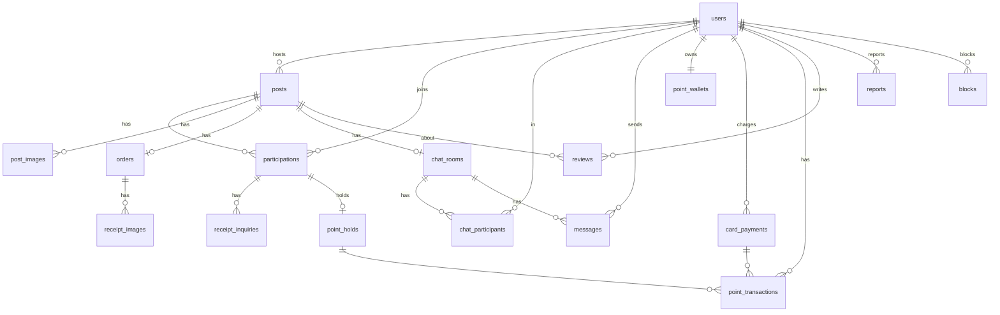

# 식구(Sik-Gu) DB 설계 정리

> 출처: 팀 회의록 Google Doc (10/5 ~ 11/16 회의, ERD 초안(11/9), API 명세서 7장 "ERD 반영 필요 사항")
> 이 문서는 **11/9 ERD 초안 + 이후 API 명세서에서 나온 수정 사항을 합친 버전**입니다.
> - `[원본]` = 11/9 ERDCloud 초안에 있던 내용
> - `[반영]` = API 명세서 / 개요 문서에서 "ERD 반영 필요"로 지적된 내용
> - `[제안]` = 문서에 명시되진 않았지만 구현상 필요해 보여 추가한 것 (팀 확인 필요)

---

## 1. 기술 스택 (11/5 결정)

| 항목 | 선택 |
|---|---|
| RDB | PostgreSQL |
| 캐시/보조 저장소 | Redis |
| 백엔드 | Spring Boot (Layered + MVC, 모놀리식) |
| 배포 | Docker 검토 중 |

---

## 2. ENUM 정의 (API 명세서 기준)

| ENUM | 값 |
|---|---|
| `PostStatus` | `RECRUITING` 모집중 → `RECRUITED` 모집완료 → `ORDERED` 주문완료 → `SHIPPING` 배송중 → `DISTRIBUTED` 나눔 진행·수령확인 대기 → `SETTLED` 정산완료, 예외 `CANCELLED` |
| `Category` | `FOOD` 식품, `LIVING` 생활용품, `DAILY` 생필품, `ETC` 기타 |
| `ParticipationRole` | `HOST`, `PARTICIPANT` |
| `PaymentStatus` | `PAID`, `REFUNDED` |
| `ReceiptStatus` | `WAITING` 확인 대기, `RECEIVED` 받았어요, `INQUIRING` 문의중 |
| `HoldStatus` | `HELD` 보관중, `CAPTURED` 정산됨, `RELEASED` 환급됨 |
| `PointTxType` | `CHARGE`, `PAYMENT`, `REFUND`, `SETTLEMENT`, `INCENTIVE` |
| `ReportReason` | `POST_HARMFUL`, `CHAT_ABUSE`, `TRADE_VIOLATION`, `ETC` |
| `ReportStatus` | `PENDING` 처리 전, `DONE` 처리 완료 |
| `MessageType` | `TEXT`, `SYSTEM` |
| `ChatRoomStatus` | `ONGOING`, `CLOSED` (채팅 목록 탭 기준) |
| `ChargeMethod` | `KAKAOPAY`, `TOSSPAY`, `CARD` |
| `InquiryType` | `NOT_RECEIVED`, `SHORT_QUANTITY`, `WRONG_OR_DAMAGED`, `ETC` |
| `DesiredResolution` | `REDELIVER`, `PARTIAL_REFUND`, `FULL_REFUND` |
| `ReviewTag` | `PUNCTUAL` 시간 약속, `CLEAN_SPLIT` 소분 깔끔, `FAST_REPLY` 응답 빠름, `FAST_PAYMENT` 결제 빠름 |

> 미정 ENUM: 카드 결제 상태, 수령 문의 처리 상태 → 문서에 값 정의 없음

---

## 3. 테이블 목록

| 도메인 | 테이블 |
|---|---|
| 사용자 | `users`, `blocks`(신규), `reports` |
| 공구 | `posts`, `post_images`(신규), `participations`, `orders`, `receipt_images`, `receipt_inquiries`(신규) |
| 후기 | `reviews`, `review_tags`[제안] |
| 채팅 | `chat_rooms`, `chat_participants`, `messages` |
| 포인트 | `point_wallets`, `card_payments`, `point_holds`, `point_transactions` |

---

## 4. 테이블 상세

> PK 네이밍: 모든 테이블의 PK는 `{엔티티}_id` 형식 (예: `users.user_id`), FK도 같은 이름으로 참조

### 4.1 `users` 사용자

| 컬럼 | 타입 | 제약 | 비고 |
|---|---|---|---|
| user_id | BIGSERIAL | PK | [원본] |
| login_id | VARCHAR | UNIQUE, NOT NULL | [반영] 별도 아이디 로그인 결정 |
| school_email | VARCHAR | UNIQUE, NOT NULL | [원본] 인증 수단 |
| password_hash | VARCHAR | NOT NULL | [원본] `hash(입력 비밀번호 + salt)` 결과 |
| password_salt | VARCHAR | NOT NULL | 가입 시 생성한 사용자별 랜덤 salt |
| nickname | VARCHAR | NOT NULL | [원본] 랜덤 부여 |
| university_name | VARCHAR | | [원본] 학교명 |
| dong_name | VARCHAR | | [반영] 주소 → 동 이름 |
| latitude / longitude | DOUBLE PRECISION | | [반영] 거리 계산용, 외부엔 동 이름만 노출 |
| rating_avg | NUMERIC(2,1) | | [반영] 평균 별점 캐시 |
| trade_count | INT | DEFAULT 0 | [반영] 거래 횟수 캐시 |
| created_at | TIMESTAMP | | [반영] 가입 일시 |

#### 비밀번호 저장·로그인 방식
1. **회원가입**: 보안 난수(`SecureRandom`)로 사용자별 salt 생성 → `hash(password + salt)` → `password_hash`, `password_salt` 저장
2. **로그인**: `login_id`로 사용자 조회 → 입력 비밀번호 + 저장된 salt로 다시 해시 → `password_hash`와 비교
3. 일치하면 **JWT 발급** (Access Token + Refresh Token)

> 참고: 해시 함수는 SHA-256 같은 빠른 해시보다 BCrypt / Argon2 / PBKDF2 같은 느린 해시가 권장됨.
> Spring Security의 `BCryptPasswordEncoder`를 쓰면 salt가 해시 문자열 안에 같이 들어가서 `password_salt` 컬럼 없이도 같은 동작을 함 (팀 선택 사항).

### 4.2 `posts` 게시글(공구)

| 컬럼 | 타입 | 제약 | 비고 |
|---|---|---|---|
| post_id | BIGSERIAL | PK | [원본] |
| host_id | BIGINT | FK → users | [원본] |
| title | VARCHAR | NOT NULL | [원본] |
| content | TEXT | | [원본] |
| product_name | VARCHAR | | [원본] |
| product_link | VARCHAR | | [반영] 내용에서 분리 |
| category | Category | | [원본] |
| base_unit | VARCHAR | | [원본] 예: "2L 생수 4병" |
| total_units | INT | NOT NULL | [원본] 마감 기준 (이 수만큼 차면 모집완료) |
| filled_units | INT | NOT NULL, DEFAULT 0, CHECK (filled_units <= total_units) | 현재 참여된 단위 수. 참여 시 비관적 락 걸고 증가 |
| participant_count | INT | NOT NULL, DEFAULT 0 | 현재 참여 인원 수 (목록·상세 표시용, 호스트 포함) |
| total_price | INT | | [반영] |
| unit_price | INT | | [원본] 서버에서 계산 (total_price / total_units) |
| deadline_at | TIMESTAMP | | [반영] 모집 마감 일시 |
| trade_place_name | VARCHAR | | [반영] 주소 → 거래 장소 이름 |
| trade_latitude / trade_longitude | DOUBLE PRECISION | | [반영] |
| dong_name | VARCHAR | | [반영] |
| view_count | INT | DEFAULT 0 | [원본] 인기순 정렬용 |
| status | PostStatus | | [반영] 4개 → 7개 + CANCELLED |
| recruited_at | TIMESTAMP | NULL | [반영] 모집완료 시각 (`filled_units == total_units` 순간) |
| ordered_at | TIMESTAMP | NULL | [반영] 주문완료 시각 (영수증 등록) |
| shipped_at | TIMESTAMP | NULL | [반영] 배송 시작 시각 |
| distributed_at | TIMESTAMP | NULL | [반영] 호스트가 나눔 일정·장소를 입력해 `DISTRIBUTED`가 된 시각 |
| settled_at | TIMESTAMP | NULL | [반영] 정산완료 시각 |
| cancelled_at | TIMESTAMP | NULL | [제안] 취소 시각 (인원 미달 / 호스트 취소) |
| created_at | TIMESTAMP | | [원본] |

> 원본의 "기본 이미지" 컬럼은 `post_images`로 분리. 이미지가 없으면 기본 이미지 사용.
> **[결정] 상품은 별도 테이블 없이 게시글에 통합** (`product_name`, `product_link`)
> - 게시글 1개 = 상품 1개(1:1)이고 호스트가 글마다 직접 입력하므로 분리 이득 없음
> - 검색(제목·상품명·카테고리·거리·상태)이 `posts` 한 테이블에서 JOIN 없이 처리됨
> - 상품 카탈로그(여러 게시글이 같은 상품 공유) 기능이 생기면 그때 분리 검토
>
> 검색 성능: `ILIKE '%검색어%'`는 B-Tree 인덱스를 못 타므로, 데이터가 늘면 `pg_trgm` GIN 인덱스 추가
> ```sql
> CREATE EXTENSION IF NOT EXISTS pg_trgm;
> CREATE INDEX idx_posts_title_trgm ON posts USING gin (title gin_trgm_ops);
> CREATE INDEX idx_posts_product_name_trgm ON posts USING gin (product_name gin_trgm_ops);
> ```

### 4.3 `post_images` 게시글 이미지 [반영·신규]

| 컬럼 | 타입 | 제약 |
|---|---|---|
| post_image_id | BIGSERIAL | PK |
| post_id | BIGINT | FK → posts |
| image_url | VARCHAR | NOT NULL |
| sort_order | INT | |

### 4.4 `participations` 게시글 참여 (연결 엔티티)

| 컬럼 | 타입 | 제약 | 비고 |
|---|---|---|---|
| participation_id | BIGSERIAL | PK | [반영] 원본은 (게시글ID, 사용자ID) 복합 PK → 단독 PK로 변경 |
| post_id | BIGINT | FK → posts | |
| user_id | BIGINT | FK → users | |
| role | ParticipationRole | | [원본] |
| units | INT | | [원본] 수량 |
| payment_status | PaymentStatus | | [원본] |
| receipt_status | ReceiptStatus | | [원본] 수령 상태 |
| joined_at | TIMESTAMP | | [반영] 참여 일시 |
| | | UNIQUE(post_id, user_id) | [반영] |

> 원본의 "시스템 매칭/유저 주도" 컬럼은 MVP에서 제거·보류 (유저 주도형만)

### 4.5 `orders` 주문정보

| 컬럼 | 타입 | 제약 | 비고 |
|---|---|---|---|
| order_id | BIGSERIAL | PK | [반영] 원본 PK가 (택배사, 송장번호)였던 문제 수정 |
| post_id | BIGINT | FK → posts, UNIQUE | [반영] |
| courier | VARCHAR | NULL | [반영] 배송 시작 시 입력 |
| tracking_number | VARCHAR | NULL | [반영] |
| receipt_amount | INT | | [원본] 영수증 금액 |
| registered_at | TIMESTAMP | | [원본] |
| distribute_at | TIMESTAMP | NULL | [원본] 나눔 예정 일시. '받았어요' 미클릭 시 **자동 정산 기한의 기준** |
| distribute_place | VARCHAR | NULL | [원본] 나눔 장소 |

### 4.6 `receipt_images` 영수증 사진

| 컬럼 | 타입 | 제약 |
|---|---|---|
| receipt_image_id | BIGSERIAL | PK |
| order_id | BIGINT | FK → orders |
| image_url | VARCHAR | NOT NULL |

### 4.7 `receipt_inquiries` 수령 문의 [반영·신규]

| 컬럼 | 타입 | 제약 | 비고 |
|---|---|---|---|
| inquiry_id | BIGSERIAL | PK | |
| participation_id | BIGINT | FK → participations | |
| type | InquiryType | | |
| received_units | INT | NULL | SHORT_QUANTITY일 때 필수 |
| desired_resolution | DesiredResolution | NULL | |
| content | TEXT | | |
| status | (미정) | | |
| created_at | TIMESTAMP | | [제안] |

> 이미지: `inquiry_images(inquiry_image_id, inquiry_id, image_url)` [제안] — WRONG_OR_DAMAGED일 때 1장 이상

### 4.8 `reviews` 후기

| 컬럼 | 타입 | 제약 | 비고 |
|---|---|---|---|
| review_id | BIGSERIAL | PK | |
| writer_id | BIGINT | FK → users | |
| post_id | BIGINT | FK → posts | |
| target_id | BIGINT | FK → users | |
| rating | SMALLINT | | 별점 |
| content | TEXT | | |
| created_at | TIMESTAMP | | |
| | | UNIQUE(writer_id, post_id, target_id) | [반영] |

> 태그 저장 [반영] → `review_tags(review_id FK, tag ReviewTag, PK(review_id, tag))` [제안]

### 4.9 `reports` 신고

| 컬럼 | 타입 | 제약 | 비고 |
|---|---|---|---|
| report_id | BIGSERIAL | PK | |
| reporter_id | BIGINT | FK → users | |
| target_id | BIGINT | FK → users | 사용자만 신고 가능 (게시글 신고 X) |
| post_id | BIGINT | FK → posts, NULL | [반영] 관련 게시글 |
| reason | ReportReason | | [반영] |
| content | TEXT | | |
| status | ReportStatus | | |
| created_at | TIMESTAMP | | |
| processed_at | TIMESTAMP | NULL | |

> 관련 메시지·증빙 이미지 [반영] → `report_messages(report_id, message_id)`, `report_images(report_id, image_url)` [제안]

### 4.10 `blocks` 차단 [반영·신규]

| 컬럼 | 타입 | 제약 |
|---|---|---|
| block_id | BIGSERIAL | PK |
| blocker_id | BIGINT | FK → users |
| blocked_id | BIGINT | FK → users |
| created_at | TIMESTAMP | |
| | | UNIQUE(blocker_id, blocked_id) |

### 4.11 `chat_rooms` 채팅방

| 컬럼 | 타입 | 제약 | 비고 |
|---|---|---|---|
| chat_room_id | BIGSERIAL | PK | |
| post_id | BIGINT | FK → posts, UNIQUE | 게시글 생성 시 자동 개설 |
| name | VARCHAR | | |
| status | ChatRoomStatus | | |
| created_at | TIMESTAMP | | |

### 4.12 `chat_participants` 채팅 참여

| 컬럼 | 타입 | 제약 |
|---|---|---|
| user_id | BIGINT | PK, FK → users |
| chat_room_id | BIGINT | PK, FK → chat_rooms |
| joined_at | TIMESTAMP | |
| last_read_at | TIMESTAMP | 안 읽은 메시지 수 계산용 |

### 4.13 `messages` 메시지

| 컬럼 | 타입 | 제약 | 비고 |
|---|---|---|---|
| message_id | BIGSERIAL | PK | 커서 페이지네이션 기준 |
| chat_room_id | BIGINT | FK → chat_rooms | |
| sender_id | BIGINT | FK → users, NULL | SYSTEM 메시지는 NULL |
| type | MessageType | | [반영] |
| content | TEXT | | |
| sent_at | TIMESTAMP | | |

### 4.14 `point_wallets` 포인트 지갑

| 컬럼 | 타입 | 제약 | 비고 |
|---|---|---|---|
| wallet_id | BIGSERIAL | PK | |
| user_id | BIGINT | FK → users, UNIQUE | |
| available_balance | BIGINT | | 사용 가능 잔액 |
| held_amount | BIGINT | | 보류 중인 금액 |
| version | BIGINT | | 동시성 제어(낙관적 락) |
| updated_at | TIMESTAMP | | |

### 4.15 `card_payments` 카드 결제 내역 (포인트 충전)

| 컬럼 | 타입 | 제약 | 비고 |
|---|---|---|---|
| payment_id | BIGSERIAL | PK | |
| user_id | BIGINT | FK → users | |
| pg_order_id | VARCHAR | UNIQUE | PG 주문번호 예: `CHG-20261027-0001`, 멱등성 키 (`orders.order_id`와 구분) |
| payment_key | VARCHAR | | PG 결제 키 |
| pg_provider | VARCHAR | | PG사 |
| method | ChargeMethod | | |
| amount | INT | | |
| canceled_amount | INT | DEFAULT 0 | |
| status | (미정) | | |
| approved_at | TIMESTAMP | NULL | |
| created_at / updated_at | TIMESTAMP | | |

### 4.16 `point_holds` 포인트 보류

| 컬럼 | 타입 | 제약 |
|---|---|---|
| hold_id | BIGSERIAL | PK |
| participation_id | BIGINT | FK → participations |
| user_id | BIGINT | FK → users |
| post_id | BIGINT | FK → posts |
| amount | INT | |
| status | HoldStatus | |
| held_at | TIMESTAMP | |
| resolved_at | TIMESTAMP | NULL (확정 또는 해제 일시) |

### 4.17 `point_transactions` 포인트 거래 내역

| 컬럼 | 타입 | 제약 | 비고 |
|---|---|---|---|
| transaction_id | BIGSERIAL | PK | |
| user_id | BIGINT | FK → users | |
| payment_id | BIGINT | FK → card_payments, NULL | [반영] NULL 허용 |
| hold_id | BIGINT | FK → point_holds, NULL | [반영] NULL 허용 |
| post_id | BIGINT | FK → posts, NULL | [반영] 어느 공구 건인지 추적 (환급·정산) |
| type | PointTxType | | [반영] SETTLEMENT·REFUND·INCENTIVE 추가 |
| amount | INT | | 부호 포함 (결제는 음수) |
| balance_after | BIGINT | | |
| description | VARCHAR | | |
| created_at | TIMESTAMP | | |

---

## 5. 관계도



---

## 6. 포인트 흐름과 DB 처리

| 단계 | 이벤트 | 테이블 변화 |
|---|---|---|
| 충전 | `/points/charges` → PG → `/confirm` | `card_payments` 생성 → 승인 시 `point_wallets.available_balance +`, `point_transactions(CHARGE)` |
| 공구 등록 | `POST /posts` (호스트) | 게시글 생성과 함께 호스트의 `participations(HOST)` 생성, 호스트 몫(`hostUnits`) 포인트 `point_holds(HELD)`, `point_transactions(PAYMENT)`, `filled_units = hostUnits`, `participant_count = 1`. 잔액 부족이면 `POINT409` |
| 참여 | `POST /posts/{id}/participations` | `participations` 생성, `point_holds(HELD)`, 지갑 available → held 이동, `point_transactions(PAYMENT)` |
| 취소/인원 미달 | `DELETE` | `point_holds → RELEASED`, held → available, `point_transactions(REFUND)`, `payment_status=REFUNDED` |
| 나눔 | 호스트가 나눔 일정·장소 입력 (`PATCH .../order/distribution`) | `orders.distribute_at`, `distribute_place` 저장, `posts.status=DISTRIBUTED`, `distributed_at` 기록 |
| 수령확인 | 참여자 각자 '받았어요' (`POST .../receipt`) | `participations.receipt_status=RECEIVED` |
| 정산 | 전원 `RECEIVED` (또는 자동 정산 기한 경과) | 호스트 포함 전체 `point_holds → CAPTURED`, 호스트 지갑 + (총 금액 = 본인 보류분 포함), `point_transactions(SETTLEMENT, INCENTIVE)`, `posts.status=SETTLED` |

### 동시성·정합성 처리 [결정]

| 상황 | 처리 방식 |
|---|---|
| 여러 명이 동시에 참여 (마지막 단위 경쟁) | `posts` 행에 **비관적 락** (`SELECT ... FOR UPDATE`) |
| 같은 사람이 참여 버튼 두 번 클릭 | `participations`의 `UNIQUE(post_id, user_id)` → 위반 시 "이미 참여" 409 |
| 포인트 지갑 잔액 변경 | `point_wallets.version` **낙관적 락** (`@Version`) |
| 데드락 방지 | 락 순서를 항상 **게시글 → 지갑**으로 통일 (참여, 참여 취소, 공구 취소 모두) |

**문제 상황**: 남은 단위가 1개일 때 A, B가 동시에 조회하면 둘 다 "남았다"고 판단하고 저장 → 총 단위 초과

**참여 처리 순서** (한 트랜잭션)
1. `posts` 행 비관적 락으로 조회
2. 모집중(`RECRUITING`)인지 확인, 아니면 `POST409`
3. `filled_units + 요청 단위 <= total_units` 확인, 넘으면 400
4. `filled_units += 요청 단위`, `participant_count += 1`
5. 지갑에서 포인트 보류 (`available_balance -`, `held_amount +`), 잔액 부족이면 `POINT409`
6. `participations`, `point_holds`, `point_transactions(PAYMENT)` 저장
7. `filled_units == total_units`이면 상태를 `RECRUITED`로 변경

**참여 취소**: 같은 순서로 게시글 락 → `filled_units -=`, `participant_count -= 1` → 지갑 환급

```java
@Lock(LockModeType.PESSIMISTIC_WRITE)
@Query("select p from Post p where p.postId = :postId")
Optional<Post> findByIdForUpdate(@Param("postId") Long postId);
```

- **충전 confirm 멱등** → 같은 `pg_order_id` 재요청 시 기존 결과 반환 (`pg_order_id` UNIQUE)

---

## 7. Redis 사용처

문서에는 "PostgreSQL + Redis"만 결정돼 있고 **구체적인 용도는 미정**. 후보 [제안]:
- 이메일 인증코드 (TTL)
- Refresh Token 저장 / 로그아웃 블랙리스트
- 조회수 집계 후 주기적으로 DB 반영
- 채팅 (STOMP 메시지 브로커 / 안 읽은 수 캐시)

---

## 8. DB에 영향 주는 미정 사항

- [x] 상품을 별도 테이블로 둘지 vs 게시글에 통합할지 → **게시글에 통합**
- [x] 상태 변경 시각: 게시글 컬럼 vs 상태 이력 테이블 → **게시글 컬럼** (상태가 한 방향으로만 진행되므로 충분. 감사 기록 필요해지면 이력 테이블 추가)
- [x] '나눔 완료'와 '수령 확인'을 상태 하나로 볼지 → **하나로 (`DISTRIBUTED`)**. 호스트의 별도 '나눔완료' 버튼 없음. 호스트가 나눔 일정·장소를 입력하면 `DISTRIBUTED`, 수령확인은 참여자별 `receipt_status`로 관리 (만나서 나누면 두 행동이 사실상 동시라 분리 의미 없음)
- [x] 호스트 본인 구매분도 포인트 결제하는지 → **결제함 (보류)**. 공구 등록 시 호스트도 `participations` + `point_holds` 생성 (D8)
- [ ] 모집 마감 기한과 자동 취소 시각 — **보류** (2026-11-11 논의)
  - 정할 것: 마감 기한을 누가 정하나(호스트 + 최대 기한 제한?), 마감 때 다 안 차면 자동 취소 vs 호스트가 남은 단위 부담 후 진행, 취소 시점(`deadline_at` 즉시 vs 유예)
  - 구현 메모: 스케줄러로 `status = RECRUITING AND deadline_at <= now()` 조회 → 게시글 락 → `CANCELLED` + 전원 환급. 참여 API에서도 `deadline_at > now()` 확인. `(status, deadline_at)` 인덱스
- [ ] 영수증 금액 ≠ 모집 금액일 때 차액 처리
- [ ] '받았어요' 미클릭 시 자동 정산 기한 (기준: `orders.distribute_at` + N일, N 미정), 인센티브 금액
- [ ] 수령 문의 해결 주체(호스트 vs 운영팀), 문의 상태 ENUM
- [ ] 후기 작성 기한·수정 여부
- [ ] 채팅 이미지 전송 지원 여부 (→ `MessageType`에 IMAGE 추가 여부)
- [ ] 남은 포인트 현금 환불, 충전 최소·최대 금액
- [ ] 주소 저장 방식(동 검색 vs GPS) — 현재는 둘 다 지원, 동 이름 + 위경도 저장
- [ ] 거리 검색 방식: 위경도 단순 계산 vs PostGIS
- [ ] 관심(찜) 기능 여부 (→ 찜 테이블 추가)

---

## 9. 결정 기록

> 구현 방식과 그렇게 정한 이유를 남기는 곳입니다. 새 결정이 생기면 아래에 이어서 추가하세요.

### D1. PK 이름은 `{엔티티}_id` 형식 (2026-11-11)
- **결정**: 모든 테이블 PK를 `id`가 아니라 `user_id`, `post_id`처럼 이름 붙여서 정의. FK도 같은 이름으로 참조
- **이유**
  - PK와 FK 이름이 같아서 JOIN할 때 어떤 테이블의 ID인지 바로 보임 (`posts.post_id = participations.post_id`)
  - 여러 테이블을 JOIN한 결과에서 `id` 컬럼끼리 이름이 겹치지 않음
- **같이 바뀐 것**: `orders`의 PK가 `order_id`가 되면서, `card_payments`의 PG 주문번호 컬럼은 `pg_order_id`로 이름 변경 (API의 `orderId` 값이 여기 저장됨)

### D2. 상품을 별도 테이블 없이 게시글에 통합 (2026-11-11)
- **결정**: `posts.product_name`, `posts.product_link`로 저장. `products` 테이블 만들지 않음
- **이유**
  - 게시글 1개 = 상품 1개(1:1)이고, 호스트가 글마다 상품 정보를 직접 입력함 → 나눠도 얻는 게 없음
  - 검색 조건(제목·상품명·카테고리·거리·모집 상태)이 전부 `posts` 한 테이블에 있어 JOIN 없이 조회 가능
- **검토한 대안**: 별도 `products` 테이블 → 여러 게시글이 같은 상품을 공유하는 상품 카탈로그, 상품별 가격 통계 같은 기능이 생기면 그때 분리
- **주의**: `ILIKE '%검색어%'`는 일반 인덱스를 못 탐 → 데이터가 늘면 `pg_trgm` GIN 인덱스 추가

### D3. 동시 참여는 게시글 행 비관적 락 (2026-11-11)
- **결정**: 참여·참여 취소 시 `posts` 행을 `SELECT ... FOR UPDATE`로 잠그고 처리. 게시글에 `filled_units`(참여된 단위), `participant_count`(참여 인원) 컬럼을 두고 락 안에서 증감
- **해결하려는 문제**: 남은 단위가 1개일 때 A, B가 동시에 조회하면 둘 다 "남았다"고 판단하고 저장 → 총 단위 초과 (초과 판매)
- **이유**
  - 인기 공구는 마감 직전 동시 참여가 몰려 충돌이 잦음 → 먼저 온 요청부터 순서대로 처리하는 비관적 락이 적합
  - 낙관적 락은 충돌이 잦으면 실패·재시도가 많아짐
  - Redis 분산 락은 서버 여러 대일 때 필요한 것. 모놀리식 + DB 1개라 불필요
- **`filled_units` 컬럼을 둔 이유**: 매번 `participations`의 수량을 SUM으로 계산하면 락 걸 대상이 애매함. 게시글에 숫자로 들고 있어야 게시글 행 하나만 잠그면 됨. `CHECK (filled_units <= total_units)`로 DB에서도 한 번 더 막음
- **마감 기준이 인원이 아니라 단위인 이유**: 한 사람이 여러 단위를 살 수 있어서 (예: 6단위를 3명이 나눔). 인원 수는 표시용

### D4. 중복 참여·지갑·락 순서 (2026-11-11)
- **같은 사람이 참여 버튼 두 번 클릭** → `participations`의 `UNIQUE(post_id, user_id)` 제약으로 막고, 위반 에러는 "이미 참여" 409로 응답
  - 이유: 애플리케이션 체크만으로는 동시 요청을 못 막음. DB 제약이 최종 방어선
- **포인트 지갑** → `point_wallets.version` 낙관적 락 (`@Version`)
  - 이유: 지갑은 본인만 쓰는 데이터라, 같은 사람이 여러 공구에 동시에 결제하는 경우가 드묾 → 충돌이 드문 곳엔 낙관적 락이 가볍고 충분
- **락 순서는 항상 게시글 → 지갑**
  - 이유: 트랜잭션 A는 게시글→지갑, B는 지갑→게시글 순으로 잡으면 서로 기다리다 데드락. 참여, 참여 취소, 공구 취소 모두 같은 순서를 지켜야 함

### D5. 상태 변경 시각은 게시글 컬럼으로 저장 (2026-11-11)
- **결정**: `posts`에 `recruited_at`, `ordered_at`, `shipped_at`, `distributed_at`, `settled_at`, `cancelled_at` 컬럼
- **필요한 이유**
  - 공구 상세 화면 스테퍼에 단계별 시각 표시 (API `statusTimeline`)
  - 자동 처리(자동 취소, 자동 정산)의 기준 시각
  - 분쟁 시 언제 주문·배송됐는지 확인
- **이유 (이력 테이블 대신 컬럼)**: 상태가 한 방향으로만 진행되고 되돌아가지 않아서, 단계별 시각 하나씩만 있으면 충분함. 조회가 단순하고 빠름
- **검토한 대안**: `post_status_histories` 이력 테이블 → 누가 언제 바꿨는지 감사(audit) 기록이 필요해지면 추가

### D6. 나눔완료와 수령확인을 `DISTRIBUTED` 하나로, 호스트 나눔완료 버튼 없음 (2026-11-11)
- **결정**
  - 호스트는 나눔 일정·장소만 입력 (`PATCH .../order/distribution`, API 분리 안 함) → 이때 `DISTRIBUTED`
  - 수령확인은 참여자 각자 '받았어요' → `participations.receipt_status`로 관리
  - 전원 `RECEIVED` → `SETTLED` (호스트에게 정산)
  - '받았어요' 미클릭 시 자동 정산 기한은 나눔 예정 시각(`orders.distribute_at`) + N일
- **이유**
  - 직접 만나서 나눠주는 방식이라, 호스트의 "나눔완료"와 참여자의 "받았어요"가 사실상 같은 순간에 일어남 → 호스트 버튼이 하는 일이 없음
  - 수령확인은 공구 전체가 아니라 참여자 한 명 한 명의 상태 → 게시글 상태가 아니라 참여 테이블에 두는 게 맞음
  - '받았어요'가 일정 입력 직후 열려도 문제없음: 참여자 본인을 지키는 버튼이라 못 받았으면 안 누르면 됨
  - 화면의 "수령확인" 단계는 `receivedCount / totalCount`(예: 4/5명)로 표시
- **검토한 대안**
  - 상태를 `DISTRIBUTED` / `RECEIVING`으로 분리 → "아무도 안 누름"과 "몇 명만 누름"을 구분할 기준이 애매
  - 일정 입력 API와 나눔완료 API 분리 → 위 이유로 호스트 나눔완료 버튼 자체가 불필요해서 철회
- **API 명세서에 반영할 것**: `PATCH .../order/distribution` 설명을 "나눔 일정·장소 + 나눔 완료"에서 "나눔 일정·장소 입력"으로 수정

### D7. 비밀번호는 salt + hash로 저장, 일치하면 JWT 발급 (2026-11-11)
- **결정**: 가입 시 사용자별 랜덤 salt 생성 → `hash(비밀번호 + salt)` 저장. 로그인 시 같은 salt로 다시 해시해서 비교 → 일치하면 Access/Refresh Token 발급
- **이유**
  - 비밀번호 원문을 저장하지 않아서 DB가 유출돼도 원문을 바로 알 수 없음
  - salt가 있어서 같은 비밀번호라도 사용자마다 다른 해시가 나옴 → 미리 계산된 해시표(레인보우 테이블) 공격을 막음
  - salt는 비밀값이 아님. 숨기는 게 목적이 아니라 해시를 사용자마다 다르게 만드는 게 목적이라 DB에 저장해도 됨
- **미정: BCrypt 사용 여부**
  - `BCryptPasswordEncoder`를 쓰면 결과 문자열(`$2a$10$` + salt 22자 + hash 31자)에 salt가 같이 들어 있어서 `password_salt` 컬럼이 필요 없음
  - 로그인 검증은 `matches(입력값, 저장값)`: 저장값에서 salt와 cost를 꺼내 다시 해시해서 비교. `encode()`는 매번 새 salt를 만드므로 비교에 쓰면 안 됨
  - SHA-256 같은 빠른 해시보다 BCrypt처럼 일부러 느린 해시가 무차별 대입 공격에 강함
  - BCrypt로 정하면 `password_salt` 컬럼 제거

### D8. 호스트도 본인 구매분을 포인트로 결제(보류) (2026-11-11)
- **결정**: 공구 등록 시 호스트도 본인 몫(`hostUnits`)만큼 포인트를 보류. 호스트도 `participations`(role=HOST) + `point_holds`를 참여자와 똑같이 생성
  - 잔액이 부족하면 공구 등록 불가 (`POINT409`) → "충전 후 등록" 안내
  - 정산 시 호스트 본인 보류분도 같이 `CAPTURED` → 호스트는 총 금액을 받음
- **이유**
  - **보증금 역할**: 영수증 미첨부·주문 불이행 시 "호스트 포인트를 참여자들이 나눠가짐" 패널티를 실제로 줄 수 있으려면 호스트 포인트가 묶여 있어야 함
  - 완료 시점에 차감하는 방식이면 호스트가 그 전에 잔액을 다 써서 패널티를 피할 수 있음 → 참여 시점에 미리 보류해야 함
  - 호스트·참여자를 같은 로직으로 처리 → 정산·환불 코드에 호스트 예외 처리가 없음
  - API 명세서 `GET .../participations` 예시도 호스트를 `paidPoint`, `paymentStatus: PAID`로 표기 (이 방식 가정)
- **호스트 실제 부담은 똑같음**: 예) 총 29,040원, 호스트 2단위(9,680원)
  - 실제 돈 29,040원 결제 → 포인트 9,680P 보류 → 정산 때 29,040P 받음 → 최종 부담 9,680원 (본인 몫)
- **검토한 대안**
  - 호스트는 결제 안 하고 정산 때 본인 몫을 뺀 금액만 받기(상계) → 결과는 같지만 보증금이 없어서 패널티 불가
  - 참여자도 완료 시점에 차감 → 그 사이 잔액을 다 쓰면 호스트가 돈을 못 받음. 참여 즉시 보류해야 지급이 보장됨
- **남은 미정**: 영수증 미첨부 유예 시간, 호스트 패널티 금액·분배 방식
